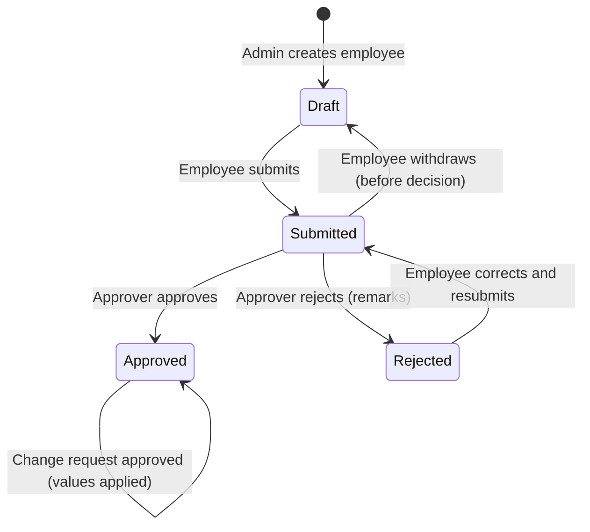
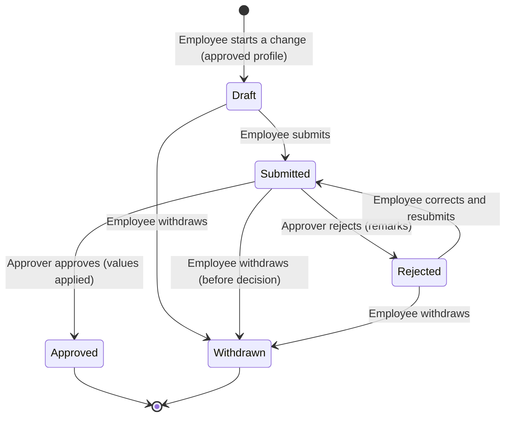

# PMS – BRD-M1: Employee Information Management System (EIMS)

Document ID: PMS-BRD-M1-EIMS-v1.0
Module: Employee Information Management System (EIMS)
Project: Payroll Management System (PMS) – proof of concept (POC), Step 3 BRD
Author: Rajesh Verma (Enterprise Architect)
Date: November 2026

## 1. Document control

### 1.1 Version / revision history

| Version | Revision | Date | Author | Change remark |
| --- | --- | --- | --- | --- |
| 1.0 | 0.1 | 18-Nov-2026 | Rajesh Verma | First draft from UX v1.0 (D-34), PMS-BRD v1.0 rev 0.3 and decisions D-01 to D-72 |

### 1.2 Review and approval

Names are added when the customer shares them.

| Role | Name | Date | Decision |
| --- | --- | --- | --- |
| Product owner | Rajesh Verma | | |
| Business analyst | [BA] | | |
| Module business owner / SME | [HR Manager] | | |
| Module business owner / SME | [Finance Manager] | | |

## 2. Introduction

### 2.1 Purpose

This document defines the business requirements of the Employee Information Management System (EIMS): onboarding employees, completing and approving employee profiles, changing approved profiles through profile change requests, maintaining the Admin-owned details and deactivating employees.

Glossary, roles, the end-to-end process, cross-module rules (BR-CMN) and system-wide NFRs are in the anchor PMS-BRD and are referenced, not repeated. Sign-in and password functions are in PMS-BRD-M5-SUP (AUTH).

### 2.2 Reference documents

| # | Document | Version | Use |
| --- | --- | --- | --- |
| 1 | PMS-BRD (anchor) | v1.0 rev 0.3 | Glossary, roles, end-to-end process, cross-module rules, integrations, system-wide NFRs |
| 2 | UX Journey Index and UX Summaries SCR-EIMS-01 to SCR-EIMS-04 | v1.0 (D-34) | Journeys, screens, fields, actions |
| 3 | PMS – Business Requirements Document (baseline) §6 | v1.0 (D-09) | Employee entity, validations EIMS-V1 to V6, user stories EIMS-US1 to US6 |
| 4 | Decision log | D-01 to D-72 | Approved decisions |

## 3. Module overview and scope

### 3.1 Overview

EIMS holds one employee record per person and is the source of employee data for every other module. The Admin creates the employee with the basic details; the employee completes and submits the profile; the manager (or the Admin for the top-level employee) approves it. Only an employee with an approved profile can enter attendance or request leave (BR-CMN-09).

Once approved, the profile stays approved. The employee changes it through a profile change request, which is approved in the same way; the other modules keep using the approved profile until the change is approved (BR-CMN-11, D-70).

The Admin maintains the details the employee cannot change – role, manager, hourly wage rate and date of joining – and deactivates leavers.

EIMS covers steps 1, 3 and 4 of the end-to-end process (anchor §5.1) and journeys UJ-EIMS-01 to UJ-EIMS-09 and UJ-SYS-04.

### 3.2 Scope

| In scope (POC) | Phase 2 / Future | Out of scope (reason) |
| --- | --- | --- |
| Onboard an employee: basic details, role, manager, hourly wage rate; system-generated Employee Id and temporary password | Future: onboarding before the joining date (pre-boarding) (D-71) | Self-registration – employees are created by the Admin only (baseline §4) |
| Complete, save as draft, submit and withdraw (before decision) the own profile | – | – |
| Approve or reject a profile (manager; Admin for the top-level employee) | – | – |
| Profile change request for an approved profile: draft, submit, withdraw, approve or reject (D-70) | – | – |
| Maintain Admin-owned details: role, manager, hourly wage rate, date of joining | – | – |
| Deactivate an employee (soft delete) | Future: reactivate an inactive employee (D-71) | Physical deletion – records are never deleted (BR-CMN-06) |
| Reset an employee's password (Admin) | Future: self-service password reset (anchor §13.1) | – |
| Employee directory: Admin (all), manager (direct reports) | Future: skip-level view for managers (D-63) | – |

### 3.3 Hand-overs with other modules

| Direction (in / out) | Other module | What is handed over | When | Anchor rule / process ref |
| --- | --- | --- | --- | --- |
| Out | AMS, LMS | Profile status (approved or not), date of joining, active flag, Manager Id | When attendance or leave is entered, submitted or approved | BR-CMN-09, BR-CMN-11, INT-03 |
| Out | AMS, LMS, SMS, Shell | Approver of each record: manager, or Admin for the top-level employee | On submit and in approval views | BR-CMN-01, BR-CMN-08, INT-04 |
| Out | SMS | Current hourly wage rate | When a salary record is generated | BR-CMN-13, INT-05 |
| Out | Shell | Profile status tile, profile to-do items, pending profiles and change requests for the inbox, Admin tiles | When the dashboard or inbox opens | §5.3 FR-CMN, INT-07 |
| In | AMS, LMS | Whether attendance or leave exists before a proposed new date of joining | When the Admin changes the date of joining | D-71, INT-09 |
| Out / in | Identity provider (SUP) | User account (Employee Id as user name), role, temporary password, active / inactive | Onboarding, role change, password reset, deactivation | INT-08 |

## 4. Users and access

### 4.1 Users of this module

| Role id (anchor §4.2) | What they do in this module |
| --- | --- |
| ROLE-EMP | Completes, saves, submits and withdraws own profile; raises and withdraws own profile change requests; views own Admin-owned details (read only) |
| ROLE-MGR | Everything an Employee does for own profile; views direct reports in the directory (without wage rates); approves or rejects direct reports' profiles and profile change requests |
| ROLE-ADM | Onboards employees; maintains role, manager, hourly wage rate and date of joining; deactivates employees; resets passwords; views all employees; approves or rejects the top-level employee's profile and change requests |
| SYS-EIMS | Generates the Employee Id and temporary password at onboarding (UJ-SYS-04) |

### 4.2 Role × screen access matrix

R = read, R/W = read and write, A = approve, — = no access.

| Screen id | Screen | Employee | Manager | Admin | Data scope |
| --- | --- | --- | --- | --- | --- |
| SCR-EIMS-01 | Employee directory | — | R (direct reports; no wage rate) | R (all employees, incl. wage rate and manager); reset password | Manager: direct reports; Admin: all |
| SCR-EIMS-02 | Employee admin form (create / edit / deactivate) | — | — | R/W | All employees |
| SCR-EIMS-03 | My profile (incl. profile change request) | R/W (own) | R/W (own) | — | Own |
| SCR-EIMS-04 | Profile review | — | R, A (direct reports; read-only view from the directory) | R, A (top-level employee) | Manager: direct reports; Admin: top-level employee |
| SCR-SH-04 | Approvals inbox – profile items | — | A (direct reports) | A (top-level employee) | As SCR-EIMS-04 |

## 5. User journeys and screens

Requirement ids are assigned in §7 and listed in the traceability matrix (§15).

| Journey id | Journey | Actor | Screens | Requirement ids |
| --- | --- | --- | --- | --- |
| UJ-EIMS-01 | Onboard a new employee | Admin | SCR-EIMS-01 → SCR-EIMS-02 | §7.2, §7.5 |
| UJ-EIMS-02 | Complete and submit my profile (withdraw before decision) | Employee | SCR-SH-03 → SCR-EIMS-03 | §7.3 |
| UJ-EIMS-03 | Review a team member's profile or change request | Manager (Admin for top-level) | SCR-SH-04 → SCR-EIMS-04 | §7.4 |
| UJ-EIMS-04 | Fix and resubmit a rejected profile or change request | Employee | SCR-SH-03 → SCR-EIMS-03 | §7.3 |
| UJ-EIMS-05 | Change my approved profile (profile change request) | Employee | SCR-EIMS-03 | §7.3 |
| UJ-EIMS-06 | Change role, manager, hourly wage rate or date of joining | Admin | SCR-EIMS-01 → SCR-EIMS-02 | §7.2 |
| UJ-EIMS-07 | Deactivate an employee | Admin | SCR-EIMS-01 → SCR-EIMS-02 | §7.2 |
| UJ-EIMS-08 | Reset an employee's password | Admin | SCR-EIMS-01 | §7.1 |
| UJ-EIMS-09 | View my team / all employees | Manager, Admin | SCR-EIMS-01 → SCR-EIMS-04 (read only) | §7.1, §7.4 |
| UJ-SYS-04 | Generate Employee Id and temporary password | System (employee service) | – (shown once on SCR-EIMS-02) | §7.5 |

## 6. Status lifecycle

### 6.1 Employee profile lifecycle

| Status code | Status | Business meaning | Set by |
| --- | --- | --- | --- |
| DRAFT | Draft | Created by the Admin; the employee is completing it. Attendance and leave not yet allowed | Admin (create); employee (withdraw) |
| SUBMITTED | Submitted | Waiting for the approver's decision; read only for the employee except withdraw | Employee |
| APPROVED | Approved | Verified profile in use by all modules; changed only through a profile change request | Manager / Admin |
| REJECTED | Rejected | Returned with remarks; the employee corrects and resubmits | Manager / Admin |

| From | To | Action | Actor | Condition / rule |
| --- | --- | --- | --- | --- |
| – | Draft | Create employee | Admin | Basic details valid; Employee Id and temporary password generated |
| Draft | Draft | Save draft | Employee | Required fields not checked |
| Draft | Submitted | Submit for approval | Employee | All required fields and validations pass |
| Submitted | Draft | Withdraw | Employee | Only while no decision is taken (D-70) |
| Submitted | Approved | Approve | Manager of the employee; Admin for the top-level employee | Not own record (BR-CMN-08) |
| Submitted | Rejected | Reject | As above | Remarks required (BR-CMN-03) |
| Rejected | Rejected | Save draft | Employee | Required fields not checked |
| Rejected | Submitted | Resubmit | Employee | All required fields and validations pass (BR-CMN-04) |
| Approved | Approved | Approve a profile change request | Approver | New values applied to the profile (§6.3) |

### 6.2 Employee account status (Active / Inactive)

| Status code | Status | Business meaning | Set by |
| --- | --- | --- | --- |
| ACTIVE | Active | Can sign in and use PMS | System at creation |
| INACTIVE | Inactive | Cannot sign in; hidden by default in lists; all history kept | Admin (deactivate) |

| From | To | Action | Actor | Condition / rule |
| --- | --- | --- | --- | --- |
| – | Active | Create employee | Admin | – |
| Active | Inactive | Deactivate | Admin | Confirmation required; blocked while the employee is a manager with active direct reports (BR-CMN-14); effect on open items per OI-02 |
| Inactive | Active | – | – | Not allowed in the POC; reactivation is Future scope (D-71) |

### 6.3 Profile change request lifecycle

| Status code | Status | Business meaning | Set by |
| --- | --- | --- | --- |
| DRAFT | Draft | Change being prepared; the approved profile is unchanged | Employee |
| SUBMITTED | Submitted | Waiting for the approver's decision | Employee |
| APPROVED | Approved | Change accepted; the new values now form the approved profile. Closed | Manager / Admin |
| REJECTED | Rejected | Returned with remarks; the employee corrects and resubmits, or withdraws | Manager / Admin |
| WITHDRAWN | Withdrawn | Abandoned by the employee; kept for history. Closed | Employee |

| From | To | Action | Actor | Condition / rule |
| --- | --- | --- | --- | --- |
| – | Draft | Start a change | Employee | Profile is Approved; no other open request (Draft, Submitted or Rejected) for the employee (D-70) |
| Draft | Draft | Save draft | Employee | – |
| Draft | Submitted | Submit | Employee | At least one value differs from the approved profile (D-72); all validations pass |
| Submitted | Approved | Approve | Manager of the employee; Admin for the top-level employee | Not own request (BR-CMN-08); new values applied to the profile, which stays Approved |
| Submitted | Rejected | Reject | As above | Remarks required (BR-CMN-03) |
| Rejected | Submitted | Resubmit | Employee | As for Draft → Submitted (BR-CMN-04) |
| Draft, Submitted, Rejected | Withdrawn | Withdraw | Employee | Submitted only before a decision (D-72) |

If the Admin changes the employee's manager while a request is Submitted, the request is decided according to open item OI-04 (anchor §12).

## 7. Functional requirements

_Pending – drafted after review of §1–§6._

## 8. Business and validation rules

_Pending._

## 9. Data requirements

_Pending._

## 10. Notifications and alerts

_Pending._

## 11. Scheduled jobs and integrations

_Pending._

## 12. Reporting and dashboard

_Pending._

## 13. Module non-functional requirements and volumetrics

_Pending._

## 14. Assumptions, constraints and dependencies

_Pending._

## 15. Traceability matrix

_Pending._

## 16. Open items

_Pending._

## 17. Appendix

_Pending._
