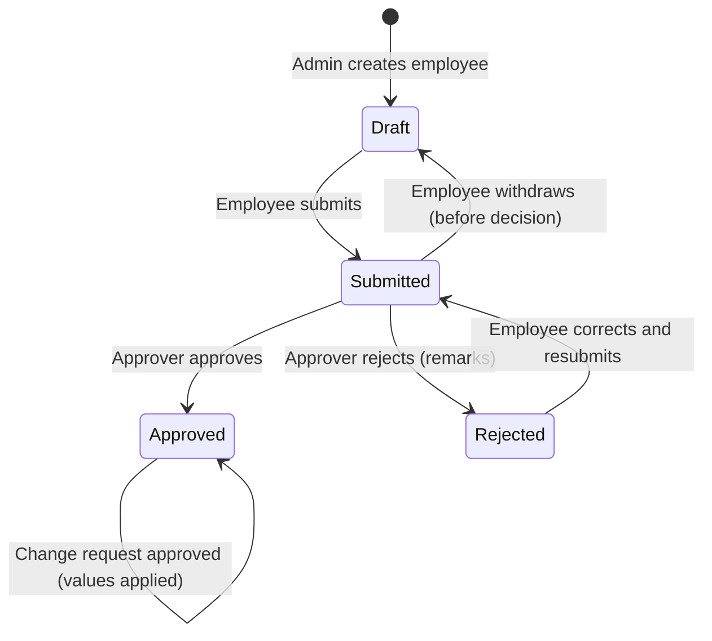
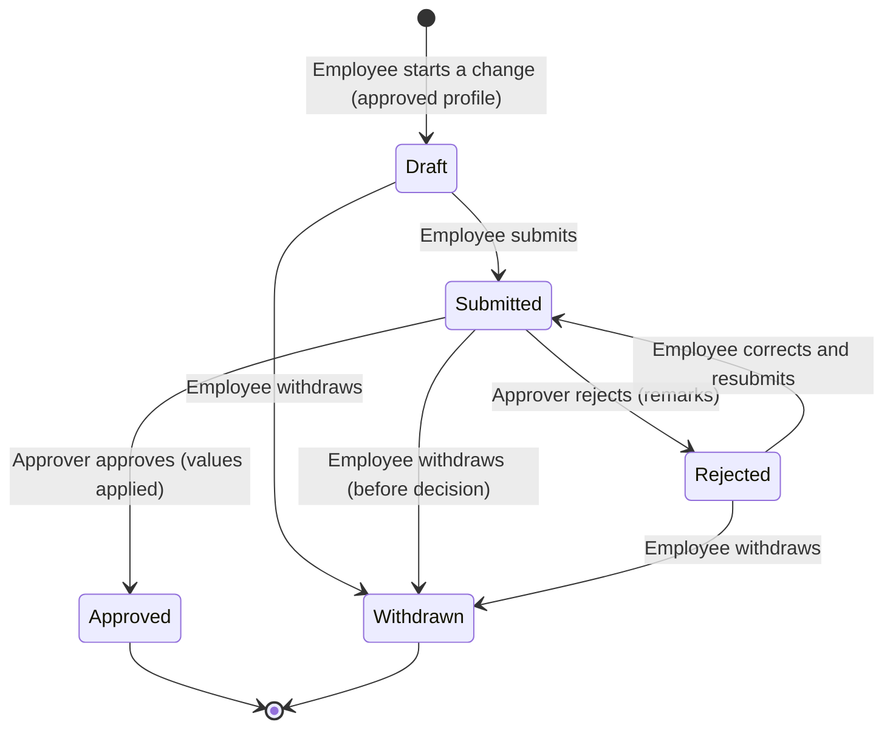

# PMS – BRD-M1: Employee Information Management System (EIMS)

Document ID: PMS-BRD-M1-EIMS-v1.0
Module: Employee Information Management System (EIMS)
Project: Payroll Management System (PMS) – proof of concept (POC), Step 3 BRD
Author: Rajesh Verma (Enterprise Architect)
Date: November 2026

## 1. Document control

### 1.1 Version / revision history

| Version | Revision | Date | Author | Change remark |
| --- | --- | --- | --- | --- |
| 1.0 | 0.1 | 18-Nov-2026 | Rajesh Verma | First draft from UX v1.0 (D-34), PMS-BRD v1.0 rev 0.3 and decisions D-01 to D-72 |
| 1.0 | 0.2 | 20-Nov-2026 | Rajesh Verma | BRD set consistency check (D-103): references to PMS-BRD rev 0.14 and D-01 to D-103; BR-CMN-19 in §8; FR-EIMS-005 and FR-EIMS-018 linked to FR-UM-006 and FR-UM-007 (D-97); INT-08 outcome; OI-12 in §14; OI-11 and OI-12 in §16 |

### 1.2 Review and approval

Names are added when the customer shares them.

| Role | Name | Date | Decision |
| --- | --- | --- | --- |
| Product owner | Rajesh Verma | | |
| Business analyst | [BA] | | |
| Module business owner / SME | [HR Manager] | | |
| Module business owner / SME | [Finance Manager] | | |

## 2. Introduction

### 2.1 Purpose

This document defines the business requirements of the Employee Information Management System (EIMS): onboarding employees, completing and approving employee profiles, changing approved profiles through profile change requests, maintaining the Admin-owned details and deactivating employees.

Glossary, roles, the end-to-end process, cross-module rules (BR-CMN) and system-wide NFRs are in the anchor PMS-BRD and are referenced, not repeated. Sign-in and password functions are in PMS-BRD-M5-SUP (AUTH).

### 2.2 Reference documents

| # | Document | Version | Use |
| --- | --- | --- | --- |
| 1 | PMS-BRD (anchor) | v1.0 rev 0.14 | Glossary, roles, end-to-end process, cross-module rules, integrations, system-wide NFRs |
| 2 | UX Journey Index and UX Summaries SCR-EIMS-01 to SCR-EIMS-04 | v1.0 (D-34) | Journeys, screens, fields, actions |
| 3 | PMS – Business Requirements Document (baseline) §6 | v1.0 (D-09) | Employee entity, validations EIMS-V1 to V6, user stories EIMS-US1 to US6 |
| 4 | Decision log | D-01 to D-103 | Approved decisions |

## 3. Module overview and scope

### 3.1 Overview

EIMS holds one employee record per person and is the source of employee data for every other module. The Admin creates the employee with the basic details; the employee completes and submits the profile; the manager (or the Admin for the top-level employee) approves it. Only an employee with an approved profile can enter attendance or request leave (BR-CMN-09).

Once approved, the profile stays approved. The employee changes it through a profile change request, which is approved in the same way; the other modules keep using the approved profile until the change is approved (BR-CMN-11, D-70).

The Admin maintains the details the employee cannot change – role, manager, hourly wage rate and date of joining – and deactivates leavers.

EIMS covers steps 1, 3 and 4 of the end-to-end process (anchor §5.1) and journeys UJ-EIMS-01 to UJ-EIMS-09 and UJ-SYS-04.

### 3.2 Scope

| In scope (POC) | Phase 2 / Future | Out of scope (reason) |
| --- | --- | --- |
| Onboard an employee: basic details, role, manager, hourly wage rate; system-generated Employee Id and temporary password | Future: onboarding before the joining date (pre-boarding) (D-71) | Self-registration – employees are created by the Admin only (baseline §4) |
| Complete, save as draft, submit and withdraw (before decision) the own profile | – | – |
| Approve or reject a profile (manager; Admin for the top-level employee) | – | – |
| Profile change request for an approved profile: draft, submit, withdraw, approve or reject (D-70) | – | – |
| Maintain Admin-owned details: role, manager, hourly wage rate, date of joining | – | – |
| Deactivate an employee (soft delete) | Future: reactivate an inactive employee (D-71) | Physical deletion – records are never deleted (BR-CMN-06) |
| Reset an employee's password (Admin) | Future: self-service password reset (anchor §13.1) | – |
| Employee directory: Admin (all), manager (direct reports) | Future: skip-level view for managers (D-63) | – |

### 3.3 Hand-overs with other modules

| Direction (in / out) | Other module | What is handed over | When | Anchor rule / process ref |
| --- | --- | --- | --- | --- |
| Out | AMS, LMS | Profile status (approved or not), date of joining, active flag, Manager Id | When attendance or leave is entered, submitted or approved | BR-CMN-09, BR-CMN-11, INT-03 |
| Out | AMS, LMS, SMS, Shell | Approver of each record: manager, or Admin for the top-level employee | On submit and in approval views | BR-CMN-01, BR-CMN-08, INT-04 |
| Out | SMS | Current hourly wage rate | When a salary record is generated | BR-CMN-13, INT-05 |
| Out | Shell | Profile status tile, profile to-do items, pending profiles and change requests for the inbox, Admin tiles | When the dashboard or inbox opens | §5.3 FR-CMN, INT-07 |
| In | AMS, LMS | Whether attendance or leave exists before a proposed new date of joining | When the Admin changes the date of joining | D-71, INT-09 |
| Out / in | Identity provider (SUP) | User account (Employee Id as user name), role, temporary password, active / inactive | Onboarding, role change, password reset, deactivation | INT-08 |

## 4. Users and access

### 4.1 Users of this module

| Role id (anchor §4.2) | What they do in this module |
| --- | --- |
| ROLE-EMP | Completes, saves, submits and withdraws own profile; raises and withdraws own profile change requests; views own Admin-owned details (read only) |
| ROLE-MGR | Everything an Employee does for own profile; views direct reports in the directory (without wage rates); approves or rejects direct reports' profiles and profile change requests |
| ROLE-ADM | Onboards employees; maintains role, manager, hourly wage rate and date of joining; deactivates employees; resets passwords; views all employees; approves or rejects the top-level employee's profile and change requests |
| SYS-EIMS | Generates the Employee Id and temporary password at onboarding (UJ-SYS-04) |

### 4.2 Role × screen access matrix

R = read, R/W = read and write, A = approve, — = no access.

| Screen id | Screen | Employee | Manager | Admin | Data scope |
| --- | --- | --- | --- | --- | --- |
| SCR-EIMS-01 | Employee directory | — | R (direct reports; no wage rate) | R (all employees, incl. wage rate and manager); reset password | Manager: direct reports; Admin: all |
| SCR-EIMS-02 | Employee admin form (create / edit / deactivate) | — | — | R/W | All employees |
| SCR-EIMS-03 | My profile (incl. profile change request) | R/W (own) | R/W (own) | — | Own |
| SCR-EIMS-04 | Profile review | — | R, A (direct reports; read-only view from the directory) | R, A (top-level employee) | Manager: direct reports; Admin: top-level employee |
| SCR-SH-04 | Approvals inbox – profile items | — | A (direct reports) | A (top-level employee) | As SCR-EIMS-04 |

## 5. User journeys and screens

Requirement ids are assigned in §7 and listed in the traceability matrix (§15).

| Journey id | Journey | Actor | Screens | Requirement ids |
| --- | --- | --- | --- | --- |
| UJ-EIMS-01 | Onboard a new employee | Admin | SCR-EIMS-01 → SCR-EIMS-02 | §7.2, §7.5 |
| UJ-EIMS-02 | Complete and submit my profile (withdraw before decision) | Employee | SCR-SH-03 → SCR-EIMS-03 | §7.3 |
| UJ-EIMS-03 | Review a team member's profile or change request | Manager (Admin for top-level) | SCR-SH-04 → SCR-EIMS-04 | §7.4 |
| UJ-EIMS-04 | Fix and resubmit a rejected profile or change request | Employee | SCR-SH-03 → SCR-EIMS-03 | §7.3 |
| UJ-EIMS-05 | Change my approved profile (profile change request) | Employee | SCR-EIMS-03 | §7.3 |
| UJ-EIMS-06 | Change role, manager, hourly wage rate or date of joining | Admin | SCR-EIMS-01 → SCR-EIMS-02 | §7.2 |
| UJ-EIMS-07 | Deactivate an employee | Admin | SCR-EIMS-01 → SCR-EIMS-02 | §7.2 |
| UJ-EIMS-08 | Reset an employee's password | Admin | SCR-EIMS-01 | §7.1 |
| UJ-EIMS-09 | View my team / all employees | Manager, Admin | SCR-EIMS-01 → SCR-EIMS-04 (read only) | §7.1, §7.4 |
| UJ-SYS-04 | Generate Employee Id and temporary password | System (employee service) | – (shown once on SCR-EIMS-02) | §7.5 |

## 6. Status lifecycle

### 6.1 Employee profile lifecycle

| Status code | Status | Business meaning | Set by |
| --- | --- | --- | --- |
| DRAFT | Draft | Created by the Admin; the employee is completing it. Attendance and leave not yet allowed | Admin (create); employee (withdraw) |
| SUBMITTED | Submitted | Waiting for the approver's decision; read only for the employee except withdraw | Employee |
| APPROVED | Approved | Verified profile in use by all modules; changed only through a profile change request | Manager / Admin |
| REJECTED | Rejected | Returned with remarks; the employee corrects and resubmits | Manager / Admin |

| From | To | Action | Actor | Condition / rule |
| --- | --- | --- | --- | --- |
| – | Draft | Create employee | Admin | Basic details valid; Employee Id and temporary password generated |
| Draft | Draft | Save draft | Employee | Required fields not checked |
| Draft | Submitted | Submit for approval | Employee | All required fields and validations pass |
| Submitted | Draft | Withdraw | Employee | Only while no decision is taken (D-70) |
| Submitted | Approved | Approve | Manager of the employee; Admin for the top-level employee | Not own record (BR-CMN-08) |
| Submitted | Rejected | Reject | As above | Remarks required (BR-CMN-03) |
| Rejected | Rejected | Save draft | Employee | Required fields not checked |
| Rejected | Submitted | Resubmit | Employee | All required fields and validations pass (BR-CMN-04) |
| Approved | Approved | Approve a profile change request | Approver | New values applied to the profile (§6.3) |

### 6.2 Employee account status (Active / Inactive)

| Status code | Status | Business meaning | Set by |
| --- | --- | --- | --- |
| ACTIVE | Active | Can sign in and use PMS | System at creation |
| INACTIVE | Inactive | Cannot sign in; hidden by default in lists; all history kept | Admin (deactivate) |

| From | To | Action | Actor | Condition / rule |
| --- | --- | --- | --- | --- |
| – | Active | Create employee | Admin | – |
| Active | Inactive | Deactivate | Admin | Confirmation required; blocked while the employee is a manager with active direct reports (BR-CMN-14); effect on open items per OI-02 |
| Inactive | Active | – | – | Not allowed in the POC; reactivation is Future scope (D-71) |

### 6.3 Profile change request lifecycle

| Status code | Status | Business meaning | Set by |
| --- | --- | --- | --- |
| DRAFT | Draft | Change being prepared; the approved profile is unchanged | Employee |
| SUBMITTED | Submitted | Waiting for the approver's decision | Employee |
| APPROVED | Approved | Change accepted; the new values now form the approved profile. Closed | Manager / Admin |
| REJECTED | Rejected | Returned with remarks; the employee corrects and resubmits, or withdraws | Manager / Admin |
| WITHDRAWN | Withdrawn | Abandoned by the employee; kept for history. Closed | Employee |

| From | To | Action | Actor | Condition / rule |
| --- | --- | --- | --- | --- |
| – | Draft | Start a change | Employee | Profile is Approved; no other open request (Draft, Submitted or Rejected) for the employee (D-70) |
| Draft | Draft | Save draft | Employee | – |
| Draft | Submitted | Submit | Employee | At least one value differs from the approved profile (D-72); all validations pass |
| Submitted | Approved | Approve | Manager of the employee; Admin for the top-level employee | Not own request (BR-CMN-08); new values applied to the profile, which stays Approved |
| Submitted | Rejected | Reject | As above | Remarks required (BR-CMN-03) |
| Rejected | Submitted | Resubmit | Employee | As for Draft → Submitted (BR-CMN-04) |
| Draft, Submitted, Rejected | Withdrawn | Withdraw | Employee | Submitted only before a decision (D-72) |

If the Admin changes the employee's manager while a request is Submitted, the request is decided according to open item OI-04 (anchor §12).

## 7. Functional requirements

All requirements are priority Must and phase POC unless stated otherwise. Approve-several-at-once from the approvals inbox follows FR-CMN-011 (anchor §5.3).

### 7.1 SCR-EIMS-01 – Employee directory

| Req id | Requirement | Priority | Phase | UX ref | Acceptance criteria (Given / When / Then) |
| --- | --- | --- | --- | --- | --- |
| FR-EIMS-001 | The Admin sees all employees with Employee Id, name with role, email, manager, date of joining, hourly wage rate and profile status. The Admin account itself is not listed. | Must | POC | SCR-EIMS-01 | Given the Admin opens Employees, when the list loads, then every active employee is listed with these columns and no Admin account appears. |
| FR-EIMS-002 | A manager sees only their direct reports, without the manager and hourly wage rate columns, and can open a read-only profile view. | Must | POC | SCR-EIMS-01 | Given a manager opens My Team, when the list loads, then only employees whose Manager Id is that manager appear, no rate is shown, and View opens SCR-EIMS-04 read only. |
| FR-EIMS-003 | Users can search by name, Employee Id or email and filter by profile status; the result count updates. With no match the screen shows "No employees found – Try a different search or filter." | Must | POC | SCR-EIMS-01 | Given the list is shown, when the user types "EMP0007", then only matching rows remain and the count shows 1. |
| FR-EIMS-004 | Inactive employees are hidden by default; "Show inactive" lists them dimmed with an "Inactive" badge. | Must | POC | SCR-EIMS-01, BR-CMN-06 | Given an inactive employee exists, when "Show inactive" is off, then it is not listed; when on, then it is listed with the badge. |
| FR-EIMS-005 | The Admin can reset an employee's password: after confirmation, the system issues a temporary password, shows it once with a Copy action, and the employee must replace it at the next sign-in. The effect on the account (earlier passwords stop working, any lock cleared, all open sessions ended) is FR-UM-006. | Must | POC | SCR-EIMS-01, UJ-EIMS-08, D-07 | Given the Admin confirms Reset password for EMP0007, then a temporary password is shown once, and EMP0007's next sign-in opens Set password. |
| FR-EIMS-006 | From the directory the Admin can start onboarding ("+ Onboard employee") and open an employee for editing. | Must | POC | SCR-EIMS-01 | Given the Admin clicks Edit on a row, then SCR-EIMS-02 opens in edit mode for that employee. |

**User stories**

| Id | As a | I want to | So that |
| --- | --- | --- | --- |
| US-EIMS-01 | Manager | see my direct reports and their profile status | I know whose profile still needs attention |
| US-EIMS-02 | Admin | find any employee quickly and reset their password | users who forgot their password can sign in again |

### 7.2 SCR-EIMS-02 – Employee admin form (create / edit / deactivate)

| Req id | Requirement | Priority | Phase | UX ref | Acceptance criteria (Given / When / Then) |
| --- | --- | --- | --- | --- | --- |
| FR-EIMS-010 | The Admin creates an employee with first, middle and last name, email, date of joining, role (Employee or Manager), manager (or "None – top-level") and hourly wage rate. On save the employee is created as Draft and Active, a user account is created, and a panel shows the Employee Id and temporary password once, with Copy. | Must | POC | SCR-EIMS-02, UJ-EIMS-01, D-02 | Given valid details, when the Admin saves, then the employee exists as Draft / Active with a new Employee Id, and the temporary password is shown once and never again. |
| FR-EIMS-011 | Creation is refused with field-level messages for a duplicate or invalid email, a future date of joining, a missing manager choice or an invalid rate. | Must | POC | SCR-EIMS-02, VR-EIMS-02, VR-EIMS-04, VR-EIMS-06 | Given an email already used by any employee (active or inactive), when the Admin saves, then the form shows the duplicate-email message and nothing is created. |
| FR-EIMS-012 | In edit mode name and email are read only (maintained by the employee); the Admin can change date of joining, role, manager and hourly wage rate. Saving does not change the profile status. | Must | POC | SCR-EIMS-02, BR-CMN-13 | Given an Approved employee, when the Admin changes the rate and saves, then the profile stays Approved and "Changes saved." is shown. |
| FR-EIMS-013 | A new hourly wage rate applies only to salary records generated after the change. | Must | POC | BR-CMN-13 | Given salary records exist at INR 250, when the rate changes to INR 300, then existing records keep 250 and the next generated record uses 300. |
| FR-EIMS-014 | The manager list offers only active employees with the Manager role, excluding the employee and anyone who would create a reporting loop; "None – top-level" means the Admin approves this employee's records. | Must | POC | SCR-EIMS-02, VR-EIMS-05, D-71 | Given A manages B, when the Admin edits A, then B is not offered as A's manager. |
| FR-EIMS-015 | A change of date of joining is accepted only if no attendance or leave (other than Cancelled) lies before the new date and the employee is still at least 18 on it; otherwise the blocking records are shown. | Must | POC | D-71, INT-09 | Given attendance on 05-Nov, when the Admin sets the joining date to 10-Nov, then the change is refused and the 05-Nov attendance is named. |
| FR-EIMS-016 | Changing a Manager's role to Employee is blocked while they have active direct reports; the message lists the reports. | Must | POC | D-71 | Given a manager with 3 active reports, when the Admin selects role Employee, then saving is refused and the 3 reports are listed. |
| FR-EIMS-017 | After a manager change, new submissions go to the new manager (or the Admin for top-level). Items already waiting are handled per open item OI-04. | Must | POC | BR-CMN-01, OI-04 | Given B's manager changes from M1 to M2, when B submits attendance afterwards, then it appears in M2's inbox. |
| FR-EIMS-018 | The Admin deactivates an employee after confirmation: the employee becomes Inactive, can no longer sign in, and all records are kept; the user account is disabled and all open sessions end (FR-UM-007). Deactivation is blocked for a manager with active direct reports, listing them. | Must | POC | SCR-EIMS-02, UJ-EIMS-07, BR-CMN-06, BR-CMN-14 | Given an employee with no reports, when the Admin confirms Deactivate, then "<name> deactivated." is shown and a sign-in with the correct password shows the inactive-account message. |

**User stories**

| Id | As a | I want to | So that | Baseline |
| --- | --- | --- | --- | --- |
| US-EIMS-03 | Admin | create an employee with basic details | the employee can sign in and complete the profile | EIMS-US1 |
| US-EIMS-04 | Admin | set role, manager and hourly wage rate | approvals and wages work | EIMS-US5 |
| US-EIMS-05 | Admin | deactivate an employee | they can no longer sign in and their history is kept | EIMS-US6 |

### 7.3 SCR-EIMS-03 – My profile (incl. profile change request)

| Req id | Requirement | Priority | Phase | UX ref | Acceptance criteria (Given / When / Then) |
| --- | --- | --- | --- | --- | --- |
| FR-EIMS-020 | The employee sees a status banner and a read-only block "Set by your administrator" (Employee Id, manager, date of joining, hourly wage rate), followed by the editable sections Name, Parents, Birth, Employment (last employer), Address and Contact. | Must | POC | SCR-EIMS-03 | Given a Draft profile on first sign-in, then only the Admin-entered values are filled and the Draft banner is shown. |
| FR-EIMS-021 | In Draft or Rejected the employee can save a draft at any time without required-field checks; the status does not change. | Must | POC | SCR-EIMS-03 | Given half the fields are empty, when the employee saves a draft, then "Draft saved." is shown and the status stays Draft. |
| FR-EIMS-022 | Submit checks all required fields and validations; on success the profile becomes Submitted and "Profile submitted to <approver> for approval." is shown. | Must | POC | SCR-EIMS-03, VR-EIMS-01 to VR-EIMS-03, VR-EIMS-07 to VR-EIMS-09 | Given a 10-digit mobile number is missing, when the employee submits, then the field is highlighted, "Please correct the highlighted fields." is shown and the status stays Draft. |
| FR-EIMS-023 | A Submitted profile is read only with the banner "Waiting for <approver>"; until a decision is taken the employee can withdraw it back to Draft. | Must | POC | D-70 | Given a Submitted profile not yet decided, when the employee withdraws, then the status is Draft and the item leaves the approver's inbox. |
| FR-EIMS-024 | A Rejected profile shows the approver's remarks in a banner and can be corrected and resubmitted. | Must | POC | SCR-EIMS-03, BR-CMN-04 | Given a rejection with remarks, when the employee opens My Profile, then the remarks are shown and the fields are editable. |
| FR-EIMS-025 | An Approved profile is read only. "Request a change" starts a profile change request, filled with the approved values, unless the employee already has an open request. | Must | POC | D-70, UJ-EIMS-05 | Given an open request in Draft, when the employee opens My Profile, then "Request a change" is replaced by a link to the open request. |
| FR-EIMS-026 | In a change request the employee edits any employee-editable field, saves a draft and submits; submit needs at least one changed value and all validations. Changed fields are marked. | Must | POC | D-70, D-72 | Given no value differs from the approved profile, when the employee submits, then "No changes to submit." is shown and the request stays Draft. |
| FR-EIMS-027 | The employee sees the request status; can withdraw it in Draft, Submitted (before decision) or Rejected; sees the remarks of a rejected request and can correct and resubmit it. | Must | POC | D-70, D-72 | Given a Rejected request, when the employee withdraws it, then it becomes Withdrawn and a new request can be started. |
| FR-EIMS-028 | While a request is open the profile stays Approved and shows the approved values; attendance and leave continue normally. When the request is approved, the new values become the profile. | Must | POC | BR-CMN-11, D-70 | Given a Submitted request to change the address, when the manager approves it, then My Profile shows the new address and the status stays Approved. |

**User stories**

| Id | As a | I want to | So that | Baseline |
| --- | --- | --- | --- | --- |
| US-EIMS-06 | Employee | fill in and submit my profile | my information is on record | EIMS-US2 |
| US-EIMS-07 | Employee | withdraw my submitted profile before it is decided | I can correct a mistake myself | – (D-70) |
| US-EIMS-08 | Employee | request a change to my approved profile | my details stay current, after approval | EIMS-US4 |

### 7.4 SCR-EIMS-04 – Profile review

| Req id | Requirement | Priority | Phase | UX ref | Acceptance criteria (Given / When / Then) |
| --- | --- | --- | --- | --- | --- |
| FR-EIMS-030 | The review shows the employee's name, Employee Id, date of joining, submission date and status. | Must | POC | SCR-EIMS-04 | Given a Submitted profile, when the approver opens it, then these header values are shown. |
| FR-EIMS-031 | For a new profile all submitted values are shown in one column with Approve and Reject. | Must | POC | SCR-EIMS-04 | Given a first submission, then one "Submitted" column is shown. |
| FR-EIMS-032 | For a profile change request the approved and requested values are shown side by side; changed rows carry a "Changed" badge and the old value is struck through. | Must | POC | SCR-EIMS-04, D-70 | Given a request changing only the mobile number, then only that row is marked Changed. |
| FR-EIMS-033 | The approver approves, or rejects with remarks (required, up to 500 characters). Messages: "Profile approved." / "Profile rejected and returned to <name>." The approver never sees their own profile or request here. | Must | POC | SCR-EIMS-04, BR-CMN-03, BR-CMN-08 | Given empty remarks, when the approver rejects, then "Remarks are required to reject." is shown and the status is unchanged. |
| FR-EIMS-034 | Opened from the directory, the profile is shown read only in one column with no actions. | Must | POC | SCR-EIMS-04, UJ-EIMS-09 | Given a manager clicks View, then no Approve or Reject action is offered. |
| FR-EIMS-035 | If the item was already decided or withdrawn, actions are hidden and a banner says so ("Already approved / rejected by <name> on <date>" or "Withdrawn by the employee"). | Must | POC | SCR-EIMS-04, D-70 | Given the employee withdrew the request, when the manager opens it from an old link, then the withdrawn banner is shown and no action is possible. |

**User stories**

| Id | As a | I want to | So that | Baseline |
| --- | --- | --- | --- | --- |
| US-EIMS-09 | Manager | approve or reject my team's profiles and change requests | only verified data is used | EIMS-US3 |
| US-EIMS-10 | Manager | see exactly what changed in a change request | I can decide quickly and correctly | – (D-70) |

### 7.5 UJ-SYS-04 – Employee Id and temporary password generation

| Req id | Requirement | Priority | Phase | UX ref | Acceptance criteria (Given / When / Then) |
| --- | --- | --- | --- | --- | --- |
| FR-EIMS-040 | The system generates a unique Employee Id: "EMP" followed by a sequential number padded to 4 digits (EMP0001, EMP0002, …). Ids are never reused, also after deactivation. | Must | POC | UJ-SYS-04, D-02, D-71 | Given EMP0012 is the highest Id (active or inactive), when a new employee is created, then the Id is EMP0013. |
| FR-EIMS-041 | The system generates a temporary password that meets the password policy, shows it only to the Admin once, and requires the employee to replace it at the first sign-in. The Employee Id is the sign-in user name. | Must | POC | UJ-SYS-04, D-28, INT-08 | Given a new employee, when they sign in with the temporary password, then Set password opens and the dashboard cannot be reached before a new password is saved. |

## 8. Business and validation rules

| Rule id | Rule | Type (business / validation) | Applies to (screen / function) | Source (decision / UX) |
| --- | --- | --- | --- | --- |
| VR-EIMS-01 | The employee is at least 18 years old on the date of joining. | Validation | SCR-EIMS-03 (date of birth); SCR-EIMS-02 (date of joining change) | D-02; baseline EIMS-V1 |
| VR-EIMS-02 | Email is in a valid format and unique across all employees, active and inactive. | Validation | SCR-EIMS-02, SCR-EIMS-03 | D-02, D-71; baseline EIMS-V2 |
| VR-EIMS-03 | Mobile number is exactly 10 digits; it does not have to be unique. | Validation | SCR-EIMS-03 | D-02, D-71; baseline EIMS-V3 |
| VR-EIMS-04 | Date of joining is not later than today. | Validation | SCR-EIMS-02 | D-02, D-71; baseline EIMS-V4 |
| VR-EIMS-05 | The manager is an active employee with the Manager role, is not the employee, and does not create a reporting loop; or "None – top-level". | Validation | SCR-EIMS-02 | D-02, D-71; baseline EIMS-V5 |
| VR-EIMS-06 | Hourly wage rate is greater than 0, with up to 2 decimals (INR). | Validation | SCR-EIMS-02 | D-02; baseline EIMS-V6 |
| VR-EIMS-07 | First, middle and last name: up to 50 characters each. Father's and mother's name, place of birth, last employer, address lines, city and state: up to 100 characters each. | Validation | SCR-EIMS-02, SCR-EIMS-03 | UX SCR-EIMS-02, SCR-EIMS-03 |
| VR-EIMS-08 | Zip / PIN code: exactly 6 digits when the country is India; otherwise 3 to 10 letters, digits, spaces or hyphens. | Validation | SCR-EIMS-03 | UX SCR-EIMS-03, D-71 |
| VR-EIMS-09 | Country of birth and address country are chosen from the country list. | Validation | SCR-EIMS-03 | UX SCR-EIMS-03 |
| VR-EIMS-10 | To submit a profile or change request, these are required: first and last name, father's and mother's name, date of birth, place and country of birth, address line 1, city, state, country, zip, email and mobile. To create an employee: first and last name, email, date of joining, role, manager choice and hourly wage rate. Saving a draft checks no required fields. | Validation | SCR-EIMS-02, SCR-EIMS-03 | Baseline §6 Employee entity; UX SCR-EIMS-02, SCR-EIMS-03 |
| BR-EIMS-01 | The Employee Id is "EMP" followed by a sequential number padded to 4 digits; it is generated by the system, unique and never reused. | Business | UJ-SYS-04 | D-02, D-71 |
| BR-EIMS-02 | Only the owner completes, submits and withdraws their profile; a Submitted profile can be withdrawn to Draft only before a decision. | Business | SCR-EIMS-03 | D-70 |
| BR-EIMS-03 | An approved profile changes only through a profile change request. An employee has at most one open request (Draft, Submitted or Rejected); a request needs at least one changed value to be submitted; the owner can withdraw it in Draft, Submitted (before decision) or Rejected. | Business | SCR-EIMS-03, SCR-EIMS-04 | D-70, D-72 |
| BR-EIMS-04 | A change request covers only employee-editable fields. Admin-owned details (date of joining, role, manager, hourly wage rate) are changed by the Admin directly and need no approval. | Business | SCR-EIMS-02, SCR-EIMS-03 | D-70, BR-CMN-13 |
| BR-EIMS-05 | A new date of joining is accepted only if no attendance or leave (other than Cancelled) lies before it and VR-EIMS-01 still holds. | Business | SCR-EIMS-02 | D-71, INT-09 |
| BR-EIMS-06 | A Manager's role cannot change to Employee while they have active direct reports. | Business | SCR-EIMS-02 | D-71 |
| BR-EIMS-07 | An inactive employee cannot be reactivated in the POC. | Business | SCR-EIMS-02 | D-71 |
| BR-EIMS-08 | The Admin is a system role, not an employee: no profile, not listed in the directory, not selectable as a manager. | Business | SCR-EIMS-01, SCR-EIMS-02 | D-24 |
| BR-EIMS-09 | The role (Employee or Manager) is held with the user account, set by the Admin, and is not part of profile approval. | Business | SCR-EIMS-02 | D-29 |
| BR-EIMS-10 | Managers do not see their reports' hourly wage rates; the employee sees their own rate read only; the Admin sees all rates. | Business | SCR-EIMS-01, SCR-EIMS-03 | UX SCR-EIMS-01, SCR-EIMS-03 |

Cross-module rules that also apply: BR-CMN-01 to BR-CMN-09, BR-CMN-11 to BR-CMN-14, BR-CMN-18, BR-CMN-19 (anchor §6).

## 9. Data requirements

"Mandatory" means required to submit (VR-EIMS-10); a draft may be incomplete. Sensitive attributes (D-71) are shown only within the role's data scope (anchor §4.3) and are masked in logs and test data.

### 9.1 Employee

| Attribute | Description | Type / format | Mandatory | Validation (VR id) | Set by | Sensitive (Y / N) |
| --- | --- | --- | --- | --- | --- | --- |
| Employee Id | Unique identifier and sign-in user name | Text, EMP + 4 digits | Y | BR-EIMS-01 | System | N |
| First Name | | Text, ≤ 50 | Y | VR-EIMS-07 | Admin at creation, then employee | N |
| Middle Name | | Text, ≤ 50 | N | VR-EIMS-07 | Admin at creation, then employee | N |
| Last Name | | Text, ≤ 50 | Y | VR-EIMS-07 | Admin at creation, then employee | N |
| Father's Name | | Text, ≤ 100 | Y | VR-EIMS-07 | Employee | Y |
| Mother's Name | | Text, ≤ 100 | Y | VR-EIMS-07 | Employee | Y |
| Date of Birth | | Date | Y | VR-EIMS-01 | Employee | Y |
| Place of Birth | | Text, ≤ 100 | Y | VR-EIMS-07 | Employee | Y |
| Country of Birth | | Country list | Y | VR-EIMS-09 | Employee | Y |
| Date of Joining | First working day | Date | Y | VR-EIMS-04, BR-EIMS-05 | Admin | N |
| Last Employer | Previous employer, if any | Text, ≤ 100 | N | VR-EIMS-07 | Employee | N |
| Address Line 1 | | Text, ≤ 100 | Y | VR-EIMS-07 | Employee | Y |
| Address Line 2 | | Text, ≤ 100 | N | VR-EIMS-07 | Employee | Y |
| City | | Text, ≤ 100 | Y | VR-EIMS-07 | Employee | Y |
| State | | Text, ≤ 100 | Y | VR-EIMS-07 | Employee | Y |
| Country | Address country | Country list | Y | VR-EIMS-09 | Employee | Y |
| Zip / PIN Code | | Text | Y | VR-EIMS-08 | Employee | Y |
| Email | Contact email | Email | Y | VR-EIMS-02 | Admin at creation, then employee | Y |
| Mobile Number | | 10 digits | Y | VR-EIMS-03 | Employee | Y |
| Manager Id | Employee Id of the manager; empty for the top-level employee | Employee Id | Y (or "None – top-level") | VR-EIMS-05 | Admin | N |
| Hourly Wage Rate | Wage per hour | Decimal, INR, 2 decimals | Y | VR-EIMS-06 | Admin | Y |
| Status | Profile status (§6.1) | Draft, Submitted, Approved, Rejected | Y | – | System on action | N |
| Submitted Date | When the profile was last submitted (shown on review) | Date and time, IST | – | – | System | N |
| Approver Id, Approved Date, Remarks | Workflow fields | Employee Id; date and time; text ≤ 500 | – | BR-CMN-03 | System / approver (BR-CMN-02) | N |
| Is Active | Active / Inactive (§6.2) | Yes / No | Y | – | System at creation; Admin on deactivation | N |
| Created By, Created Date, Updated By, Updated Date | Audit fields | User id; date and time, IST | Y | – | System (BR-CMN-07) | N |

The role (Employee / Manager) is held with the user account, not on the employee record (BR-EIMS-09).

### 9.2 Profile change request

| Attribute | Description | Type / format | Mandatory | Validation (VR id) | Set by | Sensitive (Y / N) |
| --- | --- | --- | --- | --- | --- | --- |
| Request Id | Unique identifier | System key | Y | – | System | N |
| Employee Id | Owner of the request | Employee Id | Y | – | System | N |
| Requested values | New values of the employee-editable fields (name, parents, birth, last employer, address, contact) | As in §9.1 | As in §9.1 | VR-EIMS-01 to 03, 07 to 10 | Employee | As in §9.1 |
| Previous values | Approved values that the request replaced, kept when the request is approved | As in §9.1 | – | – | System | As in §9.1 |
| Status | Request status (§6.3) | Draft, Submitted, Approved, Rejected, Withdrawn | Y | – | System on action | N |
| Submitted Date | When the request was last submitted | Date and time, IST | – | – | System | N |
| Approver Id, Approved Date, Remarks | Workflow fields | Employee Id; date and time; text ≤ 500 | – | BR-CMN-03 | System / approver (BR-CMN-02) | N |
| Is Active | Soft-delete flag | Yes / No | Y | – | System (BR-CMN-06) | N |
| Created By, Created Date, Updated By, Updated Date | Audit fields | User id; date and time, IST | Y | – | System (BR-CMN-07) | N |

## 10. Notifications and alerts

The POC has no email or SMS (C-05); all notifications are in-app, through the dashboard, the approvals inbox and screen banners (anchor §5.3).

| Id | Event / trigger | Recipient(s) | Channel (in-app / email) | Timing | Message summary |
| --- | --- | --- | --- | --- | --- |
| NOT-EIMS-01 | Profile not yet approved (Draft, Submitted or Rejected) | Employee | In-app: dashboard banner | Every sign-in until approved | "Complete your profile to start entering attendance and leave" with a link to My Profile (FR-CMN-005) |
| NOT-EIMS-02 | Profile or change request submitted | Approver (manager; Admin for the top-level employee) | In-app: approvals inbox, Approvals count, dashboard approval card | Immediately | New item "Profile" with employee name and submission time |
| NOT-EIMS-03 | Profile or change request withdrawn | Approver | In-app: approvals inbox | Immediately | Item removed from the inbox and counts |
| NOT-EIMS-04 | Profile or change request rejected | Employee | In-app: dashboard "Things to do"; banner on My Profile | Immediately | "Profile returned – please correct" with the approver's remarks |
| NOT-EIMS-05 | Profile or change request approved | Employee | In-app: profile status tile and My Profile banner | Immediately | Status shown as Approved; for a change request, the new values are shown |
| NOT-EIMS-06 | Employee created or password reset | Admin | In-app: one-time panel with Copy | Immediately, once | Employee Id and temporary password (handed to the employee as per OI-EIMS-01) |

## 11. Scheduled jobs and integrations

EIMS has no scheduled jobs. It takes part in these anchor integrations (anchor §7):

| Id | Name | Type (event / API / scheduled) | Trigger / schedule | Source → target | Business outcome |
| --- | --- | --- | --- | --- | --- |
| INT-03 | Employee details for other modules | API | Another module needs employee data | EIMS → AMS, LMS, SMS, Shell | Approved-profile data, date of joining, Manager Id, profile status and active flag; open change requests are not visible to other modules (BR-CMN-11) |
| INT-04 | Approver resolution | API | On submit and in approval views | EIMS → AMS, LMS, SMS, Shell | Manager, or Admin for the top-level employee (BR-CMN-01, BR-CMN-08) |
| INT-05 | Hourly wage rate | API | Salary record generation | EIMS → SMS | Current rate (BR-CMN-13, FR-EIMS-013) |
| INT-07 | Dashboard and approvals inbox | API | Dashboard or inbox opened | EIMS → Shell | Items in §12 and NOT-EIMS-01 to 05 |
| INT-08 | Identity provider | External system | Create, role change, password reset, deactivation | EIMS ↔ identity provider | Account with Employee Id as user name, role, temporary password; sign-in disabled and sessions ended when inactive; a reset clears a lock and ends all sessions (FR-UM-006, FR-UM-007) |
| INT-09 | Records before a new joining date | API | Admin changes date of joining | AMS, LMS → EIMS | Change refused when attendance or leave (other than Cancelled) lies before the new date (BR-EIMS-05) |

## 12. Reporting and dashboard

Items EIMS supplies to the shared dashboard and inbox (anchor §5.3) and to its own screens.

| Id | Report / widget | Audience | Content | Filters |
| --- | --- | --- | --- | --- |
| RPT-EIMS-01 | Profile status tile | Employee, Manager | Own profile status; open change request status, if any | – |
| RPT-EIMS-02 | "Things to do" items | Employee, Manager | Profile or change request rejected – fix; profile not yet submitted | – |
| RPT-EIMS-03 | Waiting for your approval – Profiles | Manager, Admin | Count of submitted profiles and change requests to decide | – |
| RPT-EIMS-04 | Admin tiles | Admin | Active employees; profiles not yet approved; items waiting for the Admin (top-level employee) | – |
| RPT-EIMS-05 | Recently onboarded employees | Admin | Latest created employees with Employee Id, name, date of joining and profile status | – |
| RPT-EIMS-06 | Employee directory | Admin (all), Manager (direct reports) | As FR-EIMS-001 to 004 | Search (name, Employee Id, email), profile status, show inactive |

## 13. Module non-functional requirements and volumetrics

System-wide NFRs (anchor §8) apply; module-specific additions:

| NFR id | Category | Requirement | Measure / target |
| --- | --- | --- | --- |
| NFR-EIMS-01 | Security / privacy | Sensitive employee attributes (§9) are shown only within the role's data scope and never appear in logs, error messages or test data in readable form. | 0 sensitive values found in log and test-data review (D-71) |
| NFR-EIMS-02 | Security | A temporary password is visible only once, to the Admin, at creation or reset; it cannot be displayed again. | Verified in security testing (FR-EIMS-005, FR-EIMS-041) |

| Volume type | Year 1 | Growth % per year | Peak |
| --- | --- | --- | --- |
| Employees (records) | About 100 | 0 % (20 % headroom) | All employees onboarded at go-live (see OI-EIMS-02) |
| Profile approvals | About 100 | 0 % | Go-live weeks |
| Profile change requests | About 50 | 0 % | – |
| Admin changes (role, manager, rate, joining date) and deactivations | Not estimated | – | – |

## 14. Assumptions, constraints and dependencies

| Type | Id | Statement |
| --- | --- | --- |
| Assumption | A-EIMS-01 | The approver checks the employee's details against information held outside PMS; PMS stores no supporting documents in the POC (DM is Phase 2, D-57). |
| Constraint | C-EIMS-01 | Mobile numbers are Indian 10-digit numbers (VR-EIMS-03). |
| Constraint | C-EIMS-02 | EIMS holds two business entities, Employee and Profile change request – the agreed exception to one entity per module (D-70). |
| Dependency | DEP-EIMS-01 | Identity provider for user accounts, roles, temporary passwords and sign-in blocking (anchor DEP-01, INT-08). |
| Dependency | DEP-EIMS-02 | INT-09 needs AMS and LMS. EIMS is built first (anchor DEP-03); until AMS and LMS exist there are no records to check, so the joining-date check is completed when they are delivered. |
| Dependency | DEP-EIMS-03 | Open items OI-02, OI-04 and OI-12 (anchor §12) are decided before this document is approved (anchor DEP-06). |

## 15. Traceability matrix

| Journey id | Screen id | Req id | Rule ids | Test ref (later) |
| --- | --- | --- | --- | --- |
| UJ-EIMS-01 | SCR-EIMS-01, SCR-EIMS-02 | FR-EIMS-006, 010, 011, 014 | VR-EIMS-02, 04, 05, 06, 07, 10; BR-EIMS-08, 09; BR-CMN-01 | |
| UJ-EIMS-02 | SCR-SH-03, SCR-EIMS-03 | FR-EIMS-020, 021, 022, 023 | VR-EIMS-01, 02, 03, 07, 08, 09, 10; BR-EIMS-02; BR-CMN-09 | |
| UJ-EIMS-03 | SCR-SH-04, SCR-EIMS-04 | FR-EIMS-030, 031, 032, 033, 035 | BR-CMN-01, 02, 03, 08, 12 | |
| UJ-EIMS-04 | SCR-SH-03, SCR-EIMS-03 | FR-EIMS-024, 027 | BR-CMN-04 | |
| UJ-EIMS-05 | SCR-EIMS-03 | FR-EIMS-025, 026, 027, 028 | BR-EIMS-03, 04; BR-CMN-05, 11 | |
| UJ-EIMS-06 | SCR-EIMS-01, SCR-EIMS-02 | FR-EIMS-012, 013, 014, 015, 016, 017 | VR-EIMS-01, 04, 05, 06; BR-EIMS-04, 05, 06; BR-CMN-13 | |
| UJ-EIMS-07 | SCR-EIMS-01, SCR-EIMS-02 | FR-EIMS-018; FR-UM-007 | BR-EIMS-07; BR-CMN-06, 14 | |
| UJ-EIMS-08 | SCR-EIMS-01 | FR-EIMS-005; FR-UM-006 | NFR-EIMS-02 | |
| UJ-EIMS-09 | SCR-EIMS-01, SCR-EIMS-04 | FR-EIMS-001, 002, 003, 004, 034 | BR-EIMS-10 | |
| UJ-SYS-04 | SCR-EIMS-02 | FR-EIMS-040, 041 | BR-EIMS-01; NFR-EIMS-02 | |

## 16. Open items

Cross-module open items OI-02 (pending items of a deactivated employee), OI-04 (pending items on a manager change) OI-07 (UX updates for the change request), OI-11 (UX summaries SCR-EIMS-01 and SCR-EIMS-02 to name the identity provider) and OI-12 (whether more than one top-level employee is allowed) are in the anchor §12.

| Id | Question | Owner | Due | Status / decision |
| --- | --- | --- | --- | --- |
| OI-EIMS-01 | How does the Admin hand the temporary password to the employee (in person, phone, company email outside PMS)? PMS only shows it once to the Admin. | HR Manager | Before approval of this document | Open |
| OI-EIMS-02 | At go-live, are all employees onboarded one by one by the Admin, or is a bulk import needed (not in the approved UX)? | HR Manager | Before approval of this document | Open |

## 17. Appendix

### 17.1 Future scope (not in this phase)

| Area | Requirement ref | Note |
| --- | --- | --- |
| Onboarding | D-71 | Onboarding before the joining date (pre-boarding) |
| Deactivation | D-71, BR-EIMS-07 | Reactivating an inactive employee |
| Passwords | Anchor §13.1 | Self-service password reset |
| Directory | D-63 | Skip-level view for managers |
| Documents | D-57 | Supporting documents attached to the profile (DM, Phase 2) |
