# PMS – BRD-M2: Attendance Management System (AMS)

Document ID: PMS-BRD-M2-AMS-v1.0
Module: Attendance Management System (AMS)
Project: Payroll Management System (PMS) – proof of concept (POC), Step 3 BRD
Author: Rajesh Verma (Enterprise Architect)
Date: November 2026

## 1. Document control

### 1.1 Version / revision history

| Version | Revision | Date | Author | Change remark |
| --- | --- | --- | --- | --- |
| 1.0 | 0.1 | 19-Nov-2026 | Rajesh Verma | First draft from UX v1.0 (D-34), PMS-BRD v1.0 rev 0.5 and decisions D-01 to D-77 |

### 1.2 Review and approval

Names are added when the customer shares them.

| Role | Name | Date | Decision |
| --- | --- | --- | --- |
| Product owner | Rajesh Verma | | |
| Business analyst | [BA] | | |
| Module business owner / SME | [HR Manager] | | |
| Module business owner / SME | [Finance Manager] | | |

## 2. Introduction

### 2.1 Purpose

This document defines the business requirements of the Attendance Management System (AMS): recording daily working times, submitting them for approval, approving or rejecting them, and reopening approved attendance to resolve a salary dispute. Approved attendance is the only source of wages (BR-CMN-17).

Glossary, roles, the end-to-end process, cross-module rules (BR-CMN) and system-wide NFRs are in the anchor PMS-BRD and are referenced, not repeated. The shared dashboard and approvals inbox are in anchor §5.3.

### 2.2 Reference documents

| # | Document | Version | Use |
| --- | --- | --- | --- |
| 1 | PMS-BRD (anchor) | v1.0 rev 0.5 | Glossary, roles, end-to-end process, cross-module rules, integrations, system-wide NFRs |
| 2 | UX Journey Index and UX Summaries SCR-AMS-01 to SCR-AMS-03 | v1.0 (D-34) | Journeys, screens, fields, actions |
| 3 | PMS – Business Requirements Document (baseline) §7 | v1.0 (D-09) | Attendance entity, validations AMS-V1 to V5, user stories AMS-US1 to US4 |
| 4 | Decision log | D-01 to D-77 | Approved decisions |

## 3. Module overview and scope

### 3.1 Overview

AMS records one attendance entry per employee per day: the date and the from and to times, in 15-minute steps. The employee enters and submits it; the manager (or the Admin for the top-level employee) approves or rejects it. Approval locks the entry and hands it to SMS, which generates the salary record for that day (INT-01).

If the employee disputes a salary record and the approver finds the attendance was wrong, the approver reopens the attendance: it goes back to the employee as Rejected and the salary record is voided (BR-CMN-15, INT-02). The employee corrects and resubmits it, or discards it if they did not work that day.

AMS covers steps 7, 8 and 12 of the end-to-end process (anchor §5.1) and journeys UJ-AMS-01 to UJ-AMS-04.

### 3.2 Scope

| In scope (POC) | Phase 2 / Future | Out of scope (reason) |
| --- | --- | --- |
| Daily attendance entry: date, from and to time (15-minute steps, same day), hours calculated | Future: shifts, breaks, overnight work (anchor §13.1) | Clock-in or biometric capture – times are entered by the employee (D-03) |
| Save as draft, submit, correct and resubmit after rejection | – | Withdrawal of submitted attendance – the approver rejects instead (D-31) |
| Discard a Draft or Rejected entry (D-77) | – | Physical deletion (BR-CMN-06) |
| My attendance: month calendar and list, monthly tiles, missing-weekday reminder | – | – |
| Team review: approve (one or several) or reject; history; reopen after a salary dispute | – | – |
| "Over 12 h" warning for the employee and flag for the approver (D-31, D-77) | – | – |
| – | Future: entering several days at once | Not in the approved UX |

### 3.3 Hand-overs with other modules

| Direction (in / out) | Other module | What is handed over | When | Anchor rule / process ref |
| --- | --- | --- | --- | --- |
| In | EIMS | Approved profile, date of joining, active flag, Manager Id / approver | Entry, submit, approval views | BR-CMN-09, BR-CMN-01, INT-03, INT-04 |
| In / out | LMS | Dates with submitted or approved leave (and attendance for LMS's own check) | Entry, submit; leave request | BR-CMN-10, INT-06 |
| Out | SMS | Attendance approved (date, times, hours) | On approval | INT-01 |
| Out | SMS | Attendance reopened | On reopen | BR-CMN-15, INT-02 |
| In | SMS | Salary status of approved attendance ("Salary disputed") | History and inbox views | INT-10 |
| Out | SMS (reconciliation) | All approved attendance | Nightly, 01:00 IST | JOB-CMN-01 |
| Out | EIMS | Whether attendance exists before a proposed new joining date | Admin changes date of joining | INT-09 |
| Out | Shell | Tiles, to-do items, missing days, pending approvals | Dashboard or inbox opened | §5.3, INT-07 |

## 4. Users and access

### 4.1 Users of this module

| Role id (anchor §4.2) | What they do in this module |
| --- | --- |
| ROLE-EMP | Enters, saves, submits, corrects, resubmits and discards own attendance; views own calendar, list and tiles |
| ROLE-MGR | Everything an Employee does for own attendance; approves or rejects direct reports' attendance; views their history; reopens approved attendance whose salary is disputed |
| ROLE-ADM | For the top-level employee only: approves or rejects attendance and reopens it after a salary dispute (D-58, D-63) |
| SYS-SMS, SYS-REC | Read approved and reopened attendance to generate, void and reconcile salary records |

### 4.2 Role × screen access matrix

R = read, R/W = read and write, A = approve, — = no access.

| Screen id | Screen | Employee | Manager | Admin | Data scope |
| --- | --- | --- | --- | --- | --- |
| SCR-AMS-01 | My attendance (calendar / list) | R (own) | R (own) | — | Own |
| SCR-AMS-02 | Attendance entry | R/W (own) | R/W (own) | — | Own |
| SCR-AMS-03 | Team attendance review (Pending / History, reopen) | — | R, A (direct reports) | R, A (top-level employee only) | Manager: direct reports; Admin: top-level employee |
| SCR-SH-04 | Approvals inbox – attendance items | — | A (direct reports) | A (top-level employee) | As SCR-AMS-03 |

## 5. User journeys and screens

Requirement ids are assigned in §7 and listed in the traceability matrix (§15).

| Journey id | Journey | Actor | Screens | Requirement ids |
| --- | --- | --- | --- | --- |
| UJ-AMS-01 | Enter and submit daily attendance (or discard a draft) | Employee | SCR-AMS-01 → SCR-AMS-02 | §7.1, §7.2 |
| UJ-AMS-02 | Fix and resubmit (or discard) rejected attendance | Employee | SCR-AMS-01 → SCR-AMS-02 | §7.2 |
| UJ-AMS-03 | Approve or reject team attendance | Manager (Admin for top-level) | SCR-SH-04 → SCR-AMS-03 | §7.3 |
| UJ-AMS-04 | Reopen attendance after a salary dispute | Manager (Admin for top-level) | SCR-SMS-02 or SCR-SH-04 → SCR-AMS-03 | §7.3 |

## 6. Status lifecycle

### 6.1 Attendance lifecycle

```mermaid
stateDiagram-v2
    [*] --> Draft : Employee saves draft
    [*] --> Submitted : Employee submits directly
    Draft --> Submitted : Employee submits
    Submitted --> Approved : Approver approves (salary record generated)
    Submitted --> Rejected : Approver rejects (remarks)
    Rejected --> Submitted : Employee corrects and resubmits
    Approved --> Rejected : Approver reopens (salary disputed; salary record voided)
    Draft --> [*] : Employee discards (soft delete)
    Rejected --> [*] : Employee discards (soft delete)
```

| Status code | Status | Business meaning | Set by |
| --- | --- | --- | --- |
| DRAFT | Draft | Saved by the employee, not yet sent for approval; editable; does not block leave | Employee |
| SUBMITTED | Submitted | Waiting for the approver; read only; cannot be withdrawn (D-31) | Employee |
| APPROVED | Approved | Verified and locked; a salary record exists for it | Manager / Admin |
| REJECTED | Rejected | Returned with remarks (on rejection or reopen); editable; does not block leave | Manager / Admin |

A discarded entry keeps its last status and is marked inactive (Is Active = false); it no longer appears in calendars, lists or totals, and its date is free for a new entry (D-77).

| From | To | Action | Actor | Condition / rule |
| --- | --- | --- | --- | --- |
| – | Draft | Save draft | Employee | Profile approved (BR-CMN-09); date valid; no other active entry on the date |
| – or Draft | Submitted | Submit for approval | Employee | All validations pass, incl. no submitted or approved leave on the date (BR-CMN-10) |
| Submitted | Approved | Approve (one or several) | Manager of the employee; Admin for the top-level employee | Not own record (BR-CMN-08); hands over to SMS (INT-01) |
| Submitted | Rejected | Reject | As above | Remarks required (BR-CMN-03) |
| Rejected | Submitted | Resubmit | Employee | As for submit (BR-CMN-04) |
| Approved | Rejected | Reopen | As above | Only when the linked salary record is Disputed; remarks required; salary record voided (BR-CMN-15, INT-02) |
| Draft, Rejected | (inactive) | Discard | Employee | Confirmation required (D-77) |

## 7. Functional requirements

_Pending – drafted after review of §1–§6._

## 8. Business and validation rules

_Pending._

## 9. Data requirements

_Pending._

## 10. Notifications and alerts

_Pending._

## 11. Scheduled jobs and integrations

_Pending._

## 12. Reporting and dashboard

_Pending._

## 13. Module non-functional requirements and volumetrics

_Pending._

## 14. Assumptions, constraints and dependencies

_Pending._

## 15. Traceability matrix

_Pending._

## 16. Open items

_Pending._

## 17. Appendix

_Pending._
