# PMS – BRD-M2: Attendance Management System (AMS)

Document ID: PMS-BRD-M2-AMS-v1.0
Module: Attendance Management System (AMS)
Project: Payroll Management System (PMS) – proof of concept (POC), Step 3 BRD
Author: Rajesh Verma (Enterprise Architect)
Date: November 2026

## 1. Document control

### 1.1 Version / revision history

| Version | Revision | Date | Author | Change remark |
| --- | --- | --- | --- | --- |
| 1.0 | 0.1 | 19-Nov-2026 | Rajesh Verma | First draft from UX v1.0 (D-34), PMS-BRD v1.0 rev 0.5 and decisions D-01 to D-77 |

### 1.2 Review and approval

Names are added when the customer shares them.

| Role | Name | Date | Decision |
| --- | --- | --- | --- |
| Product owner | Rajesh Verma | | |
| Business analyst | [BA] | | |
| Module business owner / SME | [HR Manager] | | |
| Module business owner / SME | [Finance Manager] | | |

## 2. Introduction

### 2.1 Purpose

This document defines the business requirements of the Attendance Management System (AMS): recording daily working times, submitting them for approval, approving or rejecting them, and reopening approved attendance to resolve a salary dispute. Approved attendance is the only source of wages (BR-CMN-17).

Glossary, roles, the end-to-end process, cross-module rules (BR-CMN) and system-wide NFRs are in the anchor PMS-BRD and are referenced, not repeated. The shared dashboard and approvals inbox are in anchor §5.3.

### 2.2 Reference documents

| # | Document | Version | Use |
| --- | --- | --- | --- |
| 1 | PMS-BRD (anchor) | v1.0 rev 0.5 | Glossary, roles, end-to-end process, cross-module rules, integrations, system-wide NFRs |
| 2 | UX Journey Index and UX Summaries SCR-AMS-01 to SCR-AMS-03 | v1.0 (D-34) | Journeys, screens, fields, actions |
| 3 | PMS – Business Requirements Document (baseline) §7 | v1.0 (D-09) | Attendance entity, validations AMS-V1 to V5, user stories AMS-US1 to US4 |
| 4 | Decision log | D-01 to D-77 | Approved decisions |

## 3. Module overview and scope

### 3.1 Overview

AMS records one attendance entry per employee per day: the date and the from and to times, in 15-minute steps. The employee enters and submits it; the manager (or the Admin for the top-level employee) approves or rejects it. Approval locks the entry and hands it to SMS, which generates the salary record for that day (INT-01).

If the employee disputes a salary record and the approver finds the attendance was wrong, the approver reopens the attendance: it goes back to the employee as Rejected and the salary record is voided (BR-CMN-15, INT-02). The employee corrects and resubmits it, or discards it if they did not work that day.

AMS covers steps 7, 8 and 12 of the end-to-end process (anchor §5.1) and journeys UJ-AMS-01 to UJ-AMS-04.

### 3.2 Scope

| In scope (POC) | Phase 2 / Future | Out of scope (reason) |
| --- | --- | --- |
| Daily attendance entry: date, from and to time (15-minute steps, same day), hours calculated | Future: shifts, breaks, overnight work (anchor §13.1) | Clock-in or biometric capture – times are entered by the employee (D-03) |
| Save as draft, submit, correct and resubmit after rejection | – | Withdrawal of submitted attendance – the approver rejects instead (D-31) |
| Discard a Draft or Rejected entry (D-77) | – | Physical deletion (BR-CMN-06) |
| My attendance: month calendar and list, monthly tiles, missing-weekday reminder | – | – |
| Team review: approve (one or several) or reject; history; reopen after a salary dispute | – | – |
| "Over 12 h" warning for the employee and flag for the approver (D-31, D-77) | – | – |
| – | Future: entering several days at once | Not in the approved UX |

### 3.3 Hand-overs with other modules

| Direction (in / out) | Other module | What is handed over | When | Anchor rule / process ref |
| --- | --- | --- | --- | --- |
| In | EIMS | Approved profile, date of joining, active flag, Manager Id / approver | Entry, submit, approval views | BR-CMN-09, BR-CMN-01, INT-03, INT-04 |
| In / out | LMS | Dates with submitted or approved leave (and attendance for LMS's own check) | Entry, submit; leave request | BR-CMN-10, INT-06 |
| Out | SMS | Attendance approved (date, times, hours) | On approval | INT-01 |
| Out | SMS | Attendance reopened | On reopen | BR-CMN-15, INT-02 |
| In | SMS | Salary status of approved attendance ("Salary disputed") | History and inbox views | INT-10 |
| Out | SMS (reconciliation) | All approved attendance | Nightly, 01:00 IST | JOB-CMN-01 |
| Out | EIMS | Whether attendance exists before a proposed new joining date | Admin changes date of joining | INT-09 |
| Out | Shell | Tiles, to-do items, missing days, pending approvals | Dashboard or inbox opened | §5.3, INT-07 |

## 4. Users and access

### 4.1 Users of this module

| Role id (anchor §4.2) | What they do in this module |
| --- | --- |
| ROLE-EMP | Enters, saves, submits, corrects, resubmits and discards own attendance; views own calendar, list and tiles |
| ROLE-MGR | Everything an Employee does for own attendance; approves or rejects direct reports' attendance; views their history; reopens approved attendance whose salary is disputed |
| ROLE-ADM | For the top-level employee only: approves or rejects attendance and reopens it after a salary dispute (D-58, D-63) |
| SYS-SMS, SYS-REC | Read approved and reopened attendance to generate, void and reconcile salary records |

### 4.2 Role × screen access matrix

R = read, R/W = read and write, A = approve, — = no access.

| Screen id | Screen | Employee | Manager | Admin | Data scope |
| --- | --- | --- | --- | --- | --- |
| SCR-AMS-01 | My attendance (calendar / list) | R (own) | R (own) | — | Own |
| SCR-AMS-02 | Attendance entry | R/W (own) | R/W (own) | — | Own |
| SCR-AMS-03 | Team attendance review (Pending / History, reopen) | — | R, A (direct reports) | R, A (top-level employee only) | Manager: direct reports; Admin: top-level employee |
| SCR-SH-04 | Approvals inbox – attendance items | — | A (direct reports) | A (top-level employee) | As SCR-AMS-03 |

## 5. User journeys and screens

Requirement ids are assigned in §7 and listed in the traceability matrix (§15).

| Journey id | Journey | Actor | Screens | Requirement ids |
| --- | --- | --- | --- | --- |
| UJ-AMS-01 | Enter and submit daily attendance (or discard a draft) | Employee | SCR-AMS-01 → SCR-AMS-02 | §7.1, §7.2 |
| UJ-AMS-02 | Fix and resubmit (or discard) rejected attendance | Employee | SCR-AMS-01 → SCR-AMS-02 | §7.2 |
| UJ-AMS-03 | Approve or reject team attendance | Manager (Admin for top-level) | SCR-SH-04 → SCR-AMS-03 | §7.3 |
| UJ-AMS-04 | Reopen attendance after a salary dispute | Manager (Admin for top-level) | SCR-SMS-02 or SCR-SH-04 → SCR-AMS-03 | §7.3 |

## 6. Status lifecycle

### 6.1 Attendance lifecycle

```mermaid
stateDiagram-v2
    [*] --> Draft : Employee saves draft
    [*] --> Submitted : Employee submits directly
    Draft --> Submitted : Employee submits
    Submitted --> Approved : Approver approves (salary record generated)
    Submitted --> Rejected : Approver rejects (remarks)
    Rejected --> Submitted : Employee corrects and resubmits
    Approved --> Rejected : Approver reopens (salary disputed; salary record voided)
    Draft --> [*] : Employee discards (soft delete)
    Rejected --> [*] : Employee discards (soft delete)
```

| Status code | Status | Business meaning | Set by |
| --- | --- | --- | --- |
| DRAFT | Draft | Saved by the employee, not yet sent for approval; editable; does not block leave | Employee |
| SUBMITTED | Submitted | Waiting for the approver; read only; cannot be withdrawn (D-31) | Employee |
| APPROVED | Approved | Verified and locked; a salary record exists for it | Manager / Admin |
| REJECTED | Rejected | Returned with remarks (on rejection or reopen); editable; does not block leave | Manager / Admin |

A discarded entry keeps its last status and is marked inactive (Is Active = false); it no longer appears in calendars, lists or totals, and its date is free for a new entry (D-77).

| From | To | Action | Actor | Condition / rule |
| --- | --- | --- | --- | --- |
| – | Draft | Save draft | Employee | Profile approved (BR-CMN-09); date valid; no other active entry on the date |
| – or Draft | Submitted | Submit for approval | Employee | All validations pass, incl. no submitted or approved leave on the date (BR-CMN-10) |
| Submitted | Approved | Approve (one or several) | Manager of the employee; Admin for the top-level employee | Not own record (BR-CMN-08); hands over to SMS (INT-01) |
| Submitted | Rejected | Reject | As above | Remarks required (BR-CMN-03) |
| Rejected | Submitted | Resubmit | Employee | As for submit (BR-CMN-04) |
| Approved | Rejected | Reopen | As above | Only when the linked salary record is Disputed; remarks required; salary record voided (BR-CMN-15, INT-02) |
| Draft, Rejected | (inactive) | Discard | Employee | Confirmation required (D-77) |

## 7. Functional requirements

All requirements are priority Must and phase POC. Approve-several-at-once from the approvals inbox follows FR-CMN-011 (anchor §5.3).

### 7.1 SCR-AMS-01 – My attendance

| Req id | Requirement | Priority | Phase | UX ref | Acceptance criteria (Given / When / Then) |
| --- | --- | --- | --- | --- | --- |
| FR-AMS-001 | The employee sees a month calendar (Monday to Sunday) with each day's status badge, from and to time and hours; days with leave show a Leave badge; today is highlighted and future days are greyed. The month can be moved back to the joining month and forward to the current month. | Must | POC | SCR-AMS-01 | Given today is 19-Nov, when the employee clicks Next month, then December is not offered. |
| FR-AMS-002 | Tiles for the shown month: approved hours (and days), waiting for approval, needs your action (Draft or Rejected) and missing weekdays. | Must | POC | SCR-AMS-01 | Given 3 approved days of 8 h, then the tile shows 24 h (3 days). |
| FR-AMS-003 | Missing weekdays (FR-CMN-004) are outlined "Missing" in the calendar; this is a reminder only. | Must | POC | SCR-AMS-01, D-28, OI-03 | Given a past Wednesday with no attendance and no leave, then it shows "Missing"; a Saturday never does. |
| FR-AMS-004 | A Calendar / List toggle shows the same month as a table: date, from, to, hours, status, approver remarks. | Must | POC | SCR-AMS-01, D-24 | Given List view, then each active entry of the month is one row. |
| FR-AMS-005 | Clicking an empty or missing day up to today opens a new entry with the date filled in; clicking a day with an entry opens it; a leave day and future days offer no entry. | Must | POC | SCR-AMS-01 | Given a day with approved leave, when the employee clicks it, then no entry form opens. |
| FR-AMS-006 | Until the profile is approved, a banner says "Your profile must be approved before you can enter attendance." and "+ Enter attendance" is disabled. | Must | POC | SCR-AMS-01, BR-CMN-09 | Given a Submitted profile, then the button is disabled. |
| FR-AMS-007 | A Draft or Rejected entry on a date now covered by submitted or approved leave is marked "Leave on this day – discard". | Must | POC | D-77, OI-08 | Given a Draft on 12-Nov and approved leave on 12-Nov, then the entry shows the flag. |
| FR-AMS-008 | If leave data cannot be loaded, attendance is still shown with the note "Leave days unavailable". | Must | POC | SCR-AMS-01 | Given LMS is unavailable, then the calendar shows attendance and the note. |

**User stories**

| Id | As a | I want to | So that | Baseline |
| --- | --- | --- | --- | --- |
| US-AMS-01 | Employee | view my attendance history and status by month | I can track approvals and missing days | AMS-US4 |

### 7.2 SCR-AMS-02 – Attendance entry

| Req id | Requirement | Priority | Phase | UX ref | Acceptance criteria (Given / When / Then) |
| --- | --- | --- | --- | --- | --- |
| FR-AMS-010 | The employee enters the date and the from and to times in 15-minute steps between 00:00 and 23:45; hours worked are calculated as the employee types (2 decimals). From time defaults to 09:00. | Must | POC | SCR-AMS-02, D-31, D-77 | Given 09:00 to 17:30, then hours show 8.50. |
| FR-AMS-011 | Save draft keeps the entry as Draft ("Draft saved."); only the date rules are checked. | Must | POC | SCR-AMS-02 | Given no to time, when the employee saves a draft, then it is saved as Draft. |
| FR-AMS-012 | Submit checks all rules (§8); on success the entry becomes Submitted and "Attendance for <date> submitted to <approver>." is shown. | Must | POC | SCR-AMS-02 | Given valid times, when the employee submits, then the entry appears in the approver's inbox. |
| FR-AMS-013 | Above 12 hours the employee sees "Over 12 hours – please confirm the times." and must confirm before submitting; it is not blocked. | Must | POC | SCR-AMS-02, D-31 | Given 07:00 to 20:00, when the employee submits, then the confirmation appears; after confirming, the entry is Submitted. |
| FR-AMS-014 | Errors are shown at the field: "Date cannot be in the future", "Attendance for this date already exists – Open it", "You have leave on <date>", "To time must be after From time". | Must | POC | SCR-AMS-02 | Given an existing entry for 12-Nov, when the employee picks 12-Nov, then the "already exists – Open it" message links to it. |
| FR-AMS-015 | Once an entry exists its date cannot be changed. | Must | POC | SCR-AMS-02 | Given a Draft for 12-Nov, then the date field is read only. |
| FR-AMS-016 | The banner and actions follow the status: Draft – editable; Submitted – read only, "Waiting for approval"; Approved – read only, "Locked – salary record generated"; Rejected – editable, red banner with the approver's remarks. | Must | POC | SCR-AMS-02, BR-CMN-04, BR-CMN-05 | Given a Rejected entry, then the remarks are shown and Submit is available. |
| FR-AMS-017 | The employee can discard a Draft or Rejected entry after confirmation; it disappears from calendar, list and totals and the date can be entered again. | Must | POC | D-77, OI-08 | Given a reopened (Rejected) entry for a day not worked, when the employee discards it, then the day shows as Missing (if a weekday) and no salary is generated for it. |

**User stories**

| Id | As a | I want to | So that | Baseline |
| --- | --- | --- | --- | --- |
| US-AMS-02 | Employee | enter and submit my daily attendance | my hours are recorded and paid | AMS-US1 |
| US-AMS-03 | Employee | edit and resubmit rejected attendance | I can correct mistakes | AMS-US2 |
| US-AMS-04 | Employee | discard an entry I created by mistake or a day I did not work | my records stay correct | – (D-77) |

### 7.3 SCR-AMS-03 – Team attendance review

| Req id | Requirement | Priority | Phase | UX ref | Acceptance criteria (Given / When / Then) |
| --- | --- | --- | --- | --- | --- |
| FR-AMS-020 | The Team tab has Pending (with count) and History, with filters for team member and date range (from ≤ to). History opens on the current month and includes reports who became inactive, marked Inactive. | Must | POC | SCR-AMS-03, D-77 | Given a report deactivated last week, then their October entries appear in History when October is selected. |
| FR-AMS-021 | Pending rows show employee, date, from, to, hours and submitted time; rows above 12 hours carry an "Over 12 h" flag. | Must | POC | SCR-AMS-03, D-77 | Given a 13-hour entry, then the row shows the flag. |
| FR-AMS-022 | The approver approves one row or several selected rows; each becomes Approved and locked, and its salary record is generated ("Approved. Salary record will be generated."). | Must | POC | SCR-AMS-03, BR-CMN-12, INT-01 | Given 5 rows selected, when the approver approves, then all 5 are Approved and 5 salary records appear in SMS. |
| FR-AMS-023 | The approver rejects one row at a time with remarks (required, up to 500 characters): "Rejected and returned to <name>." | Must | POC | SCR-AMS-03, BR-CMN-03 | Given empty remarks, then "Remarks are required to reject." is shown. |
| FR-AMS-024 | History shows the decision, approver remarks and status; Rejected rows show "With employee"; Approved rows whose salary record is Disputed show "Salary disputed" and a Reopen action. | Must | POC | SCR-AMS-03, INT-10 | Given an approved day with an Accepted salary record, then no Reopen action is offered. |
| FR-AMS-025 | Reopen explains the effect (attendance back to the employee as Rejected, salary record voided), requires remarks, and then reopens: "Attendance reopened. Salary record voided." | Must | POC | SCR-AMS-03, BR-CMN-15, INT-02 | Given a disputed day, when the approver confirms Reopen with remarks, then the attendance is Rejected and the salary record is Voided. |
| FR-AMS-026 | A manager sees and decides only direct reports' attendance, never their own; the Admin sees and decides only the top-level employee's attendance. | Must | POC | BR-CMN-01, BR-CMN-08, D-58 | Given a manager opens Team, then their own entries are not listed. |
| FR-AMS-027 | With nothing pending: "Nothing pending – All attendance in this range has been decided." | Must | POC | SCR-AMS-03 | Given no submitted entries in range, then the message is shown. |

**User stories**

| Id | As a | I want to | So that | Baseline |
| --- | --- | --- | --- | --- |
| US-AMS-05 | Manager | see pending attendance for my team and approve or reject it | wages are calculated only on verified hours | AMS-US3 |
| US-AMS-06 | Manager | reopen an attendance day when a salary dispute shows it was wrong | the employee can correct it and be paid correctly | – (D-07) |

### 7.4 Hand-over to salary (system)

| Req id | Requirement | Priority | Phase | UX ref | Acceptance criteria (Given / When / Then) |
| --- | --- | --- | --- | --- | --- |
| FR-AMS-030 | Each approval hands the approved attendance (employee, date, from and to time, hours) to SMS once. | Must | POC | UJ-SYS-01, INT-01 | Given an attendance is approved, then exactly one non-voided salary record exists for it after reconciliation (KPI-04). |
| FR-AMS-031 | Each reopen hands the reopened attendance to SMS so the linked salary record is voided. | Must | POC | UJ-SYS-03, INT-02 | Given a reopen, then the linked salary record shows Voided with the reason. |
| FR-AMS-032 | AMS provides all approved attendance to the nightly reconciliation. | Must | POC | UJ-SYS-02, JOB-CMN-01 | Given a hand-over was missed, when reconciliation runs at 01:00 IST, then the missing salary record is created. |

## 8. Business and validation rules

| Rule id | Rule | Type (business / validation) | Applies to (screen / function) | Source (decision / UX) |
| --- | --- | --- | --- | --- |
| VR-AMS-01 | One active attendance entry per employee per date; discarded entries do not count. | Validation | SCR-AMS-02 | D-03 (A1), D-77; baseline AMS-V1 |
| VR-AMS-02 | From time is earlier than to time, on the same day; no overnight entries. | Validation | SCR-AMS-02 | D-03 (A2); baseline AMS-V2 |
| VR-AMS-03 | The date is not in the future and not before the employee's date of joining; there is no other limit on past dates. | Validation | SCR-AMS-02 | D-77; baseline AMS-V3 |
| VR-AMS-04 | An entry cannot be submitted for a date covered by the employee's submitted or approved leave. | Validation | SCR-AMS-02 | D-03 (A3), D-77, BR-CMN-10; baseline AMS-V4 |
| VR-AMS-05 | Only an employee with an approved profile can create or submit attendance. | Validation | SCR-AMS-01, SCR-AMS-02 | BR-CMN-09; baseline AMS-V5 |
| VR-AMS-06 | From and to times are on 15-minute steps between 00:00 and 23:45; the minimum is 15 minutes (0.25 h). | Validation | SCR-AMS-02 | D-31, D-77 |
| VR-AMS-07 | To submit, date, from time and to time are required; to save a draft, only the date is required. | Validation | SCR-AMS-02 | UX SCR-AMS-02, D-79 |
| BR-AMS-01 | Hours worked = to time – from time, in hours with 2 decimals (for example 09:00 to 17:30 = 8.50). | Business | SCR-AMS-02, SCR-AMS-03, INT-01 | D-05 (S2); UX SCR-AMS-02 |
| BR-AMS-02 | A submitted entry cannot be withdrawn by the employee; the approver rejects it instead. | Business | SCR-AMS-02 | D-31 |
| BR-AMS-03 | Above 12 hours the employee must confirm before submitting, and approvers see an "Over 12 h" flag; nothing is blocked. | Business | SCR-AMS-02, SCR-AMS-03, SCR-SH-04 | D-31, D-77 |
| BR-AMS-04 | Only Draft and Rejected entries can be discarded, by their owner, after confirmation; the entry is kept inactive and the date becomes free. | Business | SCR-AMS-02 | D-77 |
| BR-AMS-05 | The date of an entry cannot be changed once the entry exists. | Business | SCR-AMS-02 | UX SCR-AMS-02 |
| BR-AMS-06 | Weekends may carry attendance and are never shown as missing. | Business | SCR-AMS-01 | D-08, D-28 |

Cross-module rules that also apply: BR-CMN-01 to BR-CMN-10, BR-CMN-12, BR-CMN-15, BR-CMN-17, BR-CMN-18 (anchor §6); missing weekdays per FR-CMN-004.

## 9. Data requirements

"Mandatory" means required to submit (VR-AMS-07). Attendance data is not classed as sensitive (D-71 lists the sensitive employee attributes); it is still shown only within the role's data scope (anchor §4.3).

### 9.1 Attendance

| Attribute | Description | Type / format | Mandatory | Validation (VR id) | Set by | Sensitive (Y / N) |
| --- | --- | --- | --- | --- | --- | --- |
| Attendance Id | Unique identifier | System key | Y | – | System | N |
| Employee Id | Owner of the entry | Employee Id | Y | VR-AMS-05 | System (signed-in employee) | N |
| Date | Work date | Date, IST | Y | VR-AMS-01, 03, 04 | Employee | N |
| From Time | Start of work | Time HH:MM, 15-minute steps | Y | VR-AMS-02, 06 | Employee | N |
| To Time | End of work | Time HH:MM, 15-minute steps | Y | VR-AMS-02, 06 | Employee | N |
| Hours worked | To time – from time; shown on screens and handed to SMS | Decimal, 2 places | – (derived) | BR-AMS-01 | System | N |
| Status | Attendance status (§6.1) | Draft, Submitted, Approved, Rejected | Y | – | System on action | N |
| Submitted Date | When the entry was last submitted (shown in team review) | Date and time, IST | – | – | System | N |
| Approver Id, Approved Date, Remarks | Workflow fields; remarks hold the rejection or reopen reason | Employee Id; date and time; text ≤ 500 | – | BR-CMN-03 | System / approver (BR-CMN-02) | N |
| Is Active | Soft-delete flag; false when discarded | Yes / No | Y | BR-AMS-04 | System; employee on discard | N |
| Created By, Created Date, Updated By, Updated Date | Audit fields | User id; date and time, IST | Y | – | System (BR-CMN-07) | N |

## 10. Notifications and alerts

_Pending._

## 11. Scheduled jobs and integrations

_Pending._

## 12. Reporting and dashboard

_Pending._

## 13. Module non-functional requirements and volumetrics

_Pending._

## 14. Assumptions, constraints and dependencies

_Pending._

## 15. Traceability matrix

_Pending._

## 16. Open items

_Pending._

## 17. Appendix

_Pending._
