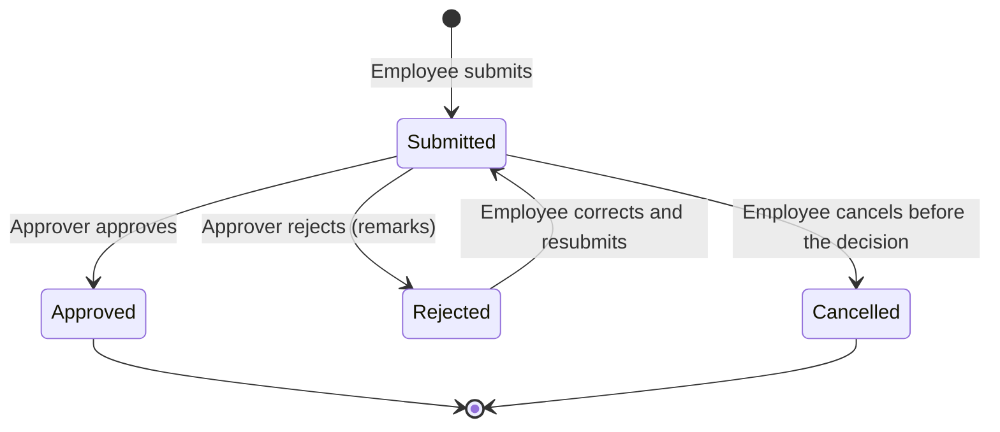

# PMS – BRD-M3: Leave Management System (LMS)

Document ID: PMS-BRD-M3-LMS-v1.0
Module: Leave Management System (LMS)
Project: Payroll Management System (PMS) – proof of concept (POC), Step 3 BRD
Author: Rajesh Verma (Enterprise Architect)
Date: November 2026

## 1. Document control

### 1.1 Version / revision history

| Version | Revision | Date | Author | Change remark |
| --- | --- | --- | --- | --- |
| 1.0 | 0.1 | 19-Nov-2026 | Rajesh Verma | First draft from UX v1.0 (D-34), PMS-BRD v1.0 rev 0.7 and decisions D-01 to D-84 |

### 1.2 Review and approval

Names are added when the customer shares them.

| Role | Name | Date | Decision |
| --- | --- | --- | --- |
| Product owner | Rajesh Verma | | |
| Business analyst | [BA] | | |
| Module business owner / SME | [HR Manager] | | |
| Module business owner / SME | [Finance Manager] | | |

## 2. Introduction

### 2.1 Purpose

This document defines the business requirements of the Leave Management System (LMS): requesting full-day leave, cancelling a request while it waits for a decision, approving or rejecting it, and correcting and resubmitting a rejected request. Leave is recorded only – balances are not tracked and approved leave earns no wage (D-04, BR-CMN-17).

Glossary, roles, the end-to-end process, cross-module rules (BR-CMN) and system-wide NFRs are in the anchor PMS-BRD and are referenced, not repeated. The shared dashboard and approvals inbox are in anchor §5.3.

### 2.2 Reference documents

| # | Document | Version | Use |
| --- | --- | --- | --- |
| 1 | PMS-BRD (anchor) | v1.0 rev 0.7 | Glossary, roles, end-to-end process, cross-module rules, integrations, system-wide NFRs |
| 2 | UX Journey Index and UX Summaries SCR-LMS-01 to SCR-LMS-03 | v1.0 (D-34) | Journeys, screens, fields, actions |
| 3 | PMS – Business Requirements Document (baseline) §8 | v1.0 (D-09) | Leave entity, validations LMS-V1 to V6, user stories LMS-US1 to US4 |
| 4 | Decision log | D-01 to D-84 | Approved decisions |

## 3. Module overview and scope

### 3.1 Overview

LMS records leave requests of three full-day types – Casual, Sick and Earned – for a date range. From and to dates are inclusive and every calendar day counts, weekends included (D-04, D-32). The employee submits the request directly, without a draft or a reason (D-32); the manager (or the Admin for the top-level employee) approves or rejects it. While the request is waiting, the employee can cancel it; a rejected request can be corrected and resubmitted (D-07, BR-CMN-04).

Leave may be requested for past dates back to the date of joining, for example sick leave after the fact, and for any future date (D-07, D-84). Submitted and approved leave blocks those dates for attendance (BR-CMN-10); approved leave is locked and earns no wage (BR-CMN-05, BR-CMN-17).

LMS covers steps 5 and 6 of the end-to-end process (anchor §5.1) and journeys UJ-LMS-01 to UJ-LMS-04.

### 3.2 Scope

| In scope (POC) | Phase 2 / Future | Out of scope (reason) |
| --- | --- | --- |
| Full-day leave request: type (Casual, Sick, Earned), from and to date; days counted as calendar days | Future: half-day leave (anchor §13.1) | Leave reason – not part of the agreed entity (D-32) |
| Past dates back to the date of joining and future dates, with no limit on how far ahead or on the length (D-07, D-84) | Future: leave balances, accruals and entitlement checks (anchor §13.1) | Leave drafts – the request is short, submitted directly (D-32) |
| Submit; correct and resubmit after rejection (type and dates can change, D-84) | – | Cancelling a rejected request – it stays Rejected and can be fixed later (D-84) |
| Cancel while Submitted (status Cancelled) | Future: cancelling approved leave (D-84) | Paid leave in salary – approved leave earns no wage (D-05) |
| My leave: tiles for approved days this year by type and pending requests, filters by status and type, request list | – | Holiday calendar and weekend rules (D-08) |
| Team review: Pending with "Also away", approve (one or several) or reject; History | – | – |

### 3.3 Hand-overs with other modules

| Direction (in / out) | Other module | What is handed over | When | Anchor rule / process ref |
| --- | --- | --- | --- | --- |
| In | EIMS | Approved profile, date of joining, active flag, Manager Id / approver, names of the approver's direct reports | Request, submit, approval views | BR-CMN-09, BR-CMN-01, INT-03, INT-04 |
| In / out | AMS | Dates with submitted or approved attendance (for LMS's check); dates with submitted or approved leave (for AMS's check) | Submit; attendance entry and submit | BR-CMN-10, INT-06 |
| Out | EIMS | Whether leave other than Cancelled exists before a proposed new joining date | Admin changes date of joining | INT-09 |
| Out | Shell | Leave this month tile, to-do items (rejected requests, pending requests), pending approvals, leave days for the missing-attendance reminder | Dashboard or inbox opened | §5.3, FR-CMN-004, INT-07 |
| – | SMS | Nothing: approved leave earns no wage | – | BR-CMN-17 |

## 4. Users and access

### 4.1 Users of this module

| Role id (anchor §4.2) | What they do in this module |
| --- | --- |
| ROLE-EMP | Requests and submits own leave; cancels own request while Submitted; corrects and resubmits own rejected request; views own list and tiles |
| ROLE-MGR | Everything an Employee does for own leave; approves or rejects direct reports' leave, seeing who else in the team is away; views their history |
| ROLE-ADM | For the top-level employee only: approves or rejects leave (D-58, D-63) |

### 4.2 Role × screen access matrix

R = read, R/W = read and write, A = approve, — = no access.

| Screen id | Screen | Employee | Manager | Admin | Data scope |
| --- | --- | --- | --- | --- | --- |
| SCR-LMS-01 | My leave | R (own); cancel own Submitted | R (own); cancel own Submitted | — | Own |
| SCR-LMS-02 | Leave request (new or fix rejected) | R/W (own) | R/W (own) | — | Own |
| SCR-LMS-03 | Team leave review (Pending / History) | — | R, A (direct reports) | R, A (top-level employee only) | Manager: direct reports; Admin: top-level employee |
| SCR-SH-04 | Approvals inbox – leave items | — | A (direct reports) | A (top-level employee) | As SCR-LMS-03 |

The Admin's access to SCR-LMS-03 for the top-level employee is not yet in the UX summary; the update is tracked as anchor OI-01.

## 5. User journeys and screens

Requirement ids are assigned in §7 and listed in the traceability matrix (§15).

| Journey id | Journey | Actor | Screens | Requirement ids |
| --- | --- | --- | --- | --- |
| UJ-LMS-01 | Request leave | Employee | SCR-LMS-01 → SCR-LMS-02 | §7.1, §7.2 |
| UJ-LMS-02 | Cancel a pending request | Employee | SCR-LMS-01 | §7.1 |
| UJ-LMS-03 | Fix and resubmit a rejected request | Employee | SCR-SH-03 or SCR-LMS-01 → SCR-LMS-02 | §7.1, §7.2 |
| UJ-LMS-04 | Approve or reject team leave | Manager (Admin for top-level) | SCR-SH-04 → SCR-LMS-03 | §7.3 |

## 6. Status lifecycle

### 6.1 Leave request lifecycle

| Status code | Status | Business meaning | Set by |
| --- | --- | --- | --- |
| SUBMITTED | Submitted | Waiting for the approver; read only; can be cancelled; blocks its dates for attendance and other leave (BR-CMN-10) | Employee |
| APPROVED | Approved | Decided and locked; cannot be cancelled in the POC (D-84); blocks its dates for attendance; earns no wage (BR-CMN-05, BR-CMN-17) | Manager / Admin |
| REJECTED | Rejected | Returned with remarks; type and dates can be corrected and the request resubmitted; cannot be cancelled and stays Rejected if not resubmitted; does not block any date (D-84) | Manager / Admin |
| CANCELLED | Cancelled | Withdrawn by the employee before the decision; final; shown dimmed in the list; does not block any date (D-32) | Employee |

Leave requests are never discarded or deleted: Rejected and Cancelled requests stay in the employee's list (BR-CMN-06).

| From | To | Action | Actor | Condition / rule |
| --- | --- | --- | --- | --- |
| – | Submitted | Submit for approval | Employee | Profile approved (BR-CMN-09); all validations pass, incl. no overlap with own submitted or approved leave and no submitted or approved attendance on any date (BR-CMN-10); Request Date and Submitted Date set (D-84) |
| Submitted | Approved | Approve (one or several) | Manager of the employee; Admin for the top-level employee | Not own record (BR-CMN-08); BR-CMN-12 |
| Submitted | Rejected | Reject | As above | Remarks required (BR-CMN-03) |
| Submitted | Cancelled | Cancel | Employee | Confirmation required; only before the approver decides (D-07) |
| Rejected | Submitted | Resubmit | Employee | As for submit; the request's own earlier dates do not count as an overlap; Submitted Date updated, Request Date kept (BR-CMN-04, D-84) |
