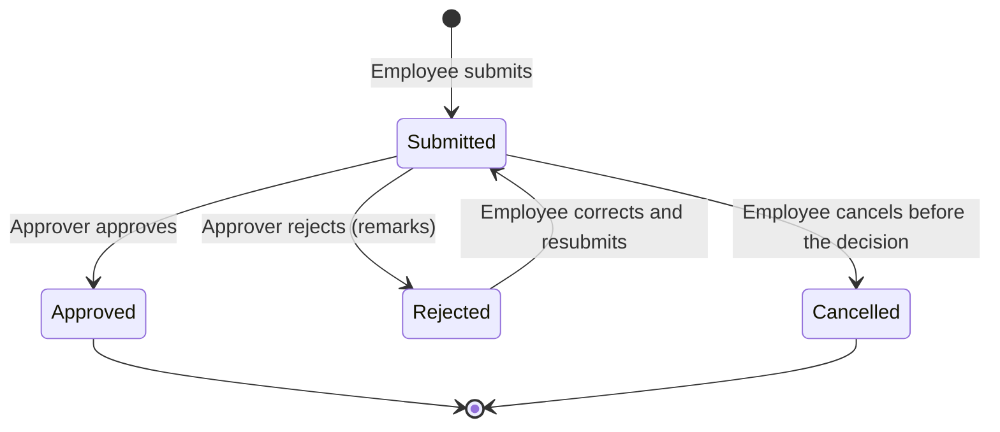

# PMS – BRD-M3: Leave Management System (LMS)

Document ID: PMS-BRD-M3-LMS-v1.0
Module: Leave Management System (LMS)
Project: Payroll Management System (PMS) – proof of concept (POC), Step 3 BRD
Author: Rajesh Verma (Enterprise Architect)
Date: November 2026

## 1. Document control

### 1.1 Version / revision history

| Version | Revision | Date | Author | Change remark |
| --- | --- | --- | --- | --- |
| 1.0 | 0.1 | 19-Nov-2026 | Rajesh Verma | First draft from UX v1.0 (D-34), PMS-BRD v1.0 rev 0.7 and decisions D-01 to D-84 |

### 1.2 Review and approval

Names are added when the customer shares them.

| Role | Name | Date | Decision |
| --- | --- | --- | --- |
| Product owner | Rajesh Verma | | |
| Business analyst | [BA] | | |
| Module business owner / SME | [HR Manager] | | |
| Module business owner / SME | [Finance Manager] | | |

## 2. Introduction

### 2.1 Purpose

This document defines the business requirements of the Leave Management System (LMS): requesting full-day leave, cancelling a request while it waits for a decision, approving or rejecting it, and correcting and resubmitting a rejected request. Leave is recorded only – balances are not tracked and approved leave earns no wage (D-04, BR-CMN-17).

Glossary, roles, the end-to-end process, cross-module rules (BR-CMN) and system-wide NFRs are in the anchor PMS-BRD and are referenced, not repeated. The shared dashboard and approvals inbox are in anchor §5.3.

### 2.2 Reference documents

| # | Document | Version | Use |
| --- | --- | --- | --- |
| 1 | PMS-BRD (anchor) | v1.0 rev 0.7 | Glossary, roles, end-to-end process, cross-module rules, integrations, system-wide NFRs |
| 2 | UX Journey Index and UX Summaries SCR-LMS-01 to SCR-LMS-03 | v1.0 (D-34) | Journeys, screens, fields, actions |
| 3 | PMS – Business Requirements Document (baseline) §8 | v1.0 (D-09) | Leave entity, validations LMS-V1 to V6, user stories LMS-US1 to US4 |
| 4 | Decision log | D-01 to D-84 | Approved decisions |

## 3. Module overview and scope

### 3.1 Overview

LMS records leave requests of three full-day types – Casual, Sick and Earned – for a date range. From and to dates are inclusive and every calendar day counts, weekends included (D-04, D-32). The employee submits the request directly, without a draft or a reason (D-32); the manager (or the Admin for the top-level employee) approves or rejects it. While the request is waiting, the employee can cancel it; a rejected request can be corrected and resubmitted (D-07, BR-CMN-04).

Leave may be requested for past dates back to the date of joining, for example sick leave after the fact, and for any future date (D-07, D-84). Submitted and approved leave blocks those dates for attendance (BR-CMN-10); approved leave is locked and earns no wage (BR-CMN-05, BR-CMN-17).

LMS covers steps 5 and 6 of the end-to-end process (anchor §5.1) and journeys UJ-LMS-01 to UJ-LMS-04.

### 3.2 Scope

| In scope (POC) | Phase 2 / Future | Out of scope (reason) |
| --- | --- | --- |
| Full-day leave request: type (Casual, Sick, Earned), from and to date; days counted as calendar days | Future: half-day leave (anchor §13.1) | Leave reason – not part of the agreed entity (D-32) |
| Past dates back to the date of joining and future dates, with no limit on how far ahead or on the length (D-07, D-84) | Future: leave balances, accruals and entitlement checks (anchor §13.1) | Leave drafts – the request is short, submitted directly (D-32) |
| Submit; correct and resubmit after rejection (type and dates can change, D-84) | – | Cancelling a rejected request – it stays Rejected and can be fixed later (D-84) |
| Cancel while Submitted (status Cancelled) | Future: cancelling approved leave (D-84) | Paid leave in salary – approved leave earns no wage (D-05) |
| My leave: tiles for approved days this year by type and pending requests, filters by status and type, request list | – | Holiday calendar and weekend rules (D-08) |
| Team review: Pending with "Also away", approve (one or several) or reject; History | – | – |

### 3.3 Hand-overs with other modules

| Direction (in / out) | Other module | What is handed over | When | Anchor rule / process ref |
| --- | --- | --- | --- | --- |
| In | EIMS | Approved profile, date of joining, active flag, Manager Id / approver, names of the approver's direct reports | Request, submit, approval views | BR-CMN-09, BR-CMN-01, INT-03, INT-04 |
| In / out | AMS | Dates with submitted or approved attendance (for LMS's check); dates with submitted or approved leave (for AMS's check) | Submit; attendance entry and submit | BR-CMN-10, INT-06 |
| Out | EIMS | Whether leave other than Cancelled exists before a proposed new joining date | Admin changes date of joining | INT-09 |
| Out | Shell | Leave this month tile, to-do items (rejected requests, pending requests), pending approvals, leave days for the missing-attendance reminder | Dashboard or inbox opened | §5.3, FR-CMN-004, INT-07 |
| – | SMS | Nothing: approved leave earns no wage | – | BR-CMN-17 |

## 4. Users and access

### 4.1 Users of this module

| Role id (anchor §4.2) | What they do in this module |
| --- | --- |
| ROLE-EMP | Requests and submits own leave; cancels own request while Submitted; corrects and resubmits own rejected request; views own list and tiles |
| ROLE-MGR | Everything an Employee does for own leave; approves or rejects direct reports' leave, seeing who else in the team is away; views their history |
| ROLE-ADM | For the top-level employee only: approves or rejects leave (D-58, D-63) |

### 4.2 Role × screen access matrix

R = read, R/W = read and write, A = approve, — = no access.

| Screen id | Screen | Employee | Manager | Admin | Data scope |
| --- | --- | --- | --- | --- | --- |
| SCR-LMS-01 | My leave | R (own); cancel own Submitted | R (own); cancel own Submitted | — | Own |
| SCR-LMS-02 | Leave request (new or fix rejected) | R/W (own) | R/W (own) | — | Own |
| SCR-LMS-03 | Team leave review (Pending / History) | — | R, A (direct reports) | R, A (top-level employee only) | Manager: direct reports; Admin: top-level employee |
| SCR-SH-04 | Approvals inbox – leave items | — | A (direct reports) | A (top-level employee) | As SCR-LMS-03 |

The Admin's access to SCR-LMS-03 for the top-level employee is not yet in the UX summary; the update is tracked as anchor OI-01.

## 5. User journeys and screens

Requirement ids are assigned in §7 and listed in the traceability matrix (§15).

| Journey id | Journey | Actor | Screens | Requirement ids |
| --- | --- | --- | --- | --- |
| UJ-LMS-01 | Request leave | Employee | SCR-LMS-01 → SCR-LMS-02 | §7.1, §7.2 |
| UJ-LMS-02 | Cancel a pending request | Employee | SCR-LMS-01 | §7.1 |
| UJ-LMS-03 | Fix and resubmit a rejected request | Employee | SCR-SH-03 or SCR-LMS-01 → SCR-LMS-02 | §7.1, §7.2 |
| UJ-LMS-04 | Approve or reject team leave | Manager (Admin for top-level) | SCR-SH-04 → SCR-LMS-03 | §7.3 |

## 6. Status lifecycle

### 6.1 Leave request lifecycle

| Status code | Status | Business meaning | Set by |
| --- | --- | --- | --- |
| SUBMITTED | Submitted | Waiting for the approver; read only; can be cancelled; blocks its dates for attendance and other leave (BR-CMN-10) | Employee |
| APPROVED | Approved | Decided and locked; cannot be cancelled in the POC (D-84); blocks its dates for attendance; earns no wage (BR-CMN-05, BR-CMN-17) | Manager / Admin |
| REJECTED | Rejected | Returned with remarks; type and dates can be corrected and the request resubmitted; cannot be cancelled and stays Rejected if not resubmitted; does not block any date (D-84) | Manager / Admin |
| CANCELLED | Cancelled | Withdrawn by the employee before the decision; final; shown dimmed in the list; does not block any date (D-32) | Employee |

Leave requests are never discarded or deleted: Rejected and Cancelled requests stay in the employee's list (BR-CMN-06).

| From | To | Action | Actor | Condition / rule |
| --- | --- | --- | --- | --- |
| – | Submitted | Submit for approval | Employee | Profile approved (BR-CMN-09); all validations pass, incl. no overlap with own submitted or approved leave and no submitted or approved attendance on any date (BR-CMN-10); Request Date and Submitted Date set (D-84) |
| Submitted | Approved | Approve (one or several) | Manager of the employee; Admin for the top-level employee | Not own record (BR-CMN-08); BR-CMN-12 |
| Submitted | Rejected | Reject | As above | Remarks required (BR-CMN-03) |
| Submitted | Cancelled | Cancel | Employee | Confirmation required; only before the approver decides (D-07) |
| Rejected | Submitted | Resubmit | Employee | As for submit; the request's own earlier dates do not count as an overlap; Submitted Date updated, Request Date kept (BR-CMN-04, D-84) |

## 7. Functional requirements

All requirements are priority Must and phase POC. Approve-several-at-once and changed-meanwhile handling in the approvals inbox follow FR-CMN-011 and FR-CMN-014 (anchor §5.3).

### 7.1 SCR-LMS-01 – My leave

| Req id | Requirement | Priority | Phase | UX ref | Acceptance criteria (Given / When / Then) |
| --- | --- | --- | --- | --- | --- |
| FR-LMS-001 | Tiles show approved days taken in the current calendar year for each type (Casual, Sick, Earned) and the number of pending requests with the approver's name ("Waiting for <approver>"). Days are counted in the calendar year in which they fall. | Must | POC | SCR-LMS-01, D-84 | Given approved Casual leave 30-Dec-2026 to 02-Jan-2027, then the 2026 Casual tile counts 2 days. |
| FR-LMS-002 | An information note states that leave balances are not tracked and that days are calendar days, from and to inclusive. | Must | POC | SCR-LMS-01, D-04, D-32 | Given the screen opens, then the note is shown. |
| FR-LMS-003 | The list shows each request – dates, type, days, requested date, status and manager remarks – newest first, with filters by status and by type; Cancelled requests are shown dimmed. | Must | POC | SCR-LMS-01 | Given the Rejected filter, then only Rejected requests are listed. |
| FR-LMS-004 | Cancel is offered only on Submitted requests. A confirmation explains that the request is withdrawn before the manager decides and cannot be undone; on confirmation the request becomes Cancelled: "Leave request cancelled." | Must | POC | SCR-LMS-01, UJ-LMS-02, D-07 | Given an Approved request, then no Cancel action is offered. |
| FR-LMS-005 | If the approver decided the request meanwhile, cancelling fails and the employee is told to refresh. | Must | POC | SCR-LMS-01, FR-CMN-014 | Given the approver approved the request a moment ago, when the employee confirms Cancel, then the request stays Approved and the refresh message is shown. |
| FR-LMS-006 | Edit is offered only on Rejected requests and opens the request form filled in (SCR-LMS-02). Approved and Cancelled requests offer no action. | Must | POC | SCR-LMS-01, UJ-LMS-03, D-84 | Given a Rejected request, when the employee clicks Edit, then the form opens with its type, dates and the approver's remarks. |
| FR-LMS-007 | Until the profile is approved, a banner explains that the profile must be approved first and "+ Request leave" is disabled. | Must | POC | SCR-LMS-01, BR-CMN-09 | Given a Submitted profile, then the button is disabled. |
| FR-LMS-008 | With no requests: "No leave requests – Use + Request leave to apply."; if the list cannot be loaded, an alert with Retry is shown. | Must | POC | SCR-LMS-01 | Given a new employee with no requests, then the empty message is shown. |
| FR-LMS-009 | A manager also sees a Team tab, with the pending count, leading to SCR-LMS-03. | Must | POC | SCR-LMS-01 | Given an Employee without the Manager role, then no Team tab is shown. |

**User stories**

| Id | As a | I want to | So that | Baseline |
| --- | --- | --- | --- | --- |
| US-LMS-01 | Employee | view my leave history and status | I can track approvals | LMS-US4 |
| US-LMS-02 | Employee | cancel a request before it is decided | I can change my plans | LMS-US2 |

### 7.2 SCR-LMS-02 – Leave request

| Req id | Requirement | Priority | Phase | UX ref | Acceptance criteria (Given / When / Then) |
| --- | --- | --- | --- | --- | --- |
| FR-LMS-010 | The employee chooses the leave type (Casual, Sick or Earned; Casual pre-selected) and the from and to dates; the to date defaults to the from date. The number of leave days and the date range are shown as the employee types, counting every calendar day inclusive. | Must | POC | SCR-LMS-02, D-32 | Given Fri 13-Nov to Mon 16-Nov, then 4 days are shown. |
| FR-LMS-011 | Past dates back to the date of joining and any future date are accepted, with no limit on the length of a request. | Must | POC | SCR-LMS-02, D-07, D-84 | Given a from date three weeks ago (after the date of joining), when the employee submits sick leave, then it is Submitted. |
| FR-LMS-012 | A side panel lists the rules: full days only; calendar days inclusive; balances not checked; no overlap with own submitted or approved leave; no day with submitted or approved attendance; cancel possible until the manager decides. | Must | POC | SCR-LMS-02 | Given the form opens, then the rules panel is shown. |
| FR-LMS-013 | Submit for approval checks all rules (§8); on success the request becomes Submitted, "<Type> leave <range> submitted to <approver>." is shown and the employee returns to My leave. There is no draft (D-32). | Must | POC | SCR-LMS-02, UJ-LMS-01 | Given valid dates, when the employee submits, then the request appears in the approver's inbox. |
| FR-LMS-014 | Errors are shown at the date fields: "To date must be on or after From date", "Overlaps your submitted <type> leave (<range>)", "You already have attendance on <date>", and a from date before the date of joining is refused. Submit is disabled while saving; if saving fails: "Leave request could not be submitted. Please try again." | Must | POC | SCR-LMS-02 | Given submitted attendance on Tue 10-Nov, when the employee submits leave 09-Nov to 11-Nov, then the attendance message names 10-Nov and nothing is saved. |
| FR-LMS-015 | When fixing a rejected request, a red banner shows the approver's name, decision date and remarks; type and both dates can be changed; the request's own earlier dates do not count as an overlap; Submit sends it back as Submitted. | Must | POC | SCR-LMS-02, UJ-LMS-03, BR-CMN-04, D-84 | Given a Rejected Earned request 22–26 Dec, when the employee changes it to 22–24 Dec and submits, then it is Submitted with the new dates. |
| FR-LMS-016 | Cancel on the form returns to My leave without saving anything. | Must | POC | SCR-LMS-02 | Given a new form with dates entered, when the employee clicks Cancel, then no request exists. |

**User stories**

| Id | As a | I want to | So that | Baseline |
| --- | --- | --- | --- | --- |
| US-LMS-03 | Employee | request leave for a date range, including past sick days | my absence is recorded | LMS-US1 |
| US-LMS-04 | Employee | correct and resubmit a rejected request | I can fix what the manager pointed out | – (BR-CMN-04) |

### 7.3 SCR-LMS-03 – Team leave review

| Req id | Requirement | Priority | Phase | UX ref | Acceptance criteria (Given / When / Then) |
| --- | --- | --- | --- | --- | --- |
| FR-LMS-020 | The Team tab has Pending (with count) and History, with filters for team member and leave type; History also has a date range (from ≤ to), opens on requests overlapping the current month and includes reports who became inactive, marked Inactive. | Must | POC | SCR-LMS-03, D-84 | Given a report deactivated last week, then their October leave appears in History when October is selected. |
| FR-LMS-021 | Pending rows show employee, type, dates, days and submitted time. | Must | POC | SCR-LMS-03 | Given a resubmitted request, then the submitted time is the resubmission time. |
| FR-LMS-022 | Each pending row shows "Also away": the approver's other direct reports with submitted or approved leave overlapping the request's dates, as names and a count in text. It is empty for the top-level employee's requests. | Must | POC | SCR-LMS-03, D-84 | Given two other reports with approved leave on one of the dates, then the row shows both names and "2". |
| FR-LMS-023 | The approver approves one row or several selected rows; each becomes Approved and locked: "Leave for <name> approved." | Must | POC | SCR-LMS-03, BR-CMN-12 | Given 3 rows selected, when the approver approves, then all 3 are Approved. |
| FR-LMS-024 | The approver rejects one row at a time with remarks (required, up to 500 characters): "Leave rejected and returned to <name>." | Must | POC | SCR-LMS-03, BR-CMN-03 | Given empty remarks, then "Remarks are required to reject." is shown. |
| FR-LMS-025 | If the employee cancelled a request meanwhile, its row is removed with "This request was cancelled by the employee."; in a bulk approval, failed items stay selected with their own error (FR-CMN-014). | Must | POC | SCR-LMS-03 | Given a request cancelled after the page opened, when the approver approves it, then the row is removed with the message. |
| FR-LMS-026 | History shows decided requests with the decision, approver, decision date, remarks and status. | Must | POC | SCR-LMS-03 | Given a rejected request, then History shows its remarks. |
| FR-LMS-027 | A manager sees and decides only direct reports' leave, never their own; the Admin sees and decides only the top-level employee's leave. | Must | POC | BR-CMN-01, BR-CMN-08, D-58 | Given a manager opens Team, then their own requests are not listed. |
| FR-LMS-028 | With nothing pending: "Nothing pending – All leave requests have been decided." | Must | POC | SCR-LMS-03 | Given no submitted requests, then the message is shown. |

**User stories**

| Id | As a | I want to | So that | Baseline |
| --- | --- | --- | --- | --- |
| US-LMS-05 | Manager | approve or reject my team's leave requests, seeing who else is away | I can plan team capacity | LMS-US3 |

## 8. Business and validation rules

| Rule id | Rule | Type (business / validation) | Applies to (screen / function) | Source (decision / UX) |
| --- | --- | --- | --- | --- |
| VR-LMS-01 | The from date is on or before the to date. | Validation | SCR-LMS-02 | Baseline LMS-V1 |
| VR-LMS-02 | The from date is not before the employee's date of joining. Past dates are allowed; there is no limit on future dates or on the length of a request. | Validation | SCR-LMS-02 | D-07 (O5), D-84; baseline LMS-V2 |
| VR-LMS-03 | No date of the request overlaps the employee's other submitted or approved leave. When a rejected request is fixed, its own earlier dates do not count. | Validation | SCR-LMS-02 | D-04 (L4), D-84; baseline LMS-V3 |
| VR-LMS-04 | No date of the request has submitted or approved attendance; draft or rejected attendance does not block leave. | Validation | SCR-LMS-02 | BR-CMN-10, D-77, INT-06; baseline LMS-V4 |
| VR-LMS-05 | The leave type is Casual, Sick or Earned. | Validation | SCR-LMS-02 | D-04 (L2); baseline LMS-V5 |
| VR-LMS-06 | Only an employee with an approved profile can submit leave. | Validation | SCR-LMS-01, SCR-LMS-02 | BR-CMN-09; baseline LMS-V6 |
| VR-LMS-07 | To submit, leave type, from date and to date are required. | Validation | SCR-LMS-02 | UX SCR-LMS-02 |
| BR-LMS-01 | Leave days = to date – from date + 1; every calendar day counts, weekends included. | Business | SCR-LMS-01, SCR-LMS-02, SCR-LMS-03 | D-32 (UXQ-19); UX SCR-LMS-01 |
| BR-LMS-02 | Leave is taken in full days only. | Business | SCR-LMS-02 | D-04 (L2) |
| BR-LMS-03 | Leave balances and entitlements are not tracked or checked. | Business | SCR-LMS-01, SCR-LMS-02 | D-04 (L3) |
| BR-LMS-04 | Only a Submitted request can be cancelled, by its owner, after confirmation and before the approver decides; Cancelled is final. | Business | SCR-LMS-01 | D-07 (O4), D-32 |
| BR-LMS-05 | A Rejected request cannot be cancelled; it stays Rejected until the owner corrects type or dates and resubmits it, which is possible at any time. | Business | SCR-LMS-01, SCR-LMS-02 | BR-CMN-04, D-84 |
| BR-LMS-06 | Approved leave cannot be cancelled or changed in the POC. | Business | SCR-LMS-01 | BR-CMN-05, D-84 |
| BR-LMS-07 | The Request Date is set on the first submission and never changes; the Submitted Date is set on every submission. | Business | SCR-LMS-02, SCR-LMS-03 | D-04 (L1), D-84 |
| BR-LMS-08 | In monthly and yearly figures, each leave day is counted in the calendar month and year in which it falls. | Business | SCR-LMS-01, SCR-SH-03 | D-84 |
| BR-LMS-09 | "Also away" lists the approver's other direct reports whose submitted or approved leave overlaps the request's dates; it is empty for the top-level employee's requests. | Business | SCR-LMS-03 | D-84; UX SCR-LMS-03 |

Cross-module rules that also apply: BR-CMN-01 to BR-CMN-10, BR-CMN-12, BR-CMN-17, BR-CMN-18 (anchor §6).

## 9. Data requirements

"Mandatory" means required to submit (VR-LMS-07). Leave data is not classed as sensitive (D-71 lists the sensitive employee attributes); it is still shown only within the role's data scope (anchor §4.3).

### 9.1 Leave

| Attribute | Description | Type / format | Mandatory | Validation (VR id) | Set by | Sensitive (Y / N) |
| --- | --- | --- | --- | --- | --- | --- |
| Leave Id | Unique identifier | System key | Y | – | System | N |
| Employee Id | Owner of the request | Employee Id | Y | VR-LMS-06 | System (signed-in employee) | N |
| Request Date | Date of the first submission (shown as "Requested") | Date, IST | Y | BR-LMS-07 | System | N |
| Leave Type | Casual, Sick or Earned | List | Y | VR-LMS-05 | Employee | N |
| From Date | First day of leave (inclusive) | Date, IST | Y | VR-LMS-01 to 04 | Employee | N |
| To Date | Last day of leave (inclusive) | Date, IST | Y | VR-LMS-01, 03, 04 | Employee | N |
| Leave days | To date – from date + 1; shown on screens and tiles | Whole number | – (derived) | BR-LMS-01 | System | N |
| Status | Leave status (§6.1) | Submitted, Approved, Rejected, Cancelled | Y | – | System on action | N |
| Submitted Date | When the request was last submitted (shown in team review) | Date and time, IST | Y | BR-LMS-07 | System | N |
| Approver Id, Approved Date, Remarks | Workflow fields; remarks hold the rejection reason | Employee Id; date and time; text ≤ 500 | – | BR-CMN-03 | System / approver (BR-CMN-02) | N |
| Is Active | Soft-delete flag (BR-CMN-06); no user action sets it in the POC | Yes / No | Y | – | System | N |
| Created By, Created Date, Updated By, Updated Date | Audit fields | User id; date and time, IST | Y | – | System (BR-CMN-07) | N |

## 10. Notifications and alerts

All notifications are in-app (anchor C-05): dashboard, approvals inbox and screen banners.

| Id | Event / trigger | Recipient(s) | Channel (in-app / email) | Timing | Message summary |
| --- | --- | --- | --- | --- | --- |
| NOT-LMS-01 | Leave submitted or resubmitted | Approver (manager; Admin for the top-level employee) | In-app: approvals inbox, Approvals count, dashboard approval card | Immediately | New "Leave" item with employee, type, date range and days |
| NOT-LMS-02 | Leave rejected | Employee | In-app: dashboard "Things to do"; red banner on the request form | Immediately | "Leave <range> returned – please correct" with the approver's name, date and remarks |
| NOT-LMS-03 | Leave approved | Employee | In-app: status in My leave; leave tiles on My leave and the dashboard | Immediately | Status Approved; approved days added to the tiles |
| NOT-LMS-04 | Leave cancelled by the employee | Approver | In-app: item removed from the approvals inbox and Pending; message if the approver acts on it (FR-LMS-025) | Immediately | "This request was cancelled by the employee." |
| NOT-LMS-05 | Own request waiting for a decision | Employee | In-app: dashboard "Things to do" and pending tile (FR-CMN-003, FR-LMS-001) | Each time the dashboard or My leave opens | "Waiting for <approver>" with the number of pending requests |

## 11. Scheduled jobs and integrations

LMS has no scheduled jobs of its own. It takes part in these anchor integrations (anchor §7):

| Id | Name | Type (event / API / scheduled) | Trigger / schedule | Source → target | Business outcome |
| --- | --- | --- | --- | --- | --- |
| INT-03, INT-04 | Employee details and approver | API | Request, submit, approval views | EIMS → LMS | Approved profile, joining date, approver and direct reports (VR-LMS-02, VR-LMS-06, BR-LMS-09) |
| INT-06 | Attendance and leave date check | API | Leave submit; attendance entry and submit | AMS ↔ LMS | No date with both (VR-LMS-04, BR-CMN-10) |
| INT-07 | Dashboard and approvals inbox | API | Dashboard or inbox opened | LMS → Shell | Items in §12, leave days for the missing-attendance reminder (FR-CMN-004), NOT-LMS-01 to 05 |
| INT-09 | Records before a new joining date | API | Admin changes date of joining | LMS → EIMS | Leave other than Cancelled before the new date is reported |

## 12. Reporting and dashboard

| Id | Report / widget | Audience | Content | Filters |
| --- | --- | --- | --- | --- |
| RPT-LMS-01 | Leave this month tile (dashboard) | Employee, Manager | Approved leave days falling in the current month and the pending count (FR-CMN-002, BR-LMS-08) | – |
| RPT-LMS-02 | "Things to do" items (dashboard) | Employee, Manager | Rejected requests to fix; requests waiting for a decision | – |
| RPT-LMS-03 | Waiting for your approval – Leave | Manager, Admin | Count of submitted requests to decide | – |
| RPT-LMS-04 | My leave tiles | Employee, Manager | Approved days this year by type; pending requests (FR-LMS-001) | – (current calendar year) |
| RPT-LMS-05 | Team leave history | Manager, Admin | Decisions, approver, remarks, status (FR-LMS-020, 026) | Team member, leave type, date range |

## 13. Module non-functional requirements and volumetrics

System-wide NFRs (anchor §8) apply; LMS has no module-specific additions.

| Volume type | Year 1 | Growth % per year | Peak |
| --- | --- | --- | --- |
| Leave requests | About 1,200 (about 1 per employee per month, anchor §8.1) | 0 % (20 % headroom) | Anchor daily peaks; month-end approval catch-up |
| Approval decisions | About 1,200 | 0 % | As above |
| Cancellations | Not estimated (expected rare) | – | – |

## 14. Assumptions, constraints and dependencies

| Type | Id | Statement |
| --- | --- | --- |
| Assumption | A-LMS-01 | Approvers decide from their own knowledge of the team's work, helped by "Also away"; there are no balances or entitlements to check (D-04). |
| Constraint | C-LMS-01 | Full days only, counted as calendar days including weekends (D-04, D-32). |
| Constraint | C-LMS-02 | Dates are IST (D-08, BR-CMN-18). |
| Dependency | DEP-LMS-01 | EIMS provides the approved profile, joining date, approver and direct reports (anchor DEP-03, INT-03, INT-04). |
| Dependency | DEP-LMS-02 | AMS provides attendance dates (INT-06). LMS may be built before AMS; until AMS exists there is no attendance, so the check passes and is completed when AMS is delivered. |
| Dependency | DEP-LMS-03 | Open items OI-02 and OI-04 (anchor §12) are decided before this document is approved (anchor DEP-06). |

## 15. Traceability matrix

| Journey id | Screen id | Req id | Rule ids | Test ref (later) |
| --- | --- | --- | --- | --- |
| UJ-LMS-01 | SCR-LMS-01, SCR-LMS-02 | FR-LMS-001, 002, 003, 007, 008, 010, 011, 012, 013, 014, 016 | VR-LMS-01 to 07; BR-LMS-01, 02, 03, 07, 08; BR-CMN-09, 10 | |
| UJ-LMS-02 | SCR-LMS-01 | FR-LMS-004, 005 | BR-LMS-04, 06 | |
| UJ-LMS-03 | SCR-SH-03, SCR-LMS-01, SCR-LMS-02 | FR-LMS-006, 013, 014, 015 | VR-LMS-03; BR-LMS-05, 07; BR-CMN-04 | |
| UJ-LMS-04 | SCR-SH-04, SCR-LMS-01, SCR-LMS-03 | FR-LMS-009, 020 to 028 | BR-LMS-09; BR-CMN-01, 03, 08, 12, 17 | |

## 16. Open items

Cross-module open items that affect LMS are in the anchor §12: OI-01 (Admin opens SCR-LMS-03 for the top-level employee), OI-02 (pending items of a deactivated employee), OI-04 (pending items on a manager change) and OI-09 (LMS UX updates). LMS has no module-only open items.

| Id | Question | Owner | Due | Status / decision |
| --- | --- | --- | --- | --- |
| – | None | – | – | – |

## 17. Appendix

### 17.1 Future scope (not in this phase)

| Area | Requirement ref | Note |
| --- | --- | --- |
| Leave types | Anchor §13.1 | Half-day leave |
| Entitlement | Anchor §13.1 | Leave balances, accruals and entitlement checks |
| Changes | §3.2, D-84 | Cancelling approved leave |
| Calendar | Anchor §13.1 | Holiday calendar and weekend rules |
