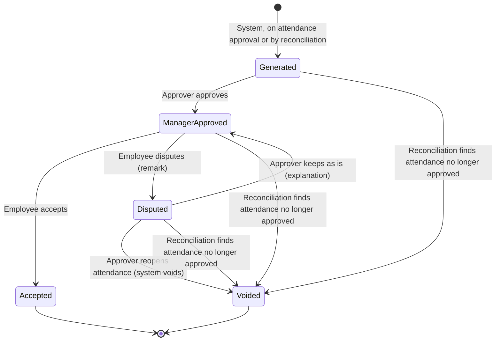

# PMS – BRD-M4: Salary Management System (SMS)

Document ID: PMS-BRD-M4-SMS-v1.0
Module: Salary Management System (SMS)
Project: Payroll Management System (PMS) – proof of concept (POC), Step 3 BRD
Author: Rajesh Verma (Enterprise Architect)
Date: November 2026

## 1. Document control

### 1.1 Version / revision history

| Version | Revision | Date | Author | Change remark |
| --- | --- | --- | --- | --- |
| 1.0 | 0.1 | 19-Nov-2026 | Rajesh Verma | First draft from UX v1.0 (D-34), PMS-BRD v1.0 rev 0.9 and decisions D-01 to D-90 |

### 1.2 Review and approval

Names are added when the customer shares them.

| Role | Name | Date | Decision |
| --- | --- | --- | --- |
| Product owner | Rajesh Verma | | |
| Business analyst | [BA] | | |
| Module business owner / SME | [HR Manager] | | |
| Module business owner / SME | [Finance Manager] | | |

## 2. Introduction

### 2.1 Purpose

This document defines the business requirements of the Salary Management System (SMS): generating a daily salary record automatically from each approved attendance day, approval of the record by the manager, acceptance or dispute by the employee, resolution of a dispute (keep as is, or reopen the attendance), voiding of records whose attendance is reopened, the nightly reconciliation and the earnings view for a period. Wages are never entered by hand (D-05, KPI-02).

Glossary (salary terms), roles, the end-to-end process, cross-module rules (BR-CMN), integrations and system-wide NFRs are in the anchor PMS-BRD and are referenced, not repeated. The shared dashboard and approvals inbox are in anchor §5.3; the reopen of attendance itself is in PMS-BRD-M2-AMS.

### 2.2 Reference documents

| # | Document | Version | Use |
| --- | --- | --- | --- |
| 1 | PMS-BRD (anchor) | v1.0 rev 0.9 | Glossary, roles, end-to-end process (steps 9–13), cross-module rules, integrations, system-wide NFRs |
| 2 | PMS-BRD-M2-AMS | v1.0 rev 0.1 | Attendance hand-over to salary (§3.3, §7.4), reopen after a salary dispute (§7.3) |
| 3 | UX Journey Index and UX Summaries SCR-SMS-01, SCR-SMS-02 (salary items on SCR-SH-03, SCR-SH-04) | v1.0 (D-34) | Journeys, screens, fields, actions |
| 4 | PMS – Business Requirements Document (baseline) §9 | v1.0 (D-09) | Salary entity, wage formula, rules SMS-R1 to R4, user stories SMS-US1 to US4 |
| 5 | Decision log | D-01 to D-90 | Approved decisions |

## 3. Module overview and scope

### 3.1 Overview

SMS keeps one salary record per approved attendance day. When the manager (or the Admin for the top-level employee) approves an attendance entry, the system generates the salary record as Generated: Day Hour from the attendance, the employee's current Hourly Wage Rate copied from EIMS, and Day Wage Amount = Day Hour × rate, rounded half up to 2 decimals, in INR (D-05, BR-CMN-13, D-90). Nobody can edit hours, rate or amount.

The approver approves the generated record (one or several at once) and cannot reject it (D-07). The employee then accepts it – one or several at once – or disputes it with a remark (D-33). A dispute goes back to the approver, who either keeps the record as it is with an explanation (the record returns to Manager Approved and the employee may accept or dispute again) or reopens the attendance: the attendance goes back to the employee as Rejected and the salary record is set to Voided; a new record is generated when the corrected attendance is approved again (BR-CMN-15, D-25).

A nightly reconciliation at 01:00 IST makes sure every approved attendance has exactly one non-voided salary record: it creates missing records, voids records whose attendance is no longer approved and logs any other mismatch (JOB-CMN-01, D-90). Approved leave earns no wage (BR-CMN-17).

SMS covers steps 9 to 13 of the end-to-end process (anchor §5.1) and journeys UJ-SMS-01 to UJ-SMS-04 and UJ-SYS-01 to UJ-SYS-03.

### 3.2 Scope

| In scope (POC) | Phase 2 / Future | Out of scope (reason) |
| --- | --- | --- |
| Automatic salary record per approved attendance day; rate copied at generation; amount rounded half up to 2 decimals (D-05, D-90) | Future: paid leave in salary (anchor §13.1) | Manual entry or editing of hours, rate or amount (baseline SMS-R4) |
| Manager (Admin for the top-level employee) approves generated records, one or several at once | Future: statutory deductions (PF, ESI, PT, TDS), allowances (anchor §13.1) | Rejecting a generated salary record – errors are fixed at the attendance (D-07) |
| Employee accepts (one or several) or disputes (one at a time, remark required); may dispute again after Keep as is (D-33, D-90) | Future: payslips and monthly payroll runs (anchor §13.1) | Auto-accept of records left in Manager Approved – dashboard reminders only (D-33) |
| Dispute resolution: Keep as is with explanation, or Reopen attendance (salary record Voided) | – | Rate history in EIMS – late or regenerated records use the current rate (D-90) |
| Voided records kept, hidden by default ("Show voided"), excluded from totals (D-25) | – | Disputing an Accepted record – acceptance is final |
| Nightly reconciliation 01:00 IST: create missing, void stale, log other mismatches (D-24, D-90) | – | – |
| My salary: earnings for a date range with tiles and period total; Team salary: Needs action, All records, team totals | – | – |

### 3.3 Hand-overs with other modules

| Direction (in / out) | Other module | What is handed over | When | Anchor rule / process ref |
| --- | --- | --- | --- | --- |
| In | AMS | Attendance approved: employee, date, from and to time, hours | On approval | INT-01, BR-CMN-17 |
| In | AMS | Attendance reopened, with the approver's reopen remarks | On reopen of a disputed day | INT-02, BR-CMN-15 |
| In | AMS | All approved attendance (for reconciliation) | Nightly, 01:00 IST | JOB-CMN-01 |
| In | EIMS | Current hourly wage rate | When a salary record is generated | INT-05, BR-CMN-13 |
| In | EIMS | Employee name, Manager Id, active flag; approver of the record (manager, or Admin for the top-level employee) | Approval and team views | INT-03, INT-04, BR-CMN-01, BR-CMN-08 |
| Out | AMS, Shell | Salary status of approved attendance ("Salary disputed") so the approver can reopen | Attendance history and approvals inbox opened | INT-10 |
| Out | Shell | Earnings this month tile, salary records to review, pending salary approvals and disputes, last reconciliation run | Dashboard or inbox opened | §5.3, FR-CMN-002, FR-CMN-007, INT-07 |
| – | LMS | Nothing: approved leave earns no wage | – | BR-CMN-17 |

## 4. Users and access

### 4.1 Users of this module

| Role id (anchor §4.2) | What they do in this module |
| --- | --- |
| ROLE-EMP | Views own salary records and earnings for a period; accepts own Manager Approved records (one or several); disputes them one at a time with a remark |
| ROLE-MGR | Everything an Employee does for own salary; approves direct reports' generated records (one or several); resolves their disputes with Keep as is or Reopen attendance; views their records and team totals |
| ROLE-ADM | For the top-level employee only: approves generated records and resolves disputes (D-58, D-63); no access to other employees' salary |
| SYS-SMS | Generates salary records on attendance approval and voids them when attendance is reopened (UJ-SYS-01, UJ-SYS-03) |
| SYS-REC | Nightly at 01:00 IST: creates missing records, voids records whose attendance is no longer approved, logs other mismatches (UJ-SYS-02) |

### 4.2 Role × screen access matrix

R = read, R/W = read and write, A = approve, — = no access.

| Screen id | Screen | Employee | Manager | Admin | Data scope |
| --- | --- | --- | --- | --- | --- |
| SCR-SMS-01 | My salary | R (own); accept / dispute own | R (own); accept / dispute own | — | Own |
| SCR-SMS-02 | Team salary review (Needs action / All records, team totals) | — | R, A (direct reports; approve, keep as is, reopen) | R, A (top-level employee only) | Manager: direct reports; Admin: top-level employee |
| SCR-SH-04 | Approvals inbox – salary items | — | A (direct reports) | A (top-level employee) | As SCR-SMS-02 |
| SCR-SH-03 | Dashboard – salary tile and to-do items | R (own) | R (own; approval counts) | R (last reconciliation run) | Own; Admin: system tile only |

A manager never sees their own salary records in SCR-SMS-02 or the approvals inbox (BR-CMN-08). The Admin's access to SCR-SMS-02 for the top-level employee is not yet in the UX summary (anchor OI-01); other SMS UX updates are tracked as anchor OI-10.

## 5. User journeys and screens

Requirement ids are assigned in §7 and listed in the traceability matrix (§15).

| Journey id | Journey | Actor | Screens | Requirement ids |
| --- | --- | --- | --- | --- |
| UJ-SMS-01 | Approve generated salary records | Manager (Admin for top-level) | SCR-SH-04 → SCR-SMS-02 | §7.2 |
| UJ-SMS-02 | Accept or dispute my salary | Employee | SCR-SH-03 → SCR-SMS-01 | §7.1 |
| UJ-SMS-03 | Resolve a dispute | Manager (Admin for top-level) | SCR-SMS-02 or SCR-SH-04 (Reopen continues in AMS, UJ-AMS-04) | §7.2 |
| UJ-SMS-04 | See my earnings for a period | Employee | SCR-SMS-01 | §7.1 |
| UJ-SYS-01 | Generate salary record | System (salary service) | – (record appears in SCR-SMS-02, SCR-SH-04) | §7.3 |
| UJ-SYS-02 | Nightly salary reconciliation (01:00 IST) | System (reconciliation job) | – (last run on the Admin dashboard, SCR-SH-03) | §7.3 |
| UJ-SYS-03 | Void salary on reopened attendance | System (salary service) | – (record shown as Voided in SCR-SMS-01, SCR-SMS-02) | §7.3 |

## 6. Status lifecycle

### 6.1 Salary record lifecycle

| Status code | Status | Business meaning | Set by |
| --- | --- | --- | --- |
| GENERATED | Generated | Created by the system from approved attendance; waiting for the approver; cannot be rejected (D-07) | System (SYS-SMS, SYS-REC) |
| MANAGER_APPROVED | Manager Approved | Approved by the approver; waiting for the employee to accept or dispute; counts in earnings (FR-CMN-002) | Manager / Admin |
| ACCEPTED | Accepted | Confirmed by the employee; final; counts in earnings | Employee |
| DISPUTED | Disputed | Questioned by the employee with a remark; waiting for the approver to keep as is or reopen the attendance; not counted in earnings; the attendance shows "Salary disputed" (INT-10) | Employee |
| VOIDED | Voided | No longer valid because the linked attendance was reopened; final; kept for history, hidden by default, excluded from every total; void reason kept (D-25, BR-CMN-16) | System (SYS-SMS, SYS-REC) |

Only one non-voided salary record exists per attendance (D-25, NFR-06). Salary records are never deleted; Is Active is not set by any user action (BR-CMN-06).

| From | To | Action | Actor | Condition / rule |
| --- | --- | --- | --- | --- |
| – | Generated | Generate | System (on INT-01, or reconciliation) | Attendance Approved; no non-voided record exists for it; rate = current EIMS rate at generation (BR-CMN-13, INT-05, D-90) |
| Generated | Manager Approved | Approve (one or several) | Manager of the employee; Admin for the top-level employee | Not own record (BR-CMN-08); record still Generated and its attendance still Approved, otherwise refused with a refresh message (FR-CMN-014, D-90); BR-CMN-12 |
| Manager Approved | Accepted | Accept (one or several) | Employee (owner) | D-33; Accepted Date set (D-90) |
| Manager Approved | Disputed | Dispute | Employee (owner) | Dispute remark required, up to 500 characters; one record at a time; Disputed Date set; allowed again after Keep as is (D-90) |
| Disputed | Manager Approved | Keep as is | Manager / Admin, as for approve | Explanation required, up to 500 characters (BR-CMN-03, D-33); dispute remark kept (D-90) |
| Disputed | Voided | Reopen attendance (in AMS; system voids the record) | Manager / Admin; system | Reopen remarks required (BR-CMN-03); attendance back to Rejected (BR-CMN-15, INT-02); void reason kept |
| Generated, Manager Approved, Disputed | Voided | Reconcile | System (SYS-REC) | Linked attendance is no longer Approved (missed reopen hand-over) (JOB-CMN-01, D-90) |

## 7. Functional requirements

To be drafted after review of §1–§6.

## 8. Business and validation rules

To be drafted.

## 9. Data requirements

To be drafted.

## 10. Notifications and alerts

To be drafted.

## 11. Scheduled jobs and integrations

To be drafted.

## 12. Reporting and dashboard

To be drafted.

## 13. Module non-functional requirements and volumetrics

To be drafted.

## 14. Assumptions, constraints and dependencies

To be drafted.

## 15. Traceability matrix

To be drafted.

## 16. Open items

To be drafted.

## 17. Appendix

To be drafted.
