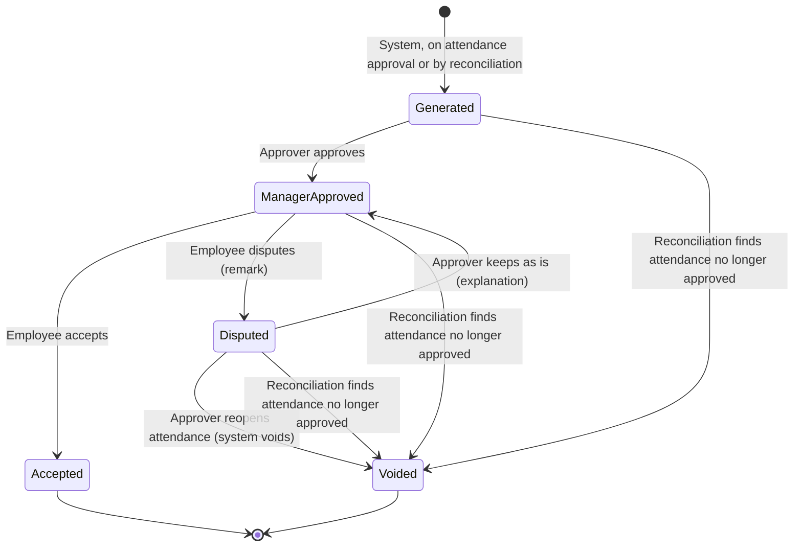

# PMS – BRD-M4: Salary Management System (SMS)

Document ID: PMS-BRD-M4-SMS-v1.0
Module: Salary Management System (SMS)
Project: Payroll Management System (PMS) – proof of concept (POC), Step 3 BRD
Author: Rajesh Verma (Enterprise Architect)
Date: November 2026

## 1. Document control

### 1.1 Version / revision history

| Version | Revision | Date | Author | Change remark |
| --- | --- | --- | --- | --- |
| 1.0 | 0.1 | 19-Nov-2026 | Rajesh Verma | First draft from UX v1.0 (D-34), PMS-BRD v1.0 rev 0.9 and decisions D-01 to D-90 |
| 1.0 | 0.2 | 20-Nov-2026 | Rajesh Verma | BRD set consistency check (D-103): references to PMS-BRD rev 0.14, PMS-BRD-M2-AMS rev 0.2 and D-01 to D-103; BR-CMN-11, 14, 19 in §8; Voided status meaning (D-90) |
| 1.0 | 0.3 | 20-Nov-2026 | Rajesh Verma | Business open items decided (D-104): OI-02 and OI-04 shown as closed in §14 and §16 (no requirement change) |

### 1.2 Review and approval

Names are added when the customer shares them.

| Role | Name | Date | Decision |
| --- | --- | --- | --- |
| Product owner | Rajesh Verma | | |
| Business analyst | [BA] | | |
| Module business owner / SME | [HR Manager] | | |
| Module business owner / SME | [Finance Manager] | | |

## 2. Introduction

### 2.1 Purpose

This document defines the business requirements of the Salary Management System (SMS): generating a daily salary record automatically from each approved attendance day, approval of the record by the manager, acceptance or dispute by the employee, resolution of a dispute (keep as is, or reopen the attendance), voiding of records whose attendance is reopened, the nightly reconciliation and the earnings view for a period. Wages are never entered by hand (D-05, KPI-02).

Glossary (salary terms), roles, the end-to-end process, cross-module rules (BR-CMN), integrations and system-wide NFRs are in the anchor PMS-BRD and are referenced, not repeated. The shared dashboard and approvals inbox are in anchor §5.3; the reopen of attendance itself is in PMS-BRD-M2-AMS.

### 2.2 Reference documents

| # | Document | Version | Use |
| --- | --- | --- | --- |
| 1 | PMS-BRD (anchor) | v1.0 rev 0.14 | Glossary, roles, end-to-end process (steps 9–13), cross-module rules, integrations, system-wide NFRs |
| 2 | PMS-BRD-M2-AMS | v1.0 rev 0.2 | Attendance hand-over to salary (§3.3, §7.4), reopen after a salary dispute (§7.3) |
| 3 | UX Journey Index and UX Summaries SCR-SMS-01, SCR-SMS-02 (salary items on SCR-SH-03, SCR-SH-04) | v1.0 (D-34) | Journeys, screens, fields, actions |
| 4 | PMS – Business Requirements Document (baseline) §9 | v1.0 (D-09) | Salary entity, wage formula, rules SMS-R1 to R4, user stories SMS-US1 to US4 |
| 5 | Decision log | D-01 to D-103 | Approved decisions |

## 3. Module overview and scope

### 3.1 Overview

SMS keeps one salary record per approved attendance day. When the manager (or the Admin for the top-level employee) approves an attendance entry, the system generates the salary record as Generated: Day Hour from the attendance, the employee's current Hourly Wage Rate copied from EIMS, and Day Wage Amount = Day Hour × rate, rounded half up to 2 decimals, in INR (D-05, BR-CMN-13, D-90). Nobody can edit hours, rate or amount.

The approver approves the generated record (one or several at once) and cannot reject it (D-07). The employee then accepts it – one or several at once – or disputes it with a remark (D-33). A dispute goes back to the approver, who either keeps the record as it is with an explanation (the record returns to Manager Approved and the employee may accept or dispute again) or reopens the attendance: the attendance goes back to the employee as Rejected and the salary record is set to Voided; a new record is generated when the corrected attendance is approved again (BR-CMN-15, D-25).

A nightly reconciliation at 01:00 IST makes sure every approved attendance has exactly one non-voided salary record: it creates missing records, voids records whose attendance is no longer approved and logs any other mismatch (JOB-CMN-01, D-90). Approved leave earns no wage (BR-CMN-17).

SMS covers steps 9 to 13 of the end-to-end process (anchor §5.1) and journeys UJ-SMS-01 to UJ-SMS-04 and UJ-SYS-01 to UJ-SYS-03.

### 3.2 Scope

| In scope (POC) | Phase 2 / Future | Out of scope (reason) |
| --- | --- | --- |
| Automatic salary record per approved attendance day; rate copied at generation; amount rounded half up to 2 decimals (D-05, D-90) | Future: paid leave in salary (anchor §13.1) | Manual entry or editing of hours, rate or amount (baseline SMS-R4) |
| Manager (Admin for the top-level employee) approves generated records, one or several at once | Future: statutory deductions (PF, ESI, PT, TDS), allowances (anchor §13.1) | Rejecting a generated salary record – errors are fixed at the attendance (D-07) |
| Employee accepts (one or several) or disputes (one at a time, remark required); may dispute again after Keep as is (D-33, D-90) | Future: payslips and monthly payroll runs (anchor §13.1) | Auto-accept of records left in Manager Approved – dashboard reminders only (D-33) |
| Dispute resolution: Keep as is with explanation, or Reopen attendance (salary record Voided) | – | Rate history in EIMS – late or regenerated records use the current rate (D-90) |
| Voided records kept, hidden by default ("Show voided"), excluded from totals (D-25) | – | Disputing an Accepted record – acceptance is final |
| Nightly reconciliation 01:00 IST: create missing, void stale, log other mismatches (D-24, D-90) | – | – |
| My salary: earnings for a date range with tiles and period total; Team salary: Needs action, All records, team totals | – | – |

### 3.3 Hand-overs with other modules

| Direction (in / out) | Other module | What is handed over | When | Anchor rule / process ref |
| --- | --- | --- | --- | --- |
| In | AMS | Attendance approved: employee, date, from and to time, hours | On approval | INT-01, BR-CMN-17 |
| In | AMS | Attendance reopened, with the approver's reopen remarks | On reopen of a disputed day | INT-02, BR-CMN-15 |
| In | AMS | All approved attendance (for reconciliation) | Nightly, 01:00 IST | JOB-CMN-01 |
| In | EIMS | Current hourly wage rate | When a salary record is generated | INT-05, BR-CMN-13 |
| In | EIMS | Employee name, Manager Id, active flag; approver of the record (manager, or Admin for the top-level employee) | Approval and team views | INT-03, INT-04, BR-CMN-01, BR-CMN-08 |
| Out | AMS, Shell | Salary status of approved attendance ("Salary disputed") so the approver can reopen | Attendance history and approvals inbox opened | INT-10 |
| Out | Shell | Earnings this month tile, salary records to review, pending salary approvals and disputes, last reconciliation run | Dashboard or inbox opened | §5.3, FR-CMN-002, FR-CMN-007, INT-07 |
| – | LMS | Nothing: approved leave earns no wage | – | BR-CMN-17 |

## 4. Users and access

### 4.1 Users of this module

| Role id (anchor §4.2) | What they do in this module |
| --- | --- |
| ROLE-EMP | Views own salary records and earnings for a period; accepts own Manager Approved records (one or several); disputes them one at a time with a remark |
| ROLE-MGR | Everything an Employee does for own salary; approves direct reports' generated records (one or several); resolves their disputes with Keep as is or Reopen attendance; views their records and team totals |
| ROLE-ADM | For the top-level employee only: approves generated records and resolves disputes (D-58, D-63); no access to other employees' salary |
| SYS-SMS | Generates salary records on attendance approval and voids them when attendance is reopened (UJ-SYS-01, UJ-SYS-03) |
| SYS-REC | Nightly at 01:00 IST: creates missing records, voids records whose attendance is no longer approved, logs other mismatches (UJ-SYS-02) |

### 4.2 Role × screen access matrix

R = read, R/W = read and write, A = approve, — = no access.

| Screen id | Screen | Employee | Manager | Admin | Data scope |
| --- | --- | --- | --- | --- | --- |
| SCR-SMS-01 | My salary | R (own); accept / dispute own | R (own); accept / dispute own | — | Own |
| SCR-SMS-02 | Team salary review (Needs action / All records, team totals) | — | R, A (direct reports; approve, keep as is, reopen) | R, A (top-level employee only) | Manager: direct reports; Admin: top-level employee |
| SCR-SH-04 | Approvals inbox – salary items | — | A (direct reports) | A (top-level employee) | As SCR-SMS-02 |
| SCR-SH-03 | Dashboard – salary tile and to-do items | R (own) | R (own; approval counts) | R (last reconciliation run) | Own; Admin: system tile only |

A manager never sees their own salary records in SCR-SMS-02 or the approvals inbox (BR-CMN-08). The Admin's access to SCR-SMS-02 for the top-level employee is not yet in the UX summary (anchor OI-01); other SMS UX updates are tracked as anchor OI-10.

## 5. User journeys and screens

Requirement ids are assigned in §7 and listed in the traceability matrix (§15).

| Journey id | Journey | Actor | Screens | Requirement ids |
| --- | --- | --- | --- | --- |
| UJ-SMS-01 | Approve generated salary records | Manager (Admin for top-level) | SCR-SH-04 → SCR-SMS-02 | §7.2 |
| UJ-SMS-02 | Accept or dispute my salary | Employee | SCR-SH-03 → SCR-SMS-01 | §7.1 |
| UJ-SMS-03 | Resolve a dispute | Manager (Admin for top-level) | SCR-SMS-02 or SCR-SH-04 (Reopen continues in AMS, UJ-AMS-04) | §7.2 |
| UJ-SMS-04 | See my earnings for a period | Employee | SCR-SMS-01 | §7.1 |
| UJ-SYS-01 | Generate salary record | System (salary service) | – (record appears in SCR-SMS-02, SCR-SH-04) | §7.3 |
| UJ-SYS-02 | Nightly salary reconciliation (01:00 IST) | System (reconciliation job) | – (last run on the Admin dashboard, SCR-SH-03) | §7.3 |
| UJ-SYS-03 | Void salary on reopened attendance | System (salary service) | – (record shown as Voided in SCR-SMS-01, SCR-SMS-02) | §7.3 |

## 6. Status lifecycle

### 6.1 Salary record lifecycle

| Status code | Status | Business meaning | Set by |
| --- | --- | --- | --- |
| GENERATED | Generated | Created by the system from approved attendance; waiting for the approver; cannot be rejected (D-07) | System (SYS-SMS, SYS-REC) |
| MANAGER_APPROVED | Manager Approved | Approved by the approver; waiting for the employee to accept or dispute; counts in earnings (FR-CMN-002) | Manager / Admin |
| ACCEPTED | Accepted | Confirmed by the employee; final; counts in earnings | Employee |
| DISPUTED | Disputed | Questioned by the employee with a remark; waiting for the approver to keep as is or reopen the attendance; not counted in earnings; the attendance shows "Salary disputed" (INT-10) | Employee |
| VOIDED | Voided | No longer valid because the linked attendance was reopened or, as found by the nightly reconciliation, is no longer Approved (D-90); final; kept for history, hidden by default, excluded from every total; void reason kept (D-25, BR-CMN-16) | System (SYS-SMS, SYS-REC) |

Only one non-voided salary record exists per attendance (D-25, NFR-06). Salary records are never deleted; Is Active is not set by any user action (BR-CMN-06).

| From | To | Action | Actor | Condition / rule |
| --- | --- | --- | --- | --- |
| – | Generated | Generate | System (on INT-01, or reconciliation) | Attendance Approved; no non-voided record exists for it; rate = current EIMS rate at generation (BR-CMN-13, INT-05, D-90) |
| Generated | Manager Approved | Approve (one or several) | Manager of the employee; Admin for the top-level employee | Not own record (BR-CMN-08); record still Generated and its attendance still Approved, otherwise refused with a refresh message (FR-CMN-014, D-90); BR-CMN-12 |
| Manager Approved | Accepted | Accept (one or several) | Employee (owner) | D-33; Accepted Date set (D-90) |
| Manager Approved | Disputed | Dispute | Employee (owner) | Dispute remark required, up to 500 characters; one record at a time; Disputed Date set; allowed again after Keep as is (D-90) |
| Disputed | Manager Approved | Keep as is | Manager / Admin, as for approve | Explanation required, up to 500 characters (BR-CMN-03, D-33); dispute remark kept (D-90) |
| Disputed | Voided | Reopen attendance (in AMS; system voids the record) | Manager / Admin; system | Reopen remarks required (BR-CMN-03); attendance back to Rejected (BR-CMN-15, INT-02); void reason kept |
| Generated, Manager Approved, Disputed | Voided | Reconcile | System (SYS-REC) | Linked attendance is no longer Approved (missed reopen hand-over) (JOB-CMN-01, D-90) |

## 7. Functional requirements

All requirements are priority Must and phase POC. Salary items in the approvals inbox (SCR-SH-04) follow FR-CMN-010 to FR-CMN-014 (anchor §5.3) with the same rules as SCR-SMS-02 (§7.2); the dashboard tile and to-do items are in §12.

### 7.1 SCR-SMS-01 – My salary

| Req id | Requirement | Priority | Phase | UX ref | Acceptance criteria (Given / When / Then) |
| --- | --- | --- | --- | --- | --- |
| FR-SMS-001 | Tiles for the selected period show: Earned in period (amount of Manager Approved and Accepted records); To review (count and amount of Manager Approved records); Waiting for manager (count of Generated records); Disputed (count, "With your manager"). Generated, Disputed and Voided records are not counted in earnings. | Must | POC | SCR-SMS-01, FR-CMN-002, BR-CMN-16 | Given in the period one Accepted record of ₹ 2,125.00, one Manager Approved of ₹ 2,250.00 and one Disputed, then Earned shows ₹ 4,375.00 and Disputed shows 1. |
| FR-SMS-002 | A period filter (From, To) defaults to the first day of the current month to today; From must be on or before To. A "Show voided" toggle is off by default. Tiles, table and total update when the period or toggle changes. | Must | POC | SCR-SMS-01, UJ-SMS-04, D-25 | Given the screen opens on 19 Nov 2026, then the period is 01 Nov 2026 to 19 Nov 2026 and voided records are hidden. |
| FR-SMS-003 | The table lists one row per salary record in the period, newest date first: date, attendance from–to time, hours (2 decimals), rate (₹ per hour), amount (₹, 2 decimals), status and notes. The employee's current hourly wage rate is shown above the table. | Must | POC | SCR-SMS-01 | Given a record for Mon 02 Nov, 09:00–17:30, then the row shows 8.50 h × 250.00 = ₹ 2,125.00. |
| FR-SMS-004 | Notes show the latest dispute remark ("Your remark"), the approver's Keep as is explanation, or the void reason, whichever applies. | Must | POC | SCR-SMS-01, D-90 | Given a dispute closed with Keep as is, then the row shows both the employee's remark and the approver's explanation. |
| FR-SMS-005 | With "Show voided" on, voided records are listed greyed, with the amount struck through, a "Voided" text badge and the void reason; they are never counted in tiles or totals. | Must | POC | SCR-SMS-01, D-25, BR-CMN-16 | Given a voided record and its regenerated replacement on the same date, when Show voided is on, then both rows are listed and only the replacement counts in the total. |
| FR-SMS-006 | A footer shows the total earned in the period (Manager Approved and Accepted; excluding Generated, Disputed and Voided). | Must | POC | SCR-SMS-01, UJ-SMS-04 | Given the period changes, then the footer total equals the Earned tile. |
| FR-SMS-007 | Accept is offered on each Manager Approved row; the record becomes Accepted and final: "Salary for <date> accepted." | Must | POC | SCR-SMS-01, UJ-SMS-02, D-05 | Given a Manager Approved record, when the employee clicks Accept, then it is Accepted and no further action is offered. |
| FR-SMS-008 | Manager Approved rows have a checkbox; Accept selected accepts all selected rows: "<n> salary record(s) accepted." Records that fail stay selected with their own error; the others are accepted. | Must | POC | SCR-SMS-01, D-33 | Given 3 rows selected, when the employee clicks Accept selected, then all 3 are Accepted. |
| FR-SMS-009 | Dispute is offered on each Manager Approved row, one at a time. A dialog explains what happens (the approver reviews it; if the attendance was wrong it is reopened, this record is voided and a new one is generated), shows date, times, hours × rate = amount, and asks "What is wrong?" (required, up to 500 characters). On confirmation the record becomes Disputed: "Dispute sent to <approver>." | Must | POC | SCR-SMS-01, UJ-SMS-02, BR-CMN-03 | Given an empty remark, when the employee confirms, then "A remark is required to dispute." is shown and nothing changes. |
| FR-SMS-010 | After the approver closes a dispute with Keep as is, the record is Manager Approved again with the explanation, and the employee can accept it or dispute it again. | Must | POC | D-33, D-90 | Given a record returned with Keep as is, then Accept and Dispute are offered again. |
| FR-SMS-011 | Only Manager Approved records offer actions; Generated, Accepted, Disputed and Voided records offer none. If the record was changed meanwhile, the action fails and the employee is told to refresh. | Must | POC | SCR-SMS-01, FR-CMN-014 | Given a record voided after the page opened, when the employee clicks Accept, then the record stays Voided and the refresh message is shown. |
| FR-SMS-012 | Manager Approved records are never accepted automatically; they stay waiting and the dashboard keeps showing them as salary records to review. | Must | POC | D-33, FR-CMN-003 | Given a record left in Manager Approved for 30 days, then it is still Manager Approved and listed in "Things to do". |
| FR-SMS-013 | With no records in the period: "No salary records in this period."; with nothing to review the To review tile shows 0 and no checkboxes are shown; if the data cannot be loaded, an alert with Retry is shown. | Must | POC | SCR-SMS-01 | Given a new employee with no approved attendance, then the empty message is shown. |
| FR-SMS-014 | A manager also sees a Team tab, with the Needs action count, leading to SCR-SMS-02. | Must | POC | SCR-SMS-01 | Given an Employee without the Manager role, then no Team tab is shown. |

**User stories**

| Id | As a | I want to | So that | Baseline |
| --- | --- | --- | --- | --- |
| US-SMS-01 | Employee | accept or dispute my salary records | errors are raised and corrected | SMS-US3 |
| US-SMS-02 | Employee | accept several salary records at once | reviewing a month's wages is quick | – (D-33) |
| US-SMS-03 | Employee | view my salary records and total for a date range | I know what I have earned | SMS-US4 |

### 7.2 SCR-SMS-02 – Team salary review

| Req id | Requirement | Priority | Phase | UX ref | Acceptance criteria (Given / When / Then) |
| --- | --- | --- | --- | --- | --- |
| FR-SMS-020 | The Team tab has Needs action (with count) and All records, with filters for team member, date range and "Show voided". Needs action lists every Generated and Disputed record regardless of the date range, disputes first, then newest date. All records and team totals default to the first day of the current month to today and include reports who became inactive, marked Inactive. | Must | POC | SCR-SMS-02, D-90 | Given a Generated record from last month, then it is listed in Needs action although the date range is the current month. |
| FR-SMS-021 | Rows show employee name and Employee Id, date, hours, rate, amount, status and notes (the employee's dispute remark, the Keep as is explanation or the void reason). Voided records are shown as in FR-SMS-005 when "Show voided" is on. | Must | POC | SCR-SMS-02 | Given a Disputed record, then the employee's remark is shown in Notes. |
| FR-SMS-022 | The approver approves one Generated row or several selected rows; each becomes Manager Approved: "Approved. <name> can now review it." / "<n> salary record(s) approved. Employees can now review them." Only Generated rows can be selected. | Must | POC | SCR-SMS-02, UJ-SMS-01, BR-CMN-12 | Given 4 Generated rows selected, when the approver approves, then all 4 are Manager Approved and appear in the employees' To review tiles. |
| FR-SMS-023 | A generated record cannot be rejected; the screen states that generated records can only be approved and that a wrong wage is fixed at the attendance. | Must | POC | SCR-SMS-02, D-07 | Given a Generated row, then no Reject action is offered. |
| FR-SMS-024 | Approving fails for a record that is no longer Generated or whose attendance is no longer Approved, with a message to refresh; in a bulk approval the failed records stay selected with their own error and the others are approved. | Must | POC | FR-CMN-014, D-90 | Given one of 3 selected records was voided meanwhile, when the approver approves, then 2 are Manager Approved and the voided one stays selected with the refresh message. |
| FR-SMS-025 | Keep as is on a Disputed row opens a dialog showing employee, date, amount and the employee's remark, explaining that the record goes back to Manager Approved for the employee to accept again, and asking for an explanation (required, up to 500 characters). On confirmation the record is Manager Approved: "Dispute closed. <name> can accept the record." | Must | POC | SCR-SMS-02, UJ-SMS-03, D-33, BR-CMN-03 | Given an empty explanation, then "An explanation is required." is shown and the record stays Disputed. |
| FR-SMS-026 | Reopen attendance on a Disputed row opens a dialog explaining the effect (attendance back to the employee as Rejected; this salary record Voided; a new one generated when the corrected attendance is approved) and asking for remarks for the employee (required, up to 500 characters). On confirmation the attendance is reopened (FR-AMS-025) and the salary record is Voided with the reason: "Attendance reopened. Salary record voided." | Must | POC | SCR-SMS-02, UJ-SMS-03, UJ-AMS-04, BR-CMN-15, INT-02 | Given a disputed record, when the approver confirms Reopen with remarks, then the attendance is Rejected and the salary record is Voided. |
| FR-SMS-027 | A "Team totals in period" table shows per employee, for the filters set: approved hours and earned amount (Manager Approved and Accepted records) and the number of open items (Generated and Disputed). | Must | POC | SCR-SMS-02, BR-CMN-16 | Given a report with one Accepted 8.00 h record and one Voided 9.00 h record, then the totals show 8.00 h. |
| FR-SMS-028 | A manager sees and decides only direct reports' salary records, never their own; the Admin sees and decides only the top-level employee's records. | Must | POC | BR-CMN-01, BR-CMN-08, D-58 | Given a manager opens Team, then their own salary records are not listed. |
| FR-SMS-029 | With nothing to act on: "Nothing needs action – All generated records are approved and there are no open disputes."; if the data cannot be loaded, an alert with Retry is shown. | Must | POC | SCR-SMS-02 | Given no Generated or Disputed records, then the message is shown. |

**User stories**

| Id | As a | I want to | So that | Baseline |
| --- | --- | --- | --- | --- |
| US-SMS-04 | Manager | approve my team's generated salary records | wages are confirmed before the employee sees them as final | SMS-US2 |
| US-SMS-05 | Manager | close a dispute as is, or reopen the attendance when it was wrong | every dispute ends with a correct wage | – (D-07, D-33) |

### 7.3 Salary generation, voiding and reconciliation (system)

| Req id | Requirement | Priority | Phase | UX ref | Acceptance criteria (Given / When / Then) |
| --- | --- | --- | --- | --- | --- |
| FR-SMS-040 | When attendance is approved, the system creates one salary record as Generated: employee, link to the attendance, work date, Day Hour = the attendance hours, Day Wage Rate = the employee's current hourly wage rate from EIMS, Day Wage Amount = Day Hour × rate rounded half up to 2 decimals, INR. | Must | POC | UJ-SYS-01, INT-01, INT-05, D-05, D-90 | Given attendance 09:00–17:30 approved and a rate of ₹ 250.00, then a Generated record of 8.50 h and ₹ 2,125.00 exists within 1 minute (NFR-01). |
| FR-SMS-041 | Only one non-voided salary record exists per attendance: a repeated hand-over for the same approval creates nothing new; after a void, the next approval of the corrected attendance creates a new record. | Must | POC | UJ-SYS-01, D-25, NFR-06 | Given the same approval is handed over twice, then one non-voided record exists. |
| FR-SMS-042 | When attendance is reopened, the system sets its non-voided salary record to Voided and keeps the reason (the approver's reopen remarks and the reopen date). | Must | POC | UJ-SYS-03, INT-02, D-25 | Given a reopen with remarks "Out time was 17:00", then the record is Voided and the reason shows those remarks. |
| FR-SMS-043 | Every day at 01:00 IST the reconciliation compares all approved attendance with the salary records: it creates a Generated record (as FR-SMS-040, current rate) for approved attendance without a non-voided record, and sets to Voided any non-voided record whose attendance is no longer Approved, with a reason stating it was voided by reconciliation. | Must | POC | UJ-SYS-02, JOB-CMN-01, D-24, D-90 | Given an approval whose hand-over was lost, when reconciliation runs, then the missing record is created as Generated. |
| FR-SMS-044 | Other mismatches (for example more than one non-voided record for one attendance, or hours that differ from the attendance) are logged and not changed. | Must | POC | UJ-SYS-02, D-90 | Given a record whose hours differ from its attendance, when reconciliation runs, then the record is unchanged and a mismatch is logged. |
| FR-SMS-045 | Every reconciliation run is logged with start and end time, result, records created, records voided and mismatches logged; the Admin dashboard shows the last run (FR-CMN-007). The run finishes in under 5 minutes (NFR-01). | Must | POC | UJ-SYS-02, SCR-SH-03, D-59, D-90 | Given last night's run created 2 records, then the Admin tile shows the run time, its result and "2 created". |
| FR-SMS-046 | SMS provides the salary status of approved attendance to AMS and the shell; attendance whose salary record is Disputed is marked "Salary disputed" and can be reopened. | Must | POC | INT-10, FR-AMS-024 | Given a Disputed record, then the attendance shows "Salary disputed" in team attendance history. |

**User stories**

| Id | As a | I want to | So that | Baseline |
| --- | --- | --- | --- | --- |
| US-SMS-06 | System | calculate the day wage when attendance is approved | wages are accurate and need no manual entry | SMS-US1 |

## 8. Business and validation rules

| Rule id | Rule | Type (business / validation) | Applies to (screen / function) | Source (decision / UX) |
| --- | --- | --- | --- | --- |
| VR-SMS-01 | To dispute, a remark is required: not blank, up to 500 characters. | Validation | SCR-SMS-01 | BR-CMN-03; UX SCR-SMS-01 |
| VR-SMS-02 | To close a dispute with Keep as is, an explanation is required: not blank, up to 500 characters. | Validation | SCR-SMS-02, SCR-SH-04 | BR-CMN-03, D-33; UX SCR-SMS-02 |
| VR-SMS-03 | In the period and date range filters, From is on or before To. | Validation | SCR-SMS-01, SCR-SMS-02 | UX SCR-SMS-01 |
| VR-SMS-04 | An action is accepted only on a record in the status that allows it (§6.1): approve on Generated with the attendance still Approved; accept and dispute on own Manager Approved; Keep as is and Reopen on Disputed. Otherwise it is refused with a message to refresh. | Validation | SCR-SMS-01, SCR-SMS-02, SCR-SH-04 | FR-CMN-014, D-90 |
| BR-SMS-01 | A salary record is generated automatically, once, when attendance is approved; there is at most one non-voided salary record per attendance. | Business | UJ-SYS-01, UJ-SYS-02 | D-05 (S4), D-25; baseline SMS-R1 |
| BR-SMS-02 | The hourly wage rate is copied into the record when it is generated – also when it is generated late by the reconciliation or again after a reopen – so later rate changes do not alter it. | Business | UJ-SYS-01, UJ-SYS-02 | BR-CMN-13, D-90; baseline SMS-R2 |
| BR-SMS-03 | Only approved attendance generates a salary record; approved leave earns no wage. | Business | UJ-SYS-01 | BR-CMN-17, D-05 (S6); baseline SMS-R3 |
| BR-SMS-04 | No one – employee, manager or Admin – enters or edits Day Hour, Day Wage Rate or Day Wage Amount. | Business | All SMS screens | D-05; baseline SMS-R4 |
| BR-SMS-05 | Day Hour = the approved attendance hours (2 decimals). Day Wage Amount = Day Hour × Day Wage Rate, rounded half up to 2 decimals, INR. Totals are the sum of the rounded amounts. | Business | UJ-SYS-01, SCR-SMS-01, SCR-SMS-02 | D-05 (S2, S3), D-90, BR-CMN-18 |
| BR-SMS-06 | A generated record can be approved but not rejected; a wrong wage is corrected through a dispute and a reopen of the attendance. | Business | SCR-SMS-02, SCR-SH-04 | D-07 (O2) |
| BR-SMS-07 | The employee accepts one or several Manager Approved records at once, or disputes them one at a time. Accepted is final. Records are never accepted automatically. | Business | SCR-SMS-01 | D-05 (S5), D-33 |
| BR-SMS-08 | A dispute is closed by the approver either with Keep as is (record back to Manager Approved) or by reopening the attendance (record Voided). After Keep as is the employee may dispute again; there is no limit. | Business | SCR-SMS-02, SCR-SH-04 | D-07 (O1), D-33, D-90 |
| BR-SMS-09 | Earnings and totals count Manager Approved and Accepted records only; Generated, Disputed and Voided records are excluded. | Business | SCR-SMS-01, SCR-SMS-02, SCR-SH-03 | FR-CMN-002, BR-CMN-16, D-25 |
| BR-SMS-10 | Voided is set only by the system and is final; voided records are kept with their void reason, hidden unless "Show voided" is on. | Business | UJ-SYS-02, UJ-SYS-03, SCR-SMS-01, SCR-SMS-02 | D-25 |
| BR-SMS-11 | The nightly reconciliation (01:00 IST) creates missing records for approved attendance, voids non-voided records whose attendance is no longer Approved, and only logs any other mismatch. | Business | UJ-SYS-02 | JOB-CMN-01, D-24, D-90 |
| BR-SMS-12 | The latest dispute remark and the approver's Keep as is explanation are kept as separate values; earlier dispute rounds remain in the audit trail. The system records the Accepted Date and the Disputed Date. | Business | SCR-SMS-01, SCR-SMS-02 | D-90, NFR-05 |
| BR-SMS-13 | In team views, Needs action shows every Generated and Disputed record regardless of the date range; All records and team totals default to the current month to today and include inactive reports. | Business | SCR-SMS-02 | D-90 |

Cross-module rules that also apply: BR-CMN-01 to BR-CMN-03, BR-CMN-06 to BR-CMN-08, BR-CMN-11 to BR-CMN-19 (anchor §6). BR-CMN-04 and BR-CMN-05 apply through AMS: a salary error is corrected by reopening and resubmitting the attendance.

## 9. Data requirements

"Mandatory" means always present once the record exists; all attributes except the dispute remark and the Keep as is explanation are set by the system or taken from other modules. The hourly wage rate is classed as sensitive (D-71); the wage amount derived from it is treated the same way. Salary data is shown only within the role's data scope (anchor §4.3); the Admin sees only the top-level employee's records.

### 9.1 Salary record

| Attribute | Description | Type / format | Mandatory | Validation (VR id) | Set by | Sensitive (Y / N) |
| --- | --- | --- | --- | --- | --- | --- |
| Salary Id | Unique identifier | System key | Y | – | System | N |
| Employee Id | Owner of the record | Employee Id | Y | – | System (from the attendance) | N |
| Attendance Id | Link to the approved attendance; at most one non-voided record per attendance | Attendance key | Y | BR-SMS-01 | System | N |
| Work Date | Date worked, from the attendance | Date, IST | Y | – | System | N |
| Attendance from and to time | Shown on screens from the linked attendance; how SMS holds them is designed in the HLD | Time, HH:MM | – (shown) | – | AMS (INT-01) | N |
| Day Hour | Hours worked | Decimal, 2 places | Y | BR-SMS-05 | System | N |
| Day Wage Rate | Hourly wage rate copied from EIMS at generation | Decimal, INR, 2 places | Y | BR-SMS-02 | System (INT-05) | Y |
| Day Wage Amount | Day Hour × Day Wage Rate, rounded half up | Decimal, INR, 2 places | Y | BR-SMS-05 | System | Y |
| Status | Salary status (§6.1) | Generated, Manager Approved, Accepted, Disputed, Voided | Y | VR-SMS-04 | System on action | N |
| Approver Id, Approved Date | Who approved the record or last closed a dispute with Keep as is, and when | Employee Id or Admin; date and time, IST | – | – | System (BR-CMN-02) | N |
| Remarks | Void reason (reopen remarks and date, or reconciliation) | Text ≤ 500 | – | – | System (BR-CMN-02, D-25) | N |
| Dispute Remark | Employee's latest dispute remark | Text ≤ 500 | – (required to dispute) | VR-SMS-01 | Employee | N |
| Resolution Explanation | Approver's latest Keep as is explanation | Text ≤ 500 | – (required for Keep as is) | VR-SMS-02 | Approver | N |
| Disputed Date | When the employee last disputed the record | Date and time, IST | – | BR-SMS-12 | System | N |
| Accepted Date | When the employee accepted the record | Date and time, IST | – | BR-SMS-12 | System | N |
| Is Active | Soft-delete flag (BR-CMN-06); no user action sets it in the POC | Yes / No | Y | – | System | N |
| Created By, Created Date, Updated By, Updated Date | Audit fields; Created By is the system | User id; date and time, IST | Y | – | System (BR-CMN-07) | N |

Earlier dispute remarks and explanations are kept in the audit trail, not as attributes (BR-SMS-12). The reconciliation run log (start and end time, result, records created and voided, mismatches) is a job log, not a business entity (anchor C-01); it is designed in the HLD.

## 10. Notifications and alerts

All notifications are in-app (anchor C-05): dashboard, approvals inbox and screen states. No reminder is ever replaced by an automatic decision (D-33).

| Id | Event / trigger | Recipient(s) | Channel (in-app / email) | Timing | Message summary |
| --- | --- | --- | --- | --- | --- |
| NOT-SMS-01 | Salary record generated | Approver (manager; Admin for the top-level employee) | In-app: approvals inbox (Salary tab), Approvals count, dashboard approval card, Needs action on SCR-SMS-02 | Immediately (within 1 minute of attendance approval, NFR-01) | New "Salary" item with employee, date, hours and amount |
| NOT-SMS-02 | Salary record approved by the approver | Employee | In-app: dashboard "Things to do" (salary records to review); To review tile on My salary | Immediately | "<n> salary record(s) to review" with the amount |
| NOT-SMS-03 | Record still waiting for acceptance | Employee | In-app: dashboard "Things to do" and To review tile (FR-SMS-012) | Each time the dashboard or My salary opens, until accepted or disputed | Count and amount of records to accept or dispute |
| NOT-SMS-04 | Salary record disputed | Approver | In-app: approvals inbox item with the employee's remark, Approvals count, dashboard approval card; disputes listed first in Needs action | Immediately | "Disputed" item with employee, date, amount and remark |
| NOT-SMS-05 | Dispute closed with Keep as is | Employee | In-app: record back in To review with the approver's explanation; dashboard "Things to do" | Immediately | "Dispute closed" with the approver's explanation; accept or dispute again |
| NOT-SMS-06 | Salary record voided (attendance reopened, or by reconciliation) | Employee; approver | In-app: record shown as Voided with the reason when "Show voided" is on; removed from Needs action. The reopened attendance itself is notified by NOT-AMS-04 | Immediately (reconciliation: after the 01:00 IST run) | Status Voided with the void reason |
| NOT-SMS-07 | Reconciliation run finished | Admin | In-app: last reconciliation run tile on the Admin dashboard (FR-CMN-007, FR-SMS-045) | After each run at 01:00 IST | Run time, result, records created and voided, mismatches logged |

## 11. Scheduled jobs and integrations

SMS runs the cross-module job JOB-CMN-01 and takes part in these anchor integrations (anchor §7); it has no module-only job.

| Id | Name | Type (event / API / scheduled) | Trigger / schedule | Source → target | Business outcome |
| --- | --- | --- | --- | --- | --- |
| INT-01 | Attendance approved | Event | Attendance approval | AMS → SMS | Salary record generated (FR-SMS-040, FR-SMS-041) |
| INT-02 | Attendance reopened | Event | Reopen of a disputed day | AMS → SMS | Salary record voided with the reason (FR-SMS-042) |
| JOB-CMN-01 | Nightly salary reconciliation | Scheduled | Daily 01:00 IST | AMS → SMS | Missing records created, stale records voided, other mismatches logged; last run on the Admin dashboard (FR-SMS-043 to FR-SMS-045) |
| INT-03, INT-04 | Employee details and approver | API | Generation, approval and team views | EIMS → SMS | Employee name, Manager Id, active flag; approver of each record (FR-SMS-028) |
| INT-05 | Hourly wage rate | API | Salary record generation | EIMS → SMS | Current rate copied into the record (BR-SMS-02) |
| INT-07 | Dashboard and approvals inbox | API | Dashboard or inbox opened | SMS → Shell | Items in §12; NOT-SMS-01 to 07 |
| INT-10 | Salary status for attendance | API | Attendance history or approvals inbox opened | SMS → AMS, Shell | "Salary disputed" and Reopen offered (FR-SMS-046) |

## 12. Reporting and dashboard

| Id | Report / widget | Audience | Content | Filters |
| --- | --- | --- | --- | --- |
| RPT-SMS-01 | Earnings this month tile (dashboard) | Employee, Manager | Amount of Manager Approved and Accepted records in the current month; Voided, Disputed and Generated excluded (FR-CMN-002, BR-SMS-09) | – |
| RPT-SMS-02 | "Things to do" items (dashboard) | Employee, Manager | Salary records to review (Manager Approved) | – |
| RPT-SMS-03 | Waiting for your approval – Salary | Manager, Admin | Count of Generated and Disputed records to act on | – |
| RPT-SMS-04 | Last reconciliation run tile (dashboard) | Admin | Run time, result, records created and voided, mismatches logged (FR-SMS-045) | – |
| RPT-SMS-05 | My salary tiles and period total | Employee, Manager | Earned in period, To review, Waiting for manager, Disputed; period total (FR-SMS-001, FR-SMS-006) | Period (default current month to today), Show voided |
| RPT-SMS-06 | Team totals in period | Manager, Admin | Per employee: approved hours, earned amount, open items (FR-SMS-027) | Team member, date range (default current month to today), Show voided |
| RPT-SMS-07 | Team salary – All records | Manager, Admin | All records with status and notes, incl. inactive reports (FR-SMS-020, FR-SMS-021) | Team member, date range, Show voided |

## 13. Module non-functional requirements and volumetrics

System-wide NFRs (anchor §8) apply; SMS has no module-specific additions. Generation within 1 minute and the reconciliation run under 5 minutes are NFR-01; void reasons, dispute remarks and explanations are covered by NFR-05; one non-voided record per approved attendance and 2-decimal amounts by NFR-06 (KPI-02, KPI-04).

| Volume type | Year 1 | Growth % per year | Peak |
| --- | --- | --- | --- |
| Salary records generated | About 26,400 (one per approved attendance, anchor §8.1), plus regenerated records after reopens | 0 % (20 % headroom) | Anchor daily peaks; month-end approval catch-up |
| Salary approvals and acceptances | About 26,400 each (often several at once) | 0 % | Month-end |
| Disputes, Keep as is, voids | Not estimated (expected rare) | – | – |
| Reconciliation runs | 365 (one per night) | 0 % | Daily 01:00 IST |

## 14. Assumptions, constraints and dependencies

| Type | Id | Statement |
| --- | --- | --- |
| Assumption | A-SMS-01 | Employees review their salary records regularly, helped by dashboard reminders; there is no deadline for accepting a record (D-33). |
| Assumption | A-SMS-02 | Approvers check the attendance before approving it, so most wage errors are caught before a salary record exists (BR-SMS-06). |
| Constraint | C-SMS-01 | SMS calculates daily wages only; no deductions, allowances, payslips or payroll runs in the POC (anchor §3.3). |
| Constraint | C-SMS-02 | Amounts are in INR with 2 decimals and dates and times in IST (BR-CMN-18). |
| Constraint | C-SMS-03 | EIMS keeps only the current hourly wage rate; records generated late or after a reopen use the rate at the time of generation (D-90). |
| Dependency | DEP-SMS-01 | AMS provides attendance approval and reopen hand-overs and all approved attendance for the reconciliation (INT-01, INT-02, JOB-CMN-01; anchor DEP-02 message broker, DEP-03 build order). |
| Dependency | DEP-SMS-02 | EIMS provides the hourly wage rate, employee details and approver (INT-03 to INT-05). |
| Dependency | DEP-SMS-03 | Open items OI-02 and OI-04 (anchor §12) were decided before approval (D-104, anchor DEP-06); OI-01, OI-06 and OI-10 are closed before HLD Part02. |

## 15. Traceability matrix

| Journey id | Screen id | Req id | Rule ids | Test ref (later) |
| --- | --- | --- | --- | --- |
| UJ-SMS-01 | SCR-SH-04, SCR-SMS-02 | FR-SMS-020, 021, 022, 023, 024, 027, 028, 029 | VR-SMS-03, 04; BR-SMS-06, 09, 13; BR-CMN-01, 08, 12 | |
| UJ-SMS-02 | SCR-SH-03, SCR-SMS-01 | FR-SMS-003, 004, 007, 008, 009, 010, 011, 012, 013 | VR-SMS-01, 04; BR-SMS-04, 07, 08, 12; BR-CMN-03 | |
| UJ-SMS-03 | SCR-SMS-02, SCR-SH-04 (Reopen continues in UJ-AMS-04) | FR-SMS-025, 026, 046 | VR-SMS-02, 04; BR-SMS-08, 12; BR-CMN-03, 15 | |
| UJ-SMS-04 | SCR-SMS-01 | FR-SMS-001, 002, 005, 006, 014 | VR-SMS-03; BR-SMS-09, 10; BR-CMN-16, 18 | |
| UJ-SYS-01 | – (SCR-SMS-02, SCR-SH-04) | FR-SMS-040, 041 | BR-SMS-01 to 05; BR-CMN-13, 17, 18 | |
| UJ-SYS-02 | SCR-SH-03 | FR-SMS-043, 044, 045 | BR-SMS-01, 02, 11 | |
| UJ-SYS-03 | SCR-SMS-01, SCR-SMS-02 | FR-SMS-042 | BR-SMS-10; BR-CMN-15, 16 | |

## 16. Open items

Cross-module open items that affect SMS are in the anchor §12: OI-01 (Admin opens SCR-SMS-02 for the top-level employee), OI-02 (pending items of a deactivated employee, incl. salary records waiting for approval or acceptance), OI-04 (pending salary approvals and disputes on a manager change; OI-02 and OI-04 closed, D-104), OI-06 (UX Journey Index reconciliation time "TBD", set to 01:00 IST) and OI-10 (SMS UX updates). SMS has no module-only open items.

| Id | Question | Owner | Due | Status / decision |
| --- | --- | --- | --- | --- |
| – | None | – | – | – |

## 17. Appendix

### 17.1 Future scope (not in this phase)

| Area | Requirement ref | Note |
| --- | --- | --- |
| Wages | Anchor §13.1 | Paid leave in salary |
| Payroll | Anchor §13.1 | Statutory deductions (PF, ESI, PT, TDS), allowances, payslips, monthly payroll runs |
| Approvals | Anchor §13.1, R-02 | Delegation of approvals when a manager is absent |
