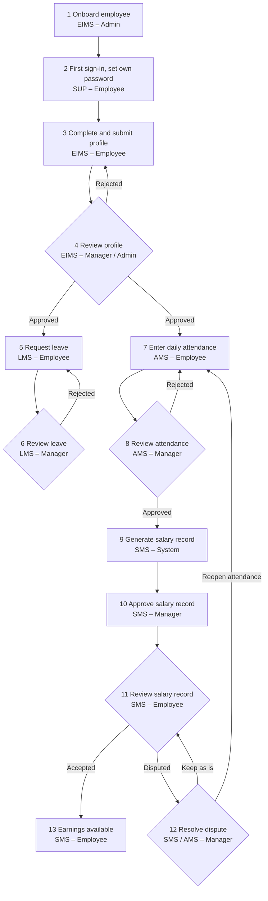

# PMS – Business Requirements Document (BRD) – Anchor

Document ID: PMS-BRD-v1.0
Scope: business context, roles, end-to-end process, cross-module rules and system-wide NFRs; module requirements are in the module BRDs
Project: Payroll Management System (PMS) – proof of concept (POC), Step 3 BRD
Author: Rajesh Verma (Enterprise Architect)
Date: November 2026

## 1. Document control

### 1.1 Version / revision history

| Version | Revision | Date | Author | Change remark |
| --- | --- | --- | --- | --- |
| 1.0 | 0.1 | 18-Nov-2026 | Rajesh Verma | First draft from UX v1.0 (D-34), BRD v1.0 baseline (D-09) and decisions D-01 to D-54 |
| 1.0 | 0.2 | 18-Nov-2026 | Rajesh Verma | All sections drafted and reviewed section by section (decisions D-55 to D-69); ready for stakeholder review |
| 1.0 | 0.3 | 18-Nov-2026 | Rajesh Verma | Profile change request introduced (D-70): BR-CMN-05, BR-CMN-11, glossary, scope, OBJ-07, C-01, NFR-05, FR-CMN-010 updated; OI-07; future scope for reactivation and pre-boarding; INT-09 (D-73) |
| 1.0 | 0.4 | 18-Nov-2026 | Rajesh Verma | RPT prefix in §2.5; EIMS status in §2.3 and §11 (D-76) |
| 1.0 | 0.5 | 19-Nov-2026 | Rajesh Verma | BR-CMN-10 clarified for draft and rejected attendance; INT-10; OI-08 (D-77) |

### 1.2 Review and approval

Names are added when the customer shares them.

| Role | Name | Date | Decision |
| --- | --- | --- | --- |
| Product owner | Rajesh Verma | | |
| Business analyst | [BA] | | |
| Business stakeholder | [HR Manager] | | |
| Business stakeholder | [Finance Manager] | | |

## 2. Introduction

### 2.1 Purpose

The PMS BRD set defines what the Payroll Management System POC must do, for whom and under which business rules. It turns the approved UX (Step 2) and the approved decisions into traceable, numbered requirements.

This anchor holds everything that spans modules: business context, roles, the end-to-end process, cross-module rules (BR-CMN), integrations, system-wide NFRs, risks and the traceability roll-up. Module requirements are only in the module BRDs (§2.3); the anchor does not repeat them.

Users of the BRD set:

- Business stakeholders (HR Manager, Finance Manager) – confirm and approve the requirements.
- Design team – input to the HLD set (Part01, Part01a, Part02, Part03).
- Development team – basis for epics, stories, code and documentation (D-14).
- QA – basis for test scenarios and UAT.

### 2.2 Reference documents

**Input documents**

| # | Document | Version | Use |
| --- | --- | --- | --- |
| 1 | UX Journey Index (`docs/01-ux/ux-journey-index.md`) | v1.0, approved (D-34) | Journeys, screens, navigation, status lists |
| 2 | UX Summaries (`docs/01-ux/ux-summary/*.md`, 17 screens) | v0.1, approved with the UX set (D-34) | Fields, actions, rules per screen |
| 3 | UX mockups (`docs/01-ux/mockups/*.html`, 17 screens) | approved (D-34) | Screen behaviour and layout |
| 4 | PMS – Business Requirements Document (baseline) | v1.0 (D-09) | Input only; content redistributed into this BRD set (D-53) |
| 5 | Decision log (`docs/decisions/decision-log.md`) | D-01 to D-54 | Approved decisions |
| 6 | ADR-001 Frontend composition (`docs/decisions/adr/`) | Accepted (D-23) | Shell and module frontend constraint |

**Downstream documents (consume the BRD set)**

| # | Document | Purpose |
| --- | --- | --- |
| 1 | PMS-HLD-Part01-Architecture-and-Design | Overall architecture and design |
| 2 | PMS-HLD-Part01a-Principles-Patterns-Decisions | Principles, patterns, ADR register |
| 3 | PMS-HLD-Part02-Functional (anchor) and module / SUP documents | Functional design |
| 4 | PMS-HLD-Part03-Datamodel (anchor) and module / SUP documents | Data model |

### 2.3 Module BRD documents

| Module | Document | Business owner / SME | Version | Status |
| --- | --- | --- | --- | --- |
| EIMS – Employee Information | PMS-BRD-M1-EIMS | HR Manager, Finance Manager | v1.0 rev 0.1 | Drafted – approval pending OI-02, OI-04, OI-EIMS-01, OI-EIMS-02 |
| AMS – Attendance | PMS-BRD-M2-AMS | HR Manager, Finance Manager | – | Not started |
| LMS – Leave | PMS-BRD-M3-LMS | HR Manager, Finance Manager | – | Not started |
| SMS – Salary | PMS-BRD-M4-SMS | HR Manager, Finance Manager | – | Not started |
| SUP – Supporting functions | PMS-BRD-M5-SUP | HR Manager, Finance Manager | – | Not started (need-basis assessment after M1–M4, D-53) |

### 2.4 Glossary and abbreviations

| Term | Meaning |
| --- | --- |
| PMS | Payroll Management System |
| POC | Proof of concept |
| EIMS / AMS / LMS / SMS | Employee Information / Attendance / Leave / Salary Management System |
| SUP | Supporting functions: ADM (administration), UM (user management), AUTH (authentication), NM (notifications), DM (document management) |
| Shell | The single web app that hosts every module screen: login, dashboard, approvals inbox, menu (ADR-001) |
| Employee Id | System-generated unique id (EMP0001, EMP0002, …); also the sign-in user name |
| Manager Id | Employee Id of an employee's manager, set by Admin; the manager approves the employee's records |
| Top-level employee | Employee with no manager ("None – top-level"); Admin approves their records |
| Direct report | Employee whose Manager Id is the given manager |
| Admin | System role that onboards and maintains employees; has no personal records (D-24) |
| Temporary password | Password issued by the system at onboarding or Admin reset; must be replaced at next sign-in |
| Profile change request | Request by an employee to change employee-editable fields of an approved profile; holds old and new values; the profile stays Approved until the request is approved (D-70) |
| Hourly Wage Rate | Wage per hour in INR, set by Admin on the employee |
| Day Hour | Hours worked on a day (To Time – From Time) |
| Day Wage Amount | Day Hour × Hourly Wage Rate, rounded to 2 decimals, INR |
| Salary record | One record per approved attendance day, holding hours, rate and wage |
| Generated / Manager Approved / Accepted / Disputed / Voided | Salary statuses; Voided is set only by the system when the linked attendance is reopened (D-25) |
| Keep as is | Manager closes a salary dispute without change, with an explanation; record returns to Manager Approved (D-33) |
| Reopen attendance | Manager returns approved attendance to the employee after a salary dispute; the salary record is voided (D-07, D-25) |
| Cancelled | Leave status for a request the employee withdrew while Submitted (D-32) |
| Reconciliation | Nightly job (01:00 IST) that creates missed salary records and logs mismatches (D-24) |
| Soft delete | Record marked inactive (Is Active = false); never physically deleted |
| IST / INR | Indian Standard Time / Indian Rupee |

### 2.5 Requirement ID conventions

| Prefix | Meaning | Example |
| --- | --- | --- |
| FR-<MOD>-<NNN> | Functional requirement of a module (supporting: ADM, UM, AUTH, NM, DM; CMN for the shared dashboard and approvals inbox in this anchor §5.3) | FR-AMS-004 |
| BR-<MOD>-<NN> | Business rule (BR-CMN for cross-module, defined in this anchor) | BR-CMN-03 |
| VR-<MOD>-<NN> | Validation rule | VR-EIMS-02 |
| NFR-<NN> | System-wide non-functional requirement (this anchor) | NFR-05 |
| NFR-<MOD>-<NN> | Module-specific non-functional requirement | NFR-SMS-01 |
| NOT-<MOD>-<NN> | Notification requirement | NOT-LMS-03 |
| JOB-<MOD>-<NN> | Scheduled / backend job (JOB-CMN for cross-module) | JOB-CMN-01 |
| RPT-<MOD>-<NN> | Report or dashboard widget supplied by a module | RPT-EIMS-01 |
| INT-<NN> | Cross-module integration (event, API or external system), defined in this anchor §7 | INT-01 |
| UJ-…, SCR-… | User journey / screen ids from UX | UJ-AMS-01, SCR-AMS-02 |

Priority uses **MoSCoW (Must / Should / Could / Won't)** . Delivery phase: POC / Phase 2 / Future.

**Mapping from the BRD v1.0 baseline ids**

Baseline ids are renumbered to this convention. The old id is kept in the "Source" column of each requirement so the history stays traceable.

| Baseline id | New id | Where |
| --- | --- | --- |
| BR-C1 to BR-C8 | BR-CMN-01 to BR-CMN-08 (same order) | This anchor §6 |
| EIMS-V1 to EIMS-V6 | VR-EIMS-01 to VR-EIMS-06 | PMS-BRD-M1-EIMS |
| AMS-V1 to AMS-V5 | VR-AMS-01 to VR-AMS-05 | PMS-BRD-M2-AMS |
| LMS-V1 to LMS-V6 | VR-LMS-01 to VR-LMS-06 | PMS-BRD-M3-LMS |
| SMS-R1 to SMS-R4 | BR-SMS-01 to BR-SMS-04 | PMS-BRD-M4-SMS |
| EIMS-US*, AMS-US*, LMS-US*, SMS-US* | FR-<MOD>-<NNN> (mapping table in each module BRD) | Module BRDs |
| C1–C5, E1–E3, A1–A3, L1–L4, S1–S6, O1–O6 | Not renumbered; cited through their decisions D-01 to D-07 | Decision log |

## 3. Business overview

### 3.1 Business background

PMS is a lightweight payroll application built as a proof of concept (D-06). Its main purpose is to prove a modern, governed end-to-end delivery approach, from requirements through go-live, with a formal approval gate at each step (D-13, D-14).

The business scope is the core of hourly payroll for a single company in India (D-08): keep verified employee master data, record daily attendance and leave, and calculate daily wages automatically from approved attendance. Every record is entered by the employee and approved by the manager, and the employee confirms the resulting wage, so no wage is ever entered by hand.

The application is deliberately small – four functional modules, each a separate service with its own database (D-10) – but every architecture, design and SDLC standard applies in full, so the result can serve as a reusable reference.

### 3.2 Business objectives

| # | Objective | Measure of success |
| --- | --- | --- |
| OBJ-01 | Keep employee master data, submitted by the employee and approved by the manager | All EIMS journeys pass UAT (KPI-01); no profile reaches Approved without an approver (KPI-03) |
| OBJ-02 | Record daily attendance, submitted by the employee and approved by the manager | All AMS journeys pass UAT (KPI-01); no attendance reaches Approved without an approver (KPI-03) |
| OBJ-03 | Manage leave requests, raised by the employee and approved by the manager | All LMS journeys pass UAT (KPI-01); no leave reaches Approved without an approver (KPI-03) |
| OBJ-04 | Calculate daily wages automatically from approved attendance, approved by the manager and reviewed by the employee | Wage accuracy (KPI-02); salary completeness after reconciliation (KPI-04) |
| OBJ-05 | Run every delivery step with a formal review and approval gate at the end of each step | Gate and traceability measure (KPI-05) |
| OBJ-06 | Produce a reusable set of standards and guardrails covering: (1) architecture and design; (2) frontend and UX, including accessibility; (3) API and integration (contract-first, events); (4) coding and code review; (5) database and data management, including data privacy; (6) security (identity, secrets, secure coding); (7) logging and observability; (8) performance and scalability; (9) resilience and availability; (10) testing and quality; (11) DevOps, CI/CD and deployment (environments, branching, release); (12) documentation, traceability and delivery governance | All 12 standards approved at their gate (KPI-05) |
| OBJ-07 | Keep the application small: four functional modules, one business entity per module (D-06, D-10); the only exception is the EIMS profile change request (D-70) | Four module services delivered within the agreed scope (§3.3) |

**Measures of success (KPIs)**

| KPI | Measure | Target |
| --- | --- | --- |
| KPI-01 | User journeys (UJ-*) passing UAT end to end with the seeded sample data | 100 % of the 30 journeys; 100 % of Must requirements |
| KPI-02 | Salary records whose Day Wage Amount = Day Hour × Hourly Wage Rate (2 decimals) | 100 %; zero manual wage entries |
| KPI-03 | Records approved without an approver, or with missing audit fields | 0 |
| KPI-04 | Approved attendance days without exactly one non-voided salary record after the nightly reconciliation | 0 mismatches |
| KPI-05 | Delivery steps closed with a recorded approval in the decision log, with BRD → HLD → code → test traceability | 100 % of steps |

### 3.3 Scope

| Module | In scope (POC) | Phase 2 / Future |
| --- | --- | --- |
| Shell (common) | Login, set / change password, dashboard per role, approvals inbox, role-based menu | Future: runtime micro-frontends instead of build-time packages (ADR-001) |
| EIMS – Employee Information | Admin onboarding (Employee Id and temporary password), profile complete / submit / withdraw / approve, profile change requests for approved profiles, Admin-owned fields (role, manager, rate, date of joining), deactivation, password reset, employee directory | – |
| AMS – Attendance | Daily attendance entry (15-minute steps), submit, approve / reject, reopen after a salary dispute, month calendar and list | Future: shifts, breaks, overnight work, biometric or clock-in integration |
| LMS – Leave | Full-day Casual / Sick / Earned leave, submit, cancel while Submitted, approve / reject, past and future dates | Future: leave balances, accruals and entitlement checks; half-day leave |
| SMS – Salary | Automatic daily wage from approved attendance, manager approval, employee accept (single or several) or dispute, keep as is or reopen, earnings for a period | Future: paid leave in salary; statutory deductions (PF, ESI, PT, TDS); allowances; payslips; monthly payroll runs |
| SUP – Supporting functions | UM (users and roles in Keycloak) and AUTH (sign-in, temporary and own passwords, password policy, lockout, idle timeout) | Phase 2: ADM (configuration and master data), NM (email / SMS notifications), DM (documents) |

**Out of scope**

- Leave balances, accruals, entitlement checks and half-day leave – deferred; leave is recorded only (D-04).
- Paid leave in salary – approved leave earns no wage in the POC (D-05).
- Statutory deductions (PF, ESI, PT, TDS), allowances, payslips, monthly payroll runs – payroll is limited to daily wages.
- Shifts, breaks, overnight work, biometric or clock-in integration – one same-day entry per day (D-03).
- Holiday calendar and weekend rules – any date may carry attendance or leave (D-08).
- Single sign-on, multi-company, multi-currency – single company, INR only (D-08).
- Email or SMS notifications – the POC uses dashboard reminders only; NM is Phase 2.
- Self-service password reset – Admin resets passwords (D-07).
- Personal records for Admin – Admin is a system role only (D-24).
- Withdrawal of submitted attendance, leave reason and leave drafts, auto-accept of salary records – kept out to keep the POC simple (D-31, D-32, D-33).

All out-of-scope items are deferred, not rejected.

## 4. Stakeholders and roles

### 4.1 Stakeholders

| Stakeholder | Interest / responsibility |
| --- | --- |
| Product owner – Rajesh Verma | Owns scope and priorities; approves each delivery step and every decision in the decision log |
| Enterprise Architect – Rajesh Verma | Author of the BRD set; ensures requirements are complete, consistent and traceable into the HLD |
| HR Manager | Business owner / SME for all modules; confirms employee, attendance and leave rules; reviews and approves the BRD set |
| Finance Manager | Business owner / SME for all modules; confirms wage calculation and salary rules; reviews and approves the BRD set |
| Business analyst | Captures and clarifies requirements; reviews the BRD set |
| Employees | Maintain their own profile, attendance and leave; review and accept their salary records |
| Managers | Approve their direct reports' records; also act as employees for their own records |
| PMS Administrator | Runs the system: onboards and maintains employees, resets passwords, approves the top-level employee's records |
| Design, development and QA teams | Build and test PMS from the BRD set; raise gaps as open items |

### 4.2 Role catalogue

| Role id | Role name | Type (internal / system) | Description | Data scope (own / reportees / all) |
| --- | --- | --- | --- | --- |
| ROLE-EMP | Employee | Internal | Completes and maintains own profile; enters and submits own attendance; requests and cancels own leave; accepts or disputes own salary records; changes own password | Own |
| ROLE-MGR | Manager | Internal | Everything an Employee can do for own records, plus: approves or rejects direct reports' profiles, attendance and leave; approves direct reports' salary records; resolves their salary disputes (keep as is, or reopen attendance). Own records are approved by own manager (BR-CMN-08) | Own + direct reports (no skip-level) |
| ROLE-ADM | PMS Administrator (Admin) | Internal | Onboards employees; maintains role, manager, hourly wage rate and date of joining; deactivates employees; resets passwords; approves all records of the top-level employee (profile, attendance, leave, salary, disputes) (D-58). Has no personal records (D-24) | All employee master data (EIMS); top-level employee's records for approval only |
| SYS-EIMS | Employee service | System | Generates the Employee Id and temporary password at onboarding (UJ-SYS-04) | Employee records it creates |
| SYS-SMS | Salary service | System | Generates salary records on attendance approval and voids them when attendance is reopened (UJ-SYS-01, UJ-SYS-03) | All salary records |
| SYS-REC | Reconciliation job | System | Nightly at 01:00 IST: creates missed salary records and logs mismatches (UJ-SYS-02) | All approved attendance and salary records |

Roles Employee, Manager and Admin are held in the identity provider and chosen by the Admin at onboarding (D-29). The role sets what a user can do; the Manager Id on the employee record sets whose records a manager approves.

### 4.3 Role × module access

Screen-level access is in each module BRD §4.2. R = read, R/W = read and write, A = approve, — = no access.

| Module | Employee | Manager | Admin | System |
| --- | --- | --- | --- | --- |
| Shell – dashboard | R (own) | R (own + approval counts) | R (system tiles) | — |
| Shell – approvals inbox | — | A (direct reports) | A (top-level employee) | — |
| EIMS – Employee | R/W (own profile) | R/W (own profile); R, A (direct reports) | R/W (all employee master data, Admin-owned fields); A (top-level employee) | R/W (Employee Id, temporary password) |
| AMS – Attendance | R/W (own) | R/W (own); R, A (direct reports, incl. reopen after dispute) | A (top-level employee; read limited to those records) | R (approved attendance, for salary) |
| LMS – Leave | R/W (own) | R/W (own); R, A (direct reports) | A (top-level employee; read limited to those records) | — |
| SMS – Salary | R, accept / dispute (own) | R, accept / dispute (own); R, A (direct reports, incl. keep as is) | A (top-level employee; read limited to those records) | R/W (generate, void, reconcile) |
| SUP – UM / AUTH | Sign in, change own password | Sign in, change own password | Sign in, change own password; create users, assign role, reset password, deactivate | — |

Notes:

- Admin has no access to other employees' attendance, leave or salary (D-58). For the top-level employee only, Admin opens the module review screen to see the detail and decide (open item OI-01).
- A manager never sees or approves their own records in approval views (BR-CMN-08).
- Inactive employees cannot sign in; their history is kept (BR-CMN-06).

## 5. End-to-end business process and journeys

### 5.1 End-to-end business process

The main flow runs from onboarding a new employee to the employee accepting a salary record. Each step is owned by one module; the hand-over column shows what moves the flow to the next step.

| Step | Business activity | Module | Actor | Outcome / hand-over | Module BRD ref |
| --- | --- | --- | --- | --- | --- |
| 1 | Onboard a new employee with basic details, role, manager and hourly wage rate | EIMS | Admin | Employee created as Draft; system issues Employee Id and temporary password (UJ-EIMS-01, UJ-SYS-04) | M1-EIMS |
| 2 | Sign in with the temporary password and set an own password | SUP (AUTH) | Employee | Own password set; dashboard shows "complete your profile" (UJ-SH-01, UJ-SH-02) | M5-SUP |
| 3 | Complete and submit the profile | EIMS | Employee | Profile Submitted (UJ-EIMS-02) | M1-EIMS |
| 4 | Review the profile | EIMS | Manager (Admin for the top-level employee) | Approved: employee can enter attendance and leave (BR-CMN). Rejected with remarks: back to step 3 (UJ-EIMS-03, UJ-EIMS-04) | M1-EIMS |
| 5 | Request full-day leave (past or future dates); cancel while Submitted | LMS | Employee | Leave Submitted or Cancelled (UJ-LMS-01, UJ-LMS-02) | M3-LMS |
| 6 | Review the leave request | LMS | Manager (Admin for the top-level employee) | Approved: the dates cannot carry attendance and earn no wage. Rejected with remarks: back to step 5 (UJ-LMS-04, UJ-LMS-03) | M3-LMS |
| 7 | Enter and submit daily attendance (from / to time) | AMS | Employee | Attendance Submitted (UJ-AMS-01, UJ-AMS-02) | M2-AMS |
| 8 | Review the attendance | AMS | Manager (Admin for the top-level employee) | Approved: attendance locked and handed to SMS. Rejected with remarks: back to step 7 (UJ-AMS-03) | M2-AMS |
| 9 | Generate the salary record (hours × hourly wage rate) | SMS | System | Salary record Generated; nightly reconciliation creates any record that was missed (UJ-SYS-01, UJ-SYS-02) | M4-SMS |
| 10 | Approve the generated salary record | SMS | Manager (Admin for the top-level employee) | Manager Approved (UJ-SMS-01); no reject (D-07) | M4-SMS |
| 11 | Accept or dispute the salary record (one or several at once) | SMS | Employee | Accepted: flow ends. Disputed with remark: step 12 (UJ-SMS-02) | M4-SMS |
| 12 | Resolve the dispute | SMS, AMS | Manager (Admin for the top-level employee) | Keep as is with explanation: back to Manager Approved, step 11 (D-33). Reopen attendance: attendance Rejected, salary record Voided, back to step 7 (UJ-SMS-03, UJ-AMS-04, UJ-SYS-03) | M4-SMS, M2-AMS |
| 13 | See earnings for a period | SMS | Employee | Total wages shown, voided records excluded (UJ-SMS-04) | M4-SMS |

Alongside the main flow: the dashboard and approvals inbox guide every user to the next action (UJ-SH-03, UJ-SH-04, §5.3); the employee may change an approved profile through a profile change request; the profile stays Approved and in use until the request is approved (UJ-EIMS-05, D-70); the Admin maintains manager, rate and role, deactivates leavers and resets passwords (UJ-EIMS-06 to UJ-EIMS-08).

### 5.2 Journey index

PMS has 30 journeys (26 user-facing, 4 system) across 17 screens, as approved in the UX Journey Index v1.0.

| Journey id | Journey | Actor | Module(s) | Module BRD ref |
| --- | --- | --- | --- | --- |
| UJ-SH-01 | Log in | All roles | Shell, SUP | M5-SUP (AUTH) |
| UJ-SH-02 | Set password on first login | All roles | Shell, SUP | M5-SUP (AUTH) |
| UJ-SH-03 | See my tasks and status at a glance | All roles | Shell (all modules) | This anchor §5.3 |
| UJ-SH-04 | Work through pending approvals | Manager, Admin | Shell (all modules) | This anchor §5.3 |
| UJ-SH-05 | Log out | All roles | Shell, SUP | M5-SUP (AUTH) |
| UJ-EIMS-01 | Onboard a new employee | Admin | EIMS | M1-EIMS |
| UJ-EIMS-02 | Complete and submit my profile | Employee | EIMS | M1-EIMS |
| UJ-EIMS-03 | Review a team member's profile | Manager (Admin for top-level) | EIMS | M1-EIMS |
| UJ-EIMS-04 | Fix and resubmit a rejected profile | Employee | EIMS | M1-EIMS |
| UJ-EIMS-05 | Update my approved profile | Employee | EIMS | M1-EIMS |
| UJ-EIMS-06 | Change manager or hourly wage rate | Admin | EIMS (affects SMS) | M1-EIMS |
| UJ-EIMS-07 | Deactivate an employee | Admin | EIMS, SUP (UM) | M1-EIMS |
| UJ-EIMS-08 | Reset an employee's password | Admin | EIMS, SUP (UM) | M1-EIMS |
| UJ-EIMS-09 | View my team / all employees | Manager, Admin | EIMS | M1-EIMS |
| UJ-AMS-01 | Enter and submit daily attendance | Employee | AMS | M2-AMS |
| UJ-AMS-02 | Fix and resubmit rejected attendance | Employee | AMS | M2-AMS |
| UJ-AMS-03 | Approve or reject team attendance | Manager (Admin for top-level) | AMS (hands over to SMS) | M2-AMS |
| UJ-AMS-04 | Reopen attendance after a salary dispute | Manager (Admin for top-level) | AMS, SMS | M2-AMS |
| UJ-LMS-01 | Request leave | Employee | LMS | M3-LMS |
| UJ-LMS-02 | Cancel a pending request | Employee | LMS | M3-LMS |
| UJ-LMS-03 | Fix and resubmit a rejected request | Employee | LMS | M3-LMS |
| UJ-LMS-04 | Approve or reject team leave | Manager (Admin for top-level) | LMS | M3-LMS |
| UJ-SMS-01 | Approve generated salary records | Manager (Admin for top-level) | SMS | M4-SMS |
| UJ-SMS-02 | Accept or dispute my salary | Employee | SMS | M4-SMS |
| UJ-SMS-03 | Resolve a dispute | Manager (Admin for top-level) | SMS, AMS | M4-SMS |
| UJ-SMS-04 | See my earnings for a period | Employee | SMS | M4-SMS |
| UJ-SYS-01 | Generate salary record | System (salary service) | AMS → SMS | M4-SMS |
| UJ-SYS-02 | Nightly salary reconciliation (01:00 IST) | System (reconciliation job) | AMS, SMS | M4-SMS; JOB-CMN-01 in §7 |
| UJ-SYS-03 | Void salary on reopened attendance | System (salary service) | AMS → SMS | M4-SMS |
| UJ-SYS-04 | Generate Employee Id and temporary password | System (employee service) | EIMS | M1-EIMS |

### 5.3 Shared screens: dashboard and approvals inbox

The dashboard (SCR-SH-03), approvals inbox (SCR-SH-04) and shell layout (SCR-SH-00) show items from all modules. Their common behaviour is defined here once; each module BRD lists only the tiles, to-do items and inbox items it supplies. Sign-in, password and log-out requirements are in PMS-BRD-M5-SUP (AUTH).

| Req id | Requirement | Priority | Phase | Source |
| --- | --- | --- | --- | --- |
| FR-CMN-001 | After sign-in, every user lands on a dashboard whose content depends on the role (Employee, Manager, Admin). | Must | POC | UJ-SH-01, UJ-SH-03, SCR-SH-03 |
| FR-CMN-002 | Employees and managers see tiles for: hours this month (approved attendance), earnings this month (Manager Approved and Accepted salary records, excluding Voided and Disputed), leave this month (approved days and pending count) and profile status. | Must | POC | SCR-SH-03, D-25 |
| FR-CMN-003 | Employees and managers see a "Things to do" list: rejected items to fix, missing attendance days, salary records to review and pending requests. Each item opens the screen where the user can act. With nothing to do, the list shows "You're all caught up." | Must | POC | SCR-SH-03 |
| FR-CMN-004 | A missing attendance day is a Monday to Friday date, from the date of joining, with no attendance and no leave. It is a reminder only; weekend entries stay allowed. | Must | POC | D-28, D-08 |
| FR-CMN-005 | Until the profile is approved, the dashboard shows a banner asking the employee to complete the profile before entering attendance and leave, with a link to My Profile. | Must | POC | SCR-SH-03 |
| FR-CMN-006 | Managers also see "Waiting for your approval" with counts per module and a link to the approvals inbox; the card is hidden when nothing is waiting. | Must | POC | SCR-SH-03 |
| FR-CMN-007 | The Admin sees tiles for active employees, profiles not yet approved, items waiting for the Admin and the last reconciliation run, a list of recently onboarded employees and an "Onboard employee" action. The Admin has no personal tiles. | Must | POC | SCR-SH-03, D-24 |
| FR-CMN-008 | Each dashboard card loads on its own: if one module is unavailable, only its card shows "Couldn't load" with Retry, and the rest of the page works. | Must | POC | SCR-SH-03 |
| FR-CMN-010 | The approvals inbox lists every item waiting for the user's decision across modules – submitted profiles and profile change requests, attendance and leave, generated and disputed salary records – with tabs per module and counts. A manager sees direct reports' items only; the Admin sees the top-level employee's items only. | Must | POC | UJ-SH-04, SCR-SH-04, D-58 |
| FR-CMN-011 | The approver can approve one item or several selected items at once; reject is one item at a time and needs remarks. Generated salary records can be approved but not rejected. | Must | POC | D-24, D-07 |
| FR-CMN-012 | For a disputed salary record the approver can choose Keep as is (explanation required; record returns to Manager Approved) or Reopen attendance (after confirming the effect: attendance back to Rejected, salary record Voided). | Must | POC | D-33, D-07, D-25 |
| FR-CMN-013 | Each inbox item can be opened in its module review screen for full detail. | Must | POC | SCR-SH-04 |
| FR-CMN-014 | If an item was changed by someone else meanwhile, the user is told to refresh. In a bulk approval, items that fail stay selected with their own error; the others are approved. | Must | POC | SCR-SH-04 |
| FR-CMN-015 | Every screen opens inside one layout: header with the user's name, role and Employee Id; a menu filtered by role (navigation map in the UX Journey Index); an Approvals menu item with the pending count; a user menu with Change password and Log out. | Must | POC | SCR-SH-00 |
| FR-CMN-016 | When the session has expired, the user returns to the sign-in page with the message "Your session has expired. Please sign in again." | Must | POC | SCR-SH-00, D-26 |

## 6. Cross-module business rules

Rules that affect two or more modules are defined here once and referenced by id from the module BRDs. Rules that affect one module only are in that module BRD. BR-CMN-01 to BR-CMN-08 are the baseline rules BR-C1 to BR-C8, in the same order.

| Rule id | Rule | Modules affected | Source (decision / UX) |
| --- | --- | --- | --- |
| BR-CMN-01 | Every employee has a Manager Id, set by the Admin. A manager approves the records of their direct reports only. The top-level employee (no manager) has all records approved by the Admin. | EIMS, AMS, LMS, SMS | D-01 (C1), D-07 (O3), D-58; baseline BR-C1 |
| BR-CMN-02 | Every business record carries Status, Approver Id, Approved Date and Remarks. | EIMS, AMS, LMS, SMS | D-01 (C2); baseline BR-C2 |
| BR-CMN-03 | Remarks are required to reject a record, to reopen attendance and to close a dispute with Keep as is; maximum 500 characters. | EIMS, AMS, LMS, SMS | D-01, D-33, SCR-SH-04; baseline BR-C3 |
| BR-CMN-04 | A rejected record goes back to its owner, who can correct and resubmit it. | EIMS, AMS, LMS | D-01 (C4); baseline BR-C4 |
| BR-CMN-05 | Approved attendance and leave records are locked. An approved profile is changed only through a profile change request, which is approved like any other record; the profile stays Approved meanwhile (D-70). The only way to change approved attendance is a reopen after a salary dispute (BR-CMN-15). | EIMS, AMS, LMS | D-02 (E2), D-70; baseline BR-C5 |
| BR-CMN-06 | Records are never physically deleted; an Is Active flag marks soft-deleted records. An inactive employee cannot sign in, and their history is kept. | EIMS, AMS, LMS, SMS, SUP | D-01 (C5), EIMS-US6; baseline BR-C6 |
| BR-CMN-07 | Every record carries Created By, Created Date, Updated By and Updated Date, set by the system. | EIMS, AMS, LMS, SMS | D-01; baseline BR-C7 |
| BR-CMN-08 | No one approves their own records. A manager's own records are approved by their own manager (or by the Admin if the manager is the top-level employee). | EIMS, AMS, LMS, SMS | D-01; baseline BR-C8 |
| BR-CMN-09 | Only an employee with an approved profile can enter attendance or request leave. | EIMS, AMS, LMS | Baseline AMS-V5, LMS-V6; SCR-SH-03 |
| BR-CMN-10 | A date cannot carry both attendance and leave: attendance is not allowed on a date covered by the employee's submitted or approved leave, and leave is not allowed on a date that has submitted or approved attendance. Draft or Rejected attendance does not block leave, but cannot be submitted while submitted or approved leave covers the date (D-77). | AMS, LMS | D-03 (A3), D-04 (L4); baseline AMS-V4, LMS-V4 |
| BR-CMN-11 | While a profile change request is open, the profile stays Approved; the other modules keep using it and the employee keeps working normally. Approved changes apply from the moment of approval. | EIMS, AMS, LMS, SMS | D-29 (UXQ-14), D-70 |
| BR-CMN-12 | An approver can approve several records at once; rejection is one record at a time. | EIMS, AMS, LMS, SMS | D-24 (UXQ-01) |
| BR-CMN-13 | Admin-owned details (role, manager, hourly wage rate, date of joining) change without employee approval or a change request. A new hourly wage rate applies only to salary records generated after the change; existing salary records keep the rate copied when they were generated. | EIMS, SMS | D-05 (S1), SCR-EIMS-02; baseline SMS-R2 |
| BR-CMN-14 | A manager who still has active direct reports cannot be deactivated until the Admin reassigns those reports. | EIMS, AMS, LMS, SMS | D-29 (UXQ-13) |
| BR-CMN-15 | Approved attendance can be reopened only to resolve a disputed salary record. Reopening sets the attendance back to Rejected and the system sets the linked salary record to Voided; the employee corrects and resubmits, and a new salary record is generated when the attendance is approved again. | AMS, SMS | D-07 (O1, O2), D-25 |
| BR-CMN-16 | Voided salary records are excluded from every total and earnings figure (dashboard and salary screens); they stay visible on request. | SMS, Shell | D-25 |
| BR-CMN-17 | Wages come only from approved attendance; approved leave earns no wage. | LMS, SMS | D-05 (S6); baseline SMS-R3 |
| BR-CMN-18 | All dates and times are Indian Standard Time; all amounts are in INR with 2 decimals. | All | D-08 |

## 7. Integrations and cross-module jobs

Business view of how modules hand over to each other. Message formats, API contracts and delivery guarantees are designed in PMS-HLD-Part02-Functional.

| Id | Name | Type (event / API / scheduled / external system) | Trigger / schedule | Source → target | Business outcome |
| --- | --- | --- | --- | --- | --- |
| INT-01 | Attendance approved | Event | Approver approves attendance | AMS → SMS | Salary record generated as Generated, using the hours and the employee's current hourly wage rate (UJ-SYS-01, D-16) |
| INT-02 | Attendance reopened | Event | Approver reopens attendance to resolve a salary dispute | AMS → SMS | Linked salary record set to Voided, reason kept in Remarks (UJ-SYS-03, BR-CMN-15, D-25) |
| JOB-CMN-01 | Nightly salary reconciliation | Scheduled | Daily at 01:00 IST | AMS → SMS | Every approved attendance has exactly one non-voided salary record: missed records are created, mismatches are logged; last run shown on the Admin dashboard (UJ-SYS-02, D-16, D-24, KPI-04) |
| INT-03 | Employee details for other modules | API | When another module needs employee data | EIMS → AMS, LMS, SMS, Shell | Name, Employee Id, date of joining, Manager Id, profile status and active flag from the last approved profile (BR-CMN-09, BR-CMN-11) |
| INT-04 | Approver resolution | API | On submit and in approval views | EIMS → AMS, LMS, SMS, Shell | Each record goes to the owner's manager, or to the Admin for the top-level employee; no self-approval (BR-CMN-01, BR-CMN-08) |
| INT-05 | Hourly wage rate | API | When a salary record is generated | EIMS → SMS | Current rate copied into the salary record; later rate changes do not alter it (BR-CMN-13) |
| INT-06 | Attendance and leave date check | API | When attendance or leave is saved or submitted | AMS ↔ LMS | No date carries both attendance and leave (BR-CMN-10) |
| INT-07 | Dashboard and approvals inbox | API | User opens the dashboard or approvals inbox | EIMS, AMS, LMS, SMS → Shell | Tiles, to-do items, missing attendance days and pending approvals shown per role; each module's card loads on its own (§5.3) |
| INT-08 | Identity provider | External system | Admin onboards, changes role, deactivates or resets a password; user signs in or changes password | EIMS ↔ identity provider | User account created with the Employee Id as user name and a temporary password; role stored; sign-in disabled for inactive employees; password policy, lockout and idle timeout enforced (D-16, D-26, D-28, D-29) |
| INT-09 | Records before a new joining date | API | Admin changes an employee's date of joining | AMS, LMS → EIMS | Change allowed only if no attendance or leave (other than Cancelled) lies before the new date (D-71) |
| INT-10 | Salary status for attendance | API | Approver opens attendance history or the approvals inbox | SMS → AMS, Shell | Approved attendance whose salary record is Disputed is marked "Salary disputed" and can be reopened (BR-CMN-15, D-77) |

## 8. System-wide non-functional requirements

Module-specific NFRs are in each module BRD §13. Targets are sized for about 100 employees in year 1 (D-59).

| NFR id | Category | Requirement | Measure / target |
| --- | --- | --- | --- |
| NFR-01 | Performance | Screens and services respond quickly under normal peak load; salary records appear soon after attendance approval; the nightly reconciliation finishes well before the working day. | Page load p95 ≤ 2 s and service response p95 ≤ 500 ms at 25 concurrent users; salary record generated within 1 minute of attendance approval; reconciliation run < 5 minutes (D-59) |
| NFR-02 | Availability | PMS is available during business hours; data can be restored after a failure; one module being down does not stop the others (FR-CMN-008). | 99 % in Production, 08:00–20:00 IST, Monday to Saturday; daily backup; RPO 24 h; RTO 8 h (D-59) |
| NFR-03 | Security | Sign-in with Employee Id and password; temporary passwords must be replaced at first sign-in; password policy: at least 8 characters, upper and lower case, a number, a special character, not the Employee Id; account locked for 15 minutes after 5 failed sign-ins; session ends after 30 minutes idle; sign-in messages never reveal whether an Employee Id exists; passwords are never stored or shown in readable form; every request is checked against the user's role and data scope (§4.3), so personal data is visible only to the employee, their manager and the Admin. | D-26, D-28, D-58, SCR-SH-01, SCR-SH-02; 0 access-control defects in security testing |
| NFR-04 | Usability and accessibility | English-only web interface for desktop browsers; consistent layout on every screen (FR-CMN-015); every action and status understandable without colour alone; keyboard operable. | Latest Chrome and Edge; designed for 1366 px wide screens; WCAG 2.1 AA, text contrast at least 4.5:1 (D-08, D-24, D-59, UX summaries §8) |
| NFR-05 | Auditability | Every record shows who created and last changed it and when (BR-CMN-07), and who approved it, when and with which remarks (BR-CMN-02); void reasons, dispute remarks and Keep as is explanations are kept; profile change requests keep old and new values (D-70); every reconciliation run is logged. | 100 % of records with complete audit fields (KPI-03) |
| NFR-06 | Data integrity | Records are never physically deleted (BR-CMN-06); one attendance entry per employee per day; exactly one non-voided salary record per approved attendance; the hourly wage rate is copied at generation (BR-CMN-13); a change by another user is detected rather than overwritten (FR-CMN-014); amounts kept to 2 decimals in INR. | 0 mismatches after nightly reconciliation (KPI-04); 100 % wage accuracy (KPI-02) |
| NFR-07 | Scalability | Each module can scale on its own as the number of employees grows, without redesign. | 100 employees in year 1; scale out per module to 10×; load-tested to 2× (200 employees, 50 concurrent users) (D-59) |
| NFR-08 | Maintainability / configurability | Each module can be changed, tested and deployed on its own; the design stays technology-neutral so the backend can later move to another platform; separate Development, QA and Production environments. | D-10, D-11, D-12, D-18 |

### 8.1 Business volumetrics (input to HLD)

Year-1 figures are planning estimates derived from about 100 employees (D-59). Growth is 0 % for the POC; the HLD plans 20 % headroom. Test and demo data use about 20 sample employees (D-08).

| Volume type | Year 1 | Growth % per year |
| --- | --- | --- |
| Users – Employees (including managers) | About 100 | 0 % (20 % headroom) |
| Users – Managers | About 10 (1 manager per 10 employees) | 0 % |
| Users – PMS Administrator | 1 | 0 % |
| Peak concurrent users | 25 | 0 % |
| Attendance records per year (AMS) | About 26,400 (100 × 22 working days × 12) | 0 % |
| Salary records per year (SMS) | About 26,400 (one per approved attendance), plus voided records after reopens | 0 % |
| Leave requests per year (LMS) | About 1,200 (about 1 per employee per month) | 0 % |
| Profile approvals per year (EIMS) | About 150 (100 onboarding + about 50 profile changes) | 0 % |
| Peak periods | Daily: 09:00–10:00 and 17:00–19:00 IST (attendance entry and approvals); month-end approval catch-up | – |

## 9. Assumptions, constraints and dependencies

| Type | Id | Statement |
| --- | --- | --- |
| Assumption | A-01 | Single company, single time zone (IST) and single currency (INR) (D-08). |
| Assumption | A-02 | Weekends and holidays are not treated differently; any date may carry attendance or leave (D-08). |
| Assumption | A-03 | Users work in English on desktop browsers (D-08). |
| Assumption | A-04 | About 20 sample employees are enough for testing and demonstration; live use is up to about 100 employees in year 1 (D-08, D-59). |
| Assumption | A-05 | The HR Manager and Finance Manager are available to answer questions and review each BRD document (D-55). |
| Constraint | C-01 | PMS is a lightweight POC: four functional modules, one business entity per module (D-06, D-10); exception: the EIMS profile change request (D-70). |
| Constraint | C-02 | Each module is a separate service with its own data store; modules share data only through agreed interfaces (§7) (D-10, D-18). |
| Constraint | C-03 | The approved technology stack and hosting apply (D-11, D-12, D-16, D-21); details are in PMS-HLD-Part01-Architecture-and-Design. |
| Constraint | C-04 | All screens run inside one shell application; module screens are built into it for the POC (D-23, ADR-001). |
| Constraint | C-05 | No email or SMS notifications in the POC; users are guided by dashboard reminders and the approvals inbox (D-57, §5.3). |
| Constraint | C-06 | No self-service password reset; the PMS Administrator resets passwords (D-07). |
| Constraint | C-07 | The approved UX v1.0 is the baseline for screens and journeys; any change needs product owner approval and a decision-log entry (D-34). |
| Dependency | DEP-01 | An identity provider for sign-in, roles, password policy, lockout and idle timeout (D-16, INT-08). |
| Dependency | DEP-02 | A message broker for the AMS → SMS hand-over events (D-16, D-21, INT-01, INT-02). |
| Dependency | DEP-03 | Build order: EIMS first, then AMS and LMS, then SMS, because every module needs an approved employee profile and SMS needs approved attendance and the hourly wage rate (baseline §10). |
| Dependency | DEP-04 | Development, QA and Production environments are available on the approved hosting platform (D-11). |
| Dependency | DEP-05 | The BRD set is reviewed and approved by the business stakeholders before the HLD starts (D-14, D-55). |
| Dependency | DEP-06 | Open items in §12 are closed before the module BRD that depends on them is approved. |

## 10. Risks

Likelihood and impact: High / Medium / Low.

| Risk id | Risk | Likelihood | Impact | Mitigation | Owner |
| --- | --- | --- | --- | --- | --- |
| R-01 | An attendance-approved hand-over to SMS is lost, so no salary record is created. | Low | High | Reliable hand-over designed in HLD; nightly reconciliation creates any missed record (JOB-CMN-01, KPI-04). | Enterprise Architect |
| R-02 | Approvals stall when a manager is absent, since the POC has no delegation. | Medium | Medium | Dashboard and inbox show pending counts; Admin can reassign the manager (BR-CMN-13, OI-04); delegation recorded as Future scope. | HR Manager |
| R-03 | The dispute and reopen cycle creates a second valid salary record for the same day. | Low | High | Exactly one non-voided salary record per attendance (NFR-06); generation repeated safely; reconciliation checks it (KPI-04). | Enterprise Architect |
| R-04 | Personal data (date of birth, parents' names, address, wages) is seen by someone outside the allowed scope. | Low | High | Role and data-scope check on every request (NFR-03, §4.3); Admin has no access to others' attendance, leave or salary (D-58); synthetic test data only. | Enterprise Architect |
| R-05 | Stakeholders expect full payroll features (deductions, payslips, payroll runs) during the POC. | Medium | Medium | Approved scope and out-of-scope list (§3.3); new needs go through the decision log as Phase 2 or Future. | Product owner |
| R-06 | Design, code or tests drift from the approved requirements and decisions. | Medium | High | Approval gate at each delivery step; decision log; BRD → HLD → code → test traceability (KPI-05, §11). | Product owner |
| R-07 | Business stakeholders are not yet named, which may delay reviews and sign-off. | Medium | Medium | Review roles fixed now (§1.2); names added when shared; product owner tracks review dates. | Product owner |
| R-08 | Open items (§12) stay unresolved and hold up the module BRDs. | Medium | Medium | Each open item has an owner and a due point; reviewed at each section review. | Product owner |

## 11. Traceability roll-up

Functional requirement and rule counts for the modules are filled in as each module BRD is approved. Every journey and screen in the approved UX is assigned to exactly one BRD document.

| Module | Journeys | Screens | Functional requirements | Rules | Coverage status |
| --- | --- | --- | --- | --- | --- |
| Shared (this anchor) | 2: UJ-SH-03, UJ-SH-04 | 3: SCR-SH-00, SCR-SH-03, SCR-SH-04 | 15: FR-CMN-001 to FR-CMN-016 | 18: BR-CMN-01 to BR-CMN-18 | Drafted |
| M1 – EIMS | 10: UJ-EIMS-01 to UJ-EIMS-09, UJ-SYS-04 | 4: SCR-EIMS-01 to SCR-EIMS-04 | 32: FR-EIMS-001 to FR-EIMS-041 | 20: VR-EIMS-01 to 10, BR-EIMS-01 to 10 | Drafted (pending open items) |
| M2 – AMS | 4: UJ-AMS-01 to UJ-AMS-04 | 3: SCR-AMS-01 to SCR-AMS-03 | In PMS-BRD-M2-AMS | Baseline VR-AMS-01 to 05 to be confirmed | Not started |
| M3 – LMS | 4: UJ-LMS-01 to UJ-LMS-04 | 3: SCR-LMS-01 to SCR-LMS-03 | In PMS-BRD-M3-LMS | Baseline VR-LMS-01 to 06 to be confirmed | Not started |
| M4 – SMS | 7: UJ-SMS-01 to UJ-SMS-04, UJ-SYS-01 to UJ-SYS-03 | 2: SCR-SMS-01, SCR-SMS-02 | In PMS-BRD-M4-SMS | Baseline BR-SMS-01 to 04 to be confirmed | Not started |
| M5 – SUP | 3: UJ-SH-01, UJ-SH-02, UJ-SH-05 | 2: SCR-SH-01, SCR-SH-02 | In PMS-BRD-M5-SUP | – | Not started |
| **Total** | **30** | **17** | | | |

## 12. Open items

Running list, completed as the anchor is drafted.

| Id | Question | Owner | Due | Status / decision |
| --- | --- | --- | --- | --- |
| OI-01 | Update the UX summaries so Admin can open the review screen for the top-level employee's records (SCR-SH-04 roles text, SCR-AMS-03, SCR-LMS-03, SCR-SMS-02), read limited to those records (D-58) | Product owner | Before HLD Part02 | Open |
| OI-02 | What happens to a deactivated employee's pending items (own submissions, and items waiting for their approval as manager)? | HR Manager | Before PMS-BRD-M1-EIMS | Open |
| OI-03 | Missing attendance reminder (FR-CMN-004): does it include today, or only days up to yesterday? | HR Manager | Before PMS-BRD-M2-AMS | Open |
| OI-04 | When the Admin changes an employee's manager (BR-CMN-13), who decides the items already waiting for approval – the old or the new manager? | HR Manager | Before PMS-BRD-M1-EIMS | Open |
| OI-05 | Which business values must the PMS Administrator be able to change without a release (for example idle timeout, lockout limits, reconciliation time, remarks length)? Today all are fixed by decisions. | Product owner | Before PMS-BRD-M5-SUP (ADM is Phase 2) | Open |
| OI-06 | UX Journey Index still shows the reconciliation time for UJ-SYS-02 as "TBD"; it was set to 01:00 IST (D-24). Correct the UX document. | Product owner | Before HLD Part02 | Open |
| OI-07 | Update the UX for the profile change request and the withdrawal of a submitted new profile (D-70): SCR-EIMS-03, SCR-EIMS-04, SCR-SH-03, SCR-SH-04, UX Journey Index (UJ-EIMS-05, status list) | Product owner | Before HLD Part02 | Open |
| OI-08 | Update the AMS UX (D-77): discard action for Draft and Rejected attendance (SCR-AMS-01, SCR-AMS-02); "Leave on this day" flag on draft or rejected attendance; "Over 12 h" flag for approvers (SCR-AMS-03, SCR-SH-04); History default current month incl. inactive reports | Product owner | Before HLD Part02 | Open |

Approved decisions are kept in `docs/decisions/decision-log.md`.

## 13. Appendix

### 13.1 Future scope (not in this phase)

| Area | Requirement ref | Note |
| --- | --- | --- |
| Supporting functions | §3.3, D-57 | Phase 2: ADM (configuration and master data), NM (email / SMS notifications), DM (documents) |
| Shell | ADR-001, D-23 | Future: module screens loaded at run time instead of being built into the shell |
| EIMS – manager view | §4.2, D-63 | Future: skip-level (indirect reports) view for managers |
| EIMS – employees | D-71 | Future: reactivating an inactive employee; onboarding before the joining date (pre-boarding) |
| Approvals | R-02 | Future: delegation of approvals when a manager is absent |
| AMS | §3.3, D-03 | Future: shifts, breaks, overnight work, biometric or clock-in integration |
| LMS | §3.3, D-04 | Future: leave balances, accruals and entitlement checks; half-day leave |
| SMS | §3.3, D-05 | Future: paid leave in salary; statutory deductions (PF, ESI, PT, TDS); allowances; payslips; monthly payroll runs |
| Common | §3.3, D-08 | Future: holiday calendar and weekend rules; single sign-on; multi-company and multi-currency |
| SUP – AUTH | §3.3, D-07 | Future: self-service password reset |
| Platform | NFR-08, D-12 | Future: backend moved to another platform (Node.js, Python FastAPI) on the technology-neutral design |
