# PMS – HLD Part01: Application Architecture & Design

Document ID: PMS-HLD-Part01-Architecture-and-Design-v1.0
Project: Payroll Management System (PMS) – proof of concept (POC), Stage 3 Solution Design
Author: Rajesh Verma (Enterprise Architect)
Date: November 2026

## 1. Document control

### 1.1 Version / revision history

| Version | Revision | Date | Author | Change remark |
| --- | --- | --- | --- | --- |
| 1.0 | 0.1 | 22-Nov-2026 | Rajesh Verma | First draft of §1–§4, based on the approved BRD set v1.0 (D-107), UX v1.1 (D-105) and decisions D-01 to D-108; Part01 design answers of 22 Nov 2026 (D-109) |
| 1.0 | 0.2 | 22-Nov-2026 | Rajesh Verma | Draft of §5–§8 (functional, system, deployment, integration architecture) |
| 1.0 | 0.3 | 22-Nov-2026 | Rajesh Verma | Draft of §9–§10 (authentication and authorization; logging and observability) |
| 1.0 | 0.4 | 22-Nov-2026 | Rajesh Verma | Draft of §11–§15 (technology stack, data architecture summary, data migration, performance test strategy, environment strategy); edge product replaced (§6.2, §11); role change ends sessions (D-111) |
| 1.0 | 0.5 | 22-Nov-2026 | Rajesh Verma | Draft of §16–§20 (security and NFR, volumetrics, architecture decisions, risks and technical debt, appendix); all sections drafted |
| 1.0 | 0.6 | 22-Nov-2026 | Rajesh Verma | Open items: OI-P01-03, 05, 06 closed; OI-P01-04 rule added (D-114) |

### 1.2 Review and approval

| Role | Name | Date | Decision |
| --- | --- | --- | --- |
| Architect | Rajesh Verma (Enterprise Architect) | 22-Nov-2026 | §1–§4 approved (D-109); §5–§8 approved (D-110); §9–§10 approved (D-111); §11–§15 approved (D-112); §16–§20 approved (D-113); all sections reviewed – final approval with the HLD set at the Stage 3 gate |
| Product owner | Rajesh Verma | 22-Nov-2026 | §1–§4 approved (D-109); §5–§8 approved (D-110); §9–§10 approved (D-111); §11–§15 approved (D-112); §16–§20 approved (D-113); all sections reviewed – final approval with the HLD set at the Stage 3 gate |

## 2. Introduction

This document describes the overall architecture and design of the Payroll Management System (PMS). It is a Big Design Up Front (BDUF) artifact: it must be approved before implementation starts (D-108).

It is the first of the 14 HLD documents of Stage 3 (D-108). Principles, patterns and the architecture decision register are catalogued in PMS-HLD-Part01a-Principles-Patterns-Decisions; functional design per module is in Part02 and the data model in Part03. Requirements are referenced by their BRD ids (INT, JOB, NFR, C, DEP, R, FR, BR) and not repeated here.

The design is technology-neutral wherever the replatforming goal requires it (D-12, NFR-08): products are named only in §6.2 (cloud mapping), §7 (deployment), §9.2 (identity provider) and §11 (technology stack).

### 2.1 Reference documents

**Requirement documents**

| # | Document | Version |
| --- | --- | --- |
| 1 | PMS-BRD (anchor), PMS-BRD-M1-EIMS, PMS-BRD-M2-AMS, PMS-BRD-M3-LMS, PMS-BRD-M4-SMS, PMS-BRD-M5-SUP | v1.0 – approved baseline (D-107) |
| 2 | UX Journey Index and 17 UX Summaries (with HTML mockups) | v1.1 (D-105) |
| 3 | Decision log / ADRs | D-01 to D-114; ADR-001 to ADR-006 |

**Design documents**

| # | Document | Purpose |
| --- | --- | --- |
| 1 | PMS-HLD-Part01-Architecture-and-Design | Overall architecture and design (this document) |
| 2 | PMS-HLD-Part01a-Principles-Patterns-Decisions | Catalogue of principles and patterns with applicability and realization; ADR register (§5) and format (§6) |
| 3 | PMS-HLD-Part02-Functional (anchor) | Module and function index, cross-module flows, common API / event / error / audit / frontend conventions, roll-up inventories, requirement coverage |
| 4 | PMS-HLD-Part02-M1-EIMS-Functional, PMS-HLD-Part02-M2-AMS-Functional, PMS-HLD-Part02-M3-LMS-Functional, PMS-HLD-Part02-M4-SMS-Functional | Solution approach for the system functions of each functional module |
| 5 | PMS-HLD-Part02-M5-SUP-Functional | Solution approach for the supporting functions (UM, AUTH, audit and activity log) |
| 6 | PMS-HLD-Part03-Datamodel (anchor) | Data conventions, ownership, entity index, master ER, cross-service consistency |
| 7 | PMS-HLD-Part03-M1-EIMS-Datamodel to PMS-HLD-Part03-M4-SMS-Datamodel, PMS-HLD-Part03-M5-SUP-Datamodel | Entity definitions per module |
| 8 | Standards and guardrails (`docs/04-standards/`) | The 12 OBJ-06 areas (D-61): architecture and design; frontend and UX; API and integration; coding and code review; database and data management; security; logging and observability; performance and scalability; resilience and availability; testing and quality; DevOps, CI/CD and deployment; documentation, traceability and delivery governance. Written after the HLD documents (D-108) |

### 2.2 Application overview

#### 2.2.1 Business background

PMS is a lightweight payroll application built as a proof of concept (D-06). Its purpose is to prove a governed end-to-end delivery approach, with a formal approval gate at each step, and to produce a reusable set of standards and guardrails (OBJ-05, OBJ-06). The business scope is the core of hourly payroll for a single company in India, in IST and INR (A-01).

Users are about 100 employees in year 1, about 10 of them managers, and one PMS Administrator (BRD §8.1). Every business record is entered by the employee and approved by the manager (by the Administrator for the top-level employee), and no wage is ever entered by hand (BR-CMN-01, BR-CMN-08, KPI-02).

The main flow (BRD §5.1) runs from onboarding an employee, through profile approval, daily attendance and leave, to a salary record generated automatically from each approved attendance day, approved by the manager and accepted or disputed by the employee; a dispute is closed with Keep as is or by reopening the attendance. A nightly reconciliation makes sure every approved attendance day has exactly one valid salary record (JOB-CMN-01, KPI-04).

#### 2.2.2 Application background

**Modules.** Four functional modules, each a separate microservice with its own database (D-10, C-01, C-02): EIMS – employee master data, profile approval and profile change requests; AMS – daily attendance; LMS – full-day leave; SMS – daily wages generated from approved attendance, with approval, acceptance and disputes. A shell provides sign-in, the role-based layout and menu, the dashboard and the approvals inbox (BRD §5.3).

**Supporting capabilities.** User and access management (UM) and authentication and session (AUTH), provided by the identity provider with the EIMS Admin screens as the user interface; the audit log and the activity log with one flow reference per user action or job run (BR-CMN-19, NFR-09). Administration, notifications and document management are Phase 2 (D-57).

**Architecture in one paragraph.** Microservices decomposed by business capability, one database per service and contracts-only sharing (D-10, D-16, D-18). A single-page web frontend in which each module's screens are built into one shell application at build time (D-23, ADR-001). All browser calls pass through an API gateway, which validates the access token and routes to the module services; module services expose contract-first REST APIs (D-16). Users sign in at a standards-based identity provider that holds accounts, roles, passwords, lockout and sessions and issues signed tokens (D-16, D-26, D-29; D-109). The AMS → SMS hand-overs are asynchronous events through a message broker, written with a transactional outbox and backed by the nightly reconciliation (INT-01, INT-02, JOB-CMN-01, D-16, D-21). Every service and the identity provider use a relational database, one per service. Everything runs as containers on a container orchestration platform, deployed on-premises for the POC and designed to move unchanged to a public cloud (AWS) later (D-109); Development, QA and Production environments (D-11).

**Peripheral systems.** The identity provider is the only system outside the module services that PMS integrates with (INT-08, DEP-01); it is part of the PMS platform. There are no external business systems: no email or SMS gateway (C-05), no single sign-on (BRD §3.3) and no biometric or clock-in devices. The Administrator sends temporary passwords by company email outside PMS (FR-AUTH-013). IT operations read the activity log and the identity provider's security events for investigation (FR-ADM-105, FR-ADM-116, FR-AUTH-030).

## 3. Architecture approach & governance (BDUF)

### 3.1 Design-before-build artifact checklist

Implementation starts only when every mandatory artifact below is approved. The Stage 3 plan and order are in D-108; the gate is the Stage 3 sign-off.

| # | Artifact | Document / section | Mandatory before build | Stakeholders to align | Status | Approved on |
| --- | --- | --- | --- | --- | --- | --- |
| 1 | Functional architecture | Part01 §5 | Yes | Product owner, BA | Approved (section review) | 22 Nov 2026 |
| 2 | System architecture | Part01 §6 | Yes | Architect, IT operations / infrastructure, Security / IT owner | Approved (section review) | 22 Nov 2026 |
| 3 | Deployment architecture | Part01 §7 | Yes | Architect, IT operations / infrastructure, DevOps | Approved (section review) | 22 Nov 2026 |
| 4 | Integration architecture | Part01 §8 | Yes | Architect, module dev leads | Approved (section review) | 22 Nov 2026 |
| 5 | Authentication & authorization | Part01 §9 | Yes | Security / IT owner, Architect | Approved (section review) | 22 Nov 2026 |
| 6 | Logging & observability | Part01 §10 | Yes | IT operations, Architect | Approved (section review) | 22 Nov 2026 |
| 7 | Principles & patterns compliance | Part01a | Yes | Architect | Not started (after Part01, D-108) | |
| 8 | Functional HLDs per module | Part02 anchor, M1-EIMS to M4-SMS, M5-SUP | Yes | BA, HR Manager, Finance Manager, dev leads | Not started | |
| 9 | Data model | Part03 anchor, M1-EIMS to M4-SMS, M5-SUP | Yes | Architect, DBA | Not started | |
| 10 | API and event contracts | `contracts/openapi`, `contracts/events` | Yes | Dev leads | Not started (from Part02) | |
| 11 | Performance test strategy & plan | Part01 §14 | Before PT | QA, IT operations | Approved (section review) | 22 Nov 2026 |
| 12 | Standards & guardrails | `docs/04-standards/` (12 areas, D-61) | Yes | Architect, dev leads | Not started (after the HLD documents, D-108) | |

### 3.2 Stakeholder alignment log

| Date | Topic / artifact | Stakeholders | Outcome | Decision ref |
| --- | --- | --- | --- | --- |
| 15 Nov 2026 | Architecture style and technology stack | Product owner | One microservice and one database per module; frontend, database, container, pipeline and test technology (§11) and Dev/QA/Prod; backend technology first, replatformed later; gateway, identity provider, event-driven AMS → SMS with outbox and reconciliation, contract-first APIs; single repository with independent services; broker edition; build-time frontend composition | D-10, D-11, D-12, D-16, D-18, D-21, D-23 (ADR-001) |
| 16 Nov 2026 | Security policy | Product owner | Idle timeout 30 minutes, lock 15 minutes after 5 failed sign-ins, password policy, role held in the identity provider | D-26, D-28, D-29 |
| 18 Nov 2026 | Scope, roles, NFR targets, standards | Product owner | UM and AUTH in the POC, ADM / NM / DM Phase 2; Admin and manager data scope; NFR targets and volumetrics; 12 OBJ-06 standards areas | D-57, D-58, D-59, D-61, D-63 |
| 20 Nov 2026 | SUP rules, audit and activity log | Product owner | Session, account and security-event rules; own password change ends other sessions; audit log and activity log with flow reference, masking, 90-day retention | D-97, D-100, D-101 |
| 21 Nov 2026 | BRD set sign-off and Stage 3 plan | Product owner; BA, HR Manager, Finance Manager, Security / IT owner (BRD review) | BRD set v1.0 approved; HLD order and dates | D-106, D-107, D-108 |
| 22 Nov 2026 | Part01 architecture questions | Product owner, Enterprise Architect | Hosting on-premises first, AWS as the later cloud target (Azure dropped); container orchestration platform; identity provider issues tokens and holds passwords; network zones; per-tier redundancy; data tier; environments; no data migration; no MFA in the POC | D-109; ADR-002, ADR-003 |
| 22 Nov 2026 | Part01 §5–§8 and platform answers | Product owner, Enterprise Architect | POC on a local container platform (or a multi-node local cluster for non-production), production simulated on AWS; environments as namespaces; observability stack; gateway holds tokens; reconciliation in SMS; no cache server; CI/CD, provisioning and secrets | D-110 |
| 22 Nov 2026 | Part01 §9–§10 | Product owner, Enterprise Architect | Token lifetimes and session limits as deployment settings; relayed user token plus service token; realm, clients and claims; alerts by email to IT operations; role change reaches APIs within the access-token lifetime | D-111 |
| 22 Nov 2026 | Part01 §11–§15 | Product owner, Enterprise Architect | Latest versions with LTS runtimes; a Gateway API edge with WAF replaces the retired edge product; schema migrations, backup retention and restore tests; seed data; performance test strategy; trunk-based CI/CD with quality gates; role change ends sessions (D-111) | D-112 |
| 22 Nov 2026 | Part01 §16–§20; document complete | Product owner, Enterprise Architect | Security and NFR realization, volumetrics, ADR-004 to ADR-006, risks and technical debt, open items; final approval at the Stage 3 gate | D-113 |

## 4. Architecture principles & patterns

The full catalogue (Part01a) assesses every principle and pattern. This chapter summarizes compliance with the design known today; catalogue ids are those of the Part01a catalogue. Part01a is drafted after this document (D-108) and confirms or corrects the entries below.

### 4.1 Compliance summary by group

Counts are filled when Part01a is assessed (open item OI-P01-01). Key items are those already fixed by approved decisions.

| Group (Part01a) | Applied | Partial | Deferred | N/A | Key items |
| --- | --- | --- | --- | --- | --- |
| A. Architecture approach & governance (GOV) | Part01a | Part01a | Part01a | Part01a | BDUF gate per stage (§3.1, D-108); decision log and ADRs; BRD → HLD → code → test traceability (KPI-05) |
| B. X-First principles (XF) | Part01a | Part01a | Part01a | Part01a | §4.2 |
| C. Well-architected qualities (WA) | Part01a | Part01a | Part01a | Part01a | §4.3 |
| D. Software design principles (SD) | Part01a | Part01a | Part01a | Part01a | Technology-neutral design (D-12) |
| E. Twelve-Factor App (TF) | Part01a | Part01a | Part01a | Part01a | Containers; configuration by deployment setting (D-97); stateless services |
| F. Frontend & experience architecture (FE) | Part01a | Part01a | Part01a | Part01a | Shell with build-time module packages (ADR-001); WCAG 2.1 AA (NFR-04) |
| G. Microservice design patterns (MS) | Part01a | Part01a | Part01a | Part01a | §4.4 |
| H. Cloud design patterns (CP) | Part01a | Part01a | Part01a | Part01a | §4.4 |
| I. Enterprise integration patterns (EIP) | Part01a | Part01a | Part01a | Part01a | §4.4 |
| J. Integration principles (INT) | Part01a | Part01a | Part01a | Part01a | Contract-first (AP-INT-02); correlation id (AP-INT-06); reconciliation (AP-INT-12) |
| K. Data architecture (DATA) | Part01a | Part01a | Part01a | Part01a | Database per service, no cross-database keys; soft delete (BR-CMN-06) |
| L. Security architecture (SEC) | Part01a | Part01a | Part01a | Part01a | Identity provider; role and data-scope check on every request (NFR-03, FR-UM-013) |
| M. Logging & observability (OBS) | Part01a | Part01a | Part01a | Part01a | Activity log with flow reference; audit log (NFR-09, BR-CMN-19) |
| N. Performance & scalability (PERF) | Part01a | Part01a | Part01a | Part01a | NFR-01, NFR-07; automated load tests (D-11) |
| O. Resilience & availability (RES) | Part01a | Part01a | Part01a | Part01a | Outbox and nightly reconciliation; per-card dashboard loading (FR-CMN-008) |
| P. DevOps & continuous delivery (DEV) | Part01a | Part01a | Part01a | Part01a | Path-filtered pipelines per service (D-18) |
| Q. Testing & quality (QA) | Part01a | Part01a | Part01a | Part01a | Unit, component and container-based integration tests; end-to-end UI tests; load tests (D-11, D-16) |
| R. AI-assisted delivery (AI) | Part01a | Part01a | Part01a | Part01a | Assessed in Part01a |

### 4.2 X-First principles

| Principle | How the design complies | Ref |
| --- | --- | --- |
| UX first (AP-XF-01) | All 30 user journeys and 17 screens were designed and approved with the business before the BRD and the HLD (experience-led design); the HLD designs against the approved UX v1.1 | D-13, D-14, D-34, D-105, C-07 |
| API first / contract first (AP-XF-02) | Every service capability is an OpenAPI 3 contract and every event a versioned schema, kept in `contracts/` and written before implementation; services share contracts only | D-16, D-18 |
| Security first (AP-XF-03) | Sign-in, passwords, lockout and sessions at the identity provider; tokens validated at the gateway and again in each service; role and data scope checked on every request, never by hiding menu items alone; least-privilege Admin scope; sensitive data masked in logs | NFR-03, FR-UM-013, FR-UM-015, D-58, D-101; §9, §16 |
| Performance first (AP-XF-04) | Response, hand-over and batch targets fixed before design; performance test strategy and plan in this document; load profile from the BRD volumetrics | NFR-01, NFR-07, BRD §8.1; §14, §17 |
| Cloud first (AP-XF-05) – adapted: cloud-ready | The POC runs on-premises; the design stays cloud-ready: containers on a container orchestration platform, configuration outside the images, no on-premises-only products, and every component mapped to an AWS service in §6.2 | Proposed D-109; NFR-08 |
| Data first (AP-XF-06) | Data ownership is fixed per module before services are built; one database per service; entities modelled in Part03 before code | D-10, C-02, D-43 |
| Privacy by design (AP-XF-11) | Sensitive attributes classified (D-71, D-93); visible only within the role's data scope; masked in the activity log; synthetic test data only | NFR-EIMS-01, FR-ADM-115, R-04 |
| Observability first (AP-XF-07) | Activity log for every operation, job and event with one flow reference across modules, shown in system error messages; audit log for every data change | NFR-09, BR-CMN-19, FR-ADM-111 to 117; §10 |
| Automation first (AP-XF-08) | Every service built, tested and deployed by its own pipeline; tests automated at unit, component, integration, end-to-end and load level | D-11, D-16, D-18; §15 |
| Accessibility first (AP-XF-10) | WCAG 2.1 AA applied from the mockups onward; nothing conveyed by colour alone; keyboard operable | NFR-04, D-59 |

### 4.3 Well-architected compliance

| Quality | Design response | Ref |
| --- | --- | --- |
| Resiliency (AP-WA-01) | The AMS → SMS hand-overs are written in the same transaction as the business change (outbox) and retried until delivered; salary generation is repeatable without duplicates; the nightly reconciliation repairs anything missed; timeout, retry and circuit-breaker defaults in §8.5 | INT-01, INT-02, JOB-CMN-01, R-01, R-03, D-16 |
| Availability (AP-WA-02) | 99 % in Production during business hours; two instances of every stateless tier; daily backup with RPO 24 h and RTO 8 h; single site for the POC – per-tier detail in §6.4 | NFR-02, D-59, D-109 |
| Decentralized (AP-WA-03) | Each module owns its data and its service; no shared database; modules interact only through APIs and events; the gateway and identity provider are shared platform components with no business logic | D-10, C-02, D-18 |
| Independent & autonomous (AP-WA-04) | Separate builds, path-filtered pipelines and independent deployment per service; contracts-only sharing. Exception: module screens are built into the shell for the POC, so a UI change redeploys the shell (ADR-001) | D-18, D-23, NFR-08 |
| Auto provisioning (AP-WA-05) | Every PMS deployment is defined in deployment charts and applied by the pipeline; AWS resources are created from infrastructure code; the local cluster comes from the local container platform or a cluster definition file (§11) | D-11, D-109, D-110 |
| Scalability (AP-WA-06) | Stateless services scale out per service on the container platform; sized for 100 employees, scale out per module to 10×, load-tested to 2× | NFR-07, D-59 |
| Security (AP-WA-07) | Identity provider, token validation at gateway and service, role and data-scope checks, private back-end network zones, encryption in transit, secrets outside code; detail in §9 and §16 | NFR-03, NFR-SUP-01 to 03 |
| Continuous delivery (AP-WA-08) | One pipeline per service with quality gates; promotion Dev → QA → Prod | D-11, D-18; §15 |
| Failure isolation (AP-WA-09) | One module being down does not stop the others: each dashboard card loads on its own; AMS approval does not wait for SMS (asynchronous hand-over); database per service | NFR-02, FR-CMN-008, INT-01 |
| Observability (AP-WA-10) | Central activity log with flow reference, audit log, metrics, health checks and alerts; detail in §10 | NFR-09, D-101 |

### 4.4 Patterns applied

Pattern selection follows from the approved decisions; Part01a records applicability and realization for each id.

| Category | Patterns applied (Part01a ids) | Where |
| --- | --- | --- |
| Microservice design patterns | Decompose by business capability (AP-MS-01); Database per service (AP-MS-03); API gateway (AP-MS-05); Saga – choreography for AMS → SMS (AP-MS-08); Transactional outbox (AP-MS-10); Domain events (AP-MS-12); API composition for the dashboard and approvals inbox (AP-MS-15); Idempotent consumer (AP-MS-16); Externalized configuration (AP-MS-18); Health check API (AP-MS-19); Log aggregation (AP-MS-20); Audit logging (AP-MS-23); Access token (AP-MS-25); Service instance per container (AP-MS-28); API versioning (AP-MS-33) | §5.3, §6, §8, §9, §10; INT-01 to INT-10, FR-CMN-008, BR-CMN-19, NFR-09 |
| Cloud design patterns | Choreography (AP-CP-07); Federated identity (AP-CP-17); Gateway offloading and routing (AP-CP-20, AP-CP-21); Health endpoint monitoring (AP-CP-23); Idempotent consumer (AP-CP-24); Publisher-subscriber (AP-CP-31); Retry (AP-CP-35); Scheduler agent supervisor for the nightly reconciliation (AP-CP-37); Static content hosting for the frontend (AP-CP-41); Circuit breaker (AP-CP-08) and rate limiting (AP-CP-34) – settings in §8.5 and §9.8 | §6, §8, §9; JOB-CMN-01 |
| Enterprise integration patterns | Messaging (AP-EIP-04) and Remote procedure invocation (AP-EIP-03) as the two integration styles; Event message (AP-EIP-17); Guaranteed delivery (AP-EIP-11); Dead letter channel (AP-EIP-10); Correlation identifier (AP-EIP-20) for the flow reference; Message broker (AP-EIP-37); Transactional client (AP-EIP-48); Event-driven consumer (AP-EIP-50); Durable subscriber (AP-EIP-54); Idempotent receiver (AP-EIP-55) | §8; INT-01, INT-02, FR-ADM-113 |

## 5. Functional architecture

### 5.1 Functional building blocks

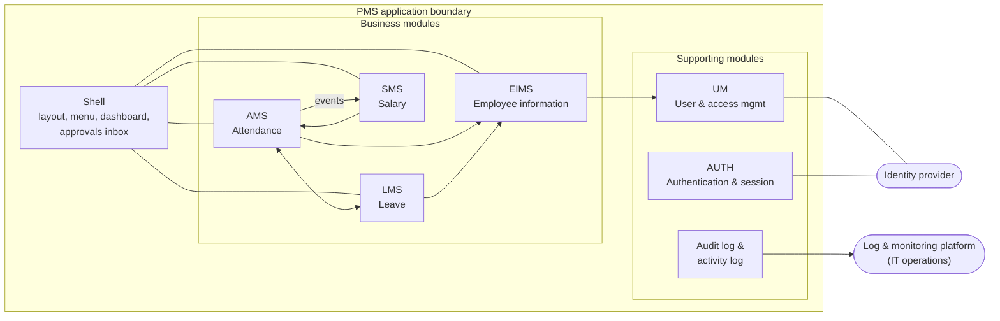

**Text version of the diagram**

| Building block | Type (business module / supporting module / peripheral system) | Key capabilities | Integrates with |
| --- | --- | --- | --- |
| Shell | Supporting (common UI) | Sign-in pages, role-based layout and menu, dashboard per role, approvals inbox across modules (BRD §5.3, FR-CMN-001 to 016) | EIMS, AMS, LMS, SMS (INT-07); AUTH |
| EIMS | Business module | Onboarding, profile and profile change request with approval, Admin-owned fields, deactivation, password reset, directory (PMS-BRD-M1-EIMS) | Shell; AMS, LMS, SMS (INT-03, INT-04, INT-05, INT-09); UM → identity provider (INT-08) |
| AMS | Business module | Daily attendance entry, submit, approve / reject, reopen after a salary dispute (PMS-BRD-M2-AMS) | Shell; EIMS (INT-03, INT-04, INT-09); LMS (INT-06); SMS (INT-01, INT-02, INT-10, JOB-CMN-01) |
| LMS | Business module | Full-day leave request, cancel, approve / reject (PMS-BRD-M3-LMS) | Shell; EIMS (INT-03, INT-04, INT-09); AMS (INT-06) |
| SMS | Business module | Salary record generation and voiding, approval, accept / dispute, keep as is, earnings, nightly reconciliation (PMS-BRD-M4-SMS) | Shell; AMS (INT-01, INT-02, INT-10, JOB-CMN-01); EIMS (INT-03, INT-04, INT-05) |
| UM | Supporting module | User accounts, roles, data scope rules (FR-UM-001 to 015) | EIMS Admin screens; identity provider (INT-08); every module for role and scope checks |
| AUTH | Supporting module | Sign-in, set / change password, lockout, idle timeout, log out, security events (FR-AUTH-001 to 030) | Shell; identity provider |
| Audit log & activity log | Supporting module | Field-level audit of every data change; activity log with one flow reference per user action or job run (FR-ADM-101 to 117) | Every module and job; log and monitoring platform |
| Identity provider | Peripheral system (platform) | Accounts, password store and policy, lockout, sessions, token issuing, security events (DEP-01) | UM, AUTH, API gateway |
| Log and monitoring platform | Peripheral system (platform) | Central activity log, metrics, traces, dashboards and alerts for IT operations (NFR-09) | Every component |

### 5.2 End-to-end functional process

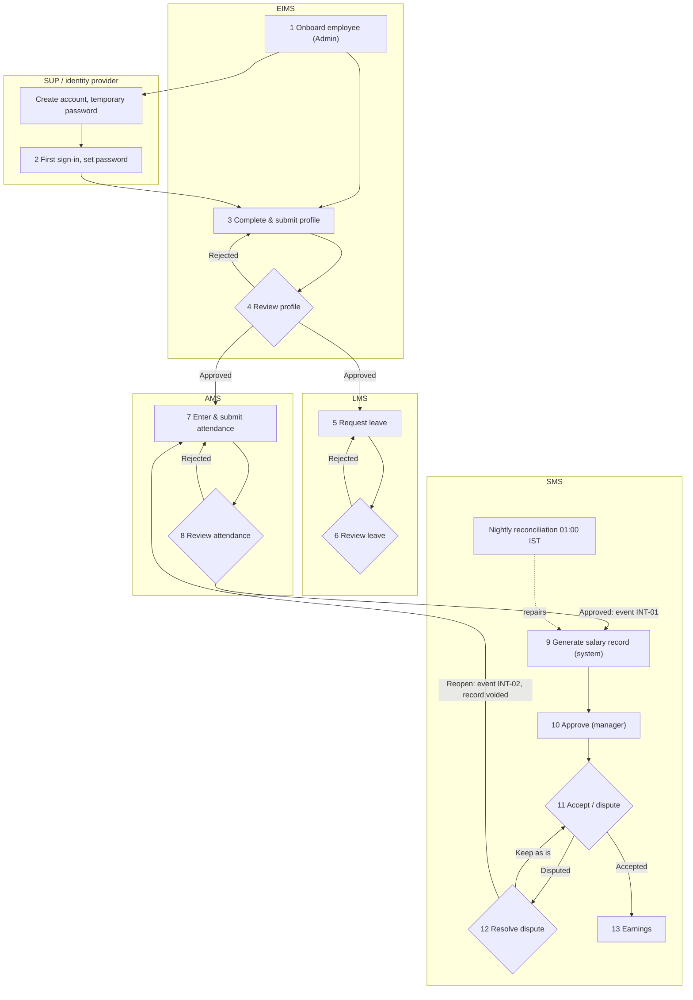

**Text version of the diagram** (steps as BRD §5.1; system hand-overs added)

| Step | Functional component / peripheral system | Activity | Output / next step |
| --- | --- | --- | --- |
| 1 | EIMS (Admin) → UM → identity provider | Onboard employee; account created with Employee Id and temporary password (INT-08) | Employee Draft; account enabled → 2 |
| 2 | AUTH, identity provider | First sign-in; own password set | → 3 |
| 3–4 | EIMS | Profile completed, submitted, reviewed (manager; Admin for the top-level employee) | Rejected → 3; Approved → 5 and 7 |
| 5–6 | LMS (with AMS date check INT-06, EIMS approver INT-04) | Leave requested and reviewed | Rejected → 5; Approved: dates blocked for attendance |
| 7–8 | AMS (with LMS date check INT-06, EIMS approver INT-04) | Attendance entered, submitted, reviewed | Rejected → 7; Approved → event INT-01 to SMS |
| 9 | SMS (system) | Salary record generated from hours and current rate (INT-05), within 1 minute (NFR-01) | Generated → 10 |
| 10 | SMS (manager; Admin for top-level) | Salary record approved | Manager Approved → 11 |
| 11 | SMS (employee) | Accept or dispute (one or several) | Accepted → 13; Disputed → 12 |
| 12 | SMS, AMS (manager; Admin for top-level) | Keep as is, or reopen attendance (event INT-02 voids the salary record) | → 11, or → 7 |
| 13 | SMS | Earnings for a period, voided records excluded | End |
| Nightly | SMS job (JOB-CMN-01) with AMS query | Create missed records, void stale ones, log mismatches | Result on Admin dashboard (FR-SMS-045) |
| Throughout | Shell | Dashboard and approvals inbox compose items from each module (INT-07) | Next action for each user |

### 5.3 Domain / sub-domain based micro-application identification

Each tower is one micro-application: a frontend package built into the shell (ADR-001), one backend service and one database. UM and AUTH have no tower of their own: they are provided by the identity provider, with screens in the shell and EIMS (PMS-BRD-M5-SUP §3.1).

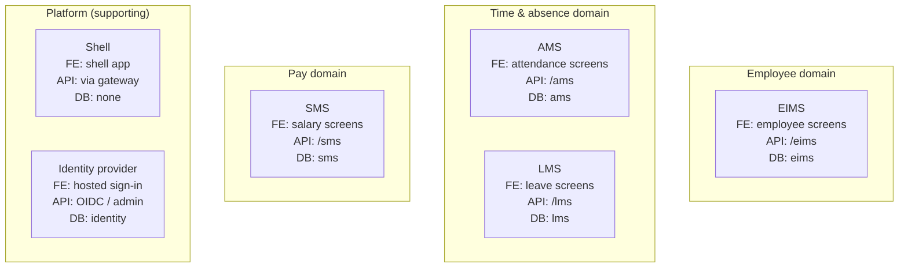

**Text version of the diagram**

| Domain / sub-domain | Tower | Frontend | Backend API | Backend DB |
| --- | --- | --- | --- | --- |
| Employee | EIMS | Employee screens package (`services/eims/frontend`) | EIMS service, context /eims | eims database |
| Time & absence | AMS | Attendance screens package (`services/ams/frontend`) | AMS service, context /ams | ams database |
| Time & absence | LMS | Leave screens package (`services/lms/frontend`) | LMS service, context /lms | lms database |
| Pay | SMS | Salary screens package (`services/sms/frontend`) | SMS service, context /sms (incl. JOB-CMN-01) | sms database |
| Platform | Shell | Shell application (`platform/shell-ui`) composing the module packages | API gateway (`platform/gateway`) | None |
| Platform | Identity provider | Sign-in and set-password pages per BRD | OIDC endpoints; admin API used by EIMS | Identity provider database |

**List of microservices**

| Seq | Domain / sub-domain name | Domain context | Purpose |
| --- | --- | --- | --- |
| 1 | Employee – EIMS | /eims/ | Employee master data, profile and change request approval, Admin-owned fields, account hand-over to the identity provider |
| 2 | Time & absence – AMS | /ams/ | Daily attendance and its approval; publishes attendance approved / reopened events |
| 3 | Time & absence – LMS | /lms/ | Full-day leave and its approval |
| 4 | Pay – SMS | /sms/ | Salary records from approved attendance; approval, acceptance, disputes; nightly reconciliation |

### 5.4 Stakeholder alignment

| Stakeholder | Date | Outcome |
| --- | --- | --- |
| Product owner | 22 Nov 2026 | Approved (D-110) |

## 6. System architecture

### 6.1 Logical system architecture (technology-neutral)

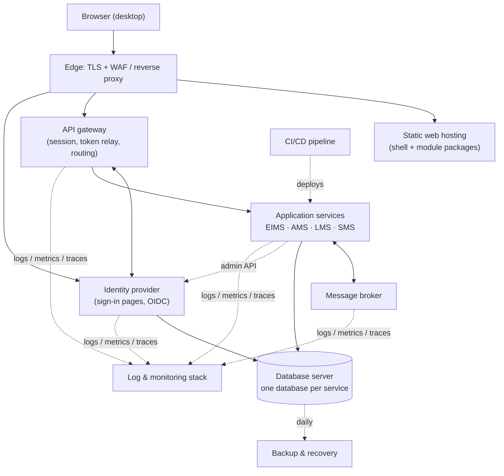

| Seq | Component | Purpose | Technology | Instances / sizing |
| --- | --- | --- | --- | --- |
| 1 | Load balancer / edge | Single HTTPS entry, TLS termination, WAF rule set, routing to web, gateway and identity provider | Ingress controller with WAF (§6.2) | Local: 1; AWS: managed, multi-node |
| 2 | API gateway | Holds the user session and tokens (server side), relays the access token, validates and routes to services, rate limiting | Reactive gateway (§6.2) | Prod 2, Dev / QA 1 |
| 3 | Identity provider | Accounts, passwords, roles, lockout, sessions, token issuing, security events (DEP-01) | OIDC identity provider (§9.2) | Prod 2, Dev / QA 1 |
| 4 | Web server / static hosting | Serves the built shell application | Static web server container | Prod 2, Dev / QA 1 |
| 5 | Application services | EIMS, AMS, LMS, SMS business logic and APIs; audit log in own database | Containerised services, stateless | Prod 2 each, Dev / QA 1 each; scale out to 10× (NFR-07) |
| 6 | Message broker / queue | AMS → SMS events (INT-01, INT-02), dead-letter queue | Persistent broker (§6.2) | 1 node with persistent storage |
| 7 | Cache server | None in the POC; services may keep short-lived in-memory copies of read-mostly data; shared cache Future | – | – |
| 8 | Database server | One database per service plus the identity provider's | Relational database | 1 server per environment |
| 9 | Scheduler / batch | Nightly reconciliation inside SMS; a database lock lets one instance run it (JOB-CMN-01) | In-service scheduler + lock | Runs in one SMS instance |
| 10 | Log and monitoring stack | Activity log, metrics, traces, dashboards, alerts (NFR-09) | Open telemetry collector + log, metric and trace stores + dashboards | 1 per cluster, environments separated by label |
| 11 | Backup and recovery | Daily database backup, RPO 24 h, RTO 8 h (NFR-02) | Scheduled backup job | Daily; kept on separate storage |

### 6.2 Platform mapping – on-premises POC (local machine) and AWS target

The POC runs on-premises on Kubernetes in Docker (D-109, D-110, ADR-002): Docker Desktop Kubernetes on the product owner's workstation (Windows), or at times a multi-node Kubernetes-in-Docker cluster (kind or k3d, chosen when first used) for the non-production environments. AWS (ap-south-1, Mumbai) is the cloud target and is used to simulate production; when no AWS simulation runs, the pms-prod namespace on the local cluster serves as Prod. The same container images and Helm charts deploy to every platform.

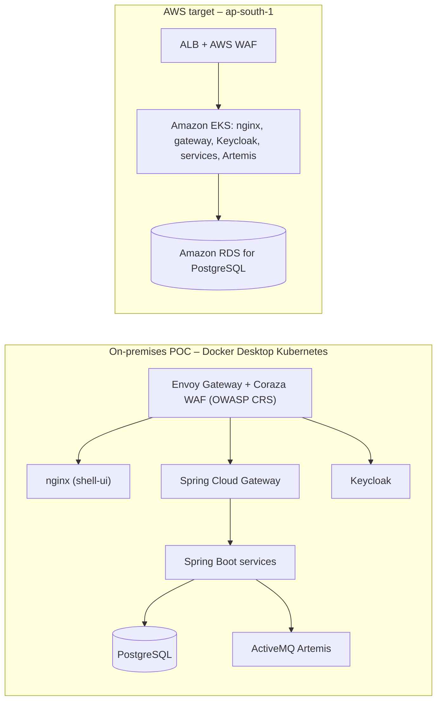

| Seq | Component | On-premises POC (local machine) | AWS service (target) | Purpose | HA and scalability assurance |
| --- | --- | --- | --- | --- | --- |
| 1 | Edge | Envoy Gateway (Kubernetes Gateway API) with the Coraza WAF and the OWASP Core Rule Set; local certificate; host name pms.local (replaces ingress-nginx, retired by the Kubernetes project in March 2026 – D-112) | Application Load Balancer + AWS WAF; Route 53; ACM certificate | HTTPS entry and WAF | AWS: managed, scales automatically |
| 2 | Container platform | Docker Desktop Kubernetes (single node), or a multi-node Kubernetes-in-Docker cluster for non-production; namespaces pms-dev, pms-qa, pms-prod | Amazon EKS (managed node group) | Runs all PMS containers | Replicas per Deployment; AWS node group can grow |
| 3 | API gateway | Spring Cloud Gateway | Same on EKS | Session, token relay, routing | 2 replicas in Prod; session affinity at the edge |
| 4 | Identity provider | Keycloak | Same on EKS, database on RDS | OIDC, accounts, lockout, sessions | 2 replicas in Prod (clustered cache) |
| 5 | Static web | nginx serving the shell build | Same on EKS | Frontend | 2 replicas in Prod |
| 6 | Application services | Spring Boot containers (D-12: later Node.js, Python FastAPI) | Same on EKS | EIMS, AMS, LMS, SMS | 2 replicas in Prod; horizontal scale-out |
| 7 | Message broker | ActiveMQ Artemis, StatefulSet with persistent volume | Same on EKS with an EBS volume (Amazon MQ offers ActiveMQ Classic only) | Events | Single node, persistent; outbox and reconciliation cover loss |
| 8 | Database | PostgreSQL, one server per environment (StatefulSet, persistent volume) | Amazon RDS for PostgreSQL, single-AZ | Databases per service and Keycloak | Daily backup; AWS automated backups and point-in-time restore |
| 9 | Scheduler | Inside SMS with ShedLock | Same | JOB-CMN-01 | One run per night across replicas |
| 10 | Observability | OpenTelemetry Collector, Loki, Prometheus, Tempo, Grafana (namespace observability) | Same on EKS, or CloudWatch + Amazon Managed Grafana | Logs, metrics, traces, alerts | Single instance; 90-day log retention in Prod |
| 11 | Backup | Kubernetes CronJob with pg_dump, daily, to a folder on a separate drive | RDS automated backups and snapshots | RPO 24 h, RTO 8 h | Restore tested per §15 |
| 12 | Image registry | GitHub Container Registry | GHCR or Amazon ECR | Container images | Managed |
| 13 | CI/CD | GitHub Actions; self-hosted runner on the local machine deploys with Helm | GitHub Actions to EKS | Build, test, deploy | Path-filtered pipeline per service (D-18) |
| 14 | Secrets | Kubernetes Secrets, created by the pipeline from GitHub environment secrets | AWS Secrets Manager via External Secrets Operator; KMS envelope encryption | Credentials | Per service, least privilege |

### 6.3 Network topology (on-premises POC and AWS target)

**On-premises POC (one machine).** Zones are realised in the cluster: the edge (DMZ) is the ingress controller, the only component reachable from outside the cluster, over HTTPS on the machine (or the LAN, if opened). Per environment, the application zone holds the gateway, static web, identity provider and services, and the data zone the database and broker; network policies allow only the flows below and deny all others. There are no subnets or address ranges to manage locally – the platform assigns them.

**AWS target.** One VPC in ap-south-1, single availability zone for the POC (D-109). Address ranges below are illustrative and are fixed when the AWS environment is built.

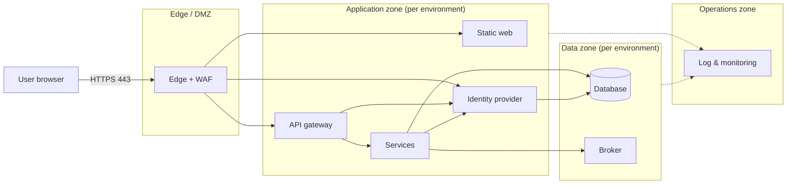

**Network zones / subnets**

| Zone / subnet | Address range (CIDR) | Purpose | Components placed | Exposure (public / private) |
| --- | --- | --- | --- | --- |
| Edge / DMZ | Local: cluster-assigned; AWS: public subnet 10.20.0.0/24 (illustrative) | Only entry point; TLS, WAF | Edge (ingress / load balancer + WAF) | Public (local: machine or LAN only) |
| Application zone | Local: namespace per environment; AWS: private subnet 10.20.10.0/24 (illustrative) | Stateless tiers | Static web, API gateway, identity provider, EIMS, AMS, LMS, SMS | Private |
| Data zone | Local: same namespace, pods labelled data; AWS: data subnet 10.20.20.0/24 (illustrative) | State | Database, broker | Private |
| Operations zone | Local: namespace observability; AWS: private subnet (with application zone) | Logs, metrics, traces | Log and monitoring stack | Private (dashboards for IT operations only) |

**Allowed traffic flows**

| Source zone | Destination zone | Protocol / port | Purpose | Control (NSG / firewall rule / private endpoint) |
| --- | --- | --- | --- | --- |
| Internet / user | Edge | HTTPS 443 | All user traffic | Local: ingress only exposed service; AWS: security group on the load balancer |
| Edge | Application: static web, gateway, identity provider | HTTP 8080 (inside the cluster) | Frontend, API, sign-in pages | Network policy / security group: from edge only |
| Application: gateway | Application: services, identity provider | HTTP 8080 | API routing, token exchange and refresh | Network policy: gateway → services, gateway → identity provider |
| Application: services | Application: identity provider | HTTP 8080 | Token keys; admin API (EIMS only, INT-08) | Network policy |
| Application: services | Application: services | HTTP 8080 | Synchronous APIs INT-03 to INT-06, INT-09, INT-10, JOB-CMN-01 query | Network policy per allowed pair |
| Application: services, identity provider | Data: database | Database protocol 5432 | Own database only (separate credentials per database) | Network policy; AWS: security group on RDS |
| Application: AMS, SMS | Data: broker | Broker protocol 61616 | Events INT-01, INT-02 | Network policy: AMS and SMS only |
| All zones | Operations | OTLP 4317 / 4318 | Logs, metrics, traces | Network policy: to the collector only |
| CI/CD runner (local machine) | Cluster API | HTTPS 6443 | Deployment | Local only; AWS: cluster API restricted to the pipeline role |

**External connectivity**

| Connection | Type (internet / VPN / private link / peering) | Purpose | Security |
| --- | --- | --- | --- |
| User access | Local machine / LAN (POC); internet via the load balancer (AWS) | Use of PMS | HTTPS only, WAF |
| Source repository, pipeline and image registry service | Internet, outbound only | Code, builds, images; runner polls the pipeline service (no inbound) | Tokens with least privilege |
| No business external systems | – | No email, SMS gateway, SSO or devices in the POC (C-05) | – |

### 6.4 Per-tier redundancy

| Tier | Zone count | Redundancy model | Failover behaviour |
| --- | --- | --- | --- |
| Edge | 1 (local); AWS load balancer spans zones by design | Local: single ingress; AWS: managed | Local: restart by the platform; AWS: automatic |
| Static web, API gateway, identity provider, services | 1 | Prod: 2 replicas each; Dev / QA: 1 | The platform restarts failed instances and routes to the healthy one; a gateway failover keeps the user signed in through the identity-provider session |
| Scheduler (JOB-CMN-01) | 1 | Runs in one SMS replica under a database lock | If that replica fails, the next scheduled run (or a manual run) repairs; missed hand-overs are repaired by the next run (KPI-04) |
| Message broker | 1 | Single node, persistent storage | Restart with messages kept; outbox re-sends anything not acknowledged |
| Database | 1 | Single server per environment, persistent storage, daily backup | Restore from backup within RTO 8 h, RPO 24 h (NFR-02); AWS: point-in-time restore |
| Log and monitoring | 1 | Single instance | Loss of observability does not stop PMS; logs buffered by the collector |

On the local machine the redundancy is demonstrated (failover between replicas); the 99 % business-hours availability target is verified only in the AWS production simulation (D-109, D-110; recorded in §19).

### 6.5 Stakeholder alignment

| Stakeholder | Date | Outcome |
| --- | --- | --- |
| Product owner | 22 Nov 2026 | Approved (D-110) |

## 7. Deployment architecture

### 7.1 Deployment diagram

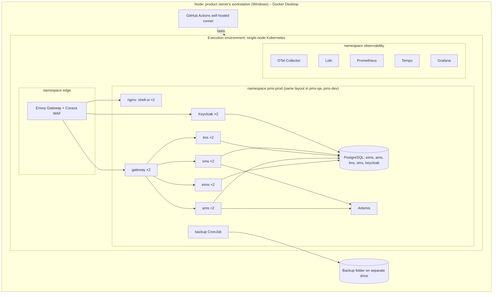

**Text version of the diagram:** see §7.2 and §7.3.

### 7.2 Nodes and execution environments

| Node | Type (VM / container / PaaS / SaaS) | Execution environment (runtime, version) | Deployed artifacts | Zone / subnet | Scaling |
| --- | --- | --- | --- | --- | --- |
| Workstation (on-premises POC) | Physical machine, Windows | Docker Desktop with single-node Kubernetes, or a multi-node Kubernetes-in-Docker cluster for non-production (versions in §11) | All PMS containers, observability stack, self-hosted runner | – | Fixed; at least 32 GB memory (OI-P01-03 closed) |
| Edge | Container | Envoy Gateway (Gateway API) with Coraza WAF and OWASP Core Rule Set | Gateway and HTTPRoute resources per environment host name | Edge | 1 |
| Static web | Container | nginx | Shell-ui build (module packages built in, ADR-001) | Application | Prod 2, Dev / QA 1 |
| API gateway | Container | Java runtime, Spring Cloud Gateway | `platform/gateway` image | Application | Prod 2, Dev / QA 1 |
| Identity provider | Container | Keycloak | Realm configuration from `platform/keycloak` | Application | Prod 2, Dev / QA 1 |
| EIMS, AMS, LMS, SMS | Container | Java runtime, Spring Boot (D-12) | `services/<module>/backend` images | Application | Prod 2, Dev / QA 1; horizontal |
| Database | Container (StatefulSet) | PostgreSQL | Databases eims, ams, lms, sms, keycloak; schema migrations run by each service | Data | 1 per environment |
| Broker | Container (StatefulSet) | ActiveMQ Artemis | Addresses and queues from `infra/activemq` | Data | 1 per environment |
| Observability | Containers | OpenTelemetry Collector, Loki, Prometheus, Tempo, Grafana | Dashboards and alert rules | Operations | 1 |
| Backup job | Container (CronJob) | PostgreSQL client tools | Daily dump per database | Data | Daily |
| CI/CD runner | Process on the workstation | GitHub Actions self-hosted runner, Helm | Helm charts in `infra/` | – | 1 |
| AWS target | PaaS + containers | Amazon EKS, RDS for PostgreSQL, ALB + WAF | Same images and Helm charts; Terraform for AWS resources | VPC per §6.3 | Node group and replicas |

### 7.3 Middleware and communication paths

| From node | To node | Middleware / protocol | Port | Security (TLS, auth) |
| --- | --- | --- | --- | --- |
| Browser | Edge | HTTPS | 443 | TLS (local certificate; ACM on AWS); WAF |
| Edge | Static web, gateway, Keycloak | HTTP | 8080 | Cluster-internal; network policy |
| Gateway | Keycloak | OIDC over HTTP (token, refresh, logout) | 8080 | Confidential client (client secret) |
| Gateway | Services | REST over HTTP with bearer access token | 8080 | Token validated again in each service |
| Service | Service | REST over HTTP | 8080 | Service token (client credentials) or relayed user token – §9.9 |
| EIMS | Keycloak admin API | REST over HTTP | 8080 | Service account with only the user-management roles needed |
| AMS, SMS | Artemis | JMS over the Artemis core protocol | 61616 | User and password per service; address permissions |
| Services, Keycloak | PostgreSQL | PostgreSQL wire protocol | 5432 | Own database user per service; TLS on AWS (RDS) |
| All | OpenTelemetry Collector | OTLP | 4317 / 4318 | Cluster-internal |
| Runner | Kubernetes API | HTTPS | 6443 | Local kubeconfig; namespace-scoped deploy account |

Inside the local cluster, traffic behind the edge is not encrypted; network policies restrict it. On AWS, database connections use TLS; in-cluster encryption is decided in the security standard (point carried to §16).

### 7.4 Deployment per environment

| Environment | Nodes and sizing | Differences from production |
| --- | --- | --- |
| Local developer run | Docker Compose on the workstation (`infra/docker`) | Single instances; no ingress or WAF; seed data |
| Dev (namespace pms-dev) | 1 replica per tier; own PostgreSQL, Artemis, Keycloak realm | Synthetic seed data (about 20 employees); may be scaled to zero when not in use |
| QA (namespace pms-qa) | 1 replica per tier; scaled to Prod replicas for the performance-test window | Synthetic seed data; test runs |
| Prod (namespace pms-prod, local) | 2 replicas per stateless tier; daily backup | Admin account only at install; 90-day activity log retention; used when no AWS production simulation runs |
| AWS production simulation (target) | EKS node group, RDS single-AZ, ALB + WAF, created with Terraform | Built on demand to simulate production and torn down after; availability target verified there |

### 7.5 Stakeholder alignment

| Stakeholder | Date | Outcome |
| --- | --- | --- |
| Product owner | 22 Nov 2026 | Approved (D-110) |

## 8. Integration architecture

### 8.1 Functional integration diagram

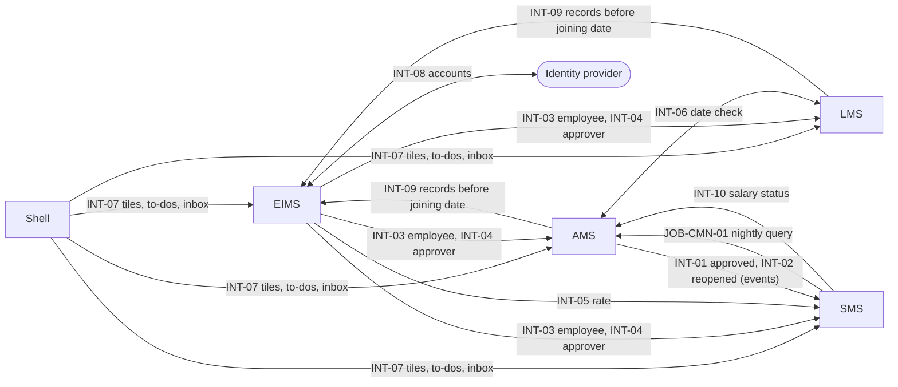

The text version is the integration catalogue in §8.2.

### 8.2 Integration catalogue

| Seq | Source | Target | Data object | Style (sync / async / batch) | Integration pattern (Part01a id) | Protocol | Message format | Authentication | Connection mechanism | Error handling |
| --- | --- | --- | --- | --- | --- | --- | --- | --- | --- | --- |
| 1 | AMS | SMS | Attendance approved (INT-01) | Async | Transactional outbox (AP-MS-10), event message (AP-EIP-17), idempotent receiver (AP-EIP-55) | Broker topic, durable subscription | JSON event in a common envelope (event id, type, version, flow reference, time) | Broker credentials per service | Outbox relay in AMS publishes; SMS durable subscriber | Redelivery with backoff, then dead-letter queue; duplicates ignored by event id and attendance id; reconciliation repairs |
| 2 | AMS | SMS | Attendance reopened (INT-02) | Async | As 1 | As 1 | As 1 | As 1 | As 1 | As 1; void is idempotent |
| 3 | SMS | AMS | Approved attendance for a date range (JOB-CMN-01) | Batch (nightly) | Reconciliation for eventual consistency (AP-INT-12), scheduler agent supervisor (AP-CP-37) | REST | JSON, paged | Service token | SMS job calls AMS API | Job retries the run; result and counts logged and shown on the Admin dashboard |
| 4 | AMS, LMS, SMS, shell | EIMS | Employee details (INT-03) | Sync | Remote procedure invocation (AP-EIP-03) | REST | JSON | User token relayed or service token (§9.9) | Via service-to-service call | Timeout, retry for reads, circuit breaker (§8.5); caller shows an error with the flow reference |
| 5 | AMS, LMS, SMS, shell | EIMS | Approver resolution (INT-04) | Sync | As 4 | REST | JSON | As 4 | As 4 | As 4 |
| 6 | SMS | EIMS | Current hourly wage rate (INT-05) | Sync | As 4 | REST | JSON | Service token | Called while generating a salary record | Event processing retried; not acknowledged until the rate is read |
| 7 | AMS ↔ LMS | LMS ↔ AMS | Date check (INT-06) | Sync | As 4 | REST | JSON | As 4 | Called on save and submit | Save refused with a retry message if the check cannot be made (never skipped) |
| 8 | Shell | EIMS, AMS, LMS, SMS | Dashboard tiles, to-dos, inbox items (INT-07) | Sync | API composition in the client (AP-MS-15) | REST via gateway | JSON | User session at the gateway | One call per module card | Each card fails on its own with Retry (FR-CMN-008) |
| 9 | EIMS | Identity provider | User account create, role, reset, disable, end sessions (INT-08) | Sync | Remote procedure invocation (AP-EIP-03) | Identity provider admin REST API | JSON | Service account (client credentials) | EIMS calls the admin API | Failure refuses the Admin action with a reference; consistency between employee record and account designed in Part02-SUP |
| 10 | EIMS | AMS, LMS | Records before a new joining date (INT-09) | Sync | As 4 | REST | JSON | Service token | EIMS calls both before saving | Change refused if either check cannot be made |
| 11 | AMS, shell | SMS | Salary status for attendance (INT-10) | Sync | As 4 | REST | JSON | As 4 | Called in history and inbox views; caller fixed in Part02 | Status shown as unknown with Retry; Reopen not offered until known |
| 12 | Browser | Gateway → services | All user actions | Sync | API gateway (AP-MS-05), gateway routing (AP-CP-21) | HTTPS / REST | JSON (OpenAPI 3 contracts) | Session cookie → access token at gateway | Gateway routes by context /eims, /ams, /lms, /sms | Standard error body with the flow reference (Part02 anchor) |
| 13 | Gateway | Identity provider | Sign-in, refresh, logout | Sync | Federated identity (AP-CP-17) | OIDC | – | Confidential client | Redirect and back-channel | Sign-in error page per FR-AUTH-008 |
| 14 | All components | Log and monitoring | Activity log, metrics, traces | Async | Log aggregation (AP-MS-20), wire tap (AP-EIP-59) | OTLP | Structured JSON logs, metrics, spans | Cluster-internal | Collector | Collector buffers; PMS keeps running |

### 8.3 Technical integration diagram

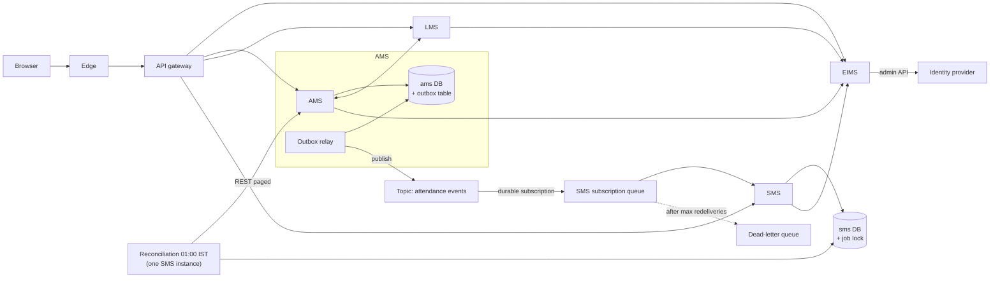

**Text version of the diagram**

| Element | Role |
| --- | --- |
| Outbox table (ams database) | Event row written in the same transaction as the attendance status change |
| Outbox relay (inside AMS) | Reads unsent rows and publishes them to the attendance events topic; marks them sent after the broker confirms |
| Attendance events topic | Publish-subscribe channel (AP-CP-31); SMS is the only subscriber in the POC |
| SMS subscription queue | Durable subscription (AP-EIP-54); SMS processes each event once (idempotent) |
| Dead-letter queue | Events that still fail after the maximum redeliveries; alert to IT operations; reconciliation repairs the outcome |
| Reconciliation job | Runs in one SMS instance under a database lock; reads approved attendance from AMS; creates, voids, logs mismatches |
| Synchronous APIs | INT-03 to INT-06, INT-09, INT-10 between services; INT-08 to the identity provider |

### 8.4 Protocol and pattern selection guide

| Need | Chosen protocol / pattern | Reason |
| --- | --- | --- |
| Query from UI | REST GET through the gateway, one call per module card | Contract-first (D-16); independent loading (FR-CMN-008) |
| Command from UI | REST POST / PUT / PATCH through the gateway, with a version check on the record | Detect changes by others (FR-CMN-014, NFR-06) |
| State change to other services | Event through the broker with transactional outbox | Decoupled, reliable hand-over within 1 minute (INT-01, INT-02, NFR-01, R-01) |
| Reference data from another service | Synchronous REST query to the owning service | Database per service, no shared tables (C-02) |
| Bulk / periodic data | Scheduled job with paged REST query | Nightly reconciliation (JOB-CMN-01) |
| Long-running process | None in the POC; the dispute cycle is a sequence of user actions with events | – |

### 8.5 Integration resilience defaults

Proposed defaults; final values go into the API and integration standard (docs/04-standards/).

| Integration type | Timeout | Retry policy | Circuit breaker | Idempotency | Dead-letter handling |
| --- | --- | --- | --- | --- | --- |
| Internal REST APIs | Connect 1 s, response 2 s (p95 target 500 ms, NFR-01) | Reads only: up to 2 retries with exponential backoff; commands are not retried automatically | Per downstream service: opens after 50 % failures in a 20-call window, half-open after 30 s | Commands carry the record version; repeated submits are refused by status rules | Not applicable; error shown with the flow reference |
| Async events | Consumer processing 30 s | Broker redelivery up to 5 times with backoff (1 s doubling); outbox relay retries until confirmed | Not applicable | Event id and business key (attendance id) checked before processing; one non-voided salary record per attendance (NFR-06) | Dead-letter queue after 5 attempts; alert; nightly reconciliation repairs the outcome |
| External APIs (identity provider admin) | Connect 1 s, response 5 s | Reads only, up to 2 retries | As internal REST | Account operations keyed by Employee Id | Not applicable; Admin action refused with the flow reference |

### 8.6 Stakeholder alignment

| Stakeholder | Date | Outcome |
| --- | --- | --- |
| Product owner | 22 Nov 2026 | Approved (D-110) |

## 9. Authentication & authorization

Architecture-level design of identity, access and API security. User-facing functions (sign-in, set and change password, log out, onboarding, role administration) are designed in PMS-HLD-Part02-M5-SUP-Functional. Business policy is in PMS-BRD-M5-SUP §5 and §6. All durations below (token lifetimes, session limits, lockout) are deployment settings per environment, changed by release or deployment, not by the Admin (D-97, D-111).

### 9.1 Users, user categories and roles

| User category | Description | Authentication path | MFA |
| --- | --- | --- | --- |
| Employee (including managers) | About 100 users; user name = Employee Id (FR-UM-001) | Browser → edge → identity provider sign-in page (OIDC) → gateway session | No (POC, FR-AUTH-001, D-109) |
| PMS Administrator | One account set up at installation, fixed user name not in the Employee Id format (FR-UM-004) | Same as employees | No (POC) |
| Service identities | EIMS, AMS, LMS, SMS acting as the system (event processing, nightly job, account administration) | Client credentials at the identity provider | Not applicable |
| IT operations | Not PMS users; read logs and dashboards, reset the Admin password (FR-UM-005), run backups and restores | Platform and observability accounts outside PMS; identity-provider administration console reachable only from inside the cluster, never through the edge | Per IT operations policy |

| Role id | Role name | Role type (business / system / external) | Data scope |
| --- | --- | --- | --- |
| ROLE-EMP | Employee (realm role EMPLOYEE) | Business | Own records |
| ROLE-MGR | Manager (realm role MANAGER) | Business | Own records + direct reports by the current Manager Id (no skip-level, D-63) |
| ROLE-ADM | PMS Administrator (realm role ADMIN) | Business | All EIMS employee master data; the top-level employee's records for review and decision only (D-58) |
| SYS-EIMS | EIMS service client | System | Employee records it creates; user accounts through the admin API (user management only) |
| SYS-SMS | SMS service client | System | All salary records; approved attendance through the AMS API |
| SYS-REC | Reconciliation job (runs as the SMS service client) | System | All approved attendance and salary records |
| SYS-AMS, SYS-LMS | AMS and LMS service clients | System | Read-only checks between services (INT-06, INT-09) |

### 9.2 Identity provider / authorization server

| Item | Decision |
| --- | --- |
| Product / service | Keycloak (D-16), self-hosted in each environment; realm configuration kept as code in `platform/keycloak` and applied by the pipeline |
| Realm / tenant design | One realm `pms` per environment; brute-force detection: temporary lock 15 minutes after 5 consecutive failures, no permanent lock (D-26, FR-AUTH-005); password policy length 8, upper case, lower case, digit, special character, not containing the user name, different from the current password (password history 1) (D-28, D-97, D-99); temporary password = credential marked temporary with the update-password required action (FR-AUTH-006); login theme styled to SCR-SH-01 and SCR-SH-02 with the BRD messages (FR-AUTH-002 to 008); registration, social login and "forgot password" disabled (FR-UM-002, FR-AUTH-007); events (login, login error, logout, update password, admin user events) enabled and forwarded to the log store (FR-AUTH-030) |
| User store (IdP-managed / federated / application) | IdP-managed; passwords stored and hashed only by the identity provider with its built-in algorithm (Argon2 in current releases; fixed in the security standard) – PMS holds no passwords (ADR-003) |
| Clients (per frontend, per service) | `pms-gateway`: confidential, Authorization Code + PKCE, redirect only to the PMS host; `eims-svc`, `ams-svc`, `lms-svc`, `sms-svc`: confidential, client credentials only, with the realm roles their calls need; `eims-admin`: client credentials limited to user management (create, update role, reset credential, disable, end sessions) for INT-08; audience mappers add `eims`, `ams`, `lms`, `sms` to user tokens |
| Environments (one realm per environment / shared) | One identity provider instance and realm per environment (Dev, QA, Prod namespaces; AWS production simulation); its database in the environment's PostgreSQL server (D-109) |

### 9.3 Authentication flows

| Flow | Used by | Protocol / grant (e.g. OIDC Authorization Code + PKCE, Client Credentials) | Notes |
| --- | --- | --- | --- |
| Interactive user sign-in | All users via the gateway | OIDC Authorization Code + PKCE; gateway is the confidential client | Browser receives only an HttpOnly session cookie; tokens stay in the gateway (D-110) |
| Set password (first sign-in, after reset) | All users | Required action at the identity provider during sign-in | No PMS page reachable before it is done (FR-AUTH-006, FR-AUTH-010) |
| Change own password | All users | Application-initiated update-password action at the identity provider with re-authentication | Ends the user's other sessions, current session continues (D-100); screen behaviour in Part02-SUP |
| Token refresh | Gateway | Refresh token grant, refresh token rotated on every use | Fails when the identity-provider session has ended → user returns to sign-in (FR-CMN-016) |
| Sign-out / single logout | All users; Admin actions | RP-initiated logout (user); identity-provider back-channel logout to the gateway (deactivation, password reset, role change, own password change) | The gateway instance that receives a back-channel logout relays it to its peer instances; refresh failure ends any session missed within the access-token lifetime (§9.5) |
| Service-to-service | Services, nightly job, EIMS admin calls | Client credentials (system calls); relayed user access token (calls on behalf of a user) | §9.9 |

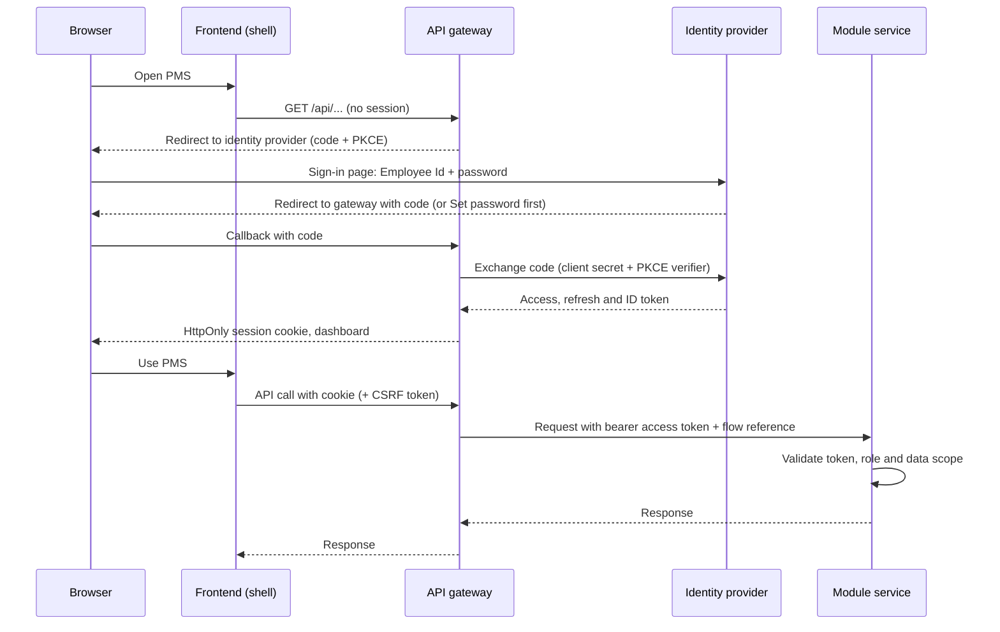

**Text version of the diagram**

| Step | From → to | Action |
| --- | --- | --- |
| 1–3 | Browser → shell → gateway | No session: gateway starts Authorization Code + PKCE and redirects to the identity provider |
| 4–5 | Browser ↔ identity provider | User signs in; temporary password leads to Set password first; lock and messages per FR-AUTH-003 to 005 |
| 6–9 | Browser → gateway ↔ identity provider | Gateway exchanges the code, keeps the tokens, gives the browser an HttpOnly session cookie |
| 10–15 | Shell → gateway → service | Each API call carries the cookie and CSRF token; gateway relays the access token and flow reference; the service validates token, role and data scope |

### 9.4 MFA approach

No second sign-in factor in the POC (FR-AUTH-001, BRD M5-SUP §3.2, D-109). The identity provider supports one-time-password factors, so MFA – for example for the PMS Administrator first – can be enabled later by configuration without redesign; recorded as Future (§20).

### 9.5 Token design

| Item | Decision |
| --- | --- |
| Token type and format (JWT) | Signed JWT access token; ID token used only by the gateway; refresh token opaque to PMS |
| Signing algorithm and key rotation | RS256 (asymmetric); public keys published by the identity provider and cached by the gateway and services; keys rotated by the identity provider with the previous key kept active for validation until existing tokens expire; rotation interval in the security standard |
| Access token lifetime | 5 minutes (setting) |
| Refresh token lifetime and rotation | Bound to the identity-provider session: ends after 30 minutes idle (D-26) or 10 hours absolute (settings); rotated on every use, reuse refused |
| Claims (sub, roles, scopes, data-scope attributes, tenant) | `sub`, `preferred_username` (Employee Id or Admin user name), one realm role (EMPLOYEE, MANAGER or ADMIN), `aud`, `azp`, `sid`, `exp`, `iat`. No reporting-line claims: the Manager Id stays in EIMS and is checked through INT-04, so a manager change applies at once (FR-UM-014). No tenant (single company, A-01) |
| Audience per service | User tokens carry `eims`, `ams`, `lms`, `sms`; service tokens carry only the called services' audiences; each service accepts only tokens with its own audience |
| Revocation / forced logout | Session ended at the identity provider (deactivation, reset, role change, own password change) + back-channel logout to the gateway; any request still holding an access token is limited to its 5-minute lifetime |
| Token storage in the browser | None. The browser holds only the gateway session cookie: HttpOnly, Secure, SameSite=Lax, path /; state-changing calls also carry a CSRF token |

### 9.6 Session management

| Item | Decision |
| --- | --- |
| Session idle timeout | 30 minutes (D-26), enforced by the identity-provider session and the gateway session (same setting); expiry message per FR-CMN-016; no warning (Future) |
| Absolute session timeout | 10 hours (setting) – one working day |
| Concurrent sessions | Allowed; each session times out on its own (FR-AUTH-021) |
| Account lockout policy | 5 consecutive failures → locked 15 minutes; Admin password reset clears the lock and count; successful sign-in resets the count; unknown Employee Ids never locked and get the generic message (D-26, D-97, FR-AUTH-005) |

### 9.7 Authorization model

| Layer | Mechanism | Enforced at |
| --- | --- | --- |
| Coarse-grained (role → API / route) | RBAC: routes per module and per role group (for example Admin-only EIMS administration routes, Manager / Admin approval routes) | Gateway |
| Fine-grained (role → feature / action) | Permission per API operation from the role claim; no self-approval (BR-CMN-08) | Service |
| Data scope (own / reportees / all) | Own: record owner = token `preferred_username`. Reportees: current Manager Id from EIMS (INT-04). Admin: all EIMS employee data; other modules only the top-level employee's records (D-58). Applied in the query, so out-of-scope data is never read | Service / query |
| UI (menu, button visibility) | Role claim from the gateway session drives the menu (FR-UM-012); a refused request opens the neutral "You don't have access to this page." page (FR-UM-015) | Frontend (never the only check) |

A refused request returns the same neutral response whether or not the record exists, and is written to the activity log with user, reason and flow reference (FR-UM-015, FR-ADM-117). A role change ends all the user's sessions at once (EIMS through the identity-provider admin API), so the new role applies to every request and to the menu from the next sign-in (FR-UM-011, D-97 (4), D-111).

### 9.8 API-level security

| Control | Decision |
| --- | --- |
| Token validation (signature, issuer, audience, expiry) | At the gateway and again in every service: signature against the identity provider's keys, issuer, own audience, expiry and not-before, with at most 30 s clock skew |
| Scopes per API | Audience per service plus role checks (§9.7); no fine-grained OAuth scopes in the POC |
| Rate limiting / throttling | Gateway: per user and per route (limits in the security standard); edge: per client address on the sign-in path, in addition to the identity provider's lockout |
| CORS policy | Single origin: static web, `/api` (gateway) and `/auth` (identity provider) are served from one host name, so cross-origin requests are refused |
| Input validation and payload limits | Request bodies validated against the OpenAPI contract and the BRD validation rules in the service; payload limit 1 MB at the edge and gateway |
| Security headers | At the edge: HSTS, Content-Security-Policy (self only), X-Content-Type-Options nosniff, frame-ancestors none, Referrer-Policy same-origin; no caching of API responses |
| Public (unauthenticated) endpoints | Static frontend assets, identity-provider sign-in pages and OIDC endpoints only; health and metrics endpoints are reachable inside the cluster only, never through the edge |

### 9.9 Service-to-service authentication

- **On behalf of a user** (for example AMS asking EIMS for the approver, INT-04; the shell calling a module): the user's access token is relayed, so the called service applies its own role and data-scope checks.
- **As the system** (event processing in SMS, the nightly job, EIMS → identity provider admin API, INT-09 and INT-06 checks without a user context): the calling service uses its own client-credentials token, holding only the roles its calls need.
- **Identity and flow propagation:** every HTTP call carries the flow reference and trace context headers (§10.5); every event carries the flow reference and the acting user (Employee Id, Admin or System) in its envelope, so audit entries record who triggered a system change (FR-ADM-102).
- Network policies allow only the service pairs in §6.3; mutual TLS is not used in the POC.

### 9.10 Secrets and key management

Secrets – database credentials, identity-provider client secrets, broker credentials, backup credentials – are kept as platform secrets, created by the deployment pipeline from protected environment secrets, one set per environment and service, readable only by the service that uses them; on AWS they come from the cloud secret store with key-managed encryption (D-110). Token-signing keys are held and rotated by the identity provider. No secrets in code, container images, Helm values files or logs; repositories are scanned for secrets in the pipeline. In the POC, credentials are rotated per release and immediately on suspicion; rotation schedule in the security standard.

### 9.11 Stakeholder alignment

| Item | Stakeholder | Date | Outcome |
| --- | --- | --- | --- |
| §9 Authentication & authorization | Product owner, Security / IT owner (role) | 22 Nov 2026 | Approved (D-111) |

## 10. Unified & centralized logging and observability

### 10.1 Logging architecture

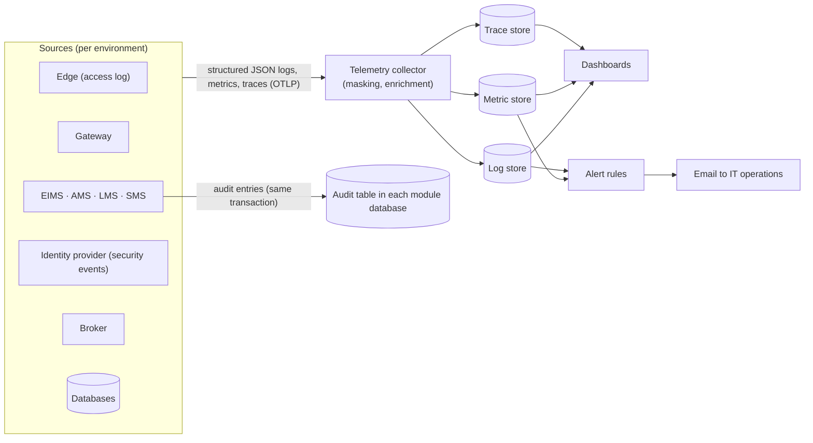

**Text version of the diagram**

| Element | Role |
| --- | --- |
| Sources | Every node writes structured JSON logs to standard output and emits metrics and traces |
| Telemetry collector | One per cluster; receives all signals, applies masking as a second line of defence, adds environment labels, buffers on outage |
| Log, metric and trace stores | Central stores with environment labels; retention per §10.8 |
| Dashboards and alert rules | For IT operations; alerts emailed to the IT operations / product owner mailbox (D-111) |
| Audit tables | Business audit trail in each module's own database, written in the same transaction as the change (BR-CMN-19); not sent to the log store |

### 10.2 Log types

| Log type | Purpose | Produced by | Store | Retention |
| --- | --- | --- | --- | --- |
| Application log (activity log) | Entry, each completed step and exit with result and duration of every service operation (FR-ADM-111) | Gateway, EIMS, AMS, LMS, SMS | Log store | 90 days in Prod (D-101); 14 days Dev / QA |
| Access log (gateway, web) | Every HTTP request: method, route, status, duration, user, flow reference (no query values, tokens or cookies) | Edge, gateway | Log store | 90 days Prod; 14 days Dev / QA |
| Business event log | Publish and consume of INT-01 / INT-02 events, job start / steps / end with counts (FR-ADM-112) | AMS outbox relay, SMS consumer, SMS job | Log store (outbox rows kept in the AMS database) | 90 days Prod |
| Security log | Sign-in, failure, lock, logout, password set / change / reset, account create, role change, deactivation (FR-AUTH-030); refused requests (FR-ADM-117) | Identity provider; gateway and services | Log store (identity-provider events also in its own database) | 90 days Prod |
| Audit trail (business) | Field-level old / new values of every business record and user-account change (FR-ADM-101 to 105) | Each module service | Audit table in the module database | As long as the record (FR-ADM-103) |
| Infrastructure / platform log | Container platform, ingress, database, broker logs | Platform components | Log store | 14 days |

### 10.3 Standard log record

| Field | Description | Mandatory |
| --- | --- | --- |
| timestamp (UTC, ISO-8601) | Event time in UTC; dashboards display IST (BR-CMN-18) | Y |
| level | ERROR, WARN, INFO, DEBUG (DEBUG never in Prod) | Y |
| service / node | Module or component name and instance | Y |
| environment | dev, qa, prod, aws-sim | Y |
| correlation_id | The flow reference (§10.5) | Y |
| trace_id / span_id | Trace context of the request or message | Y |
| user_id (no personal data) | Employee Id, the Admin user name, or "System" | N |
| event_type | entry, step, exit, event-published, event-consumed, job-start, job-step, job-end, refused, error | Y |
| message | Short text without personal or confidential values | Y |
| business keys (e.g. entity id) | Record type and id, status before / after, counts | N |
| error code / stack (errors only) | Error code from the common error catalogue (Part02 anchor); stack trace only in the log, never to the user | N |
| module, operation, process | Module (EIMS…), API operation id, use case or job id (UJ-…, JOB-CMN-01) (FR-ADM-111) | Y |
| result, duration_ms | On exit entries | Y (exit) |

### 10.4 Logging per node

| Node / component | Events logged | Level policy | Shipping method |
| --- | --- | --- | --- |
| Edge | Access log, WAF blocks | INFO; WAF blocks WARN | Standard output → collector |
| API gateway | Access log, session start / end, refused routes, back-channel logout, downstream errors | INFO in Prod | Standard output and OTLP → collector |
| EIMS, AMS, LMS, SMS | Activity log (entry, steps, exit), refused requests, events, job runs, errors | INFO in Prod; DEBUG allowed in Dev only | Standard output and OTLP → collector |
| Identity provider | Security events, admin events, errors | INFO | Event listener / standard output → collector |
| Broker | Connections, dead-letter moves, queue depth metrics | WARN; metrics always | Standard output and metrics endpoint |
| Database | Errors, slow statements over 1 s, connections | WARN | Standard output and metrics exporter |
| Backup job | Start, end, size, result | INFO | Standard output → collector |

### 10.5 Correlation and tracing

- **Flow reference.** Created by the gateway for each user request that has none (one user action = one request, including bulk approvals), and by SMS for each job run. Format: 12 characters in three groups of four, upper-case letters and digits without look-alikes (for example `7K2M-QX9D-4TBR`), easy to read out to support.
- **HTTP:** carried in the `X-Flow-Ref` header on every call (gateway → service → service), together with W3C Trace Context (`traceparent`) for distributed tracing.
- **Events:** carried in the event envelope (flow reference, trace context, acting user) and continued by the consumer, so AMS approval and SMS generation read in one sequence (FR-ADM-113).
- **Jobs:** the reconciliation run's flow reference is on every step entry and every audit entry it writes.
- **Errors:** every system error response carries the flow reference; the shell shows "Reference: <flow reference>" (FR-ADM-114).
- **Tracing standard:** OpenTelemetry instrumentation in every service and the gateway, sampling 100 % in the POC (low volume).

### 10.6 KPIs derived from logs

| KPI | Type (business / system) | Source events | Dashboard |
| --- | --- | --- | --- |
| Salary generation delay (≤ 1 minute, NFR-01) | System | INT-01 published time vs salary record created | Integration |
| Reconciliation result: created, voided, mismatches (KPI-04) | Business | JOB-CMN-01 job-end entry | Operations, Admin dashboard tile |
| Records approved without approver or audit fields (KPI-03) | Business | Audit entries and approval events | Business quality |
| API response p95 and error rate (NFR-01) | System | Gateway access log and traces | Service health |
| Page-load p95 (NFR-01) | System | Frontend timing collected by the end-to-end and load tests (§14) | Performance |
| Sign-in failures and lockouts (NFR-03) | System (security) | Identity-provider events | Security |
| Refused requests by role and route (NFR-SUP-02) | System (security) | Refused entries | Security |
| Approvals and submissions per module per day | Business | Activity log exit entries | Business activity |

### 10.7 Metrics, dashboards and alerts

| Signal | Threshold / SLO | Alert channel | Owner |
| --- | --- | --- | --- |
| Service, gateway or identity provider unavailable | Health check failing for 2 minutes | Email to IT operations (D-111) | IT operations |
| API latency | p95 > 500 ms for 10 minutes (NFR-01) | Email | IT operations |
| Error rate | > 2 % of requests (5xx) for 5 minutes | Email | IT operations |
| Dead-letter queue | Any message | Email | IT operations |
| Outbox backlog | Unsent events older than 1 minute | Email | IT operations |
| Reconciliation | Not finished by 01:30 IST, failed, or mismatches > 0 | Email | IT operations; product owner |
| Database | Storage > 80 %; backup failed or missing for 24 h | Email | IT operations |
| Sign-in security | Lockouts or refused requests above normal (threshold set after first month) | Email | Security / IT owner |
| Availability (Prod, AWS simulation) | 99 % 08:00–20:00 IST Mon–Sat (NFR-02) | Monthly report | Product owner |

### 10.8 Privacy and retention

- **Masking (FR-ADM-115, NFR-SUP-04):** services log by an allow-list of fields – ids, statuses, counts, outcomes; request and response bodies are never logged. Sensitive attributes (D-71), hourly wage rates, salary amounts and free-text remarks never appear in logs; passwords, temporary passwords, tokens, cookies and session secrets never appear anywhere. The collector applies masking rules as a second line of defence. Log review for unmasked values is part of security testing.
- **Retention:** Prod 90 days for application, access, business event and security logs (D-101); Dev and QA 14 days; platform logs 14 days; audit trail kept with the record in the module database.
- **Access:** dashboards and log search for IT operations only; developers see Dev and QA logs. Test data is synthetic in every environment (R-04), so no real personal data exists outside Prod.

## 11. Technology stack

Version policy (D-112): the latest generally available release of every framework and tool as of 22 Nov 2026, with long-term-support lines for runtimes (Java, Node.js). Versions are pinned at build start (exact patch in the build files and Helm charts) and patched monthly; minor upgrades follow the DevOps standard. The design stays technology-neutral so the backend can move to Node.js or Python FastAPI later (D-12).

### 11.1 Development

| Layer | Component | Technology | Version | Remark |
| --- | --- | --- | --- | --- |
| Frontend | UI library | React | 19.3 | D-11 |
| Frontend | Language | TypeScript | 7.0 | D-11 |
| Frontend | Build tool | Vite | 8 | Builds the shell with the module packages (ADR-001) |
| Frontend | Build runtime | Node.js | 26 LTS | Build and test only; no Node.js server in the POC |
| Frontend | Routing | React Router | 8 | Shell routes and module route contracts (ADR-001 follow-up) |
| Frontend | Unit tests | Vitest | Latest | Component and unit tests |
| Backend | Runtime | Java (Eclipse Temurin) | 25 LTS | Java 27 not used: support ends March 2027 |
| Backend | Framework | Spring Boot | 4.2 | D-12 |
| Backend | Cloud components | Spring Cloud | 2026.0 | Gateway (5.1), circuit breaker |
| Gateway | API gateway | Spring Cloud Gateway (reactive) | 5.1 (Spring Cloud 2026.0) | OAuth2 client and token relay; D-16 |
| Backend | Security | Spring Security | 7.x (with Spring Boot 4.2) | OAuth2 resource server in services; OAuth2 client at the gateway |
| Backend | Messaging client | Spring JMS with the Artemis client | With Spring Boot 4.2 | Core protocol, port 61616 |
| Backend | Resilience | Resilience4j (Spring Cloud CircuitBreaker) | With Spring Cloud 2026.0 | §8.5 defaults |
| Backend | Schema migration | Flyway | Latest | Versioned scripts per service, applied at start-up (D-112) |
| Backend | Job lock | ShedLock | Latest | JOB-CMN-01 runs once across SMS replicas |
| Backend | Contracts | OpenAPI 3.1 with OpenAPI Generator | Latest | Contract-first: server interfaces and frontend clients generated from `contracts/openapi` (D-16) |
| Backend | Build | Maven | Latest | One build per service (D-18) |
| Backend | Observability | Micrometer and OpenTelemetry (Spring Boot 4.2 support) | With Spring Boot 4.2 | Logs, metrics, traces over OTLP (§10) |
| Test | Unit | JUnit and Mockito | JUnit 6, Mockito 5 | JUnit 6 is the successor of JUnit 5 named in D-16 |
| Test | Integration | Testcontainers | 2.x | PostgreSQL, Artemis and identity provider in tests (D-16) |
| Test | End-to-end | Playwright | Latest | D-11 |
| Test | Performance | Grafana k6 | 2.x | D-11; §14 |
| Platform | Identity provider | Keycloak | 26.8 | D-16; §9.2 |
| Platform | Message broker | Apache Artemis (formerly ActiveMQ Artemis) | 2.57 or later | D-21; now its own Apache project with the same product |
| Platform | Database | PostgreSQL | 19 | D-11; availability on Amazon RDS confirmed before the AWS simulation |
| Platform | Static web | nginx (unprivileged image) | Latest stable | Serves the shell build |
| AI / ML | – | Not applicable | – | §11.3 |

### 11.2 Deployment and operations

| Layer | Technology | Remark |
| --- | --- | --- |
| Containers | Docker, Docker Desktop (latest) | D-11; OCI images, one per component |
| Container platform (local) | Docker Desktop Kubernetes; kind or k3d for a multi-node non-production cluster | D-110 |
| Container platform (AWS) | Amazon EKS (latest supported Kubernetes version) | ADR-002 |
| Edge | Envoy Gateway (Kubernetes Gateway API) with Coraza WAF and OWASP Core Rule Set 4 | D-112, replaces the retired ingress-nginx; on AWS behind ALB + AWS WAF |
| Packaging and deployment | Helm | 4.3; one chart per component, values per environment (D-110) |
| Infrastructure as code (AWS) | Terraform | 1.17; state in S3 with locking |
| CI/CD | GitHub Actions; self-hosted runner on the workstation for local deployment | D-11, D-110 |
| Image registry | GitHub Container Registry (Amazon ECR optional on AWS) | D-110 |
| Secrets | Kubernetes Secrets; AWS Secrets Manager with External Secrets Operator | D-110 |
| Observability | OpenTelemetry Collector, Prometheus 3, Loki 3, Tempo 2, Grafana 13 | D-110, D-111 |
| Security scanning | CodeQL (code), Dependabot (dependencies), Trivy (images), GitHub secret scanning | Quality gates in §15 |
| Backup | PostgreSQL client tools in a CronJob; RDS automated backups on AWS | §12 |

### 11.3 AI / ML (if applicable)

| Component | Technology | Remark |
| --- | --- | --- |
| – | Not applicable | PMS has no AI or machine-learning component |

## 12. Data architecture (summary)

Full design in PMS-HLD-Part03-Datamodel (anchor and module documents). Each service owns its database; no other service reads or writes it, and there are no foreign keys across databases (C-02, D-10). Records are never physically deleted (BR-CMN-06); every business record carries the audit fields (BR-CMN-02, BR-CMN-07) and a version for change detection (FR-CMN-014). Schema changes are versioned migration scripts per service (D-112). No cache server (D-110); services may keep short-lived in-memory copies of read-mostly data from other services. Backups: daily logical backup per database, 7 daily and 4 weekly copies kept on a separate drive locally; RDS automated backups kept 7 days on AWS; restore tested before go-live and monthly (D-112).

| Service | Database / schema | Main entities | Cached data | RPO / RTO |
| --- | --- | --- | --- | --- |
| EIMS | eims | Employee; profile change request (D-70); audit entries | None | 24 h / 8 h (NFR-02) |
| AMS | ams | Attendance; outbox (events INT-01, INT-02); audit entries | Employee and approver details from EIMS, short-lived in memory | 24 h / 8 h |
| LMS | lms | Leave request; audit entries | As AMS | 24 h / 8 h |
| SMS | sms | Salary record; reconciliation run log (job log, D-93); processed-event record (idempotency); job lock; audit entries | As AMS | 24 h / 8 h; nightly reconciliation repairs hand-overs after a restore (JOB-CMN-01) |
| Identity provider | identity | User accounts, credentials (hashed), roles, sessions, security events | Own session cache | 24 h / 8 h |

## 13. Data migration strategy

Not applicable – greenfield (D-109). No legacy payroll data is migrated.

**Seed-data approach (D-112):**

| Environment | Seed data | How |
| --- | --- | --- |
| Local developer run, Dev, QA | About 20 synthetic employees (D-08, A-04): one top-level employee, managers and employees, with sample attendance, leave and salary records; the PMS Administrator account | A separate seed job run only in Dev and QA, through the service APIs and the identity-provider admin API; never part of the schema migrations |
| QA – performance test | About 200 synthetic employees with one year of data (§14.5) | Performance-test data job; QA database snapshot restored before each run |
| Prod (local) and AWS production simulation | Only the PMS Administrator account at installation (FR-UM-004); employees onboarded one by one (D-104) | Installation step of the deployment |

Test data is always synthetic; no real personal data is used outside Production (R-04).

## 14. Performance test strategy and plan

### 14.1 Performance targets (SLAs)

| Tier / transaction type | p95 response | Throughput | Error rate |
| --- | --- | --- | --- |
| Page load (shell screens) | ≤ 2 s (NFR-01) | At 25 concurrent users; verified at 50 (NFR-07) | < 1 % |
| Service API (through the gateway) | ≤ 500 ms (NFR-01) | About 1,500 user iterations per hour at 50 users (§14.3) | < 1 % |
| Salary record after attendance approval (INT-01) | ≤ 1 minute end to end (NFR-01) | All approvals of the peak hour | 0 lost (KPI-04) |
| Nightly reconciliation (JOB-CMN-01) | < 5 minutes per run (NFR-01) | One year of data for 200 employees | 0 failures |

### 14.2 Use cases for load testing

| Use case id | Business use case | Journey / API | Why included (volume / criticality) |
| --- | --- | --- | --- |
| PT-01 | Sign in and open the dashboard | UJ-SH-01, UJ-SH-03; INT-07 (four module calls) | Every session; composes all modules |
| PT-02 | Enter and submit attendance | UJ-AMS-01 | Highest volume (about 26,400 a year), evening peak |
| PT-03 | Approve attendance in bulk from the approvals inbox | UJ-SH-04, UJ-AMS-03; INT-01 | Morning peak; triggers salary generation |
| PT-04 | Request leave | UJ-LMS-01; INT-06 | Cross-service date check |
| PT-05 | Approve salary records and accept them (several at once) | UJ-SMS-01, UJ-SMS-02 | Month-end peak |
| PT-06 | Team history: attendance and salary "All records" for a month | FR-AMS-020, FR-SMS-020 | Heaviest read queries |
| PT-07 | Nightly reconciliation | JOB-CMN-01 | Batch duration target |
| PT-08 | Employee directory and profile view | UJ-EIMS-09 | Admin and manager reads |

### 14.3 Load distribution (business mix)

Planning assumptions from the volumetrics (BRD §8.1), confirmed after the first test run.

| Use case id | Share of load % | Peak concurrent users | Transactions per hour | Think time |
| --- | --- | --- | --- | --- |
| PT-01 | 20 | 25 (1×) / 50 (2×) | 300 at 2× | 5–15 s (random) |
| PT-02 | 30 | As above | 450 at 2× | 5–15 s |
| PT-03 | 15 | As above | 225 at 2× (about 10 items each) | 5–15 s |
| PT-04 | 5 | As above | 75 at 2× | 5–15 s |
| PT-05 | 15 | As above | 225 at 2× | 5–15 s |
| PT-06 | 10 | As above | 150 at 2× | 5–15 s |
| PT-08 | 5 | As above | 75 at 2× | 5–15 s |
| PT-07 | Separate run | – | 1 run | – |

### 14.4 Test types and scenarios

| Test type | Objective | Load profile | Duration |
| --- | --- | --- | --- |
| Load | Meet NFR-01 at normal peak and at 2× (NFR-07) | 25 users, then 50 users, ramp 5 minutes | 30 minutes at each level |
| Stress | Find the breaking point and how PMS degrades | Ramp from 50 to 150 users until p95 or error target is breached | Until breach (max 45 minutes) |
| Soak / endurance | Detect memory or connection leaks, outbox backlog | 25 users steady | 2 hours |
| Spike | Recover from a sudden peak (month-end approvals) | 5 → 50 users in 1 minute, hold 10 minutes, back to 5 | 20 minutes |

### 14.5 Test data strategy

About 200 synthetic employees (2× year 1) with 20 managers and one top-level employee, one year of attendance (about 52,800 records), leave (about 2,400 requests) and salary records, generated by the performance-test data job in QA. The QA databases are restored from a snapshot before every run, so each run starts from the same data. Owner: QA. No real personal data (R-04).

### 14.6 Environment and tools

QA namespace scaled to Prod replicas for the test window (D-109); the load-test tool (§11) runs as a container in its own namespace on the same cluster and writes results to the metric store, shown next to the service dashboards (§10). Because load generator and system share one workstation, local results are indicative; the final NFR-01 and NFR-07 verification runs in the AWS production simulation (D-110). Monitoring during tests: service, gateway, database and broker dashboards, outbox backlog and dead-letter queue.

### 14.7 Entry and exit criteria

| Criteria | Entry | Exit |
| --- | --- | --- |
| Functional | Functional and end-to-end tests pass in QA for the release | – |
| Environment | QA at Prod sizing; monitoring and dashboards working | – |
| Data | Performance-test data loaded; snapshot taken | – |
| Scripts | Load-test scripts reviewed and smoke-tested | – |
| Targets | – | §14.1 targets met at 1× and 2× (load test) |
| Stability | – | No memory growth or backlog in the soak test; recovery within 5 minutes after the spike |
| Reporting | – | Results report approved by the product owner; open issues recorded as defects or technical debt |

### 14.8 Schedule and responsibilities

| Activity | Owner | Planned date |
| --- | --- | --- |
| Load-test scripts and test-data job | QA | During development, per the test plan |
| Baseline load test (local, QA) | QA | Test stage, per the test plan |
| Tuning and re-run | Dev leads, QA | Test stage |
| Final verification in the AWS production simulation | QA, IT operations | Before go-live (29 Jan 2027, D-108) |
| Results report and approval | QA; product owner | Before the go-live gate |

### 14.9 Analysis and tuning

Each run is compared with the targets in §14.1 and with the previous run. Bottlenecks are traced with the dashboards and traces (§10): slow queries, connection-pool limits, gateway or service CPU and memory, broker backlog. Fixes are made in the owning service, and the affected tests are re-run. The report lists targets, measured p95 and error rate per use case, resource use, findings and actions.

## 15. Environment strategy

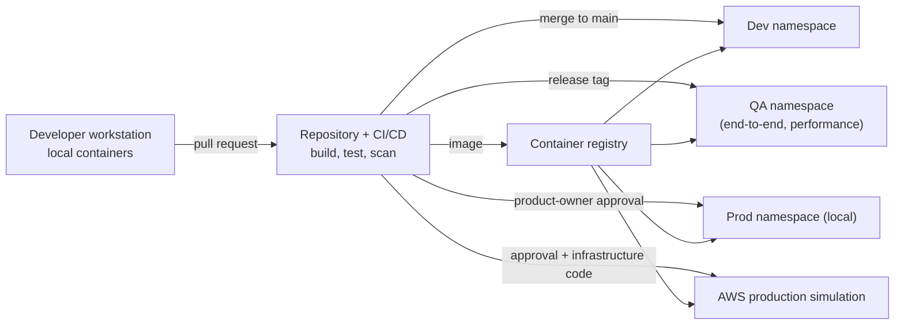

**Text version of the diagram:** see the tables below.

| Environment | Purpose | Owner | Availability | Hosting |
| --- | --- | --- | --- | --- |
| Local developer run | Coding and quick checks | Developers | On demand | Local container composition on the workstation |
| Dev | Integration of merged changes | Dev leads | On demand (may be scaled to zero) | Namespace pms-dev, local cluster |
| QA | System, end-to-end, security and performance tests; UAT | QA | During test windows | Namespace pms-qa, local cluster |
| Prod (local) | POC production and demonstration | Product owner, IT operations | Business hours when the workstation runs | Namespace pms-prod, local cluster |
| AWS production simulation | Production verification: availability, performance at scale, AWS readiness | Product owner, IT operations | Built on demand, torn down after | AWS target platform (§6.2), created from infrastructure code |

**Security posture per environment:** every environment holds synthetic data only (R-04); each has its own identity-provider realm, database credentials and secrets; Prod and the AWS simulation allow no debug logging, no direct database access for developers and deployment only through the approved pipeline; Dev and QA allow debug logging. Health and metrics endpoints are never exposed through the edge (§9.8).

**CI/CD:** the CI/CD service (§11) with one path-filtered pipeline per service and per platform component (D-18). Trunk-based development: short-lived branches and pull requests to `main`, with review. Stages and quality gates (D-112): build → unit and component tests (coverage ≥ 80 %) → contract tests against `contracts/` → code, dependency, container-image and secret scans (no high or critical findings) → image push → deploy to Dev on merge → release tag deploys to QA → end-to-end UI tests and a load-test smoke run in QA → product-owner approval deploys to Prod (and, when run, to the AWS simulation).

**Testing and deployment flow:**

| Environment | Test phase | Owning team |
| --- | --- | --- |
| Pull request | Unit, component, contract tests; scans | Developers |
| Dev | Integration and smoke tests | Dev leads |
| QA | System, end-to-end, security, performance, UAT | QA; HR Manager and Finance Manager for UAT |
| Prod (local) | Post-deployment smoke test | IT operations |
| AWS production simulation | Availability and final performance verification | QA, IT operations |

## 16. Security & NFR

### 16.1 Security guidelines

Detailed rules go into the security standard (docs/04-standards/, D-61, D-108).

| Seq | Security type | Description | Realization |
| --- | --- | --- | --- |
| 1 | Infrastructure-level security | Only the edge is reachable; zones separated; least-privilege platform access | Edge with WAF as the single entry; network policies allowing only the §6.3 flows; namespace-scoped deployment account; identity-provider console and health / metrics endpoints never exposed (§6.3, §9.8); AWS: security groups, private subnets |
| 2 | Application-level security | Every request authenticated and checked for role and data scope | Gateway session with relayed access token; token validated at gateway and service; role, permission and data scope in the service and query; neutral refusal page; no self-approval (§9.7, FR-UM-013, FR-UM-015, BR-CMN-08) |
| 3 | Data at rest | Passwords only in the identity provider, hashed; sensitive data protected like the record | No passwords in PMS (ADR-003); database files on the workstation drive, encrypted by the operating system (confirmed, OI-P01-06 closed); AWS: managed database and volume encryption with cloud key management; backups on a separate drive, encrypted likewise; audit values protected like the record (FR-ADM-104) |
| 4 | Data in transit | Encrypted between browser and edge; protected inside the platform | TLS 1.2+ (TLS 1.3 preferred) at the edge with HSTS; inside the local cluster, traffic behind the edge is not encrypted and is limited by network policies (POC limitation, §19); AWS: TLS to RDS |
| 5 | Secure environment access | Only approved people and pipelines change environments | Deployment only through the pipeline (§15); Prod and AWS simulation: no developer database access, no debug logging; observability access for IT operations only (§10.8) |
| 6 | Safe coding and deployment | Secure development life cycle | Contract validation of every request; parameterised queries only; dependency, code, image and secret scans with no high or critical findings as a gate (§15); signed, immutable image tags; non-root, read-only containers; monthly patching (D-112) |
| 7 | Secrets and key management | No secrets in code, images, values files or logs | Platform secrets per service and environment from protected pipeline secrets; cloud secret store and key management on AWS; signing keys rotated by the identity provider (§9.10) |

### 16.2 OWASP Top 10 control mapping

| OWASP category | Control |
| --- | --- |
| A01 Broken Access Control | Role and data scope enforced in the service and in the query; deny by default at gateway routes; neutral response that hides record existence; direct-link tests per role and screen (NFR-SUP-02); CSRF token with SameSite cookie |
| A02 Cryptographic Failures | TLS at the edge with HSTS; passwords hashed only by the identity provider; tokens signed RS256 with rotation; no sensitive values in logs (FR-ADM-115); encrypted disks and backups |
| A03 Injection | Requests validated against OpenAPI contracts and BRD validation rules; parameterised queries / ORM only; output encoding by the UI library; WAF rule set at the edge |
| A04 Insecure Design | BDUF with this HLD and threat review per module in Part02 (security & privacy subsection per function, D-38); business rules enforced server side (status transitions, version check FR-CMN-014) |
| A05 Security Misconfiguration | Configuration as code (deployment values, realm as code); security headers at the edge; no default credentials; registration and unused identity-provider features disabled (§9.2); health endpoints internal only |
| A06 Vulnerable and Outdated Components | Latest supported versions with monthly patching (D-112); dependency and image scanning as gates; retired components replaced (edge product, D-112) |
| A07 Identification and Authentication Failures | Identity provider with password policy, lockout, idle and absolute timeout, generic sign-in messages, sessions ended on reset, deactivation, role change and own password change (§9, D-97, D-100, D-111) |
| A08 Software and Data Integrity Failures | Pipeline-only deployment from the repository; images built once and promoted; outbox and idempotent consumer for events; audit log that cannot be changed (FR-ADM-103) |
| A09 Security Logging and Monitoring Failures | Security events from the identity provider, refused requests and activity log centralised with the flow reference; alerts by email (§10, D-111) |
| A10 Server-Side Request Forgery | Services call only fixed, configured internal addresses; no user-supplied URLs are fetched; egress from the cluster limited to the image registry and the CI/CD service |

### 16.3 Non-functional requirements realization

| Seq | NFR id (BRD) | NFR | Realization | Verification |
| --- | --- | --- | --- | --- |
| 1 | NFR-01 | Performance | Stateless services, one database per service, asynchronous AMS → SMS hand-over, per-card dashboard loading, indexes per Part03 | Performance tests §14 (local indicative, AWS final) |
| 2 | NFR-02 | Availability, backup, RPO / RTO | 2 replicas per stateless tier in Prod; daily backup with tested restore; failure isolation per module (§6.4, §12) | Restore test before go-live and monthly; availability measured in the AWS production simulation |
| 3 | NFR-03 | Security | Identity provider policy and lockout, generic messages, role and data scope on every request (§9) | Security testing; 0 access-control defects |
| 4 | NFR-04 | Usability and accessibility | Shell layout for 1366 px, WCAG 2.1 AA from the mockups; latest Chrome and Edge | Automated accessibility checks in end-to-end tests; manual review |
| 5 | NFR-05 | Auditability | Audit fields on every record; audit log per change; reconciliation run log | Audit completeness checks in system tests (KPI-03) |
| 6 | NFR-06 | Data integrity | Soft delete, unique attendance per day, idempotent salary generation, rate copied at generation, version check against overwrites | Integration tests; reconciliation result 0 mismatches (KPI-04) |
| 7 | NFR-07 | Scalability | Horizontal scale-out per service on the container platform | Load test at 2× (50 users) |
| 8 | NFR-08 | Maintainability / configurability | Independent services and pipelines; technology-neutral design and contracts; settings per environment (D-97) | Architecture review against Part01a and standards |
| 9 | NFR-09 | Logging and observability | Activity log with flow reference across calls, events and jobs; masking; 90-day retention (§10) | Log review in testing: 100 % flows traceable, 0 unmasked values |
| 10 | NFR-EIMS-01 | Sensitive data shown only within scope, never in logs or test data | Data-scope queries; log allow-list; synthetic data | Log and test-data review |
| 11 | NFR-EIMS-02 | Temporary password shown once | Returned once by the EIMS create / reset response, never stored by PMS | Security testing |
| 12 | NFR-SUP-01 to 05 | Passwords never readable; role × screen checks; no Employee Id disclosure; no unmasked log values; audit and flow traceability | §9, §10, ADR-003 | Security testing and log review |

## 17. Volumetrics

**Current volume:** none (greenfield). Year 1: about 100 employees (10 managers) and 1 PMS Administrator; 25 peak concurrent users (BRD §8.1). Growth 0 % per year; the design plans 20 % headroom and is load-tested to 2× (NFR-07).

| Volume type | YoY % | Year 1 | Year 2 | Year 3 | Year 4 | Year 5 |
| --- | --- | --- | --- | --- | --- | --- |
| Users (accounts) | 0 % (20 % headroom) | 101 | 101 | 101 | 101 | 101 |
| Peak concurrent users | 0 % | 25 | 25 | 25 | 25 | 25 |
| Transactions – attendance entries | 0 % | 26,400 | 26,400 | 26,400 | 26,400 | 26,400 |
| Transactions – salary records | 0 % | 26,400 | 26,400 | 26,400 | 26,400 | 26,400 |
| Transactions – leave requests | 0 % | 1,200 | 1,200 | 1,200 | 1,200 | 1,200 |
| Transactions – profile approvals | 0 % | 150 | 150 | 150 | 150 | 150 |
| Audit entries (estimate) | 0 % | About 490,000 | About 490,000 | About 490,000 | About 490,000 | About 490,000 |

Audit entries are an HLD estimate (BRD M5-SUP volumetrics "sized in the HLD"): about 8 entries per attendance, 10 per salary record, 8 per leave request and 30 per profile approval (creation values and status changes). Activity log: about 20,000 entries a day at year-1 usage, about 0.5 KB each – about 10 MB a day, about 1 GB for the 90-day Production retention.

| Entity | Rows per year | Avg row size | Year-5 size |
| --- | --- | --- | --- |
| Employee (EIMS) | About 100 (onboarding) | About 1 KB | < 1 MB |
| Profile change request (EIMS) | About 50 | About 1 KB | < 1 MB |
| Attendance (AMS) | About 26,400 | About 0.3 KB | About 40 MB |
| Outbox event (AMS) | About 26,400 plus reopens | About 0.5 KB | About 65 MB (cleanup of sent events decided in Part03) |
| Leave request (LMS) | About 1,200 | About 0.3 KB | About 2 MB |
| Salary record (SMS) | About 26,400 plus voided | About 0.4 KB | About 55 MB |
| Reconciliation run log (SMS) | 365 | About 0.5 KB | < 1 MB |
| Audit entries (all modules) | About 490,000 | About 0.3 KB | About 0.75 GB |
| Identity provider (accounts, sessions, events) | About 101 accounts; events about 50,000 | About 1 KB | Events kept 90 days: < 100 MB |

Year-5 sizes exclude indexes (about ×2); total database storage stays below 3 GB in year 5, with 20 % headroom.

## 18. Architecture decisions

Architecture decisions are registered in PMS-HLD-Part01a-Principles-Patterns-Decisions §5 (ADR register); each ADR is a separate file in `docs/decisions/adr/` using the format in Part01a §6. List here only the ADRs that shape this document's chapters:

| ADR | Title | Affects Part01 chapter(s) |
| --- | --- | --- |
| ADR-001 | Frontend composition – build-time packages for the POC (D-23) | §2.2.2, §4.3, §5.3, §7, §15 |
| ADR-002 | Hosting and runtime platform – on-premises Kubernetes for the POC, AWS as the cloud target (D-109, D-110) | §2.2.2, §6, §7, §11, §15 |
| ADR-003 | Identity provider issues tokens and holds passwords (D-109) | §9, §16 |
| ADR-004 | API gateway holds the user tokens – browser gets only a session cookie (D-110, D-111) | §6.1, §9.3, §9.5, §9.8, §19 |
| ADR-005 | Edge on the Kubernetes Gateway API with a WAF rule set (D-112) | §6.2, §7, §11, §16 |
| ADR-006 | AMS → SMS hand-over by transactional outbox, idempotent consumer and nightly reconciliation (D-16) | §5.2, §8, §12 |

Part01a §5 registers all six (D-113).

## 19. Risks and technical debt

BRD risks with an architecture response: R-01 and R-03 (outbox, idempotent consumer, nightly reconciliation – §8, ADR-006), R-04 (role and data scope in the service and query – §9.7), R-06 (BDUF gate, Part01a compliance, standards – §3).

| Id | Item | Impact | Mitigation / plan |
| --- | --- | --- | --- |
| AR-01 | The on-premises POC runs on one workstation: availability depends on the machine being on; capacity is shared by three environments (OI-P01-03) | POC availability below NFR-02; slow environments | Scale Dev / QA to zero when unused; availability verified in the AWS production simulation (D-110) |
| AR-02 | No shared session store: gateway instances use session affinity; a back-channel logout is relayed between instances | A request in flight can fail on gateway failover; a missed logout lasts at most the access-token lifetime (5 minutes) | Technical debt: shared in-memory session store and cache in a future phase (D-110) |
| AR-03 | Database and broker run as single nodes | Restart or restore needed on failure (RTO 8 h) | Persistent storage, daily backup, outbox and reconciliation; HA (replica, multi-AZ) Future |
| AR-04 | Inside the local cluster, traffic behind the edge is not encrypted, and platform secrets have limited encryption at rest on the local container platform | Lower protection on the workstation than on AWS | Synthetic data only; network policies; encrypted workstation and backup drives; AWS uses TLS and cloud key management; mutual TLS / service mesh Future |
| AR-05 | Brand-new major versions of the backend framework and the database (§11) may have early defects; the database version may not yet be offered by the AWS managed database service | Rework or a version step back | Monthly patching; fall back to the previous minor if blocked; RDS availability checked before the AWS simulation (OI-P01-04) |
| AR-06 | The WAF is loaded into the edge proxy as a dynamic module (§11); loading by image volume needs Kubernetes 1.35 or later | WAF may not load on an older local Kubernetes version | Check the local Kubernetes version; otherwise load the module with an init container or a custom image (OI-P01-05) |
| AR-07 | Local performance results are indicative only (load generator and system share one machine) | Wrong capacity conclusions | Final verification in the AWS production simulation (§14.6) |
| AR-08 | Module screens are built into the shell (ADR-001) | Any module UI change redeploys the shell | Module contract (routes, menu, components) kept clean; runtime micro-frontends after the POC |
| AR-09 | Backend built first in Java, to be replatformed to Node.js and Python FastAPI (D-12) | Framework-specific behaviour leaking into contracts and data | Contract-first APIs and events, technology-neutral HLD, standards review of contracts |

## 20. Appendix

### 20.1 Open items

| Id | Open item | Owner | Due |
| --- | --- | --- | --- |
| OI-P01-01 | Part01a assessment: counts per group in §4.1 and confirmation of the catalogue ids in §4.2 to §4.4 | Enterprise Architect | Part01a |
| OI-P01-02 | Provisioning approach (infrastructure and environments as code) – closed by D-110: deployment charts for PMS, infrastructure code for AWS (§11) | Enterprise Architect | Closed 22 Nov 2026 |
| OI-P01-03 | Capacity of the local workstation (CPU, memory, disk) for three namespaces, the observability stack and the local container platform; at least 32 GB memory – confirmed by the product owner | Product owner | Closed 22 Nov 2026 |
| OI-P01-04 | Database version of §11 available on the AWS managed database service (on 22 Nov 2026 offered only in the provider's preview environment); otherwise the previous major version on AWS (D-112). Rule meanwhile: schema scripts use no feature new in that version, so they run on both versions (D-114) | Enterprise Architect | Before the AWS production simulation |
| OI-P01-05 | Local Kubernetes version supports loading the WAF module (1.35 or later) – closed by D-114: the local container platform is kept at its latest release (Kubernetes 1.36 in current releases); the server version is verified as the first step of building the Dev environment; a multi-node local cluster definition also uses 1.35 or later | Enterprise Architect | Closed 22 Nov 2026 |
| OI-P01-06 | Operating-system encryption of the workstation drive and the backup drive (data at rest, §16.1) – confirmed by the product owner | Product owner | Closed 22 Nov 2026 |

### 20.2 Glossary

| Term | Meaning |
| --- | --- |
| BDUF | Big Design Up Front – the design is approved before implementation starts |
| CSRF | Cross-site request forgery; prevented with a token and a SameSite cookie |
| Dead-letter queue | Queue holding messages that could not be processed after the allowed retries |
| Flow reference | Short reference of one user action or job run, carried through all modules and shown in error messages (FR-ADM-113, FR-ADM-114) |
| Gateway API | The Kubernetes standard for routing external traffic into the cluster, successor of Ingress |
| JWT | JSON Web Token – the signed access token format |
| LTS | Long-term support release |
| Namespace | Isolated section of the container platform; one per environment in the POC |
| OIDC / PKCE | OpenID Connect sign-in protocol / Proof Key for Code Exchange, protecting the authorization code |
| Outbox | Table in which an event is stored in the same transaction as the business change and published afterwards |
| RPO / RTO | Recovery point objective (maximum data loss) / recovery time objective (maximum time to restore) |
| WAF | Web application firewall |

### 20.3 Future scope

| Area | Item | Ref |
| --- | --- | --- |
| Security | Multi-factor sign-in, starting with the PMS Administrator | §9.4, D-109 |
| Security | Mutual TLS / service mesh between services | §9.9, AR-04 |
| Platform | Shared in-memory data store for gateway sessions and caching | D-110, AR-02 |
| Availability | Database replica and multi-AZ deployment on AWS; clustered broker | AR-03 |
| Frontend | Runtime micro-frontends instead of build-time packages | ADR-001 |
| Backend | Replatforming of the backend to other technologies | D-12 |
| Observability | Audit and activity log viewer (ADM, Phase 2); cloud-native monitoring services on AWS | D-101, D-110 |
| Supporting functions | Notifications (NM) and document management (DM), Phase 2 | D-57 |
