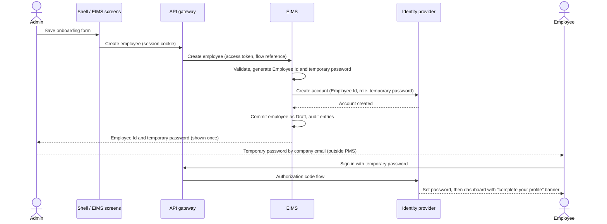
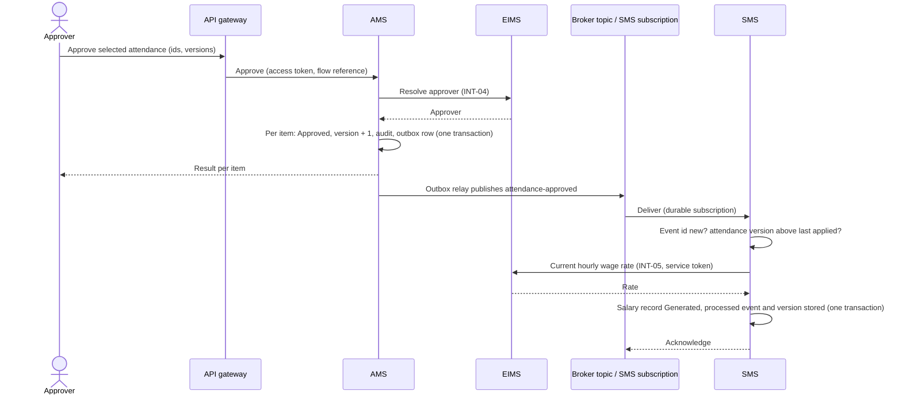
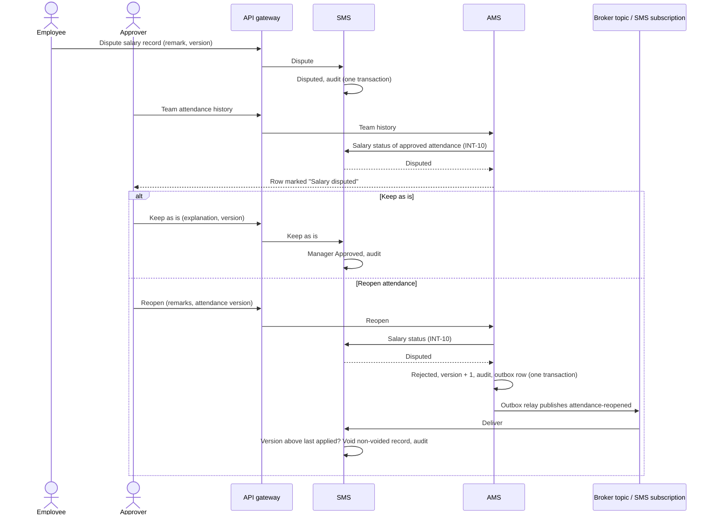
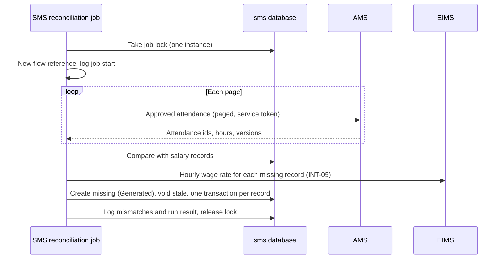
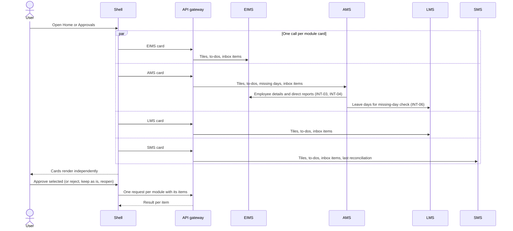
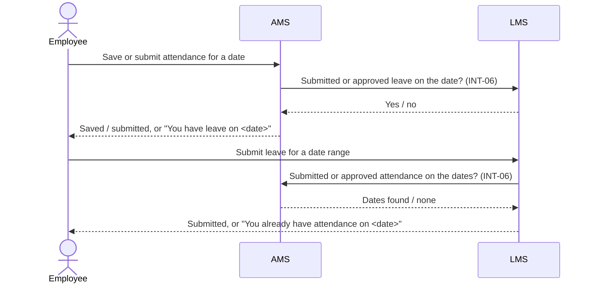
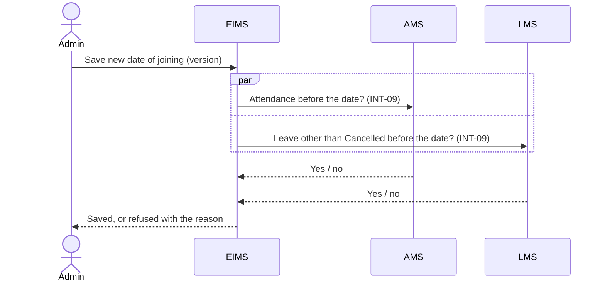
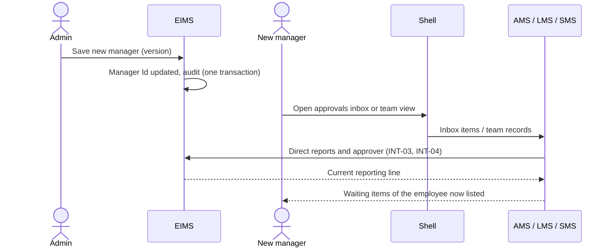
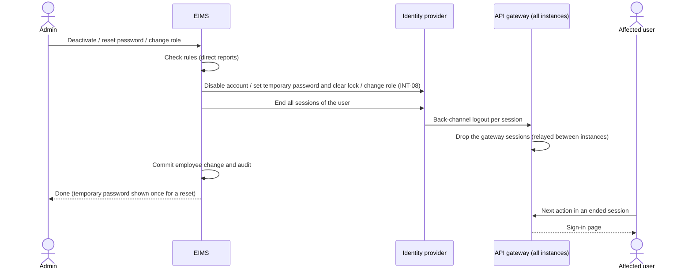

# PMS – HLD Part02: Functional Design (Anchor)

Document ID: PMS-HLD-Part02-Functional-v1.0
Scope: functional design anchor – module index, function index, cross-module flows, common design conventions and roll-up inventories; per-function designs are in the module documents
Project: Payroll Management System (PMS) – proof of concept (POC), Stage 3 Solution Design
Author: Rajesh Verma (Enterprise Architect)
Date: November 2026

## 1. Document control

### 1.1 Version / revision history

| Version | Revision | Date | Author | Change remark |
| --- | --- | --- | --- | --- |
| 1.0 | 0.1 | 23-Nov-2026 | Rajesh Verma | First draft of §1–§3, based on the approved BRD set v1.0 (D-107), UX v1.1 (D-105), PMS-HLD-Part01 v1.0 rev 0.9 and PMS-HLD-Part01a v1.0 rev 0.5; Part02 anchor design answers of 23 Nov 2026 (D-122) |
| 1.0 | 0.2 | 23-Nov-2026 | Rajesh Verma | Draft of §4 (function index, 77 functions) and §5 (cross-module flows XF-01 to XF-09); open items OI-P02-01 and 02 (D-123) |
| 1.0 | 0.3 | 23-Nov-2026 | Rajesh Verma | Draft of §6 (API, event, error, audit and activity log, notification and frontend conventions; event ordering rule; shared design system) |
| 1.0 | 0.4 | 23-Nov-2026 | Rajesh Verma | Draft of §7–§10 (roll-up inventories, cross-module NFR summary, requirement coverage of 175 FR ids, open items OI-P02-01 and 02, items brought forward); all sections drafted |

### 1.2 Review and approval

| Role | Name | Date | Decision |
| --- | --- | --- | --- |
| Architect | Rajesh Verma (Enterprise Architect) | 23-Nov-2026 | §1–§3 approved (D-122); §4–§5 approved (D-123); §6 approved (D-124); §7–§10 approved (D-125); all sections reviewed – final approval with the HLD set at the Stage 3 gate |
| Product owner | Rajesh Verma | 23-Nov-2026 | §1–§3 approved (D-122); §4–§5 approved (D-123); §6 approved (D-124); §7–§10 approved (D-125); all sections reviewed – final approval with the HLD set at the Stage 3 gate |
| Business analyst | | | |
| Dev lead | | | |

## 2. Introduction

This document is the anchor of the PMS functional design: it indexes the module design documents, designs the flows that cross modules, and sets the design conventions every module follows. Per-function designs are only in the module documents (PMS-HLD-Part02-M1-EIMS to M4-SMS and M5-SUP); this anchor never repeats them (D-48). Roll-ups that depend on a module document not yet written show "Module document (planned)" and are completed as each module document is written.

Reading rules:

- Function ids are `<MOD>0010`, `<MOD>0020` … in steps of 10 per module; supporting functions use UM, AUTH and ADM (NM and DM are Phase 2, D-57). One function is one user action on a screen or one system process.
- API references use `[API-<MOD>-nn : METHOD /ctx/resource (Purpose : ...)]`; the API inventory (§7.1) is a roll-up keyed by API id.
- Business statuses and their transitions stay in the module BRDs §6; this document holds only their technical handling.
- The design is technology-neutral (Part01 §2): identity provider, broker, gateway and edge are named by role, not by product.
- Conventions that a standard will detail refer to `docs/04-standards/<area> (planned)`, with the area names of Part01a §2.

### 2.1 Reference documents

| # | Document | Purpose |
| --- | --- | --- |
| 1 | PMS-BRD (anchor), PMS-BRD-M1-EIMS, M2-AMS, M3-LMS, M4-SMS, PMS-BRD-M5-SUP – v1.0, approved baseline (D-107) | Requirements: roles and data scope (anchor §4), end-to-end process, 30 journeys and shared screens (§5), cross-module rules BR-CMN (§6), integrations INT-01 to INT-10 and JOB-CMN-01 (§7), NFR-01 to NFR-09 (§8); module functional requirements, statuses and NFRs |
| 2 | UX Journey Index v1.1 and 17 UX Summaries v1.1 (D-105); shared mockup assets `docs/01-ux/mockups/html/assets/` | Experience design, navigation map, screen states, approved visual style (D-27) |
| 3 | PMS-HLD-Part01-Architecture-and-Design v1.0 rev 0.9 | Functional, integration, security and observability architecture (§5, §8, §9, §10), NFR realization (§16.3) |
| 4 | PMS-HLD-Part01a-Principles-Patterns-Decisions v1.0 rev 0.5 | Principles and patterns catalogue; ADR register ADR-001 to ADR-006; open items OI-P01a-01 to 17 |
| 5 | PMS-HLD-Part03-Datamodel (anchor) and module data-model documents (planned) | Data model; columns defined only in the module data-model documents |
| 6 | API and event contracts (`contracts/openapi`, `contracts/events`) | OpenAPI 3 contracts and versioned event schemas, written before implementation (D-16, D-18) |
| 7 | Decision log `docs/decisions/decision-log.md` | Approved project decisions D-01 onwards |

### 2.2 Module design documents

| Module | Document | Owning service | Version | Status |
| --- | --- | --- | --- | --- |
| EIMS | PMS-HLD-Part02-M1-EIMS-Functional | EIMS service (/eims) | – | Not started |
| AMS | PMS-HLD-Part02-M2-AMS-Functional | AMS service (/ams) | – | Not started |
| LMS | PMS-HLD-Part02-M3-LMS-Functional | LMS service (/lms) | – | Not started |
| SMS | PMS-HLD-Part02-M4-SMS-Functional | SMS service (/sms), incl. JOB-CMN-01 | – | Not started |
| SUP (UM, AUTH, ADM) | PMS-HLD-Part02-M5-SUP-Functional | Identity provider, API gateway, shell; audit and activity log in every service | – | Not started |

The shell (layout, menu, dashboard, approvals inbox) has no module document of its own: its composition is designed in this anchor (§5 XF-05, §6.5), and each module document designs the tiles, to-do items and inbox items its module supplies (BRD §5.3).

## 3. Functional landscape

### 3.1 Module overview

| Module | Purpose | Primary users (roles) | Key entities owned | Depends on (modules) | Used by (modules) |
| --- | --- | --- | --- | --- | --- |
| Shell (common UI) | One layout and role-based menu for every screen; dashboard per role and approvals inbox across modules (BRD §5.3, FR-CMN-001 to 016) | Employee, Manager, Admin | None (composes module data) | EIMS, AMS, LMS, SMS (INT-07); AUTH (session) | – |
| EIMS – Employee information | Onboarding with Employee Id and temporary password, profile and profile change request with approval, Admin-owned fields, deactivation, password reset, directory | Admin, Employee, Manager; system (SYS-EIMS) | Employee, profile change request | UM / identity provider (INT-08); AMS, LMS (INT-09) | Shell, AMS, LMS, SMS (INT-03, INT-04, INT-05) |
| AMS – Attendance | Daily attendance entry, submit, discard, approve / reject, reopen after a salary dispute; hand-over to SMS | Employee, Manager, Admin (top-level employee only) | Attendance; outbox entries | EIMS (INT-03, INT-04, INT-09 as provider); LMS (INT-06); SMS (INT-10) | Shell (INT-07); SMS (INT-01, INT-02 events; JOB-CMN-01 query); LMS (INT-06); EIMS (INT-09) |
| LMS – Leave | Full-day leave request, cancel while Submitted, approve / reject | Employee, Manager, Admin (top-level employee only) | Leave request | EIMS (INT-03, INT-04); AMS (INT-06) | Shell (INT-07); AMS (INT-06); EIMS (INT-09) |
| SMS – Salary | Salary record generation and voiding from attendance events, manager approval, accept / dispute, keep as is, earnings, nightly reconciliation | Employee, Manager, Admin (top-level employee only); system (SYS-SMS, SYS-REC) | Salary record, reconciliation run; processed-event record | AMS (INT-01, INT-02, JOB-CMN-01); EIMS (INT-03, INT-04, INT-05) | Shell (INT-07); AMS (INT-10) |
| SUP – UM | User accounts and roles held in the identity provider; role and data-scope checks (FR-UM-001 to 015) | Admin (through EIMS screens); every request | User account (in the identity provider) | Identity provider | EIMS (INT-08); every module (role and scope rules) |
| SUP – AUTH | Sign-in, set and change password, lockout, idle timeout, log out, security events (FR-AUTH-001 to 030) | All roles | Session (gateway), credentials (identity provider) | Identity provider, API gateway | Shell; every module (authenticated requests) |
| SUP – ADM (POC part) | Audit log and activity log with one flow reference per user action or job run (FR-ADM-101 to 117) | IT operations (no screen in the POC) | Audit log entry (per module database), activity log entry (log platform) | Log and monitoring platform | Every module, job and event |

### 3.2 Module dependency map

**Text version of the diagram**

| From module | To module | Dependency (API / event / job) | Purpose | Flow (§5) |
| --- | --- | --- | --- | --- |
| Shell | EIMS, AMS, LMS, SMS | API (INT-07), one call per module card | Dashboard tiles, to-do items, missing days, approvals inbox items and counts | XF-05 |
| AMS, LMS, SMS, shell | EIMS | API (INT-03) | Employee details: name, Employee Id, date of joining, Manager Id, profile status, active flag | XF-02, XF-05, XF-08 |
| AMS, LMS, SMS, shell | EIMS | API (INT-04) | Approver resolution: owner's manager, or the Admin for the top-level employee; no self-approval | XF-02, XF-05, XF-08 |
| SMS | EIMS | API (INT-05) | Current hourly wage rate, copied into the salary record at generation | XF-02, XF-04 |
| EIMS | AMS, LMS | API (INT-09) | Records before a new date of joining | XF-07 |
| AMS | LMS | API (INT-06) | Leave on the attendance date (save and submit) | XF-06 |
| LMS | AMS | API (INT-06) | Attendance on the leave dates (submit) | XF-06 |
| AMS | SMS | Event (INT-01) | Attendance approved → salary record generated | XF-02 |
| AMS | SMS | Event (INT-02) | Attendance reopened → salary record voided | XF-03 |
| SMS | AMS | Job (JOB-CMN-01), paged API | Approved attendance for the nightly reconciliation | XF-04 |
| AMS | SMS | API (INT-10) | Salary status of approved attendance: "Salary disputed" marker in team history and server-side check before a reopen | XF-03 |
| EIMS | Identity provider (UM) | API (INT-08) | Create account, set role, reset password, disable, end sessions | XF-01, XF-09 |
| Shell (through the gateway) | Identity provider (AUTH) | Sign-in, refresh, log out (Part01 §8.2 row 13) | Session for every request | XF-01, XF-09 |

## 4. System function index (all modules)

One function is one user action on a screen or one system process (D-122); ids `<MOD>0010` in steps of 10; SH for the shell, designed in this anchor because the shell has no module document; UM, AUTH and ADM for SUP (ADM only for the POC part FR-ADM-101 to 117, D-101). The references in brackets show the main requirement source; the full mapping is in §9. Design status "Not started" becomes Draft when the module document is drafted.

| Function id | System function | Module | Type (screen / API / backend job / configuration) | UX screen | Delivery phase | Design status | Document section |
| --- | --- | --- | --- | --- | --- | --- | --- |
| SH0010 | Show shell layout, role-based menu and user menu (FR-CMN-015, FR-UM-012, FR-AUTH-024) | Shell | Screen | SCR-SH-00 | POC | Draft | This anchor §6.5 |
| SH0020 | Show the dashboard per role, one card per module (FR-CMN-001 to 008) | Shell | Screen | SCR-SH-03 | POC | Draft | This anchor §5.5 (XF-05), §6.5 |
| SH0030 | Show the approvals inbox across modules, tabs and counts (FR-CMN-010, 013) | Shell | Screen | SCR-SH-04 | POC | Draft | This anchor §5.5 (XF-05), §6.5 |
| SH0040 | Decide inbox items – approve one or several, reject one, keep as is or reopen – through the owning module functions (FR-CMN-011, 012, 014) | Shell | Screen | SCR-SH-04 | POC | Draft | This anchor §5.5 (XF-05), §6.1 |
| EIMS0010 | View the employee directory – search, filter, show inactive; Admin all, manager direct reports (FR-EIMS-001 to 004, 006) | EIMS | Screen | SCR-EIMS-01 | POC | Not started | PMS-HLD-Part02-M1-EIMS (planned) |
| EIMS0020 | Onboard an employee – create the employee and the user account (FR-EIMS-010, 011, 014; INT-08) | EIMS | Screen | SCR-EIMS-02 | POC | Not started | PMS-HLD-Part02-M1-EIMS (planned) |
| EIMS0030 | Generate Employee Id and temporary password (FR-EIMS-040, 041; UJ-SYS-04) | EIMS | Backend process | – | POC | Not started | PMS-HLD-Part02-M1-EIMS (planned) |
| EIMS0040 | Edit Admin-owned fields – date of joining, role, manager, hourly wage rate (FR-EIMS-012 to 017; INT-08, INT-09) | EIMS | Screen | SCR-EIMS-02 | POC | Not started | PMS-HLD-Part02-M1-EIMS (planned) |
| EIMS0050 | Deactivate an employee (FR-EIMS-018; INT-08) | EIMS | Screen | SCR-EIMS-02 | POC | Not started | PMS-HLD-Part02-M1-EIMS (planned) |
| EIMS0060 | Reset an employee's password (FR-EIMS-005; INT-08) | EIMS | Screen | SCR-EIMS-01 | POC | Not started | PMS-HLD-Part02-M1-EIMS (planned) |
| EIMS0070 | View my profile and its status (FR-EIMS-020) | EIMS | Screen | SCR-EIMS-03 | POC | Not started | PMS-HLD-Part02-M1-EIMS (planned) |
| EIMS0080 | Save a profile draft (FR-EIMS-021) | EIMS | Screen | SCR-EIMS-03 | POC | Not started | PMS-HLD-Part02-M1-EIMS (planned) |
| EIMS0090 | Submit or resubmit my profile (FR-EIMS-022, 024) | EIMS | Screen | SCR-EIMS-03 | POC | Not started | PMS-HLD-Part02-M1-EIMS (planned) |
| EIMS0100 | Withdraw my submitted profile (FR-EIMS-023) | EIMS | Screen | SCR-EIMS-03 | POC | Not started | PMS-HLD-Part02-M1-EIMS (planned) |
| EIMS0110 | Start and save a profile change request (FR-EIMS-025, 026) | EIMS | Screen | SCR-EIMS-03 | POC | Not started | PMS-HLD-Part02-M1-EIMS (planned) |
| EIMS0120 | Submit or resubmit a profile change request (FR-EIMS-026, 027) | EIMS | Screen | SCR-EIMS-03 | POC | Not started | PMS-HLD-Part02-M1-EIMS (planned) |
| EIMS0130 | Withdraw a profile change request (FR-EIMS-027) | EIMS | Screen | SCR-EIMS-03 | POC | Not started | PMS-HLD-Part02-M1-EIMS (planned) |
| EIMS0140 | Open a profile or change request for review, or read only from the directory (FR-EIMS-030 to 032, 034, 035) | EIMS | Screen | SCR-EIMS-04 | POC | Not started | PMS-HLD-Part02-M1-EIMS (planned) |
| EIMS0150 | Approve profiles or change requests, one or several; apply approved changes (FR-EIMS-033, 028) | EIMS | Screen | SCR-EIMS-04, SCR-SH-04 | POC | Not started | PMS-HLD-Part02-M1-EIMS (planned) |
| EIMS0160 | Reject a profile or change request with remarks (FR-EIMS-033) | EIMS | Screen | SCR-EIMS-04, SCR-SH-04 | POC | Not started | PMS-HLD-Part02-M1-EIMS (planned) |
| EIMS0170 | Provide employee details to other modules (INT-03) | EIMS | API | – | POC | Not started | PMS-HLD-Part02-M1-EIMS (planned) |
| EIMS0180 | Resolve the approver of a record (INT-04) | EIMS | API | – | POC | Not started | PMS-HLD-Part02-M1-EIMS (planned) |
| EIMS0190 | Provide the current hourly wage rate (INT-05) | EIMS | API | – | POC | Not started | PMS-HLD-Part02-M1-EIMS (planned) |
| EIMS0200 | Supply EIMS dashboard tiles, to-do items and inbox items (INT-07) | EIMS | API | SCR-SH-03, SCR-SH-04 | POC | Not started | PMS-HLD-Part02-M1-EIMS (planned) |
| AMS0010 | View my attendance – month calendar or list, tiles, missing weekdays, leave days (FR-AMS-001 to 008) | AMS | Screen | SCR-AMS-01 | POC | Not started | PMS-HLD-Part02-M2-AMS (planned) |
| AMS0020 | Save an attendance draft (FR-AMS-010, 011, 014, 015; INT-06) | AMS | Screen | SCR-AMS-02 | POC | Not started | PMS-HLD-Part02-M2-AMS (planned) |
| AMS0030 | Submit or resubmit attendance (FR-AMS-012 to 014, 016; INT-04, INT-06) | AMS | Screen | SCR-AMS-02 | POC | Not started | PMS-HLD-Part02-M2-AMS (planned) |
| AMS0040 | Discard a Draft or Rejected entry (FR-AMS-017) | AMS | Screen | SCR-AMS-01, SCR-AMS-02 | POC | Not started | PMS-HLD-Part02-M2-AMS (planned) |
| AMS0050 | View team attendance – pending and history, "Salary disputed" marker (FR-AMS-020, 021, 024, 026, 027; INT-10) | AMS | Screen | SCR-AMS-03 | POC | Not started | PMS-HLD-Part02-M2-AMS (planned) |
| AMS0060 | Approve attendance, one or several, and record the hand-over event (FR-AMS-022, 030; INT-01) | AMS | Screen | SCR-AMS-03, SCR-SH-04 | POC | Not started | PMS-HLD-Part02-M2-AMS (planned) |
| AMS0070 | Reject attendance with remarks (FR-AMS-023) | AMS | Screen | SCR-AMS-03, SCR-SH-04 | POC | Not started | PMS-HLD-Part02-M2-AMS (planned) |
| AMS0080 | Reopen approved attendance after a salary dispute (FR-AMS-025, 031; INT-10, INT-02) | AMS | Screen | SCR-AMS-03, SCR-SMS-02, SCR-SH-04 | POC | Not started | PMS-HLD-Part02-M2-AMS (planned) |
| AMS0090 | Publish attendance events from the outbox (INT-01, INT-02) | AMS | Backend process | – | POC | Not started | PMS-HLD-Part02-M2-AMS (planned) |
| AMS0100 | Provide approved attendance for the nightly reconciliation (FR-AMS-032; JOB-CMN-01) | AMS | API | – | POC | Not started | PMS-HLD-Part02-M2-AMS (planned) |
| AMS0110 | Check attendance on leave dates for LMS (INT-06) | AMS | API | – | POC | Not started | PMS-HLD-Part02-M2-AMS (planned) |
| AMS0120 | Check attendance before a new date of joining (INT-09) | AMS | API | – | POC | Not started | PMS-HLD-Part02-M2-AMS (planned) |
| AMS0130 | Supply AMS dashboard tiles, to-do items, missing days and inbox items (INT-07) | AMS | API | SCR-SH-03, SCR-SH-04 | POC | Not started | PMS-HLD-Part02-M2-AMS (planned) |
| LMS0010 | View my leave – tiles, list, filters, team tab entry (FR-LMS-001 to 003, 006 to 009) | LMS | Screen | SCR-LMS-01 | POC | Not started | PMS-HLD-Part02-M3-LMS (planned) |
| LMS0020 | Submit or resubmit a leave request (FR-LMS-010 to 016; INT-04, INT-06) | LMS | Screen | SCR-LMS-02 | POC | Not started | PMS-HLD-Part02-M3-LMS (planned) |
| LMS0030 | Cancel a submitted leave request (FR-LMS-004, 005) | LMS | Screen | SCR-LMS-01 | POC | Not started | PMS-HLD-Part02-M3-LMS (planned) |
| LMS0040 | View team leave – pending with "Also away", history (FR-LMS-020 to 022, 026 to 028) | LMS | Screen | SCR-LMS-03 | POC | Not started | PMS-HLD-Part02-M3-LMS (planned) |
| LMS0050 | Approve leave, one or several (FR-LMS-023, 025) | LMS | Screen | SCR-LMS-03, SCR-SH-04 | POC | Not started | PMS-HLD-Part02-M3-LMS (planned) |
| LMS0060 | Reject leave with remarks (FR-LMS-024) | LMS | Screen | SCR-LMS-03, SCR-SH-04 | POC | Not started | PMS-HLD-Part02-M3-LMS (planned) |
| LMS0070 | Check leave on an attendance date for AMS (INT-06) | LMS | API | – | POC | Not started | PMS-HLD-Part02-M3-LMS (planned) |
| LMS0080 | Check leave before a new date of joining (INT-09) | LMS | API | – | POC | Not started | PMS-HLD-Part02-M3-LMS (planned) |
| LMS0090 | Supply LMS dashboard tiles, to-do items and inbox items (INT-07) | LMS | API | SCR-SH-03, SCR-SH-04 | POC | Not started | PMS-HLD-Part02-M3-LMS (planned) |
| SMS0010 | View my salary – period, tiles, records, voided toggle, total (FR-SMS-001 to 006, 012 to 014) | SMS | Screen | SCR-SMS-01 | POC | Not started | PMS-HLD-Part02-M4-SMS (planned) |
| SMS0020 | Accept salary records, one or several (FR-SMS-007, 008, 011) | SMS | Screen | SCR-SMS-01 | POC | Not started | PMS-HLD-Part02-M4-SMS (planned) |
| SMS0030 | Dispute a salary record with a remark (FR-SMS-009 to 011) | SMS | Screen | SCR-SMS-01 | POC | Not started | PMS-HLD-Part02-M4-SMS (planned) |
| SMS0040 | View team salary – needs action, all records, team totals (FR-SMS-020, 021, 023, 027 to 029) | SMS | Screen | SCR-SMS-02 | POC | Not started | PMS-HLD-Part02-M4-SMS (planned) |
| SMS0050 | Approve generated salary records, one or several (FR-SMS-022, 024) | SMS | Screen | SCR-SMS-02, SCR-SH-04 | POC | Not started | PMS-HLD-Part02-M4-SMS (planned) |
| SMS0060 | Close a dispute with Keep as is (FR-SMS-025) | SMS | Screen | SCR-SMS-02, SCR-SH-04 | POC | Not started | PMS-HLD-Part02-M4-SMS (planned) |
| SMS0070 | Start a reopen from a disputed salary record – dialog calling AMS0080 (FR-SMS-026) | SMS | Screen | SCR-SMS-02, SCR-SH-04 | POC | Not started | PMS-HLD-Part02-M4-SMS (planned) |
| SMS0080 | Generate a salary record on attendance approved (FR-SMS-040, 041; INT-01, INT-05) | SMS | Backend process (event) | – | POC | Not started | PMS-HLD-Part02-M4-SMS (planned) |
| SMS0090 | Void the salary record on attendance reopened (FR-SMS-042; INT-02) | SMS | Backend process (event) | – | POC | Not started | PMS-HLD-Part02-M4-SMS (planned) |
| SMS0100 | Nightly salary reconciliation (FR-SMS-043 to 045; JOB-CMN-01) | SMS | Backend job | – | POC | Not started | PMS-HLD-Part02-M4-SMS (planned) |
| SMS0110 | Provide salary status for approved attendance (FR-SMS-046; INT-10) | SMS | API | – | POC | Not started | PMS-HLD-Part02-M4-SMS (planned) |
| SMS0120 | Supply SMS dashboard tiles, to-do items, inbox items and last reconciliation run (INT-07) | SMS | API | SCR-SH-03, SCR-SH-04 | POC | Not started | PMS-HLD-Part02-M4-SMS (planned) |
| UM0010 | Create the user account at onboarding (FR-UM-001, 002; INT-08) | SUP (UM) | Backend process | – | POC | Not started | PMS-HLD-Part02-M5-SUP (planned) |
| UM0020 | Set up the PMS Administrator account at installation (FR-UM-004, 005) | SUP (UM) | Configuration | – | POC | Not started | PMS-HLD-Part02-M5-SUP (planned) |
| UM0030 | Replace the password with a temporary one, clear the lock and end sessions (FR-UM-006) | SUP (UM) | Backend process | – | POC | Not started | PMS-HLD-Part02-M5-SUP (planned) |
| UM0040 | Disable the account and end sessions on deactivation (FR-UM-003, 007) | SUP (UM) | Backend process | – | POC | Not started | PMS-HLD-Part02-M5-SUP (planned) |
| UM0050 | Change the role and end sessions (FR-UM-010, 011) | SUP (UM) | Backend process | – | POC | Not started | PMS-HLD-Part02-M5-SUP (planned) |
| UM0060 | Check role and data scope on every request (FR-UM-013, 014) | SUP (UM) | Backend process | – | POC | Not started | PMS-HLD-Part02-M5-SUP (planned) |
| UM0070 | Return the neutral no-access response and page (FR-UM-015) | SUP (UM) | Screen | SCR-SH-00 | POC | Not started | PMS-HLD-Part02-M5-SUP (planned) |
| AUTH0010 | Sign in (FR-AUTH-001 to 008, 014) | SUP (AUTH) | Screen | SCR-SH-01 | POC | Not started | PMS-HLD-Part02-M5-SUP (planned) |
| AUTH0020 | Set password at first sign-in or after a reset (FR-AUTH-006, 010, 012, 013, 015) | SUP (AUTH) | Screen | SCR-SH-02 | POC | Not started | PMS-HLD-Part02-M5-SUP (planned) |
| AUTH0030 | Change my password (FR-AUTH-011, 012, 015, 022) | SUP (AUTH) | Screen | SCR-SH-02 | POC | Not started | PMS-HLD-Part02-M5-SUP (planned) |
| AUTH0040 | End the session after 30 minutes idle or at the absolute limit (FR-AUTH-020, 021; FR-CMN-016) | SUP (AUTH) | Backend process | SCR-SH-01 | POC | Not started | PMS-HLD-Part02-M5-SUP (planned) |
| AUTH0050 | Log out (FR-AUTH-023) | SUP (AUTH) | Screen | SCR-SH-00 | POC | Not started | PMS-HLD-Part02-M5-SUP (planned) |
| AUTH0060 | Record security events (FR-AUTH-030) | SUP (AUTH) | Backend process | – | POC | Not started | PMS-HLD-Part02-M5-SUP (planned) |
| ADM0010 | Write audit log entries for every data change (FR-ADM-101 to 104) | SUP (ADM) | Backend process | – | POC | Not started | PMS-HLD-Part02-M5-SUP (planned) |
| ADM0020 | Extract a record's audit history on request (FR-ADM-105) | SUP (ADM) | Configuration (operations procedure) | – | POC | Not started | PMS-HLD-Part02-M5-SUP (planned) |
| ADM0030 | Write activity log entries for operations, jobs and events (FR-ADM-111, 112, 115, 116) | SUP (ADM) | Backend process | – | POC | Not started | PMS-HLD-Part02-M5-SUP (planned) |
| ADM0040 | Create and carry the flow reference (FR-ADM-113) | SUP (ADM) | Backend process | – | POC | Not started | PMS-HLD-Part02-M5-SUP (planned) |
| ADM0050 | Show "Reference: <flow reference>" in system error messages (FR-ADM-114) | SUP (ADM) | Screen | SCR-SH-00 and every screen | POC | Not started | PMS-HLD-Part02-M5-SUP (planned) |
| ADM0060 | Log refused requests (FR-ADM-117) | SUP (ADM) | Backend process | – | POC | Not started | PMS-HLD-Part02-M5-SUP (planned) |

Totals: 77 functions – Shell 4, EIMS 20, AMS 13, LMS 9, SMS 12, SUP (UM) 7, SUP (AUTH) 6, SUP (ADM) 6.

## 5. Cross-module flows

One subsection per business flow that spans two or more modules (D-122). The step table under each diagram is its text version. Business statuses are those of the module BRDs §6; this section holds only the technical hand-over. Every user action and job run carries one flow reference through all steps (Part01 §10.5); every command carries the record version (FR-CMN-014, §6.1).

| Flow | Name | Integrations | Modules |
| --- | --- | --- | --- |
| XF-01 | Onboarding and account creation | INT-08 | EIMS, SUP (UM, AUTH), shell |
| XF-02 | Attendance approval → salary generation | INT-01, INT-04, INT-05 | AMS, SMS, EIMS, shell |
| XF-03 | Salary dispute → reopen attendance → void salary record | INT-02, INT-10 | SMS, AMS, shell |
| XF-04 | Nightly salary reconciliation | JOB-CMN-01, INT-05 | SMS, AMS, EIMS |
| XF-05 | Dashboard and approvals inbox composition | INT-07, INT-03, INT-04, INT-06 | Shell, EIMS, AMS, LMS, SMS |
| XF-06 | Attendance and leave date check | INT-06 | AMS, LMS |
| XF-07 | Date-of-joining change check | INT-09 | EIMS, AMS, LMS |
| XF-08 | Manager change moving waiting items | INT-04 | EIMS, AMS, LMS, SMS, shell |
| XF-09 | Account changes ending sessions – deactivation, password reset, role change | INT-08 | EIMS, SUP (UM, AUTH), gateway |

### 5.1 XF-01 – Onboarding and account creation

| Item | Detail |
| --- | --- |
| Business purpose | A new employee gets an employee record and a user account in one Admin action, and can sign in and complete the profile |
| Trigger | Admin saves the onboarding form (SCR-EIMS-02) |
| Modules involved | EIMS, SUP (UM through the identity provider, AUTH), shell |
| Requirement refs | FR-EIMS-010, 011, 014, 040, 041; FR-UM-001, 002; FR-AUTH-006, 010, 013; INT-08; BRD §5.1 steps 1–2; UJ-EIMS-01, UJ-SYS-04, UJ-SH-01, UJ-SH-02; D-104 (OI-EIMS-01) |
| Pre-conditions / post-conditions | Pre: Admin signed in; manager chosen or "None – top-level" (only one top-level employee). Post: employee Draft; account enabled with the Employee Id as user name, the chosen role and a temporary password that must be replaced at first sign-in; temporary password shown once to the Admin |

| Step | Module | Function id | Interaction (sync API / event / job) | API / event | Consistency (local tx / outbox / saga / compensation) |
| --- | --- | --- | --- | --- | --- |
| 1 | EIMS | EIMS0020 | Sync API through the gateway | Create employee – Module document (planned) | Validation only (FR-EIMS-011, 014) |
| 2 | EIMS | EIMS0030 | Internal | – | Employee Id sequence, never reused (FR-EIMS-040) |
| 3 | SUP (UM) | UM0010 | Sync API to the identity provider (INT-08), service account | Identity provider admin API | Keyed by Employee Id (Part01 §8.5) |
| 4 | EIMS | EIMS0020 | Internal | – | Local transaction: employee Draft and audit entries (ADM0010) |
| 5 | – | – | Manual hand-over by company email (D-104) | – | – |
| 6 | SUP (AUTH) | AUTH0010, AUTH0020 | Sign-in through the gateway (Part01 §8.2 row 13) | OIDC | Identity provider |
| 7 | Shell, EIMS | SH0020, EIMS0200 | Sync API (INT-07) | Dashboard card – Module document (planned) | Read only |

**Failure handling & compensation:** If the account cannot be created, the onboarding is refused with "Reference: <flow reference>" and no employee is saved. The exact order of steps 3 and 4, retry of a half-done onboarding by the same Employee Id and any gap in the Employee Id sequence are designed in PMS-HLD-Part02-M5-SUP, as Part01 §8.2 row 9 requires (OI-P02-01).

**Reconciliation:** None automatic in the POC. A mismatch between employees and accounts is found by IT operations from the activity log (refused or failed onboarding with its flow reference).

### 5.2 XF-02 – Attendance approval → salary generation

| Item | Detail |
| --- | --- |
| Business purpose | Every approved attendance gets exactly one salary record within 1 minute, at the current hourly wage rate |
| Trigger | Approver approves one or several attendance entries (SCR-AMS-03 or approvals inbox) |
| Modules involved | AMS, SMS, EIMS, shell |
| Requirement refs | FR-AMS-022, 030; FR-SMS-040, 041; FR-CMN-011, 014; BR-CMN-08, 12, 13; INT-01, INT-04, INT-05; NFR-01, NFR-06; UJ-AMS-03, UJ-SYS-01; ADR-006 |
| Pre-conditions / post-conditions | Pre: attendance Submitted; approver is the owner's manager (Admin for the top-level employee), never the owner. Post: attendance Approved and locked; salary record Generated with hours, copied rate and amount |

| Step | Module | Function id | Interaction (sync API / event / job) | API / event | Consistency (local tx / outbox / saga / compensation) |
| --- | --- | --- | --- | --- | --- |
| 1 | AMS | AMS0060 | Sync API through the gateway | Approve attendance – Module document (planned) | Version check per item (§6.1) |
| 2 | EIMS | EIMS0180 | Sync API (INT-04), user token relayed | Resolve approver – Module document (planned) | Read only |
| 3 | AMS | AMS0060 | Internal | – | Local transaction per item: status, version, audit, outbox row |
| 4 | AMS | AMS0090 | Event publish | attendance-approved (INT-01, §7.2) | Transactional outbox |
| 5 | SMS | SMS0080 | Event consume | attendance-approved | Idempotent consumer: event id and attendance version (§6.2) |
| 6 | EIMS | EIMS0190 | Sync API (INT-05), service token | Hourly wage rate – Module document (planned) | Read only; event not acknowledged until read |
| 7 | SMS | SMS0080 | Internal | – | Local transaction: salary record, processed-event record, audit |

**Failure handling & compensation:** In a bulk approval, failed items stay selected with their own error, the others are approved (FR-CMN-014). If the broker is down, outbox rows stay unsent and the relay retries until confirmed. If SMS or EIMS (rate) is unavailable, the event is not acknowledged and is redelivered with backoff; after 5 attempts it goes to the dead-letter queue and IT operations are alerted (§6.2). A duplicate or older event is ignored. No compensation of the approval is needed: the hand-over is eventually consistent.

**Reconciliation:** XF-04 creates any salary record still missing the next night.

### 5.3 XF-03 – Salary dispute → reopen attendance → void salary record

| Item | Detail |
| --- | --- |
| Business purpose | A disputed wage ends either confirmed (Keep as is) or corrected through the attendance, with no voided amount counted anywhere |
| Trigger | Employee disputes a Manager Approved salary record; the approver chooses Keep as is or Reopen attendance (SCR-SMS-02, approvals inbox, or team attendance history) |
| Modules involved | SMS, AMS, shell |
| Requirement refs | FR-SMS-009, 010, 025, 026, 042, 046; FR-AMS-024, 025, 031; FR-CMN-012; BR-CMN-03, 15, 16; INT-02, INT-10; UJ-SMS-02, UJ-SMS-03, UJ-AMS-04, UJ-SYS-03; D-33 |
| Pre-conditions / post-conditions | Pre: salary record Manager Approved. Post: Keep as is – record Manager Approved again with the explanation; Reopen – attendance Rejected (back to the employee), salary record Voided with the reopen remarks and date; a new salary record follows when the attendance is approved again (XF-02) |

| Step | Module | Function id | Interaction (sync API / event / job) | API / event | Consistency (local tx / outbox / saga / compensation) |
| --- | --- | --- | --- | --- | --- |
| 1 | SMS | SMS0030 | Sync API through the gateway | Dispute – Module document (planned) | Local transaction, version check |
| 2 | AMS, SMS | AMS0050, SMS0110 | Sync API (INT-10), user token relayed | Salary status – Module document (planned) | Read only; status unknown shown with Retry, Reopen not offered |
| 3a | SMS | SMS0060 | Sync API through the gateway | Keep as is – Module document (planned) | Local transaction, version check |
| 3b | AMS | AMS0080 (from SMS0070 or AMS0050) | Sync API through the gateway | Reopen – Module document (planned) | Version check on the attendance |
| 4 | SMS | SMS0110 | Sync API (INT-10), user token relayed | Salary status | Reopen refused unless the record is Disputed (server-side, D-122) |
| 5 | AMS | AMS0080 | Internal | – | Local transaction: status, version, audit, outbox row |
| 6 | AMS | AMS0090 | Event publish | attendance-reopened (INT-02, §7.2) | Transactional outbox |
| 7 | SMS | SMS0090 | Event consume | attendance-reopened | Idempotent consumer (event id, attendance version); void is idempotent |
| 8 | AMS → SMS | AMS0030 → AMS0060 → SMS0080 | As XF-02 | attendance-approved | As XF-02; a new record because the earlier one is Voided (FR-SMS-041) |

**Failure handling & compensation:** If SMS cannot answer the salary status (step 4), the reopen is refused with a retry message and "Reference: <flow reference>". Between steps 5 and 7 the salary record stays Disputed (normally under 1 minute, NFR-01). An event that keeps failing goes to the dead-letter queue (§6.2). If Keep as is is taken by another approver between steps 4 and 7, the void still applies, because the attendance is no longer Approved (BR-CMN-15). Late or out-of-order approved and reopened events for one attendance are resolved by the version rule (§6.2): an event whose version is lower than or equal to the last applied one is ignored.

**Reconciliation:** XF-04 voids any non-voided salary record whose attendance is no longer Approved.

### 5.4 XF-04 – Nightly salary reconciliation

| Item | Detail |
| --- | --- |
| Business purpose | Every approved attendance has exactly one non-voided salary record each morning (KPI-04) |
| Trigger | Schedule, daily at 01:00 IST (JOB-CMN-01) |
| Modules involved | SMS (job), AMS, EIMS, shell (Admin dashboard) |
| Requirement refs | FR-SMS-043 to 045; FR-AMS-032; FR-CMN-007; FR-ADM-112; JOB-CMN-01, INT-05; NFR-01 (run under 5 minutes), NFR-06; UJ-SYS-02; D-90; ADR-006 |
| Pre-conditions / post-conditions | Pre: no other run holds the job lock. Post: missing records created, stale records voided, other mismatches logged; run logged with counts and shown as the last run on the Admin dashboard |

| Step | Module | Function id | Interaction (sync API / event / job) | API / event | Consistency (local tx / outbox / saga / compensation) |
| --- | --- | --- | --- | --- | --- |
| 1 | SMS | SMS0100 | Job, database lock (Part01 §8.3) | – | One run at a time |
| 2 | AMS | AMS0100 | Sync paged API, service token | Approved attendance for reconciliation – Module document (planned) | Read only |
| 3 | EIMS | EIMS0190 | Sync API (INT-05), service token | Hourly wage rate | Read only |
| 4 | SMS | SMS0100 | Internal | – | Local transaction per created or voided record; attendance version stored as for events (§6.2) |
| 5 | SMS | SMS0100, SMS0120 | Internal; Admin dashboard card (INT-07) | Dashboard card | Run record (start, end, result, counts) |

**Failure handling & compensation:** If AMS or EIMS cannot be reached, the job retries the run; a run that still fails is logged as failed with its flow reference, IT operations are alerted, and the Admin dashboard shows the failed last run; the next night repairs. Each record is created or voided in its own transaction, so a run that stops half-way leaves no partial record and can simply be repeated. Other mismatches (FR-SMS-044) are logged, never changed.

**Reconciliation:** This flow is the reconciliation for XF-02 and XF-03.

### 5.5 XF-05 – Dashboard and approvals inbox composition

| Item | Detail |
| --- | --- |
| Business purpose | Every user sees the next action across modules on one page, and approvers decide items of all modules in one place |
| Trigger | User opens Home (SCR-SH-03) or Approvals (SCR-SH-04); the menu's pending count on every page (SCR-SH-00) |
| Modules involved | Shell, EIMS, AMS, LMS, SMS |
| Requirement refs | FR-CMN-001 to 016; BR-CMN-08, 12, 16; INT-07, INT-03, INT-04, INT-06; BRD §5.3; UJ-SH-03, UJ-SH-04; NFR-02; D-58 |
| Pre-conditions / post-conditions | Pre: signed in. Post: each card shows its module's data or "Couldn't load" with Retry; inbox decisions are applied by the owning module |

| Step | Module | Function id | Interaction (sync API / event / job) | API / event | Consistency (local tx / outbox / saga / compensation) |
| --- | --- | --- | --- | --- | --- |
| 1 | Shell | SH0010, SH0020, SH0030 | Client composition, one call per card (Part01 §8.4) | – | – |
| 2 | EIMS | EIMS0200 | Sync API (INT-07), user session | EIMS card – Module document (planned) | Read only, role and scope applied in the query |
| 3 | AMS | AMS0130 | Sync API (INT-07); calls EIMS0170, EIMS0180 and LMS0070 | AMS card – Module document (planned) | Read only |
| 4 | LMS | LMS0090 | Sync API (INT-07); calls EIMS0170, EIMS0180 | LMS card – Module document (planned) | Read only |
| 5 | SMS | SMS0120 | Sync API (INT-07); calls EIMS0170, EIMS0180 | SMS card – Module document (planned) | Read only; Voided excluded from totals (BR-CMN-16) |
| 6 | Shell → module | SH0040 → EIMS0150 / 0160, AMS0060 / 0070, LMS0050 / 0060, SMS0050 / 0060, SMS0070 → AMS0080 | Sync API through the gateway, one request per module | Module approve / reject / keep / reopen APIs | Per item: local transaction and version check in the owning module |

**Failure handling & compensation:** A module that is unavailable fails only its own card with Retry and the flow reference (FR-CMN-008); the menu count leaves that module out until it answers. In a bulk decision each item succeeds or fails on its own; failed items stay selected with their own error (FR-CMN-014). No cross-module transaction is needed.

**Reconciliation:** Not applicable; every card is read fresh from the owning module (no cache server in the POC, D-110 (8)).

### 5.6 XF-06 – Attendance and leave date check

| Item | Detail |
| --- | --- |
| Business purpose | No date carries both attendance and leave (BR-CMN-10) |
| Trigger | Employee saves or submits attendance (SCR-AMS-02); employee submits a leave request (SCR-LMS-02) |
| Modules involved | AMS, LMS |
| Requirement refs | BR-CMN-10; FR-AMS-007, 011, 012, 014; FR-LMS-012 to 014; INT-06; D-77 |
| Pre-conditions / post-conditions | Pre: profile approved (BR-CMN-09). Post: the record is saved or submitted only if the other module confirms no conflicting record |

| Step | Module | Function id | Interaction (sync API / event / job) | API / event | Consistency (local tx / outbox / saga / compensation) |
| --- | --- | --- | --- | --- | --- |
| 1 | AMS | AMS0020, AMS0030 | Sync API through the gateway | Save / submit attendance – Module document (planned) | Local transaction after the check |
| 2 | LMS | LMS0070 | Sync API (INT-06), service token (Part01 §9.9) | Leave on date – Module document (planned) | Read only |
| 3 | LMS | LMS0020 | Sync API through the gateway | Submit leave – Module document (planned) | Local transaction after the check |
| 4 | AMS | AMS0110 | Sync API (INT-06), service token | Attendance on dates – Module document (planned) | Read only |

**Failure handling & compensation:** If the check cannot be made, the save or submit is refused with a retry message and the flow reference; the check is never skipped (Part01 §8.2 row 7). Two submissions for the same employee and date reaching AMS and LMS at the same moment can each pass the other's check, since the check and the save are in different databases; how this is prevented or detected is open item OI-P02-02.

**Reconciliation:** None in the POC (OI-P02-02).

### 5.7 XF-07 – Date-of-joining change check

| Item | Detail |
| --- | --- |
| Business purpose | No attendance or leave lies before an employee's date of joining |
| Trigger | Admin changes the date of joining (SCR-EIMS-02) |
| Modules involved | EIMS, AMS, LMS |
| Requirement refs | FR-EIMS-015; INT-09; D-71 |
| Pre-conditions / post-conditions | Pre: Admin signed in. Post: the new date is saved only if neither AMS nor LMS holds a record before it (leave other than Cancelled) |

| Step | Module | Function id | Interaction (sync API / event / job) | API / event | Consistency (local tx / outbox / saga / compensation) |
| --- | --- | --- | --- | --- | --- |
| 1 | EIMS | EIMS0040 | Sync API through the gateway | Update Admin-owned fields – Module document (planned) | Version check |
| 2 | AMS | AMS0120 | Sync API (INT-09), service token | Records before date – Module document (planned) | Read only |
| 3 | LMS | LMS0080 | Sync API (INT-09), service token | Records before date – Module document (planned) | Read only |
| 4 | EIMS | EIMS0040 | Internal | – | Local transaction and audit |

**Failure handling & compensation:** If either check cannot be made, the change is refused with the flow reference (Part01 §8.2 row 10). A backdated record saved in AMS or LMS during the change is the same check-then-act case as XF-06 (OI-P02-02).

**Reconciliation:** None.

### 5.8 XF-08 – Manager change moving waiting items

| Item | Detail |
| --- | --- |
| Business purpose | After a manager change, new and already waiting items of the employee are decided by the new manager; the old manager no longer sees the employee |
| Trigger | Admin changes an employee's manager (SCR-EIMS-02) |
| Modules involved | EIMS, AMS, LMS, SMS, shell |
| Requirement refs | FR-EIMS-014, 017; FR-UM-014; BR-CMN-01, 08; INT-04; D-104 (OI-04); Part01 §9.7 |
| Pre-conditions / post-conditions | Pre: new manager is an active employee with the Manager role and creates no reporting loop. Post: every approval view, inbox and data-scope check resolves the approver from the new Manager Id |

| Step | Module | Function id | Interaction (sync API / event / job) | API / event | Consistency (local tx / outbox / saga / compensation) |
| --- | --- | --- | --- | --- | --- |
| 1 | EIMS | EIMS0040 | Sync API through the gateway | Update Admin-owned fields | Local transaction and audit; version check |
| 2 | AMS, LMS, SMS, EIMS | AMS0050 / 0130, LMS0040 / 0090, SMS0040 / 0120, EIMS0140 / 0200 | Sync API (INT-07 and module views) | Module card and team views | Read only |
| 3 | EIMS | EIMS0170, EIMS0180 | Sync API (INT-03, INT-04), user token relayed | Employee details, approver | Read only |
| 4 | AMS, LMS, SMS, EIMS | Approve / reject functions | Sync API through the gateway | Module decision APIs | Approver checked again at decision time (INT-04) |

**Failure handling & compensation:** Nothing is copied between modules: a waiting item has no stored approver until it is decided, and the approver is resolved from the current Manager Id each time an item is listed or decided (Part01 §9.7), so the move is immediate and needs no compensation. The Approver Id is stored on the record only with the decision (BR-CMN-02). If EIMS cannot be reached, approval views and decisions fail with the flow reference rather than fall back to an old reporting line.

**Reconciliation:** Not needed.

### 5.9 XF-09 – Account changes ending sessions: deactivation, password reset, role change

| Item | Detail |
| --- | --- |
| Business purpose | An Admin change to an account takes effect on every open session at once |
| Trigger | Admin deactivates an employee, resets a password or changes a role (SCR-EIMS-01, SCR-EIMS-02) |
| Modules involved | EIMS, SUP (UM, AUTH), API gateway, shell |
| Requirement refs | FR-EIMS-005, 012, 016, 018; FR-UM-003, 006, 007, 010, 011; FR-AUTH-004, 022; FR-CMN-016; BR-CMN-06, 14; INT-08; D-97, D-100, D-104 (OI-02), D-111 (6) |
| Pre-conditions / post-conditions | Pre: deactivation – no active direct reports (BR-CMN-14); role change Manager → Employee – no active direct reports (FR-EIMS-016). Post: deactivation – employee Inactive, account disabled; reset – temporary password set, lock and failed-attempt count cleared; role change – new role held; in all three, every open session of the user has ended |

| Step | Module | Function id | Interaction (sync API / event / job) | API / event | Consistency (local tx / outbox / saga / compensation) |
| --- | --- | --- | --- | --- | --- |
| 1 | EIMS | EIMS0050, EIMS0060, EIMS0040 | Sync API through the gateway | Deactivate / reset password / update Admin-owned fields | Rule checks on EIMS data |
| 2 | SUP (UM) | UM0040, UM0030, UM0050 | Sync API to the identity provider (INT-08), service account | Identity provider admin API | Keyed by Employee Id |
| 3 | SUP (AUTH) | AUTH0040 | Back-channel logout to the gateway (Part01 §9.6) | OIDC back-channel logout | Every gateway instance drops the session |
| 4 | EIMS | EIMS0050, EIMS0060, EIMS0040 | Internal | – | Local transaction and audit (password never recorded) |
| 5 | Shell | SH0010 | Next request | – | Sign-in page; a role change shows the new menu after sign-in |

**Failure handling & compensation:** If the identity provider cannot be reached, the Admin action is refused with the flow reference and nothing changes. The order of the identity-provider call and the EIMS commit, and recovery when the second fails, are designed in PMS-HLD-Part02-M5-SUP (OI-P02-01). Deactivation does not touch AMS, LMS or SMS: waiting items stay with the approver and other open items stay as they are (BR-CMN-06). A user's own password change ends only their other sessions and stays within AUTH (AUTH0030, D-100).

**Reconciliation:** None automatic in the POC; identity-provider security events (AUTH0060) and the activity log show every account change with its flow reference.

## 6. Common design conventions

Conventions every module document applies. Values that a standard will detail refer to the planned standard; the conventions themselves are fixed here (D-124).

### 6.1 API conventions

| Topic | Convention |
| --- | --- |
| Base path and versioning | `/api/<module>/v1/<resource>`, module context first, then the major version (D-122): `/api/eims/v1`, `/api/ams/v1`, `/api/lms/v1`, `/api/sms/v1`. The edge passes `/api` to the API gateway, which routes by `/api/<module>` (Part01 §8.2 row 12). Each module versions its contract on its own; additive changes stay in v1. Version scheme and compatibility rules: docs/04-standards/api-and-integration (planned), OI-P01a-11 |
| User and system APIs | APIs a user calls (through the gateway, or relayed by another service on behalf of a user, Part01 §9.9) are normal resources. APIs only systems call with a service token – INT-05, INT-06, INT-09, the reconciliation query and the identity-provider hand-over – are grouped under `/api/<module>/v1/internal/…`, which the gateway never routes from the browser |
| Contracts | One OpenAPI 3 contract per module and major version in `contracts/openapi/` (e.g. `ams-v1.yaml`), written before implementation (D-16, D-18); each operation carries its API id `API-<MOD>-nn` (§7.1) and a function id (§4) |
| Resource naming | Plural nouns in kebab-case, ids in the path (`/attendance-entries/{id}`, `/leave-requests/{id}`, `/salary-records/{id}`, `/employees/{employeeId}`, `/profile-change-requests/{id}`). A status change is an action sub-resource with POST (`/{id}/submit`, `/{id}/approve`, `/{id}/reject`, `/{id}/withdraw`, `/{id}/reopen`, `/{id}/accept`, `/{id}/dispute`, `/{id}/keep-as-is`, `/{id}/discard`, `/{id}/cancel`); a bulk action is POST on the collection action (`/attendance-entries/approve`) with a list of items |
| Methods and status codes | GET reads (safe, may be retried); POST creates (201 with the created record) and runs actions (200 with the updated record, or per-item results for bulk); PUT saves a whole draft or form (200); no DELETE – records are never physically deleted (BR-CMN-06), discard and cancel are actions. Errors: 400 validation (VAL), 401 no or expired session, 403 route not allowed for the role (ACC), 404 record not found or outside the data scope (ACC, neutral, §6.3), 409 changed by someone else (CON), 422 business rule (BUS), 503 a dependency is unavailable (SYS), 500 unexpected (SYS) |
| Request / response envelope | No wrapper for single records. Lists: `{ items, page, size, totalItems }`. Bulk actions: `{ results: [ { id, outcome: "done" \| "failed", version, error } ] }`, always 200 when the request itself was valid, so failed items keep their own error and stay selected (FR-CMN-014) |
| Error format | Problem details (RFC 9457) with PMS fields – §6.3 |
| Pagination, sorting, filtering | Server-side paging on every list (AP-DATA-17): `page` (from 1) and `size` (default 25, maximum 100); `sort=<field>,asc\|desc` on the fields the module document lists; filters as named query parameters; date ranges `from` and `to`, inclusive, from on or before to. The reconciliation query (AMS0100) uses the same paging |
| Idempotency | No idempotency key in the POC: commands are never retried automatically (Part01 §8.5); a repeated command is refused by the status rules or the version check. Reads are retried up to 2 times. Event consumers are idempotent (§6.2) |
| Concurrency | Every business record has an integer version, raised by 1 on each change; the same number is carried in events as the subject version (§6.2). Every command carries the version it was based on in its body – per item in bulk commands. A mismatch returns 409 with code `<MOD>-CON-001` and the message to refresh (FR-CMN-014, NFR-06) |
| Date, time, money, enum formats | JSON with camelCase names. Business dates (work date, leave dates, date of joining) as ISO dates `yyyy-mm-dd`, meaning the IST calendar date; times of day `HH:mm` (attendance in 15-minute steps); timestamps ISO-8601 in UTC with `Z`, shown in IST (BR-CMN-18, AP-DATA-13). Amounts and hourly wage rates as decimal strings with 2 decimals (e.g. `"2150.00"`), always INR, no currency field (D-08); hours as decimal numbers with 2 decimals. Status and type values as upper-case codes (`SUBMITTED`, `MANAGER_APPROVED`, `CASUAL`); screen labels follow the UX summaries |
| Correlation and tracing headers | `X-Flow-Ref` on every request and response: created by the gateway when a user request has none, by SMS for each job run, and passed on by every service call (Part01 §10.5); `traceparent` (W3C Trace Context) on every call. Every error body repeats the flow reference |
| Session and request protection | Browser → gateway: HttpOnly session cookie plus the CSRF token header on every POST and PUT (ADR-004, Part01 §9.6); gateway → service and service → service: bearer access token (user token relayed or service token, Part01 §9.9); payload limit 1 MB (Part01 §9.8) |

### 6.2 Event conventions

| Topic | Convention |
| --- | --- |
| Naming | `<module>.<entity>.<past-tense-verb>`: `ams.attendance.approved` (INT-01), `ams.attendance.reopened` (INT-02). One topic for attendance events with one durable subscription for SMS (Part01 §8.3) |
| Envelope | `eventId` (unique id), `eventType`, `eventVersion` (schema major version), `occurredAt` (UTC), `source` (module), `flowRef`, `traceparent`, `actor` (`type`: EMPLOYEE, ADMIN or SYSTEM; `id`: Employee Id or Admin user name), `subject` (`type`: attendance; `id`; `version` – the attendance's record version after the change), `data` (event payload). The actor is recorded in the consumer's audit entries (FR-ADM-102, Part01 §9.9) |
| Payload | Approved: attendance id, Employee Id, work date, from and to time, hours, approver and approval time (FR-AMS-030). Reopened: attendance id, Employee Id, work date, reopen remarks, reopened by and reopen time (FR-AMS-031, FR-SMS-042). Schemas in `contracts/events/` (e.g. `ams.attendance.approved-v1.json`), designed in PMS-HLD-Part02-M2-AMS (planned) – the ADR-006 follow-up |
| Versioning and compatibility | Within one `eventVersion` only optional fields are added; a breaking change publishes a new version alongside the old until the consumer has moved; scheme in docs/04-standards/api-and-integration (planned), OI-P01a-11 |
| Delivery and ordering guarantees | At least once. The outbox row is written in the same transaction as the status change; the relay publishes unsent rows in the order they were written and marks them sent after the broker confirms (ADR-006). Arrival order is not guaranteed (redelivery, dead-letter, two SMS instances). **Ordering rule (D-122, closes OI-P01a-06):** for each attendance, SMS applies an event only if its `subject.version` is higher than the last version it applied for that attendance; otherwise it acknowledges the event, changes nothing and logs it as stale |
| Idempotent consumers | In one local transaction SMS checks the event id (already processed → acknowledge, no change), checks the ordering rule, applies the change (approved: create the Generated record unless a non-voided record already exists for the attendance, FR-SMS-041; reopened: void the non-voided record if there is one) and stores the event id and the applied version. Without a salary record to void, the reopened version is still stored, so a late approved event with a lower version is ignored. The nightly reconciliation stores the version it read in the same way (XF-04). Storage in PMS-HLD-Part03 (planned) |
| Competing consumers | The SMS instances share the one subscription queue; each event goes to one instance (AP-CP-11). Two events for the same attendance handled at the same time by two instances are serialised by the per-attendance version record (one instance waits or fails and is redelivered), so the ordering rule holds |
| Dead-letter and replay | Redelivery up to 5 times with backoff (1 s doubling); processing time limit 30 s; then the dead-letter queue, an alert to IT operations, and the nightly reconciliation repairs the business outcome (Part01 §8.5). A replayed event passes the same id and version checks, so a replay never undoes a newer change. The inspection and replay procedure stays with docs/04-standards/api-and-integration (planned), OI-P01a-07 (D-122) |

### 6.3 Error code scheme

Every error response uses problem details (RFC 9457) with three PMS fields:

| Field | Content |
| --- | --- |
| `type`, `title`, `status`, `detail` | Standard fields; `title` is the user message from the BRD / UX summary; `detail` never holds personal or confidential values or stack traces |
| `code` | `<MOD>-<CAT>-nnn` |
| `flowRef` | The flow reference; the frontend shows "Reference: <flow reference>" with every system error (FR-ADM-114) |
| `errors[]` | For validation and business-rule errors: `field`, `code`, `message` per field, shown at the field (UX summaries §7) |

| Category | Meaning | HTTP status | Message shown |
| --- | --- | --- | --- |
| VAL | Validation of input (BRD VR rules) | 400 | BRD / UX field message |
| BUS | Business rule refused (BRD BR rules, status rules) | 422 | BRD / UX message |
| CON | Changed by someone else (version mismatch) | 409 | Refresh message (FR-CMN-014) |
| ACC | Refused access – neutral response | 404 for a record (missing or outside the data scope); 403 for a route the role may not use | "You don't have access to this page." (FR-UM-015) |
| SYS | System or dependency error | 503 or 500 | Generic message plus "Reference: <flow reference>" |

| Module | Error code range / prefix | Owner |
| --- | --- | --- |
| EIMS | EIMS-VAL / BUS / CON / ACC / SYS-001 … | PMS-HLD-Part02-M1-EIMS (planned) |
| AMS | AMS-… | PMS-HLD-Part02-M2-AMS (planned) |
| LMS | LMS-… | PMS-HLD-Part02-M3-LMS (planned) |
| SMS | SMS-… | PMS-HLD-Part02-M4-SMS (planned) |
| API gateway | GW-… (session expired, CSRF token missing, rate limit, downstream unavailable) | PMS-HLD-Part02-M5-SUP (planned) |
| Shell | SH-… (client-side errors, e.g. a card that cannot load) | This anchor §6.5 |

Rules:

- Every VAL and BUS code names the BRD VR or BR id it enforces; the error catalogue of each module is in its module document and is rolled up for the activity log (Part01 §10.3).
- **Neutral refused response (FR-UM-015, D-99):** a record that does not exist and a record outside the user's data scope return the same 404 body with code `<MOD>-ACC-001` and no record data; a route the role may never use returns 403 with `<MOD>-ACC-002`. The shell shows the same no-access page for both (UM0070). Both are written to the activity log as refused with the real reason, user and flow reference (FR-ADM-117).
- Sign-in, password and lockout messages are those of FR-AUTH-002 to 015, shown by the identity provider's pages; they never reveal whether an Employee Id exists (NFR-03).

### 6.4 Audit, activity log and notification conventions

| Topic | Convention |
| --- | --- |
| Audit log – what | Every create, update and status change of a business record (employee incl. Admin-owned fields, profile change request, attendance, leave, salary record) and every user-account change made through EIMS: one entry per changed field with old and new value; creation with its initial values; a status change with old and new status and the remarks entered (FR-ADM-101, 102, BR-CMN-19) |
| Audit log – where and how | In the owning module's own database, written in the same local transaction as the change (Part01 §5.1, D-110 (12)); append only, never changed or deleted, kept as long as the record (FR-ADM-103); sensitive values kept in full and protected like the record; passwords never recorded (FR-ADM-104). Entry fields: record type, record id, field, old value, new value, process (API id or job / event id, e.g. API-AMS-nn, JOB-CMN-01, INT-01), user (Employee Id, Admin user name or System; for event-driven changes the envelope actor), UTC time, flow reference. Table structure in PMS-HLD-Part03 (planned) |
| Account changes | Account create, role change, password reset and disable are audited by EIMS as account changes (no password values) and recorded by the identity provider as security events (FR-AUTH-030, AUTH0060) |
| Audit history extract | No viewer in the POC; IT operations extract a record's history at the request of the HR or Finance Manager (FR-ADM-105, ADM0020); procedure in docs/04-standards/logging-and-observability (planned) |
| Activity log | Standard log record of Part01 §10.3 for every API operation, job and event: entry, each completed step, exit with result and duration (FR-ADM-111, 112); `process` = API id, job id or event type; refused requests with event type `refused` and the reason (FR-ADM-117); stale or duplicate events with event type `event-consumed` and result `ignored`. Masking of personal and confidential values (FR-ADM-115) and retention 90 days in Production (FR-ADM-116) as Part01 §10.8 |
| Step names | Each module document names the significant steps of its functions (e.g. `validated`, `approver-resolved`, `saved`, `outbox-written`), so a flow can be followed step by step with one flow reference (US-ADM-02) |
| Notifications | None in the POC (C-05; NM is Phase 2, D-57). Reminders are dashboard to-do items and approvals-inbox items (BRD §5.3, XF-05); the temporary password is passed on by the Admin outside PMS (D-104). Operational alerts to IT operations (Part01 §10.7, D-111 (4)) are not business notifications. §7.4 records this |

### 6.5 Frontend conventions

**Composition (ADR-001).** The shell application (`platform/shell-ui`) is built with the four module packages (`services/<module>/frontend`) into one application. The shell owns the layout, menu, session handling, the shared API client, the system-error and no-access pages, and the dashboard and inbox frames (SH0010 to SH0040). Each module package registers with the shell: its routes (under `/eims`, `/ams`, `/lms`, `/sms`), its menu items per role (navigation map, UX Journey Index), its dashboard card and its approvals-inbox tab with count. Packages never call each other's code; they call only their own module's API through the gateway, apart from documented cross-module actions (SMS0070 → AMS0080).

**Shared design system (D-122, closes OI-P01a-03).** A design-system part of the shell provides the style tokens and common components; module packages use only these and define no tokens of their own. It is consumed at build time with the shell (ADR-001); it is frontend code of the shell, not a shared backend library, so D-18 (contracts-only sharing between services) holds. Detail rules (naming, component API, upkeep) in docs/04-standards/frontend-and-ux (planned).

| Style token group | Values (from the approved mockup style, D-27, `docs/01-ux/mockups/html/assets/pms-mockup.css`) |
| --- | --- |
| Colours – surfaces and text | background `#f5f7fa`, surface `#ffffff`, border `#dde3ea`, strong border `#c3ccd7`; text `#1f2933`, secondary `#52606d`, tertiary `#7b8794` |
| Colours – meaning | primary `#1f5fae` (hover `#184d8e`, tint `#e8f0fa`); success `#1e7b4f` (tint `#e3f4ea`); warning `#a35f00` (tint `#fdf1dc`); danger `#b42318` (tint `#fdeceb`); muted tint `#eef1f4` |
| Shape and type | radius 8 px; light shadow; system sans-serif font stack; base text 14 px, line height 1.5; visible focus outline 2 px in primary |
| Layout | header 56 px; sidebar 232 px; content area designed for 1366 px wide screens (NFR-04) |

| Common component | Used for | Source |
| --- | --- | --- |
| Layout – header with user menu, role-filtered sidebar with Approvals count, breadcrumb, page head | Every screen | SCR-SH-00 |
| Card and tile | Dashboard cards, module summary tiles | SCR-SH-03, SCR-AMS-01, SCR-LMS-01, SCR-SMS-01 |
| Table with toolbar, filters, tabs with counts, bulk-selection bar | Lists, team views, approvals inbox | SCR-SH-04, SCR-AMS-03, SCR-LMS-03, SCR-SMS-02, SCR-EIMS-01 |
| Status badge (Draft, Submitted, Approved, Rejected, Cancelled, Leave, warning) – text plus colour, never colour alone | Status display | All module screens; NFR-04 |
| Alert and banner | Status banners, remarks of a rejection, profile-not-approved banner | SCR-EIMS-03, SCR-AMS-02, SCR-LMS-02 |
| Form field with hint, required mark and field error | Forms | SCR-EIMS-02, SCR-EIMS-03, SCR-AMS-02, SCR-LMS-02, SCR-SH-02 |
| Buttons (primary, secondary, danger) | Actions | All |
| Dialog for confirmation and required remarks (up to 500 characters) | Reject, reopen, keep as is, dispute, discard, cancel, deactivate, reset password | BR-CMN-03; module screens |
| Toast | Success messages | All |
| Empty state, loading indicator, error panel with Retry and "Reference: <flow reference>" | Screen and card states | UX summaries §7; FR-CMN-008; FR-ADM-114 |
| No-access page | Neutral refused response | SCR-SH-00; FR-UM-015 |
| Month calendar grid | My attendance | SCR-AMS-01 |
| Key-value list and side-by-side compare | Profile view and change-request review | SCR-EIMS-03, SCR-EIMS-04 |

| Topic | Convention |
| --- | --- |
| State handling | The module API is the source of truth; each page loads its own data and keeps no copy across pages; after a command the affected records are reloaded; bulk results are shown per item and failed items stay selected (FR-CMN-014) |
| Errors and session | The shared API client sends the CSRF token, reads `X-Flow-Ref`, and maps responses: 401 → sign-in page with "Your session has expired. Please sign in again." (FR-CMN-016); 403 and 404 with an ACC code → no-access page; 400 / 422 → field or form messages; 409 → refresh message; 5xx → error panel with Retry and the reference |
| Screen states | Empty, loading, validation error, system error, no access as in each UX summary §7; a dashboard card fails on its own (FR-CMN-008) |
| Formats on screen | Dates and times in IST, amounts with ₹ and 2 decimals, hours with 2 decimals, labels and messages exactly as in the BRD and UX summaries; English only |
| Accessibility and browsers | WCAG 2.1 AA, contrast at least 4.5:1, keyboard operable, landmarks as SCR-SH-00 §8; latest Chrome and Edge on desktop (NFR-04) |

## 7. Roll-up inventories

Roll-ups of the module documents, keyed by id. Rows that depend on a module document not yet written show "Module document (planned)" and are completed as each module document is written (D-48).

### 7.1 API inventory

API ids `API-<MOD>-nn` and endpoints are assigned in the module documents (§6.1). The cross-module APIs are known now and are listed below; every other API (screen actions of §4) is added from its module document.

| API id | API name | Module | Method & endpoint | Roles | Idempotent | Function |
| --- | --- | --- | --- | --- | --- | --- |
| API-EIMS-nn (planned) | Employee details (INT-03) | EIMS | GET /api/eims/v1/… – Module document (planned) | User token relayed (scope applied) or service token | Yes (read) | EIMS0170 |
| API-EIMS-nn (planned) | Approver resolution (INT-04) | EIMS | GET /api/eims/v1/… – Module document (planned) | User token relayed or service token | Yes (read) | EIMS0180 |
| API-EIMS-nn (planned) | Current hourly wage rate (INT-05) | EIMS | GET /api/eims/v1/internal/… – Module document (planned) | Service token (SMS) | Yes (read) | EIMS0190 |
| API-EIMS-nn (planned) | EIMS dashboard card and inbox items (INT-07) | EIMS | GET /api/eims/v1/… – Module document (planned) | Employee, Manager, Admin | Yes (read) | EIMS0200 |
| API-AMS-nn (planned) | Approved attendance for reconciliation (JOB-CMN-01) | AMS | GET /api/ams/v1/internal/…, paged – Module document (planned) | Service token (SMS job) | Yes (read) | AMS0100 |
| API-AMS-nn (planned) | Attendance on leave dates (INT-06) | AMS | GET /api/ams/v1/internal/… – Module document (planned) | Service token (LMS) | Yes (read) | AMS0110 |
| API-AMS-nn (planned) | Attendance before a date of joining (INT-09) | AMS | GET /api/ams/v1/internal/… – Module document (planned) | Service token (EIMS) | Yes (read) | AMS0120 |
| API-AMS-nn (planned) | AMS dashboard card and inbox items (INT-07) | AMS | GET /api/ams/v1/… – Module document (planned) | Employee, Manager, Admin | Yes (read) | AMS0130 |
| API-AMS-nn (planned) | Reopen attendance (INT-02 trigger) | AMS | POST /api/ams/v1/attendance-entries/{id}/reopen – Module document (planned) | Manager, Admin (top-level employee) | No (version check) | AMS0080 |
| API-LMS-nn (planned) | Leave on an attendance date (INT-06) | LMS | GET /api/lms/v1/internal/… – Module document (planned) | Service token (AMS) | Yes (read) | LMS0070 |
| API-LMS-nn (planned) | Leave before a date of joining (INT-09) | LMS | GET /api/lms/v1/internal/… – Module document (planned) | Service token (EIMS) | Yes (read) | LMS0080 |
| API-LMS-nn (planned) | LMS dashboard card and inbox items (INT-07) | LMS | GET /api/lms/v1/… – Module document (planned) | Employee, Manager, Admin | Yes (read) | LMS0090 |
| API-SMS-nn (planned) | Salary status for approved attendance (INT-10) | SMS | GET /api/sms/v1/… – Module document (planned) | User token relayed (AMS) | Yes (read) | SMS0110 |
| API-SMS-nn (planned) | SMS dashboard card, inbox items and last reconciliation (INT-07) | SMS | GET /api/sms/v1/… – Module document (planned) | Employee, Manager, Admin | Yes (read) | SMS0120 |
| – | Identity provider admin API (INT-08) | SUP (UM) | Identity provider admin interface – PMS-HLD-Part02-M5-SUP (planned) | Service account (EIMS) | Keyed by Employee Id | UM0010 to UM0050 |

### 7.2 Event inventory

| Event | Producer module | Consumer module(s) | Queue / topic | Flow (§5) | Function |
| --- | --- | --- | --- | --- | --- |
| ams.attendance.approved (INT-01), v1 | AMS (AMS0060 via outbox, AMS0090) | SMS | Attendance events topic; SMS durable subscription; dead-letter queue | XF-02 | SMS0080 |
| ams.attendance.reopened (INT-02), v1 | AMS (AMS0080 via outbox, AMS0090) | SMS | As above | XF-03 | SMS0090 |

### 7.3 Scheduled job inventory

| Job | Module | Schedule | Purpose | Function |
| --- | --- | --- | --- | --- |
| JOB-CMN-01 Nightly salary reconciliation | SMS (one instance under a database lock) | Daily 01:00 IST | Create missing salary records, void stale ones, log other mismatches and the run result (XF-04) | SMS0100 |

The outbox relay (AMS0090) runs continuously, not on a schedule; any outbox clean-up job is defined in PMS-HLD-Part03 (planned, ADR-006 follow-up). Platform jobs (backups) are in Part01 §12 and §15.

### 7.4 Notification inventory

| NOT id | Notification | Triggering module / function | Recipients | Channel |
| --- | --- | --- | --- | --- |
| – | None in the POC (C-05; NM Phase 2, D-57). Reminders are dashboard to-do items and approvals-inbox items (BRD §5.3, XF-05); the temporary password is passed on by the Admin outside PMS (D-104) | – | – | – |

## 8. NFR summary (cross-module)

Realization of the system-wide NFRs at Part01 level is in Part01 §16.3; this table shows how the functional design carries them. Module NFRs (e.g. NFR-EIMS-01, 02; NFR-SUP-01 to 05) are designed in the module documents.

| NFR id | Category | Requirement | Design approach | Applies to (modules / flows) |
| --- | --- | --- | --- | --- |
| NFR-01 | Performance | Page p95 ≤ 2 s, service p95 ≤ 500 ms at 25 users; salary record within 1 minute; reconciliation < 5 minutes | One call per dashboard card in parallel (XF-05); paged lists (§6.1); asynchronous hand-over with outbox (XF-02); reconciliation paged, one transaction per record (XF-04); timeouts per Part01 §8.5 | All; XF-02, XF-04, XF-05 |
| NFR-02 | Availability | 99 % in business hours; one module down does not stop the others | Per-card failure with Retry (XF-05, FR-CMN-008); events wait in the outbox or subscription while SMS is down (XF-02, XF-03); a failed check refuses only that action (XF-06, XF-07) | All; XF-02 to XF-07 |
| NFR-03 | Security | Role and data scope on every request; generic sign-in messages; no readable passwords | Role and scope in every service query (UM0060); neutral 404 / 403 refused response (§6.3); system-only APIs under `/internal` (§6.1); session changes end all sessions (XF-09); CSRF token (§6.1) | All; XF-01, XF-09 |
| NFR-04 | Usability and accessibility | Consistent layout, desktop 1366 px, WCAG 2.1 AA | Shell layout and shared design system (§6.5); text plus colour badges; messages from BRD / UX | Shell and all module packages |
| NFR-05 | Auditability | Who created, changed and approved every record; reconciliation runs logged | Audit entries per field in the same transaction (§6.4, ADM0010); event actor recorded (§6.2); run record (XF-04) | All; XF-02 to XF-04 |
| NFR-06 | Data integrity | One non-voided salary record per approved attendance; no overwrite; rate copied | Version in every command (§6.1); idempotent consumer with event id and version ordering (§6.2); nightly reconciliation (XF-04); rate read at generation (XF-02) | AMS, SMS; XF-02 to XF-04 |
| NFR-07 | Scalability | Each module scales on its own | Stateless services, competing consumers on the SMS subscription (§6.2), job lock so only one reconciliation runs (XF-04) | All |
| NFR-08 | Maintainability | Independent modules; technology-neutral | Contract per module and version (§6.1, §6.2); module packages registered in the shell (§6.5); no product names in the design | All |
| NFR-09 | Logging and observability | Activity log with one flow reference per action or job across modules | X-Flow-Ref and traceparent on every call, flowRef in every event and error (§6.1 to §6.3); named steps per function (§6.4) | All; every flow |

## 9. Requirement coverage

Every functional requirement of the approved BRD set (175 FR ids) is assigned to at least one function in §4; user stories are covered through their requirements. Cross-module rules, integrations, the job and the system-wide NFRs are covered by flows and conventions. Status "Indexed" means assigned to a function whose module document is not yet written; it becomes "Designed" when the module document section is approved.

| BRD requirement | Function id(s) / flow | Module document section | Status |
| --- | --- | --- | --- |
| FR-CMN-001 | SH0020 | This anchor §5.5, §6.5 | Draft (this anchor) |
| FR-CMN-002 | SH0020, EIMS0200, AMS0130, LMS0090, SMS0120 | This anchor §5.5, §6.5; module documents (planned) | Draft (this anchor); module parts Indexed |
| FR-CMN-003 | SH0020, EIMS0200, AMS0130, LMS0090, SMS0120 | This anchor §5.5, §6.5; module documents (planned) | Draft (this anchor); module parts Indexed |
| FR-CMN-004 | SH0020, AMS0130 | This anchor §5.5, §6.5; module documents (planned) | Draft (this anchor); module parts Indexed |
| FR-CMN-005 | SH0020, EIMS0200 | This anchor §5.5, §6.5; module documents (planned) | Draft (this anchor); module parts Indexed |
| FR-CMN-006 | SH0020, EIMS0200, AMS0130, LMS0090, SMS0120 | This anchor §5.5, §6.5; module documents (planned) | Draft (this anchor); module parts Indexed |
| FR-CMN-007 | SH0020, EIMS0200, SMS0120 | This anchor §5.5, §6.5; module documents (planned) | Draft (this anchor); module parts Indexed |
| FR-CMN-008 | SH0020 | This anchor §5.5, §6.5 | Draft (this anchor) |
| FR-CMN-010 | SH0030, EIMS0200, AMS0130, LMS0090, SMS0120 | This anchor §5.5, §6.5; module documents (planned) | Draft (this anchor); module parts Indexed |
| FR-CMN-011 | SH0040 | This anchor §5.5, §6.5 | Draft (this anchor) |
| FR-CMN-012 | SH0040 | This anchor §5.5, §6.5 | Draft (this anchor) |
| FR-CMN-013 | SH0030 | This anchor §5.5, §6.5 | Draft (this anchor) |
| FR-CMN-014 | SH0040 | This anchor §5.5, §6.5 | Draft (this anchor) |
| FR-CMN-015 | SH0010 | This anchor §5.5, §6.5 | Draft (this anchor) |
| FR-CMN-016 | AUTH0040 | PMS-HLD-Part02-M5-SUP (planned) | Indexed |
| FR-EIMS-001 | EIMS0010 | PMS-HLD-Part02-M1-EIMS (planned) | Indexed |
| FR-EIMS-002 | EIMS0010 | PMS-HLD-Part02-M1-EIMS (planned) | Indexed |
| FR-EIMS-003 | EIMS0010 | PMS-HLD-Part02-M1-EIMS (planned) | Indexed |
| FR-EIMS-004 | EIMS0010 | PMS-HLD-Part02-M1-EIMS (planned) | Indexed |
| FR-EIMS-005 | EIMS0060 | PMS-HLD-Part02-M1-EIMS (planned) | Indexed |
| FR-EIMS-006 | EIMS0010 | PMS-HLD-Part02-M1-EIMS (planned) | Indexed |
| FR-EIMS-010 | EIMS0020 | PMS-HLD-Part02-M1-EIMS (planned) | Indexed |
| FR-EIMS-011 | EIMS0020 | PMS-HLD-Part02-M1-EIMS (planned) | Indexed |
| FR-EIMS-012 | EIMS0040 | PMS-HLD-Part02-M1-EIMS (planned) | Indexed |
| FR-EIMS-013 | EIMS0040 | PMS-HLD-Part02-M1-EIMS (planned) | Indexed |
| FR-EIMS-014 | EIMS0020, EIMS0040 | PMS-HLD-Part02-M1-EIMS (planned) | Indexed |
| FR-EIMS-015 | EIMS0040 | PMS-HLD-Part02-M1-EIMS (planned) | Indexed |
| FR-EIMS-016 | EIMS0040 | PMS-HLD-Part02-M1-EIMS (planned) | Indexed |
| FR-EIMS-017 | EIMS0040 | PMS-HLD-Part02-M1-EIMS (planned) | Indexed |
| FR-EIMS-018 | EIMS0050 | PMS-HLD-Part02-M1-EIMS (planned) | Indexed |
| FR-EIMS-020 | EIMS0070 | PMS-HLD-Part02-M1-EIMS (planned) | Indexed |
| FR-EIMS-021 | EIMS0080 | PMS-HLD-Part02-M1-EIMS (planned) | Indexed |
| FR-EIMS-022 | EIMS0090 | PMS-HLD-Part02-M1-EIMS (planned) | Indexed |
| FR-EIMS-023 | EIMS0100 | PMS-HLD-Part02-M1-EIMS (planned) | Indexed |
| FR-EIMS-024 | EIMS0090 | PMS-HLD-Part02-M1-EIMS (planned) | Indexed |
| FR-EIMS-025 | EIMS0110 | PMS-HLD-Part02-M1-EIMS (planned) | Indexed |
| FR-EIMS-026 | EIMS0110, EIMS0120 | PMS-HLD-Part02-M1-EIMS (planned) | Indexed |
| FR-EIMS-027 | EIMS0120, EIMS0130 | PMS-HLD-Part02-M1-EIMS (planned) | Indexed |
| FR-EIMS-028 | EIMS0150 | PMS-HLD-Part02-M1-EIMS (planned) | Indexed |
| FR-EIMS-030 | EIMS0140 | PMS-HLD-Part02-M1-EIMS (planned) | Indexed |
| FR-EIMS-031 | EIMS0140 | PMS-HLD-Part02-M1-EIMS (planned) | Indexed |
| FR-EIMS-032 | EIMS0140 | PMS-HLD-Part02-M1-EIMS (planned) | Indexed |
| FR-EIMS-033 | EIMS0150, EIMS0160 | PMS-HLD-Part02-M1-EIMS (planned) | Indexed |
| FR-EIMS-034 | EIMS0140 | PMS-HLD-Part02-M1-EIMS (planned) | Indexed |
| FR-EIMS-035 | EIMS0140 | PMS-HLD-Part02-M1-EIMS (planned) | Indexed |
| FR-EIMS-040 | EIMS0030 | PMS-HLD-Part02-M1-EIMS (planned) | Indexed |
| FR-EIMS-041 | EIMS0030 | PMS-HLD-Part02-M1-EIMS (planned) | Indexed |
| FR-AMS-001 | AMS0010 | PMS-HLD-Part02-M2-AMS (planned) | Indexed |
| FR-AMS-002 | AMS0010 | PMS-HLD-Part02-M2-AMS (planned) | Indexed |
| FR-AMS-003 | AMS0010 | PMS-HLD-Part02-M2-AMS (planned) | Indexed |
| FR-AMS-004 | AMS0010 | PMS-HLD-Part02-M2-AMS (planned) | Indexed |
| FR-AMS-005 | AMS0010 | PMS-HLD-Part02-M2-AMS (planned) | Indexed |
| FR-AMS-006 | AMS0010 | PMS-HLD-Part02-M2-AMS (planned) | Indexed |
| FR-AMS-007 | AMS0010 | PMS-HLD-Part02-M2-AMS (planned) | Indexed |
| FR-AMS-008 | AMS0010 | PMS-HLD-Part02-M2-AMS (planned) | Indexed |
| FR-AMS-010 | AMS0020 | PMS-HLD-Part02-M2-AMS (planned) | Indexed |
| FR-AMS-011 | AMS0020 | PMS-HLD-Part02-M2-AMS (planned) | Indexed |
| FR-AMS-012 | AMS0030 | PMS-HLD-Part02-M2-AMS (planned) | Indexed |
| FR-AMS-013 | AMS0030 | PMS-HLD-Part02-M2-AMS (planned) | Indexed |
| FR-AMS-014 | AMS0020, AMS0030 | PMS-HLD-Part02-M2-AMS (planned) | Indexed |
| FR-AMS-015 | AMS0020 | PMS-HLD-Part02-M2-AMS (planned) | Indexed |
| FR-AMS-016 | AMS0030 | PMS-HLD-Part02-M2-AMS (planned) | Indexed |
| FR-AMS-017 | AMS0040 | PMS-HLD-Part02-M2-AMS (planned) | Indexed |
| FR-AMS-020 | AMS0050 | PMS-HLD-Part02-M2-AMS (planned) | Indexed |
| FR-AMS-021 | AMS0050 | PMS-HLD-Part02-M2-AMS (planned) | Indexed |
| FR-AMS-022 | AMS0060 | PMS-HLD-Part02-M2-AMS (planned) | Indexed |
| FR-AMS-023 | AMS0070 | PMS-HLD-Part02-M2-AMS (planned) | Indexed |
| FR-AMS-024 | AMS0050 | PMS-HLD-Part02-M2-AMS (planned) | Indexed |
| FR-AMS-025 | AMS0080 | PMS-HLD-Part02-M2-AMS (planned) | Indexed |
| FR-AMS-026 | AMS0050 | PMS-HLD-Part02-M2-AMS (planned) | Indexed |
| FR-AMS-027 | AMS0050 | PMS-HLD-Part02-M2-AMS (planned) | Indexed |
| FR-AMS-030 | AMS0060 | PMS-HLD-Part02-M2-AMS (planned) | Indexed |
| FR-AMS-031 | AMS0080 | PMS-HLD-Part02-M2-AMS (planned) | Indexed |
| FR-AMS-032 | AMS0100 | PMS-HLD-Part02-M2-AMS (planned) | Indexed |
| FR-LMS-001 | LMS0010 | PMS-HLD-Part02-M3-LMS (planned) | Indexed |
| FR-LMS-002 | LMS0010 | PMS-HLD-Part02-M3-LMS (planned) | Indexed |
| FR-LMS-003 | LMS0010 | PMS-HLD-Part02-M3-LMS (planned) | Indexed |
| FR-LMS-004 | LMS0030 | PMS-HLD-Part02-M3-LMS (planned) | Indexed |
| FR-LMS-005 | LMS0030 | PMS-HLD-Part02-M3-LMS (planned) | Indexed |
| FR-LMS-006 | LMS0010 | PMS-HLD-Part02-M3-LMS (planned) | Indexed |
| FR-LMS-007 | LMS0010 | PMS-HLD-Part02-M3-LMS (planned) | Indexed |
| FR-LMS-008 | LMS0010 | PMS-HLD-Part02-M3-LMS (planned) | Indexed |
| FR-LMS-009 | LMS0010 | PMS-HLD-Part02-M3-LMS (planned) | Indexed |
| FR-LMS-010 | LMS0020 | PMS-HLD-Part02-M3-LMS (planned) | Indexed |
| FR-LMS-011 | LMS0020 | PMS-HLD-Part02-M3-LMS (planned) | Indexed |
| FR-LMS-012 | LMS0020 | PMS-HLD-Part02-M3-LMS (planned) | Indexed |
| FR-LMS-013 | LMS0020 | PMS-HLD-Part02-M3-LMS (planned) | Indexed |
| FR-LMS-014 | LMS0020 | PMS-HLD-Part02-M3-LMS (planned) | Indexed |
| FR-LMS-015 | LMS0020 | PMS-HLD-Part02-M3-LMS (planned) | Indexed |
| FR-LMS-016 | LMS0020 | PMS-HLD-Part02-M3-LMS (planned) | Indexed |
| FR-LMS-020 | LMS0040 | PMS-HLD-Part02-M3-LMS (planned) | Indexed |
| FR-LMS-021 | LMS0040 | PMS-HLD-Part02-M3-LMS (planned) | Indexed |
| FR-LMS-022 | LMS0040 | PMS-HLD-Part02-M3-LMS (planned) | Indexed |
| FR-LMS-023 | LMS0050 | PMS-HLD-Part02-M3-LMS (planned) | Indexed |
| FR-LMS-024 | LMS0060 | PMS-HLD-Part02-M3-LMS (planned) | Indexed |
| FR-LMS-025 | LMS0050 | PMS-HLD-Part02-M3-LMS (planned) | Indexed |
| FR-LMS-026 | LMS0040 | PMS-HLD-Part02-M3-LMS (planned) | Indexed |
| FR-LMS-027 | LMS0040 | PMS-HLD-Part02-M3-LMS (planned) | Indexed |
| FR-LMS-028 | LMS0040 | PMS-HLD-Part02-M3-LMS (planned) | Indexed |
| FR-SMS-001 | SMS0010 | PMS-HLD-Part02-M4-SMS (planned) | Indexed |
| FR-SMS-002 | SMS0010 | PMS-HLD-Part02-M4-SMS (planned) | Indexed |
| FR-SMS-003 | SMS0010 | PMS-HLD-Part02-M4-SMS (planned) | Indexed |
| FR-SMS-004 | SMS0010 | PMS-HLD-Part02-M4-SMS (planned) | Indexed |
| FR-SMS-005 | SMS0010 | PMS-HLD-Part02-M4-SMS (planned) | Indexed |
| FR-SMS-006 | SMS0010 | PMS-HLD-Part02-M4-SMS (planned) | Indexed |
| FR-SMS-007 | SMS0020 | PMS-HLD-Part02-M4-SMS (planned) | Indexed |
| FR-SMS-008 | SMS0020 | PMS-HLD-Part02-M4-SMS (planned) | Indexed |
| FR-SMS-009 | SMS0030 | PMS-HLD-Part02-M4-SMS (planned) | Indexed |
| FR-SMS-010 | SMS0030 | PMS-HLD-Part02-M4-SMS (planned) | Indexed |
| FR-SMS-011 | SMS0020, SMS0030 | PMS-HLD-Part02-M4-SMS (planned) | Indexed |
| FR-SMS-012 | SMS0010 | PMS-HLD-Part02-M4-SMS (planned) | Indexed |
| FR-SMS-013 | SMS0010 | PMS-HLD-Part02-M4-SMS (planned) | Indexed |
| FR-SMS-014 | SMS0010 | PMS-HLD-Part02-M4-SMS (planned) | Indexed |
| FR-SMS-020 | SMS0040 | PMS-HLD-Part02-M4-SMS (planned) | Indexed |
| FR-SMS-021 | SMS0040 | PMS-HLD-Part02-M4-SMS (planned) | Indexed |
| FR-SMS-022 | SMS0050 | PMS-HLD-Part02-M4-SMS (planned) | Indexed |
| FR-SMS-023 | SMS0040 | PMS-HLD-Part02-M4-SMS (planned) | Indexed |
| FR-SMS-024 | SMS0050 | PMS-HLD-Part02-M4-SMS (planned) | Indexed |
| FR-SMS-025 | SMS0060 | PMS-HLD-Part02-M4-SMS (planned) | Indexed |
| FR-SMS-026 | SMS0070 | PMS-HLD-Part02-M4-SMS (planned) | Indexed |
| FR-SMS-027 | SMS0040 | PMS-HLD-Part02-M4-SMS (planned) | Indexed |
| FR-SMS-028 | SMS0040 | PMS-HLD-Part02-M4-SMS (planned) | Indexed |
| FR-SMS-029 | SMS0040 | PMS-HLD-Part02-M4-SMS (planned) | Indexed |
| FR-SMS-040 | SMS0080 | PMS-HLD-Part02-M4-SMS (planned) | Indexed |
| FR-SMS-041 | SMS0080 | PMS-HLD-Part02-M4-SMS (planned) | Indexed |
| FR-SMS-042 | SMS0090 | PMS-HLD-Part02-M4-SMS (planned) | Indexed |
| FR-SMS-043 | SMS0100 | PMS-HLD-Part02-M4-SMS (planned) | Indexed |
| FR-SMS-044 | SMS0100 | PMS-HLD-Part02-M4-SMS (planned) | Indexed |
| FR-SMS-045 | SMS0100 | PMS-HLD-Part02-M4-SMS (planned) | Indexed |
| FR-SMS-046 | SMS0110 | PMS-HLD-Part02-M4-SMS (planned) | Indexed |
| FR-UM-001 | UM0010 | PMS-HLD-Part02-M5-SUP (planned) | Indexed |
| FR-UM-002 | UM0010 | PMS-HLD-Part02-M5-SUP (planned) | Indexed |
| FR-UM-003 | UM0040 | PMS-HLD-Part02-M5-SUP (planned) | Indexed |
| FR-UM-004 | UM0020 | PMS-HLD-Part02-M5-SUP (planned) | Indexed |
| FR-UM-005 | UM0020 | PMS-HLD-Part02-M5-SUP (planned) | Indexed |
| FR-UM-006 | UM0030 | PMS-HLD-Part02-M5-SUP (planned) | Indexed |
| FR-UM-007 | UM0040 | PMS-HLD-Part02-M5-SUP (planned) | Indexed |
| FR-UM-010 | UM0050 | PMS-HLD-Part02-M5-SUP (planned) | Indexed |
| FR-UM-011 | UM0050 | PMS-HLD-Part02-M5-SUP (planned) | Indexed |
| FR-UM-012 | SH0010 | This anchor §5.5, §6.5 | Draft (this anchor) |
| FR-UM-013 | UM0060 | PMS-HLD-Part02-M5-SUP (planned) | Indexed |
| FR-UM-014 | UM0060 | PMS-HLD-Part02-M5-SUP (planned) | Indexed |
| FR-UM-015 | UM0070 | PMS-HLD-Part02-M5-SUP (planned) | Indexed |
| FR-AUTH-001 | AUTH0010 | PMS-HLD-Part02-M5-SUP (planned) | Indexed |
| FR-AUTH-002 | AUTH0010 | PMS-HLD-Part02-M5-SUP (planned) | Indexed |
| FR-AUTH-003 | AUTH0010 | PMS-HLD-Part02-M5-SUP (planned) | Indexed |
| FR-AUTH-004 | AUTH0010 | PMS-HLD-Part02-M5-SUP (planned) | Indexed |
| FR-AUTH-005 | AUTH0010 | PMS-HLD-Part02-M5-SUP (planned) | Indexed |
| FR-AUTH-006 | AUTH0010, AUTH0020 | PMS-HLD-Part02-M5-SUP (planned) | Indexed |
| FR-AUTH-007 | AUTH0010 | PMS-HLD-Part02-M5-SUP (planned) | Indexed |
| FR-AUTH-008 | AUTH0010 | PMS-HLD-Part02-M5-SUP (planned) | Indexed |
| FR-AUTH-010 | AUTH0020 | PMS-HLD-Part02-M5-SUP (planned) | Indexed |
| FR-AUTH-011 | AUTH0030 | PMS-HLD-Part02-M5-SUP (planned) | Indexed |
| FR-AUTH-012 | AUTH0020, AUTH0030 | PMS-HLD-Part02-M5-SUP (planned) | Indexed |
| FR-AUTH-013 | AUTH0020 | PMS-HLD-Part02-M5-SUP (planned) | Indexed |
| FR-AUTH-014 | AUTH0010 | PMS-HLD-Part02-M5-SUP (planned) | Indexed |
| FR-AUTH-015 | AUTH0020, AUTH0030 | PMS-HLD-Part02-M5-SUP (planned) | Indexed |
| FR-AUTH-020 | AUTH0040 | PMS-HLD-Part02-M5-SUP (planned) | Indexed |
| FR-AUTH-021 | AUTH0040 | PMS-HLD-Part02-M5-SUP (planned) | Indexed |
| FR-AUTH-022 | AUTH0030 | PMS-HLD-Part02-M5-SUP (planned) | Indexed |
| FR-AUTH-023 | AUTH0050 | PMS-HLD-Part02-M5-SUP (planned) | Indexed |
| FR-AUTH-024 | SH0010 | This anchor §5.5, §6.5 | Draft (this anchor) |
| FR-AUTH-030 | AUTH0060 | PMS-HLD-Part02-M5-SUP (planned) | Indexed |
| FR-ADM-101 | ADM0010 | PMS-HLD-Part02-M5-SUP (planned) | Indexed |
| FR-ADM-102 | ADM0010 | PMS-HLD-Part02-M5-SUP (planned) | Indexed |
| FR-ADM-103 | ADM0010 | PMS-HLD-Part02-M5-SUP (planned) | Indexed |
| FR-ADM-104 | ADM0010 | PMS-HLD-Part02-M5-SUP (planned) | Indexed |
| FR-ADM-105 | ADM0020 | PMS-HLD-Part02-M5-SUP (planned) | Indexed |
| FR-ADM-111 | ADM0030 | PMS-HLD-Part02-M5-SUP (planned) | Indexed |
| FR-ADM-112 | ADM0030 | PMS-HLD-Part02-M5-SUP (planned) | Indexed |
| FR-ADM-113 | ADM0040 | PMS-HLD-Part02-M5-SUP (planned) | Indexed |
| FR-ADM-114 | ADM0050 | PMS-HLD-Part02-M5-SUP (planned) | Indexed |
| FR-ADM-115 | ADM0030 | PMS-HLD-Part02-M5-SUP (planned) | Indexed |
| FR-ADM-116 | ADM0030 | PMS-HLD-Part02-M5-SUP (planned) | Indexed |
| FR-ADM-117 | ADM0060 | PMS-HLD-Part02-M5-SUP (planned) | Indexed |
| BR-CMN-01 | EIMS0180; XF-08 | PMS-HLD-Part02-M1-EIMS (planned); this anchor §5.8 | Indexed |
| BR-CMN-02 | All decision functions; XF-08 | Module documents (planned); PMS-HLD-Part03 (planned) | Indexed |
| BR-CMN-03 | EIMS0160, AMS0070, AMS0080, LMS0060, SMS0060 | Module documents (planned); this anchor §6.5 (remarks dialog) | Indexed |
| BR-CMN-04 | EIMS0090, EIMS0120, AMS0030, LMS0020 | Module documents (planned) | Indexed |
| BR-CMN-05 | EIMS0110 to EIMS0150, AMS0080 | Module documents (planned) | Indexed |
| BR-CMN-06 | EIMS0050, UM0040; XF-09 | This anchor §5.9, §6.1 (no DELETE); module documents (planned) | Covered in this anchor |
| BR-CMN-07 | ADM0010 | This anchor §6.4; PMS-HLD-Part03 (planned) | Indexed |
| BR-CMN-08 | EIMS0180, UM0060; XF-02 | This anchor §5.2; module documents (planned) | Indexed |
| BR-CMN-09 | AMS0030, LMS0020, EIMS0170 | Module documents (planned) | Indexed |
| BR-CMN-10 | AMS0020, AMS0030, AMS0110, LMS0020, LMS0070; XF-06 | This anchor §5.6 (OI-P02-02) | Covered in this anchor, open item |
| BR-CMN-11 | EIMS0110 to EIMS0150, EIMS0170 | PMS-HLD-Part02-M1-EIMS (planned) | Indexed |
| BR-CMN-12 | SH0040, EIMS0150, AMS0060, LMS0050, SMS0050 | This anchor §6.1 (bulk actions); module documents (planned) | Covered in this anchor |
| BR-CMN-13 | EIMS0040, EIMS0190, SMS0080; XF-02 | This anchor §5.2; module documents (planned) | Covered in this anchor |
| BR-CMN-14 | EIMS0040, EIMS0050; XF-09 | This anchor §5.9; PMS-HLD-Part02-M1-EIMS (planned) | Indexed |
| BR-CMN-15 | AMS0080, SMS0070, SMS0090; XF-03 | This anchor §5.3 | Covered in this anchor |
| BR-CMN-16 | SMS0010, SMS0040, SMS0120; XF-05 | This anchor §5.5; PMS-HLD-Part02-M4-SMS (planned) | Indexed |
| BR-CMN-17 | SMS0080; XF-02 | This anchor §5.2 | Covered in this anchor |
| BR-CMN-18 | All | This anchor §6.1, §6.5 | Covered in this anchor |
| BR-CMN-19 | ADM0010 | This anchor §6.4 | Covered in this anchor |
| INT-01 | AMS0060, AMS0090, SMS0080; XF-02 | This anchor §5.2, §6.2, §7.2 | Covered in this anchor |
| INT-02 | AMS0080, AMS0090, SMS0090; XF-03 | This anchor §5.3, §6.2, §7.2 | Covered in this anchor |
| INT-03 | EIMS0170; XF-05, XF-08 | This anchor §7.1; PMS-HLD-Part02-M1-EIMS (planned) | Covered in this anchor |
| INT-04 | EIMS0180; XF-02, XF-05, XF-08 | This anchor §5.8, §7.1 | Covered in this anchor |
| INT-05 | EIMS0190; XF-02, XF-04 | This anchor §7.1 | Covered in this anchor |
| INT-06 | AMS0110, LMS0070; XF-06 | This anchor §5.6 (OI-P02-02) | Covered in this anchor, open item |
| INT-07 | SH0020, SH0030, EIMS0200, AMS0130, LMS0090, SMS0120; XF-05 | This anchor §5.5 | Covered in this anchor |
| INT-08 | UM0010 to UM0050; XF-01, XF-09 | This anchor §5.1, §5.9; PMS-HLD-Part02-M5-SUP (planned, OI-P02-01) | Covered in this anchor, open item |
| INT-09 | AMS0120, LMS0080; XF-07 | This anchor §5.7 | Covered in this anchor |
| INT-10 | AMS0050, AMS0080, SMS0110; XF-03 | This anchor §3.2, §5.3 (caller: AMS service, D-122) | Covered in this anchor |
| JOB-CMN-01 | SMS0100, AMS0100; XF-04 | This anchor §5.4, §7.3 | Covered in this anchor |
| NFR-01 to NFR-09 | §8 | This anchor §8 | Covered in this anchor |

## 10. Appendix

### 10.1 Open items

| Id | Question | Owner | Status |
| --- | --- | --- | --- |
| OI-P02-01 | Onboarding and account changes (XF-01, XF-09): order of the identity-provider call and the EIMS commit, retry of a half-done onboarding by the same Employee Id, any gap in the Employee Id sequence, and recovery when the second step fails | Enterprise Architect – PMS-HLD-Part02-M5-SUP (Part01 §8.2 row 9) | Open (D-123) |
| OI-P02-02 | Attendance / leave date check and date-of-joining check (XF-06, XF-07) are check-then-act across two databases: simultaneous submissions for the same employee and date can pass both checks. Decide prevention or detection | Enterprise Architect – before PMS-HLD-Part02-M2-AMS | Open (D-123) |

### 10.2 Items brought forward from Part01 and Part01a

Not in the template; records how this anchor settled the items handed over.

| Item | Source | Outcome in this document |
| --- | --- | --- |
| OI-P01a-06 Ordering of approved and reopened events per attendance | Part01a §7 | Closed (D-122): subject version in every event, SMS applies only a higher version – §6.2, XF-02, XF-03; ADR-006 follow-up note |
| OI-P01a-03 Shared design system | Part01a §7 | Closed (D-122, D-124): style tokens and common components in §6.5; detail rules in docs/04-standards/frontend-and-ux (planned) |
| OI-P01a-07 Dead-letter replay | Part01a §7 | Stays with docs/04-standards/api-and-integration (D-122); §6.2 sets only the design rule |
| OI-P01a-11 Version scheme | Part01a §7 | Stays with docs/04-standards/api-and-integration; §6.1 fixes only the version form in the path (D-122) |
| OI-P01a-08 Threat-modelling method | Part01a §7 | Unchanged; due before the module Part02 documents |
| INT-10 caller | Part01 §8.2 row 11 | AMS service (D-122) – §3.2, XF-03; Part01 row 11 to be aligned at the set consistency check |
| Standard error body and common error catalogue | Part01 §8.2 row 12, §10.3 | §6.3 (D-124) |
| Event envelope and schema | ADR-006 follow-up | §6.2 envelope and payload (D-124); schemas in contracts/events with PMS-HLD-Part02-M2-AMS |
| Competing consumers on the SMS subscription | Part01a AP-CP-11 | §6.2 (D-124) |
