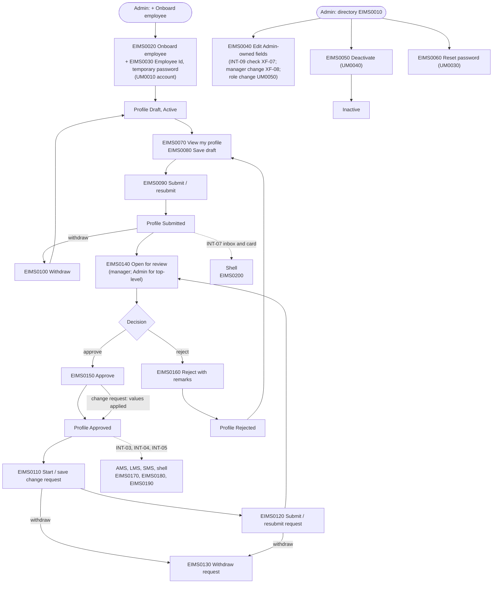
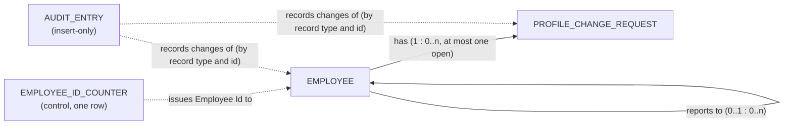
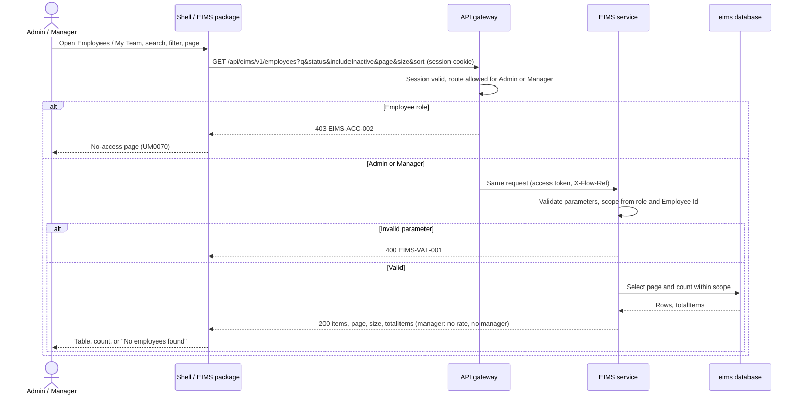
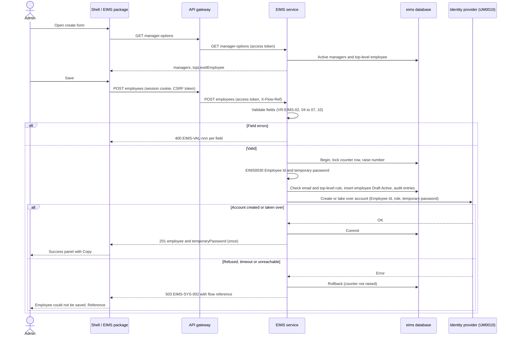
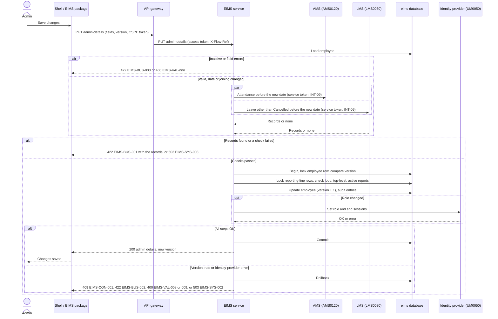
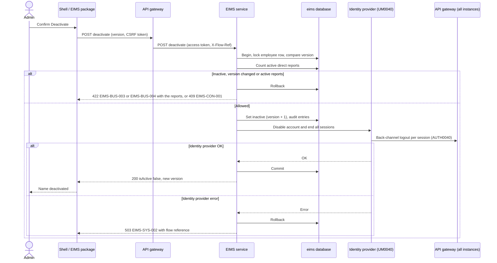
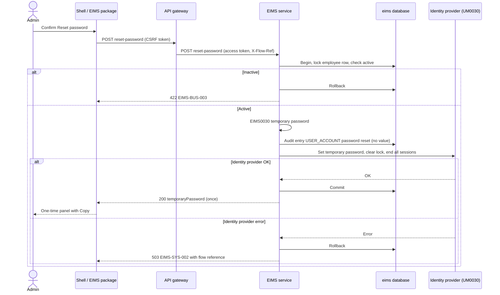
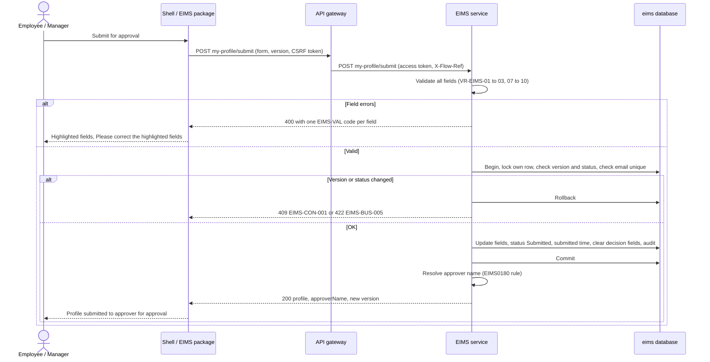

# PMS – HLD Part02-M1: Employee Information Management System (EIMS) Functional Design

Document ID: PMS-HLD-Part02-M1-EIMS-Functional-v1.0
Module: Employee Information Management System (EIMS)
Project: Payroll Management System (PMS) – proof of concept (POC), Stage 3 Solution Design
Author: Rajesh Verma (Enterprise Architect)
Date: November 2026

## 1. Document control

### 1.1 Version / revision history

| Version | Revision | Date | Author | Change remark |
| --- | --- | --- | --- | --- |
| 1.0 | 0.1 | 23-Nov-2026 | Rajesh Verma | First draft of §1–§2 and §3.1, based on the approved BRD set v1.0 (D-107), UX v1.1 (D-105), PMS-HLD-Part01 v1.0 rev 0.9, Part01a v1.0 rev 0.7, the Part02 anchor v1.0 rev 0.5 and the Part03 anchor v1.0 rev 0.4; threat-review method, settlement of the identity-provider order in this document and review grouping of 23 Nov 2026 (D-130) |
| 1.0 | 0.2 | 23-Nov-2026 | Rajesh Verma | §3.2.1 EIMS0010 employee directory drafted: API-EIMS-01, role copy on EMPLOYEE, search, sort and paging (D-131) |
| 1.0 | 0.3 | 23-Nov-2026 | Rajesh Verma | §3.2.2 EIMS0020 onboarding and §3.2.3 EIMS0030 Employee Id and temporary password drafted: API-EIMS-02, API-EIMS-03, identity-provider call inside the EIMS transaction with take-over of an orphan account (OI-P02-01 for onboarding), 12-character temporary password; OI-P02M1-01 (D-132) |
| 1.0 | 0.4 | 23-Nov-2026 | Rajesh Verma | §3.2.4 EIMS0040 Admin-owned fields drafted: API-EIMS-04, processing order, UM0050 inside the EIMS transaction (OI-P02-01 for the role change), reporting-line locks, inactive employees read only; OI-P02M1-02 (D-133) |
| 1.0 | 0.5 | 23-Nov-2026 | Rajesh Verma | §3.2.5 EIMS0050 deactivation and §3.2.6 EIMS0060 password reset drafted: API-EIMS-05, API-EIMS-06, UM0040 and UM0030 inside the EIMS transaction (OI-P02-01 complete for EIMS); OI-P02M1-03 (D-134) |
| 1.0 | 0.6 | 23-Nov-2026 | Rajesh Verma | §3.2.7 to §3.2.10 EIMS0070 to EIMS0100 my profile drafted: API-EIMS-07 to 10 (my-profile resources, owner from the token), draft-save checks, submit with the form, ISO country codes (D-135) |

### 1.2 Review and approval

| Role | Name | Date | Decision |
| --- | --- | --- | --- |
| Architect | Rajesh Verma (Enterprise Architect) | 23-Nov-2026 | §1–§3.1 approved (D-130); §3.2.1 EIMS0010 approved (D-131); §3.2.2–§3.2.3 EIMS0020–EIMS0030 approved (D-132); §3.2.4 EIMS0040 approved (D-133); §3.2.5–§3.2.6 EIMS0050–EIMS0060 approved (D-134); §3.2.7–§3.2.10 EIMS0070–EIMS0100 approved (D-135) |
| Product owner | Rajesh Verma | 23-Nov-2026 | §1–§3.1 approved (D-130); §3.2.1 EIMS0010 approved (D-131); §3.2.2–§3.2.3 EIMS0020–EIMS0030 approved (D-132); §3.2.4 EIMS0040 approved (D-133); §3.2.5–§3.2.6 EIMS0050–EIMS0060 approved (D-134); §3.2.7–§3.2.10 EIMS0070–EIMS0100 approved (D-135) |
| Business analyst | | | |
| Dev lead | | | |

## 2. Introduction: Function design

This document describes the high-level solution approach for each system function of the Employee Information Management System (EIMS) module: APIs, database, orchestration and scenarios. Architecture-wide decisions (stack, resilience defaults, logging, security) are in PMS-HLD-Part01; cross-module flows and common design conventions (API, events, errors, audit and activity log, frontend) are in the Part02 anchor. Neither is repeated here. This is the first module document of the Part02 set; AMS, LMS, SMS and SUP follow its structure and depth.

Reading rules:

- Conventions of the Part02 anchor §2 apply: function ids `EIMS0010` to `EIMS0200` in steps of 10 (anchor §4); API references `[API-EIMS-nn : METHOD /api/eims/v1/<resource> (Purpose : …)]`, rolled up in §4.2; business statuses stay in PMS-BRD-M1-EIMS §6; the design is technology-neutral and names the identity provider, gateway and broker by role.
- Requirements, rules and screen behaviour are referenced by their BRD and UX ids (FR-EIMS, VR-EIMS, BR-EIMS, BR-CMN, SCR-EIMS, UJ-EIMS) and not restated. Column definitions belong to PMS-HLD-Part03-M1-EIMS-Datamodel (planned); this document names entities and the rules of the Part03 anchor, not columns.
- Cross-module flows XF-01, XF-07, XF-08 and XF-09 stay in the Part02 anchor §5; the function chapters here design only the EIMS steps of each flow.
- The identity-provider side of an account change (UM0010 to UM0050) is designed in PMS-HLD-Part02-M5-SUP (planned); here it is a call to that function. The order of the identity-provider call and the EIMS commit, retry of a half-done onboarding and recovery (OI-P02-01) are settled in this document, with EIMS0020 and EIMS0040 to EIMS0060, because EIMS owns the transaction and the Employee Id counter (Part03 anchor §2.3); PMS-HLD-Part02-M5-SUP references them.
- Design status per function: Not started until its chapter is drafted, then Draft, In review, Approved or Deferred (D-123).
- Notifications: none in the POC (C-05, NM is Phase 2). Each function's §3.2.n.5.9 shows "None (C-05)" with its audit and activity-log entries; in-app items (BRD §10) are dashboard and inbox items supplied by EIMS0200.
- Every diagram keeps a text-version table.

**Threat review in §3.2.n.5.8 (closes OI-P01a-08).** Every function's "Security & data privacy" part applies STRIDE – Spoofing, Tampering, Repudiation, Information disclosure, Denial of service, Elevation of privilege – only at the trust boundaries the function crosses. The template's five rows (authorization, sensitive fields, masking, encryption, logging) are kept; one "Threat review" row is added per boundary crossed, naming only the STRIDE threats that apply there and the control that answers each, by reference to PMS-HLD-Part01 §9 and §16.2 or the Part02 anchor §6. A threat without an existing control is recorded as an open item of the document, not designed ad hoc. The detailed method text goes to docs/04-standards/security (planned).

| Boundary | From → to | Typical threats | Existing controls (reference) |
| --- | --- | --- | --- |
| TB-1 | Browser → edge and API gateway | S (stolen session), T (forged request), I (data in transit), D (request flood) | HttpOnly session cookie and CSRF token (ADR-004, Part01 §9.6); TLS with HSTS, WAF and rate limit at the edge (ADR-005, Part01 §9.8); payload limit 1 MB |
| TB-2 | API gateway → EIMS service | S (call without a valid user), E (route or record outside the role or data scope), R (action without a trace) | Gateway route per role group, access token validated again by the service (Part01 §9.7, §9.8); role and data scope in the service and in the query (UM0060); neutral refused response (anchor §6.3, D-99); flow reference and activity log (Part01 §10.3, §10.5) |
| TB-3 | Other service or shell → EIMS, and EIMS → AMS / LMS | S (caller not the service it claims), E (internal API reached from the browser), I (more data than the caller needs) | Service token or relayed user token, network policies per service pair (Part01 §9.9, D-111); `/internal/` APIs never routed by the gateway (anchor §6.1); responses limited to the fields of the integration (INT-03 to 05, 07, 09) |
| TB-4 | EIMS → identity provider (INT-08) | S (misuse of the admin API), T / R (account change without a record), I (temporary password exposed) | Separate service client with client credentials limited to user management – create, update role, reset credential, disable, end sessions (Part01 §9.2, ADR-003); account changes audited by EIMS and recorded as security events (anchor §6.4, AUTH0060); password never stored or logged (FR-ADM-104, NFR-EIMS-02) |
| TB-5 | EIMS service → eims database | T (change outside the application), R (change without audit), I (data at rest) | Database per service with its own credentials (Part03 anchor §2.2); audit entry in the same transaction, insert-and-select-only grant (Part03 anchor §2.5); encrypted storage and backups (Part03 anchor §6) |

### 2.1 Reference documents

**Requirement documents**

| # | Document | Version |
| --- | --- | --- |
| 1 | PMS-BRD (anchor) – §4.3 roles and data scope, §5.3 dashboard and inbox, §6 BR-CMN, §7 INT-03 to INT-05, INT-07 to INT-09; PMS-BRD-M1-EIMS; PMS-BRD-M5-SUP (FR-UM-001 to 015, FR-AUTH, FR-ADM-101 to 117) | v1.0, approved baseline (D-107) |
| 2 | UX Journey Index and UX Summaries SCR-EIMS-01 to 04, SCR-SH-03, SCR-SH-04; mockups `docs/01-ux/mockups/html/scr-eims-0*.html` | v1.1 (D-105) |
| 3 | Decision log / ADRs | D-01 to D-135; ADR-001 to ADR-006 |

**Design documents**

| # | Document | Purpose |
| --- | --- | --- |
| 1 | PMS-HLD-Part01-Architecture-and-Design v1.0 rev 0.9 | Overall architecture and design: integration catalogue §8.2, resilience defaults §8.5, authorization §9.7 to §9.9, log record §10.3, flow reference §10.5, masking §10.8, load tests §14, OWASP mapping §16.2, NFR realization §16.3 |
| 2 | PMS-HLD-Part01a-Principles-Patterns-Decisions v1.0 rev 0.7 | Principles and patterns catalogue (AP-SEC-16 threat modelling); ADR register |
| 3 | PMS-HLD-Part02-Functional (anchor) v1.0 rev 0.5 | Function index §4, cross-module flows XF-01, XF-07 to XF-09 (§5), API, error, audit and frontend conventions (§6), roll-up inventories (§7) |
| 4 | PMS-HLD-Part02-M2-AMS, M3-LMS, M4-SMS-Functional (planned) | Callers of the EIMS APIs; providers of INT-09 (AMS0120, LMS0080) |
| 5 | PMS-HLD-Part02-M5-SUP-Functional (planned) | UM0010 to UM0060, AUTH, ADM0010 to ADM0060 called by EIMS functions |
| 6 | PMS-HLD-Part03-Datamodel (anchor) v1.0 rev 0.4 and PMS-HLD-Part03-M1-EIMS-Datamodel (planned) | Data model: eims ownership, conventions, common columns, common audit entry; EIMS entity definitions |
| 7 | API contract `contracts/openapi/eims-v1.yaml` (planned) | OpenAPI 3 contract of the EIMS APIs |

## 3. Module: Employee Information Management System

### 3.1 Preread

#### 3.1.1 Overview

EIMS holds the employee master data of PMS and is the source of the reporting line that every approval in PMS follows.

| Item | Detail |
| --- | --- |
| What it does | Onboarding one employee at a time with a system-generated Employee Id and temporary password; maintenance of the Admin-owned fields (date of joining, role, manager, hourly wage rate); deactivation; password reset; the employee's own profile with submit, withdraw and approval; profile change requests on an approved profile; the employee directory (PMS-BRD-M1-EIMS §7) |
| Who uses it | Admin (onboarding, maintenance, directory, top-level employee's approvals); Manager (own profile, direct reports in the directory and their approvals); Employee (own profile and change requests); system SYS-EIMS (Employee Id and temporary password, UJ-SYS-04) – BRD §4 |
| What it owns | Data in the eims database: EMPLOYEE and PROFILE_CHANGE_REQUEST, system tables EMPLOYEE_ID_COUNTER and AUDIT_ENTRY (Part03 anchor §2.2). APIs under `/api/eims/v1`: the screen APIs of SCR-EIMS-01 to 04 and the APIs other modules and the shell use – INT-03, INT-04, INT-05, INT-07 (§4.2). EIMS publishes and consumes no events |
| What it does not own | The user account, role and password – held in the identity provider and changed only through UM0010 to UM0050 (INT-08, BR-EIMS-09, ADR-003); attendance and leave – read only through the INT-09 checks of AMS0120 and LMS0080 |
| Depends on | Identity provider through UM (INT-08); AMS and LMS for the date-of-joining check (INT-09, XF-07); API gateway and shell (session, routing, layout); ADM0010 to ADM0060 for audit, activity log and flow reference |
| Used by | Shell (INT-07: EIMS card and inbox items, SH0020 to SH0040); AMS, LMS, SMS and the shell (INT-03 employee details, INT-04 approver); SMS (INT-05 hourly wage rate) |
| In-memory copies of other services' data | None. EIMS reads AMS and LMS only for the INT-09 check, at the moment of the change and never cached; OI-P03-03 stays with PMS-HLD-Part02-M2-AMS |
| Last approved profile | The EMPLOYEE record is always the last approved profile (or the not-yet-approved first profile); a profile change request holds the requested values separately, so other modules keep reading the approved values while a request is open (BR-CMN-11, FR-EIMS-028, D-70 – replaces the D-29 snapshot). The previous values are kept on the request when it is approved (BRD §9.2) |

#### 3.1.2 Module process flow

**Text version of the diagram**

| Step | Function id | Actor | From state | Action / decision | To state / handover |
| --- | --- | --- | --- | --- | --- |
| 1 | EIMS0020, EIMS0030 | Admin; system | – | Onboard: validate, generate Employee Id and temporary password, create the account (UM0010) | Profile Draft, account Active (XF-01) |
| 2 | EIMS0070, EIMS0080 | Employee | Draft or Rejected | View, save draft | Unchanged |
| 3 | EIMS0090 | Employee | Draft or Rejected | Submit or resubmit | Submitted; item for the approver (EIMS0200) |
| 4 | EIMS0100 | Employee | Submitted (no decision yet) | Withdraw | Draft |
| 5 | EIMS0140 | Manager; Admin for the top-level employee | Submitted | Open for review | Unchanged |
| 6 | EIMS0150 / EIMS0160 | As step 5 | Submitted | Approve / reject with remarks | Approved / Rejected (back to step 2) |
| 7 | EIMS0110 | Employee | Profile Approved, no open request | Start and save a change request | Request Draft |
| 8 | EIMS0120 | Employee | Request Draft or Rejected | Submit or resubmit (at least one changed value) | Request Submitted; review as steps 5–6 |
| 9 | EIMS0130 | Employee | Request Draft, Submitted (no decision) or Rejected | Withdraw | Request Withdrawn |
| 10 | EIMS0150 | Approver | Request Submitted | Approve: requested values applied to the profile, previous values kept on the request | Request Approved; profile stays Approved |
| 11 | EIMS0010, EIMS0040 | Admin | Any active employee | Change date of joining (INT-09, XF-07), role (UM0050, XF-09), manager (XF-08) or hourly wage rate | Profile status unchanged (FR-EIMS-012) |
| 12 | EIMS0050 | Admin | Active | Deactivate (UM0040, XF-09) | Inactive |
| 13 | EIMS0060 | Admin | Active | Reset password (UM0030, XF-09) | Temporary password shown once |
| 14 | EIMS0170 to EIMS0190 | AMS, LMS, SMS, shell | – | Read employee details, approver, hourly wage rate | Read only |
| 15 | EIMS0200 | Shell | – | Read the EIMS card, to-do items and inbox items | Read only (XF-05) |

#### 3.1.3 High-level ER diagram

Entity level only; full definitions in PMS-HLD-Part03-M1-EIMS-Datamodel (planned).

**Text version of the diagram**

| Entity | Related entity | Relationship | Cardinality | Rule |
| --- | --- | --- | --- | --- |
| EMPLOYEE | EMPLOYEE | reports to (Manager Id) | 0..1 : 0..n | Empty only for the one top-level employee (BR-CMN-01, VR-EIMS-05); no reporting loop |
| PROFILE_CHANGE_REQUEST | EMPLOYEE | is raised for | 0..n : 1 | At most one open request (Draft, Submitted, Rejected) per employee (BR-EIMS-03) |
| EMPLOYEE_ID_COUNTER | EMPLOYEE | issues the Employee Id | 1 : 0..n | Raised in the same local transaction that saves the employee; never reused (Part03 anchor §2.3, BR-EIMS-01) |
| AUDIT_ENTRY | EMPLOYEE, PROFILE_CHANGE_REQUEST, user account | records each change | 0..n : 1 | Record types EMPLOYEE, PROFILE_CHANGE_REQUEST, USER_ACCOUNT; no foreign key; written in the same transaction (Part03 anchor §2.5) |

The role is not on EMPLOYEE: it is held with the user account in the identity provider (BR-EIMS-09).

#### 3.1.4 Status lifecycle

Business statuses and transitions are defined in PMS-BRD-M1-EIMS §6.1 (profile), §6.2 (Active / Inactive) and §6.3 (profile change request). Technical handling:

- Profile status is the `status` of EMPLOYEE, request status the `status` of PROFILE_CHANGE_REQUEST, both with check constraints of the BRD codes; Active / Inactive is `is_active` of EMPLOYEE (Part03 anchor §2.3, §2.4).
- Each transition is one command API of the owning function. The service checks the actor, data scope and current status, then updates the record with the version the command carries (row_version + 1); a version or status that no longer matches is refused (EIMS-CON-001 or a BUS code) and nothing changes (anchor §6.1).
- EIMS emits no events: other modules read the current values at the time they need them (INT-03, INT-04, INT-07).
- Every transition writes its audit entries in the same local transaction and an activity-log record with the function's step names (anchor §6.4).

| Transition | Enforced in | Event emitted | Audit / activity entry |
| --- | --- | --- | --- |
| Profile – → Draft, account Active | EIMS0020 (with UM0010) | None | EMPLOYEE `created` with initial values; USER_ACCOUNT `created` (no password) |
| Profile Draft / Rejected → Draft / Rejected (save) | EIMS0080 | None | One entry per changed field |
| Profile Draft / Rejected → Submitted | EIMS0090 | None | Changed fields and `status` |
| Profile Submitted → Draft | EIMS0100 | None | `status` |
| Profile Submitted → Approved / Rejected | EIMS0150 / EIMS0160 | None | `status` with the remarks of a rejection; approver and decision time |
| Request – → Draft, Draft → Draft | EIMS0110 | None | PROFILE_CHANGE_REQUEST `created`; changed fields |
| Request Draft / Rejected → Submitted | EIMS0120 | None | Changed fields and `status` |
| Request Draft / Submitted / Rejected → Withdrawn | EIMS0130 | None | `status` |
| Request Submitted → Approved (values applied) / Rejected | EIMS0150 / EIMS0160 | None | Request `status`; on approval one EMPLOYEE entry per applied field |
| Account Active → Inactive | EIMS0050 (with UM0040) | None | EMPLOYEE `is_active`; USER_ACCOUNT disabled |
| Admin-owned field change (profile status unchanged) | EIMS0040 (role change with UM0050) | None | One EMPLOYEE entry per field; USER_ACCOUNT role |
| Password reset | EIMS0060 (with UM0030) | None | USER_ACCOUNT password reset (no value) |

#### 3.1.5 System function index

| Function id | System function | Type (screen / API / backend job) | UX screen | Delivery phase | Design status |
| --- | --- | --- | --- | --- | --- |
| EIMS0010 | View the employee directory – search, filter, show inactive (FR-EIMS-001 to 004, 006) | Screen | SCR-EIMS-01 | POC | Approved |
| EIMS0020 | Onboard an employee – create the employee and the user account (FR-EIMS-010, 011, 014; INT-08) | Screen | SCR-EIMS-02 | POC | Approved |
| EIMS0030 | Generate Employee Id and temporary password (FR-EIMS-040, 041; UJ-SYS-04) | Backend process | – (shown once on SCR-EIMS-02) | POC | Approved |
| EIMS0040 | Edit Admin-owned fields – date of joining, role, manager, hourly wage rate (FR-EIMS-012 to 017; INT-08, INT-09) | Screen | SCR-EIMS-02 | POC | Approved |
| EIMS0050 | Deactivate an employee (FR-EIMS-018; INT-08) | Screen | SCR-EIMS-02 | POC | Approved |
| EIMS0060 | Reset an employee's password (FR-EIMS-005; INT-08) | Screen | SCR-EIMS-01 | POC | Approved |
| EIMS0070 | View my profile and its status (FR-EIMS-020) | Screen | SCR-EIMS-03 | POC | Approved |
| EIMS0080 | Save a profile draft (FR-EIMS-021) | Screen | SCR-EIMS-03 | POC | Approved |
| EIMS0090 | Submit or resubmit my profile (FR-EIMS-022, 024) | Screen | SCR-EIMS-03 | POC | Approved |
| EIMS0100 | Withdraw my submitted profile (FR-EIMS-023) | Screen | SCR-EIMS-03 | POC | Approved |
| EIMS0110 | Start and save a profile change request (FR-EIMS-025, 026) | Screen | SCR-EIMS-03 | POC | Not started |
| EIMS0120 | Submit or resubmit a profile change request (FR-EIMS-026, 027) | Screen | SCR-EIMS-03 | POC | Not started |
| EIMS0130 | Withdraw a profile change request (FR-EIMS-027) | Screen | SCR-EIMS-03 | POC | Not started |
| EIMS0140 | Open a profile or change request for review, or read only from the directory (FR-EIMS-030 to 032, 034, 035) | Screen | SCR-EIMS-04 | POC | Not started |
| EIMS0150 | Approve profiles or change requests, one or several; apply approved changes (FR-EIMS-033, 028) | Screen | SCR-EIMS-04, SCR-SH-04 | POC | Not started |
| EIMS0160 | Reject a profile or change request with remarks (FR-EIMS-033) | Screen | SCR-EIMS-04, SCR-SH-04 | POC | Not started |
| EIMS0170 | Provide employee details to other modules (INT-03) | API | – | POC | Not started |
| EIMS0180 | Resolve the approver of a record (INT-04) | API | – | POC | Not started |
| EIMS0190 | Provide the current hourly wage rate (INT-05) | API | – | POC | Not started |
| EIMS0200 | Supply EIMS dashboard tiles, to-do items and inbox items (INT-07) | API | SCR-SH-03, SCR-SH-04 | POC | Not started |

Review grouping (each review adds a revision row): R1 §1–§3.1 · R2 EIMS0010 · R3 EIMS0020–EIMS0030 · R4 EIMS0040 · R5 EIMS0050–EIMS0060 · R6 EIMS0070–EIMS0100 · R7 EIMS0110–EIMS0130 · R8 EIMS0140–EIMS0160 · R9 EIMS0170–EIMS0200 · R10 §4–§5.

### 3.2 EIMS system functions

#### 3.2.1 EIMS0010 – View the employee directory (Module: EIMS, Approved)

##### 3.2.1.1 Purpose, trigger and conditions

The Admin finds any employee and starts onboarding, editing or a password reset from the list; a manager sees the direct reports and opens a read-only profile.

| Item | Detail |
| --- | --- |
| Delivery phase | POC |
| Trigger | Admin opens "Employees" or a manager opens "My Team" (menu or Admin dashboard); any change of search, status filter, "Show inactive", sort or page |
| Pre-conditions | Signed in as Admin or Manager |
| Post-conditions | None – read only |

##### 3.2.1.2 Actor & data scope

| Role | Access (Read / Read-write / Approve / None) | Data scope (row-level) |
| --- | --- | --- |
| Employee | None – route refused (EIMS-ACC-002) | – |
| Manager | Read | Direct reports only: Manager Id = own Employee Id; manager and hourly wage rate not returned (FR-EIMS-002, BR-EIMS-10) |
| Admin | Read; starts EIMS0020, EIMS0040, EIMS0060 | All employees; the Admin account is not an employee and is never listed (BR-EIMS-08, D-24) |

##### 3.2.1.3 Requirement traceability

| Source | References |
| --- | --- |
| BRD functional requirements | FR-EIMS-001 to 004, 006; RPT-EIMS-06 |
| BRD business / validation rules | BR-EIMS-08, BR-EIMS-10; BR-CMN-06 |
| BRD NFRs | NFR-01, NFR-03, NFR-04; NFR-EIMS-01 |
| UX | UJ-EIMS-01, 06, 07, 08, 09; SCR-EIMS-01 |
| Decisions | D-24, D-58, D-63, D-99, D-105, D-124, D-130, D-131 |
| Related functions – depends on | UM0060 (role and scope check), UM0070 (no-access page), ADM0030, ADM0040 (activity log, flow reference) |
| Related functions – used by | EIMS0020 (+ Onboard employee), EIMS0040 and EIMS0050 (Edit), EIMS0060 (Reset password), EIMS0140 (View, read only) |

##### 3.2.1.4 Navigation & prototype reference

**Navigation:** Admin: Menu > Employees (or Admin dashboard) > Employee directory · Manager: Menu > My Team > Employee directory

**Prototype:** `docs/01-ux/mockups/html/scr-eims-01-directory.html` · UX summary `docs/01-ux/ux-summary/scr-eims-01-directory.md`

##### 3.2.1.5 Solution approach

###### 3.2.1.5.1 Design description

The [View the employee directory] function lets users work with the following sections / activities:

1. Search, status filter and "Show inactive"
2. Employee list with count and paging
3. Row and page actions (Admin: + Onboard employee, Edit, Reset password; Manager: View)

**Search, status filter and "Show inactive"**

1. One search box matches name, Employee Id or email; the profile-status filter and the "Show inactive" toggle narrow the list (FR-EIMS-003, 004).
2. Each change reloads the list from page 1 via [API-EIMS-01 : GET /api/eims/v1/employees (Purpose : list employees in the caller's data scope with search, filter, sort and paging)].
3. DB entity: [EMPLOYEE]
4. Search: one parameter `q`, case-insensitive "contains" on the full name, the Employee Id and the email. Filters: `status` (DRAFT, SUBMITTED, APPROVED, REJECTED) and `includeInactive` (default false, so inactive employees are hidden, BR-CMN-06).

**Employee list with count and paging**

1. Admin columns: Employee Id, name with role, email, manager, date of joining, hourly wage rate, profile status (FR-EIMS-001). Manager columns: the same without manager and rate (FR-EIMS-002). Inactive rows carry the "Inactive" badge (FR-EIMS-004).
2. Data fetched via [API-EIMS-01 : GET /api/eims/v1/employees (Purpose : as above)]; the count is `totalItems` (FR-EIMS-003).
3. DB entity: [EMPLOYEE] – the manager's name from the same table (reports-to relationship).
4. Paging per anchor §6.1: `page` from 1, `size` default 25, maximum 100. Sort: default Employee Id ascending; `sort` on `employeeId`, `name`, `dateOfJoining`, `status`.

**Row and page actions**

1. Admin: "+ Onboard employee" opens SCR-EIMS-02 in create mode (EIMS0020); "Edit" opens SCR-EIMS-02 in edit mode (EIMS0040, EIMS0050); "Reset password" runs EIMS0060 (FR-EIMS-005, 006).
2. Manager: "View" opens SCR-EIMS-04 read only (EIMS0140, FR-EIMS-034).
3. The actions call their own functions' APIs; this function only lists.

###### 3.2.1.5.2 Design notes

1. **One endpoint for both roles (D-131).** Admin and Manager use the same API; the service applies the data scope in the query – Admin: all employees; Manager: `Manager Id = token Employee Id` – so out-of-scope rows are never read (Part01 §9.7). For a manager the response leaves the manager and hourly wage rate fields out (not empty values), so the rate never leaves the service (BR-EIMS-10).
2. **Role mirror (D-131).** The role chip needs each employee's role. The identity provider holds the role and stays the authority for sign-in and the token role claim (BR-EIMS-09, ADR-003); EIMS keeps a copy of the role on EMPLOYEE, written only by EIMS0020 (with UM0010) and EIMS0040 (with UM0050) in the order settled in those chapters (OI-P02-01). The copy is not part of profile approval. The directory, the manager list (VR-EIMS-05, FR-EIMS-014) and the role-change rule (BR-EIMS-06) read the copy and need no identity-provider call. Column in PMS-HLD-Part03-M1-EIMS-Datamodel (planned).
3. **Search and sort.** "Contains" matching over about 100 to 200 rows (BRD §13, Part01 §14.5) needs no special index in the POC; the index plan is in PMS-HLD-Part03-M1-EIMS-Datamodel (planned). Sort by `name` orders by first name, then last name; Employee Id is always the final sort key, so pages are stable.
4. **No caching.** Every call reads the database; nothing is kept in memory between requests (§3.1.1). The list carries no record version: the list is read only, and each action loads its record with its version.
5. **Admin account.** The PMS Administrator is an identity-provider account without an EMPLOYEE record (BR-EIMS-08, FR-UM-004), so no filter is needed to keep it out.

###### 3.2.1.5.3 Sequence & orchestration

Single-service synchronous function: no cross-service or asynchronous steps.

**Text version of the diagram**

| Step | From → to | Message | Result |
| --- | --- | --- | --- |
| 1 | User → frontend | Open the screen or change search, filter, sort or page | – |
| 2 | Frontend → gateway | GET employees with the query parameters | Session cookie |
| 3 | Gateway | Session and route check | Employee role: 403 EIMS-ACC-002, no-access page |
| 4 | Gateway → EIMS | Same request with access token and flow reference | – |
| 5 | EIMS | Validate parameters; derive scope from role and Employee Id | Invalid: 400 EIMS-VAL-001 |
| 6 | EIMS → database | Select one page and the total count within scope | Rows and count |
| 7 | EIMS → frontend | 200 with items, page, size, totalItems | Fields per role |
| 8 | Frontend → user | Table and count, or the empty state | – |

###### 3.2.1.5.4 Frontend

Only what is not already in the UX summary:

1. One screen component for both menu entries; the role claim from the session chooses the columns and row actions (Admin: Edit, Reset password; Manager: View), never as the only check (Part01 §9.7).
2. Search, filter, "Show inactive", sort and page are kept in the page URL query, so a refresh or the browser's back button returns to the same list; any change except paging resets to page 1.
3. The search request is sent on Enter or when typing pauses; an earlier response that arrives late is ignored.
4. States per UX summary §7: table skeleton while loading; empty state with the BRD message; system error panel with Retry and "Reference: <flow reference>" (anchor §6.5).

###### 3.2.1.5.5 Backend

| API id | API name | Method & endpoint | Purpose | Request (key fields) | Response (key fields) | Roles |
| --- | --- | --- | --- | --- | --- | --- |
| API-EIMS-01 | List employees | GET /api/eims/v1/employees | Employees in the caller's data scope, with search, filter, sort and paging | Query: `q`, `status`, `includeInactive`, `page`, `size`, `sort` | `items[]`: employeeId, firstName, middleName, lastName, role, email, dateOfJoining, status, isActive; Admin only: managerId, managerName, hourlyWageRate; plus `page`, `size`, `totalItems` | Admin (all), Manager (direct reports) |

1. Server-side validation: `page` ≥ 1, `size` 1 to 100, `sort` and `status` from the listed values; anything else is refused with EIMS-VAL-001.
2. Read only: one read transaction for the page and the count; no audit entry, no events.
3. Idempotent and safe; reads may be retried (anchor §6.1).

###### 3.2.1.5.6 Database

| Entity | Operation (C / R / U / soft-D) | Purpose in this function |
| --- | --- | --- |
| EMPLOYEE | R | Rows and count within the data scope; manager name through the reports-to relationship; `is_active` for "Show inactive"; role copy for the role chip |

No in-memory copy of other services' data (OI-P03-03 not affected).

###### 3.2.1.5.7 Validation & error handling

| Rule ref (BRD VR / BR) | Layer (UI / API / DB) | Error code | HTTP status | Message |
| --- | --- | --- | --- | --- |
| Anchor §6.1 paging and sort | API | EIMS-VAL-001 | 400 | Generic validation message (not reachable from the screen controls) |
| BRD §4.2 – Employee has no access | Gateway / API | EIMS-ACC-002 | 403 | "You don't have access to this page." (FR-UM-015) |
| – (no match) | UI | – | 200 (empty list) | "No employees found – Try a different search or filter." (FR-EIMS-003) |
| – | API | EIMS-SYS-001 | 500 | Generic message with "Reference: <flow reference>" |

###### 3.2.1.5.8 Security & data privacy

| Item | Detail |
| --- | --- |
| Authorization check per API | API-EIMS-01: gateway route for Admin and Manager; service checks the role claim and applies the scope in the query (Admin all; Manager by own Employee Id) |
| Sensitive fields | Email (sensitive personal, D-71); hourly wage rate (sensitive pay) |
| Masking (UI / API response) | Within scope shown unmasked (Part03 anchor §6); for a manager the rate and manager fields are not returned |
| Encryption (in transit / at rest / field-level) | TLS at the edge; encrypted storage; no field-level encryption (Part03 anchor §6) |
| Logging rule | Activity log holds caller, role, filters used (whether a search was given, never its text), page, count and result; never `q`, names, emails or rates (Part01 §10.8, NFR-EIMS-01) |
| Threat review – TB-1 browser → gateway | S: session theft – HttpOnly cookie, idle timeout (ADR-004, Part01 §9.6). I: data in transit – TLS and HSTS. D: repeated searches – gateway rate limit per user (Part01 §9.8) |
| Threat review – TB-2 gateway → EIMS | E: Employee calling the route – gateway route per role and service role check (EIMS-ACC-002). E / I: manager reading other teams or rates – scope in the query and role-shaped response (Part01 §9.7). T: injected filter values – contract validation and parameterised queries (Part01 §16.2 A03) |
| Threat review – TB-5 EIMS → database | I: data at rest – encrypted storage and backups (Part03 anchor §6). No writes, so no tampering or repudiation threat |

###### 3.2.1.5.9 Notifications, audit & activity log

| Trigger | Notification (NOT id) | Activity log entry | Audit fields captured |
| --- | --- | --- | --- |
| List requested | None (C-05) | `process` API-EIMS-01; steps `validated`, `scope-applied`, `listed` (count); exit with result and duration | None – read only |
| Refused (Employee role) | None | Event type `refused` with the reason and user (FR-ADM-117) | None |

###### 3.2.1.5.10 Scenarios

| Scenario id | Scenario | Type | Requirement ref | Pre-condition | Expected result | Test level |
| --- | --- | --- | --- | --- | --- | --- |
| EIMS0010-S01 | Admin lists employees | Positive | FR-EIMS-001 | 30 active, 2 inactive employees | 30 rows over 2 pages of 25, all Admin columns, totalItems 30, no Admin account row | API, E2E |
| EIMS0010-S02 | Manager lists the team | Positive | FR-EIMS-002, BR-EIMS-10 | Manager M1 with 3 direct reports | Only the 3 reports; no `hourlyWageRate` or `managerId` in the response | API |
| EIMS0010-S03 | Search by Employee Id | Positive | FR-EIMS-003 | EMP0007 exists | `q=EMP0007` returns 1 row, totalItems 1 | API |
| EIMS0010-S04 | Search by part of an email, any case | Positive | FR-EIMS-003 | Email `asha.k@…` | `q=ASHA` finds the row | API |
| EIMS0010-S05 | No match | Edge | FR-EIMS-003 | – | 200 with empty items; empty-state message shown | API, E2E |
| EIMS0010-S06 | Inactive hidden, then shown | Positive | FR-EIMS-004, BR-CMN-06 | One inactive employee | Not listed by default; listed with `isActive` false and the badge when `includeInactive=true` | API, E2E |
| EIMS0010-S07 | Status filter | Positive | FR-EIMS-003 | Mixed statuses | `status=SUBMITTED` returns only Submitted profiles | API |
| EIMS0010-S08 | Employee calls the API | Negative | BRD §4.2, FR-UM-015 | Employee session | 403 EIMS-ACC-002; no-access page; refused entry in the activity log | API, E2E |
| EIMS0010-S09 | Manager after a manager change | Edge | FR-EIMS-017, XF-08 | B moved from M1 to M2 | B listed for M2 at once, no longer for M1 | API |
| EIMS0010-S10 | Invalid paging or sort | Negative | Anchor §6.1 | – | `size=500` or `sort=hourlyWageRate,asc` → 400 EIMS-VAL-001 | API |
| EIMS0010-S11 | Search text not logged | Negative | NFR-EIMS-01 | Search by an email | Activity log shows that a search was applied, not the text | API (log review) |
| EIMS0010-S12 | Response time | Performance | NFR-01, PT-08 | 200 employees (Part01 §14.5) | p95 ≤ 500 ms at the service at 2× load | Performance |

##### 3.2.1.6 Notes, issues & assumptions

1. Note: the role copy (design note 2) is written only by EIMS0020 and EIMS0040; how it stays in step with the identity provider when one of the two steps fails is designed with those functions (OI-P02-01).
2. Note: the Admin dashboard's "Recently onboarded employees" (RPT-EIMS-05) is supplied by EIMS0200, not by this API.

#### 3.2.2 EIMS0020 – Onboard an employee (Module: EIMS, Approved)

##### 3.2.2.1 Purpose, trigger and conditions

The Admin creates a new employee and the employee's user account in one action; the Employee Id and the temporary password are shown once.

| Item | Detail |
| --- | --- |
| Delivery phase | POC |
| Trigger | Admin saves SCR-EIMS-02 in create mode ("+ Onboard employee" from SCR-EIMS-01 or the Admin dashboard) |
| Pre-conditions | Signed in as Admin; the form passes VR-EIMS-02, 04 to 07 and 10 (create); for "None – top-level", no other active top-level employee |
| Post-conditions | EMPLOYEE saved with a new Employee Id, profile Draft, Active, role copy; user account enabled with the Employee Id as user name, the chosen role and a temporary password to be replaced at first sign-in (FR-UM-001); audit entries written; temporary password returned once. On any failure nothing is saved and no Employee Id is used up |

##### 3.2.2.2 Actor & data scope

| Role | Access (Read / Read-write / Approve / None) | Data scope (row-level) |
| --- | --- | --- |
| Employee | None – route refused (EIMS-ACC-002) | – |
| Manager | None – route refused (EIMS-ACC-002) | – |
| Admin | Read-write | All employees (manager options from all active managers) |

##### 3.2.2.3 Requirement traceability

| Source | References |
| --- | --- |
| BRD functional requirements | FR-EIMS-010, 011, 014; FR-UM-001, 002, 010; NOT-EIMS-06 |
| BRD business / validation rules | VR-EIMS-02, 04, 05, 06, 07, 10; BR-EIMS-01, 08, 09; BR-CMN-01, 07 |
| BRD NFRs | NFR-03, NFR-05; NFR-EIMS-01, NFR-EIMS-02 |
| UX | UJ-EIMS-01, UJ-SYS-04; SCR-EIMS-02 (create mode) |
| Decisions | D-02, D-24, D-28, D-29, D-71, D-104, D-126, D-130, D-131, D-132; ADR-003 |
| Related functions – depends on | EIMS0030 (Employee Id, temporary password), UM0010 (account), UM0060, ADM0010, ADM0030, ADM0040 |
| Related functions – used by | EIMS0010 (+ Onboard employee); XF-01 (anchor §5.1); AUTH0010, AUTH0020 (first sign-in); EIMS0070 (employee completes the profile) |

##### 3.2.2.4 Navigation & prototype reference

**Navigation:** Menu > Employees > + Onboard employee (or Admin dashboard > + Onboard employee) > Employee admin form (create)

**Prototype:** `docs/01-ux/mockups/html/scr-eims-02-admin-form.html` · UX summary `docs/01-ux/ux-summary/scr-eims-02-admin-form.md`

##### 3.2.2.5 Solution approach

###### 3.2.2.5.1 Design description

The [Onboard an employee] function lets the Admin work with the following sections / activities:

1. Basic details, role, manager and hourly wage rate
2. Save – employee, Employee Id, temporary password and user account in one action
3. One-time success panel

**Basic details, role, manager and hourly wage rate**

1. Captures first, middle and last name, email, date of joining, role (Employee or Manager), manager or "None – top-level", and hourly wage rate (FR-EIMS-010).
2. The manager dropdown and the current top-level employee are loaded via [API-EIMS-03 : GET /api/eims/v1/manager-options (Purpose : eligible managers and the current top-level employee for the admin form)].
3. DB entity: [EMPLOYEE]
4. Rules: VR-EIMS-02, 04, 06, 07, 10 (create) on the fields; VR-EIMS-05 for the manager; role only Employee or Manager (FR-UM-010).

**Save**

1. Creates the employee and the user account together; on any failure neither exists (D-132).
2. Saved via [API-EIMS-02 : POST /api/eims/v1/employees (Purpose : onboard an employee – create the employee and the user account, return the Employee Id and the temporary password once)].
3. DB entities: [EMPLOYEE_ID_COUNTER], [EMPLOYEE], [AUDIT_ENTRY]; identity provider through UM0010.
4. Employee Id and temporary password from EIMS0030; profile status Draft, Active (BRD §6.1, §6.2).

**One-time success panel**

1. Shows the Employee Id and the temporary password with Copy, then "Back to employees" (UX summary §2, NOT-EIMS-06).
2. The temporary password comes only from the API-EIMS-02 response and cannot be fetched again (NFR-EIMS-02).

###### 3.2.2.5.2 Design notes

1. **Order of the identity-provider call and the EIMS commit (D-132, settles OI-P02-01 for onboarding).** One EIMS local transaction holds every step: validate, lock and raise EMPLOYEE_ID_COUNTER, generate the temporary password (EIMS0030), insert EMPLOYEE and its audit entries, call UM0010, and commit only when the account exists. If the identity provider refuses, times out or cannot be reached, the transaction is rolled back: no employee, no audit entry, and the counter is not raised, so no Employee Id is lost (FR-EIMS-040, Part03 anchor §2.3).
2. **Half-done onboarding.** If the commit fails after the account was created – or a timeout hid a successful create – an account exists under an Employee Id that the rollback freed, without an employee. The next onboarding receives the same Id from the counter. UM0010 is "create or take over", keyed by Employee Id (Part01 §8.5): when an account with that user name already exists, it sets the chosen role, a new temporary password and the enabled state, and the onboarding continues. This is safe because an account can only exist without an employee for an Id the counter has not issued: Employee Ids reach EMPLOYEE only by a committed onboarding and are never deleted or reused (BR-EIMS-01, BR-CMN-06). The take-over is written to the activity log (`account-taken-over`) and recorded by the identity provider as a security event. The take-over itself is designed in PMS-HLD-Part02-M5-SUP (UM0010).
3. **Concurrency.** The counter row lock serialises onboardings: a second Admin save waits until the first commits or rolls back – at most the identity-provider response time (5 s, Part01 §8.5). Onboarding is one by one (D-104), so this wait is acceptable. The same lock also serialises the email-uniqueness and top-level checks of two onboardings; a database uniqueness rule on email and on the one active top-level employee is the backstop (PMS-HLD-Part03-M1-EIMS-Datamodel, planned).
4. **Not retried.** The command is never retried automatically (anchor §6.1); the Admin saves again after a failure and gets the same Employee Id.
5. **Email.** Compared case-insensitively against every employee, active or inactive (VR-EIMS-02, D-71); stored as entered.
6. **Role copy.** The chosen role is saved on EMPLOYEE in the same transaction as the account is created with it (D-131).
7. **Manager options.** API-EIMS-03 returns active employees whose role copy is Manager, minus the employee and every direct or indirect report of the employee (none at create), plus the current active top-level employee, if any. The save checks VR-EIMS-05 again; the list is a convenience, not the rule.
8. **Temporary password handling.** Returned only in the 201 response of API-EIMS-02; never stored in eims, never audited or logged; API responses are not cached (Part01 §9.8).

###### 3.2.2.5.3 Sequence & orchestration

| Step | Type (sync call / event / job / workflow) | Producer → consumer | Event / API | Consistency (local tx / outbox / saga / compensation) |
| --- | --- | --- | --- | --- |
| 1 | Sync call | Frontend → EIMS (gateway) | API-EIMS-02 | Local transaction opened |
| 2 | Internal | EIMS | EIMS0030 | Counter raised inside the local transaction |
| 3 | Sync call | EIMS → identity provider (service client `eims-admin`, Part01 §9.2) | UM0010, INT-08 | Create or take over, keyed by Employee Id |
| 4 | Internal | EIMS → eims database | – | Commit only after step 3 succeeds; rollback otherwise (D-132) |

**Text version of the diagram**

| Step | From → to | Message | Result |
| --- | --- | --- | --- |
| 1 | Admin → frontend → EIMS | Open create form; get manager options | Eligible managers, current top-level employee |
| 2 | Admin → frontend → gateway → EIMS | Save: POST employees | – |
| 3 | EIMS | Validate fields | Errors: 400 with one EIMS-VAL code per field, nothing saved |
| 4 | EIMS → database | Begin, lock counter row, raise number | Next Employee Id reserved inside the transaction |
| 5 | EIMS | EIMS0030 builds the Employee Id and the temporary password | – |
| 6 | EIMS → database | Check email and top-level rule, insert employee and audit entries | Not yet committed |
| 7 | EIMS → identity provider | Create or take over the account | – |
| 8a | EIMS → database → frontend | Account OK: commit, 201 with the temporary password | Success panel |
| 8b | EIMS → database → frontend | Account failed: rollback, 503 EIMS-SYS-002 | Error with reference; Employee Id not used up |

###### 3.2.2.5.4 Frontend

Only what is not already in the UX summary:

1. The create form loads API-EIMS-03 on open; the role list offers Employee and Manager only; "None – top-level" is offered always, and the form shows the current top-level employee's name when one exists (FR-EIMS-014).
2. Save is disabled while the request runs, so a double click sends one command.
3. Field errors from the 400 response are shown at their fields; 503 shows "Employee could not be saved. Please try again." with "Reference: <flow reference>" (UX summary §7).
4. The temporary password is held only in the success panel's memory and is dropped when the panel is left or the page is reloaded; it is never written to browser storage or the URL.

###### 3.2.2.5.5 Backend

| API id | API name | Method & endpoint | Purpose | Request (key fields) | Response (key fields) | Roles |
| --- | --- | --- | --- | --- | --- | --- |
| API-EIMS-02 | Onboard employee | POST /api/eims/v1/employees | Create the employee and the user account; return the Employee Id and the temporary password once | firstName, middleName, lastName, email, dateOfJoining, role (EMPLOYEE, MANAGER), managerId or topLevel true, hourlyWageRate | 201: employeeId, names, email, dateOfJoining, role, managerId, hourlyWageRate, status DRAFT, isActive true, version 1, temporaryPassword | Admin |
| API-EIMS-03 | Manager options | GET /api/eims/v1/manager-options | Eligible managers and the current top-level employee for the admin form | Query: forEmployeeId (left out at create) | managers[]: employeeId, name; topLevelEmployee: employeeId, name, or empty | Admin |

1. Server-side validation: all create rules (VR-EIMS-02, 04 to 07, 10; FR-UM-010) are checked again in the service; field errors are collected and returned together.
2. Transaction boundary: one local transaction from the counter lock to the commit, with the UM0010 call inside it (design note 1).
3. Idempotency: none (anchor §6.1); a repeated save after a failure reuses the freed Employee Id and takes over any orphan account (design note 2).
4. No events.

###### 3.2.2.5.6 Database

| Entity | Operation (C / R / U / soft-D) | Purpose in this function |
| --- | --- | --- |
| EMPLOYEE_ID_COUNTER | R, U (row lock) | Next Employee Id number, raised only by a committed onboarding |
| EMPLOYEE | R, C | Email uniqueness, top-level rule, manager eligibility; new employee Draft, Active, role copy, row_version 1 |
| AUDIT_ENTRY | C | EMPLOYEE `created` with initial values; USER_ACCOUNT `created` with the role (no password) |

No in-memory copy of other services' data.

###### 3.2.2.5.7 Validation & error handling

| Rule ref (BRD VR / BR) | Layer (UI / API / DB) | Error code | HTTP status | Message |
| --- | --- | --- | --- | --- |
| VR-EIMS-10 (create) | UI, API | EIMS-VAL-002 | 400 | Required-field message (UX SCR-EIMS-02) |
| VR-EIMS-07 | UI, API | EIMS-VAL-003 | 400 | Maximum-length message |
| VR-EIMS-02 (format) | UI, API | EIMS-VAL-004 | 400 | Invalid-email message |
| VR-EIMS-02 (unique) | API, DB | EIMS-VAL-005 | 400 | Duplicate-email message (FR-EIMS-011) |
| VR-EIMS-04 | UI, API | EIMS-VAL-006 | 400 | Future-joining-date message |
| VR-EIMS-06 | UI, API | EIMS-VAL-007 | 400 | Invalid-rate message |
| VR-EIMS-05 (manager not eligible) | API | EIMS-VAL-008 | 400 | Manager-choice message |
| VR-EIMS-05 (top-level already held) | API, DB | EIMS-VAL-009 | 400 | Message naming the current top-level employee (FR-EIMS-014) |
| FR-UM-010 (role) | API | EIMS-VAL-010 | 400 | Role-choice message |
| BRD §4.2 – Admin only | Gateway, API | EIMS-ACC-002 | 403 | "You don't have access to this page." |
| INT-08 – account not created | API | EIMS-SYS-002 | 503 | "Employee could not be saved. Please try again." with "Reference: <flow reference>" |
| – | API | EIMS-SYS-001 | 500 | Generic message with the reference |

###### 3.2.2.5.8 Security & data privacy

| Item | Detail |
| --- | --- |
| Authorization check per API | API-EIMS-02, API-EIMS-03: gateway Admin route; service checks the Admin role claim |
| Sensitive fields | Email (sensitive personal); hourly wage rate (sensitive pay); temporary password (secret) |
| Masking (UI / API response) | Email and rate shown to the Admin unmasked; temporary password only in the 201 response and the one-time panel |
| Encryption (in transit / at rest / field-level) | TLS at the edge; encrypted storage; the temporary password is never at rest in PMS (held hashed by the identity provider only, ADR-003) |
| Logging rule | Activity log: Employee Id, steps and result only; never names, email, rate, request or response bodies, or the temporary password (Part01 §10.8, NFR-EIMS-01, 02) |
| Threat review – TB-1 browser → gateway | S / T: forged create from another site – CSRF token and SameSite cookie (ADR-004). I: temporary password in transit – TLS, HSTS, no caching of API responses (Part01 §9.8) |
| Threat review – TB-2 gateway → EIMS | E: non-Admin creating employees – Admin route and service role check (EIMS-ACC-002). T: invalid or injected values – contract and VR validation, parameterised queries. R: who onboarded – audit entries with the Admin user name and flow reference (anchor §6.4) |
| Threat review – TB-4 EIMS → identity provider | S / E: misuse of the admin API – separate `eims-admin` client limited to user management (Part01 §9.2). T: taking over a live account – take-over only for an Id with no employee, which only a failed onboarding leaves (design note 2). R: account change without a record – USER_ACCOUNT audit entry and identity-provider admin event (AUTH0060). I: temporary password – sent only in the admin API call, never logged |
| Threat review – TB-5 EIMS → database | T / R: change outside the application – audit in the same transaction, insert-and-select-only grant (Part03 anchor §2.5). I: data at rest – encrypted storage and backups |

###### 3.2.2.5.9 Notifications, audit & activity log

| Trigger | Notification (NOT id) | Activity log entry | Audit fields captured |
| --- | --- | --- | --- |
| Employee onboarded | None (C-05); NOT-EIMS-06 is the one-time panel | `process` API-EIMS-02; steps `validated`, `id-generated`, `employee-saved`, `account-created` or `account-taken-over`, `committed` | EMPLOYEE `created` with initial values (names, email, date of joining, manager, rate, status, is_active, role copy); USER_ACCOUNT `created` with the role; changed_by Admin user name; process API-EIMS-02 |
| Account step failed | None | Steps up to `employee-saved`, then `account-failed`, `rolled-back`; result error EIMS-SYS-002 | None (rolled back) |
| Manager options read | None | `process` API-EIMS-03; steps `validated`, `listed` | None |

###### 3.2.2.5.10 Scenarios

| Scenario id | Scenario | Type | Requirement ref | Pre-condition | Expected result | Test level |
| --- | --- | --- | --- | --- | --- | --- |
| EIMS0020-S01 | Onboard a valid employee | Positive | FR-EIMS-010, FR-UM-001 | Highest Id EMP0012 | 201 with EMP0013, Draft, Active, temporary password; account EMP0013 enabled with the role; next sign-in opens Set password | API, E2E |
| EIMS0020-S02 | Duplicate email of an inactive employee | Negative | FR-EIMS-011, VR-EIMS-02 | Inactive employee with the same email in other letter case | 400 EIMS-VAL-005; nothing created; counter unchanged | API |
| EIMS0020-S03 | Future date of joining, invalid rate, no manager choice | Negative | FR-EIMS-011, VR-EIMS-04, 06, 10 | – | 400 with three field errors in one response | API, E2E |
| EIMS0020-S04 | Second top-level employee | Negative | FR-EIMS-014, VR-EIMS-05 | C is the active top-level employee | 400 EIMS-VAL-009 naming C | API |
| EIMS0020-S05 | Identity provider unreachable | Failure | INT-08, D-132 | Identity provider down | 503 EIMS-SYS-002 with reference; no employee; the next successful onboarding gets the same Id | API |
| EIMS0020-S06 | Commit fails after the account was created | Failure | D-132 | Database fails at commit | 500; account left without employee; next onboarding gets the same Id, takes over the account with the new role and temporary password; activity log shows `account-taken-over` | API (integration) |
| EIMS0020-S07 | Two Admins save at the same time | Concurrency | FR-EIMS-040 | Two browser sessions | Second save waits; Ids EMP0013 and EMP0014, no gap, no duplicate | API |
| EIMS0020-S08 | Temporary password shown once | Positive | NFR-EIMS-02 | After S01 | Reloading the page or reopening the employee never shows it again; not in the activity log or audit | E2E, log review |
| EIMS0020-S09 | Manager or Employee calls the API | Negative | BRD §4.2 | Non-Admin session | 403 EIMS-ACC-002; refused entry in the activity log | API |
| EIMS0020-S10 | Manager options | Positive | FR-EIMS-014 | Inactive manager and an Employee-role employee exist | Neither is offered; top-level employee returned | API |
| EIMS0020-S11 | Role outside Employee and Manager | Negative | FR-UM-010 | – | `role=ADMIN` → 400 EIMS-VAL-010 | API |

##### 3.2.2.6 Notes, issues & assumptions

1. Note: the take-over of an existing account (design note 2) is a rule of UM0010; PMS-HLD-Part02-M5-SUP designs it and references this chapter.
2. Issue: after an eims database restore (Part03 anchor §8), accounts may exist for Employee Ids issued after the backup point; the counter would issue those Ids again and UM0010 would take over the accounts of employees onboarded in the lost period. Open item OI-P02M1-01 (§5.2).
3. Assumption: the identity provider answers a create for an existing user name with a conflict that UM0010 can tell apart from other errors.

#### 3.2.3 EIMS0030 – Generate Employee Id and temporary password (Module: EIMS, Approved)

##### 3.2.3.1 Purpose, trigger and conditions

The system (SYS-EIMS) issues the next Employee Id and a temporary password for a new employee, and a new temporary password for a password reset.

| Item | Detail |
| --- | --- |
| Delivery phase | POC |
| Trigger | Called inside EIMS0020 (Employee Id and temporary password) and EIMS0060 (temporary password only); no API of its own |
| Pre-conditions | The caller's local transaction is open (EIMS0020) |
| Post-conditions | Employee Id `EMP` + 4 digits, one above the last committed number; temporary password meeting the password policy; both handed to the caller only |

##### 3.2.3.2 Actor & data scope

| Role | Access (Read / Read-write / Approve / None) | Data scope (row-level) |
| --- | --- | --- |
| Employee | None | – |
| Manager | None | – |
| Admin | Indirect, through EIMS0020 and EIMS0060 | – |
| System (SYS-EIMS) | Read-write | EMPLOYEE_ID_COUNTER |

##### 3.2.3.3 Requirement traceability

| Source | References |
| --- | --- |
| BRD functional requirements | FR-EIMS-040, 041; FR-EIMS-005 (reset) |
| BRD business / validation rules | BR-EIMS-01 |
| BRD NFRs | NFR-EIMS-02; NFR-SUP-01 |
| UX | UJ-SYS-04 |
| Decisions | D-02, D-28, D-71, D-97, D-126, D-132 |
| Related functions – depends on | – |
| Related functions – used by | EIMS0020, EIMS0060 |

##### 3.2.3.4 Navigation & prototype reference

**Navigation:** None – backend process; results shown on SCR-EIMS-02 (create) and SCR-EIMS-01 (reset).

**Prototype:** UX summaries `scr-eims-02-admin-form.md` (success panel), `scr-eims-01-directory.md` (reset dialog)

##### 3.2.3.5 Solution approach

###### 3.2.3.5.1 Design description

The [Generate Employee Id and temporary password] function covers two activities:

1. Next Employee Id
2. Temporary password

**Next Employee Id**

1. Reads and locks the single EMPLOYEE_ID_COUNTER row inside the caller's transaction, adds 1 and formats `EMP` + the number padded to 4 digits (FR-EIMS-040, BR-EIMS-01).
2. No API; called by EIMS0020.
3. DB entity: [EMPLOYEE_ID_COUNTER]
4. The raised number becomes permanent only when the caller commits; a rollback leaves the counter unchanged, so no number is lost (D-126, D-132).

**Temporary password**

1. Generates a 12-character password with at least one upper-case letter, one lower-case letter, one digit and one special character, never containing the Employee Id, from a cryptographically secure random source (D-132). Look-alike characters (0, O, 1, l, I) are left out so the Admin can pass it on without errors.
2. No API; returned to the caller, which passes it to the identity provider (UM0010 or UM0030) and returns it once to the Admin.
3. DB entity: none – never stored in eims.
4. Meets the D-28 password policy (minimum 8, character classes, not the user name), so the identity provider accepts it as a temporary credential.

###### 3.2.3.5.2 Design notes

1. **Counter, not a database sequence.** A sequence would keep numbers taken by rolled-back transactions and leave gaps; the counter row is raised in the onboarding transaction (D-126).
2. **Beyond EMP9999.** Four digits allow 9,999 employees against about 100 (BRD §13); FR-EIMS-040 pads to "4 digits", so EMP10000 onwards would remain valid if ever reached. No action in the POC.
3. **Password length.** 12 characters is above the policy minimum because a temporary password does not expire until it is replaced (FR-AUTH-013).
4. **One generator.** The same generator serves onboarding and reset, so both meet the same rules.

###### 3.2.3.5.3 Sequence & orchestration

Internal step of EIMS0020 (§3.2.2.5.3, steps 4–5) and EIMS0060; no diagram of its own, no cross-service steps.

###### 3.2.3.5.4 Frontend

None.

###### 3.2.3.5.5 Backend

No API. Internal component of the EIMS service, used inside the caller's transaction.

###### 3.2.3.5.6 Database

| Entity | Operation (C / R / U / soft-D) | Purpose in this function |
| --- | --- | --- |
| EMPLOYEE_ID_COUNTER | R, U (row lock) | Last number issued; raised by 1 inside the caller's transaction |

###### 3.2.3.5.7 Validation & error handling

| Rule ref (BRD VR / BR) | Layer (UI / API / DB) | Error code | HTTP status | Message |
| --- | --- | --- | --- | --- |
| BR-EIMS-01 – Employee Id unique | DB (unique Employee Id) | EIMS-SYS-001 | 500 | Generic message with the reference (not expected: the counter row lock serialises issuing) |

###### 3.2.3.5.8 Security & data privacy

| Item | Detail |
| --- | --- |
| Authorization check per API | No API; reachable only through EIMS0020 and EIMS0060 (Admin) |
| Sensitive fields | Temporary password (secret) |
| Masking (UI / API response) | Returned only to the calling function |
| Encryption (in transit / at rest / field-level) | Never at rest in PMS |
| Logging rule | Never logged or audited (FR-ADM-104, NFR-EIMS-02); the Employee Id may be logged |
| Threat review | No trust boundary of its own; the boundaries are those of EIMS0020 and EIMS0060. I: guessable password – cryptographically secure random source, 12 characters |

###### 3.2.3.5.9 Notifications, audit & activity log

| Trigger | Notification (NOT id) | Activity log entry | Audit fields captured |
| --- | --- | --- | --- |
| Employee Id issued | None (C-05) | Step `id-generated` of EIMS0020 | Within EMPLOYEE `created` (Employee Id) |
| Temporary password generated | None | No step of its own (part of `account-created` / `password-reset`) | None |

###### 3.2.3.5.10 Scenarios

| Scenario id | Scenario | Type | Requirement ref | Pre-condition | Expected result | Test level |
| --- | --- | --- | --- | --- | --- | --- |
| EIMS0030-S01 | Next Id after inactive employees | Positive | FR-EIMS-040 | EMP0012 inactive and the highest | EMP0013 | Unit, API |
| EIMS0030-S02 | Rolled-back onboarding | Edge | D-126, D-132 | Onboarding of EMP0013 fails | Next onboarding gets EMP0013 | API |
| EIMS0030-S03 | Password rules | Positive | FR-EIMS-041, D-28 | 10,000 generated passwords | Every one: 12 characters, all four classes, no look-alikes, no Employee Id | Unit |
| EIMS0030-S04 | Accepted by the identity provider | Positive | FR-UM-001 | – | Temporary credential set without a policy error | Integration |

##### 3.2.3.6 Notes, issues & assumptions

1. Note: the counter is created at 0 by the eims migrations (Part03 anchor §8).

#### 3.2.4 EIMS0040 – Edit Admin-owned fields (Module: EIMS, Approved)

##### 3.2.4.1 Purpose, trigger and conditions

The Admin changes an employee's date of joining, role, manager or hourly wage rate without employee approval (BR-CMN-13, BR-EIMS-04).

| Item | Detail |
| --- | --- |
| Delivery phase | POC |
| Trigger | Admin saves SCR-EIMS-02 in edit mode ("Edit" in SCR-EIMS-01) |
| Pre-conditions | Signed in as Admin; employee active (inactive employees are read only, D-133); the command carries the version the form was loaded with |
| Post-conditions | Changed fields saved in one transaction, version + 1, profile status unchanged (FR-EIMS-012); role change: identity-provider role set and all the user's sessions ended (UM0050, XF-09); manager change: approval views and inboxes follow the new reporting line at once (XF-08); rate change: applies to salary records generated afterwards (FR-EIMS-013); audit entries written |

##### 3.2.4.2 Actor & data scope

| Role | Access (Read / Read-write / Approve / None) | Data scope (row-level) |
| --- | --- | --- |
| Employee | None – route refused (EIMS-ACC-002) | – |
| Manager | None – route refused (EIMS-ACC-002) | – |
| Admin | Read-write (active employees); read only (inactive employees) | All employees |

##### 3.2.4.3 Requirement traceability

| Source | References |
| --- | --- |
| BRD functional requirements | FR-EIMS-012 to 017; FR-UM-010, 011, 014; INT-08, INT-09 |
| BRD business / validation rules | VR-EIMS-01, 04, 05, 06; BR-EIMS-04, 05, 06, 07, 09; BR-CMN-01, 08, 13 |
| BRD NFRs | NFR-02, NFR-03, NFR-05, NFR-06; NFR-EIMS-01 |
| UX | UJ-EIMS-06; SCR-EIMS-02 (edit mode) |
| Decisions | D-71, D-97, D-104, D-111, D-123, D-124, D-131, D-132, D-133 |
| Related functions – depends on | EIMS0170 (employee details for the form), API-EIMS-03 manager options (§3.2.2), AMS0120 and LMS0080 (INT-09), UM0050 (role and sessions), UM0060, ADM0010, ADM0030, ADM0040 |
| Related functions – used by | EIMS0010 (Edit); XF-07, XF-08, XF-09 (anchor §5.7 to §5.9); EIMS0180 and the approval functions of all modules (new reporting line); SMS0080 through EIMS0190 (new rate) |

##### 3.2.4.4 Navigation & prototype reference

**Navigation:** Menu > Employees > Edit > Employee admin form (edit)

**Prototype:** `docs/01-ux/mockups/html/scr-eims-02-admin-form.html` · UX summary `docs/01-ux/ux-summary/scr-eims-02-admin-form.md`

##### 3.2.4.5 Solution approach

###### 3.2.4.5.1 Design description

The [Edit Admin-owned fields] function lets the Admin work with the following sections / activities:

1. Employee header and read-only fields
2. Admin-owned fields – date of joining, role, manager, hourly wage rate
3. Save

**Employee header and read-only fields**

1. Shows Employee Id, name and email read only (maintained by the employee, FR-EIMS-012), profile status and Active / Inactive badges.
2. Data fetched via the employee details API of EIMS0170 (INT-03; API id assigned in §3.2.17) and [API-EIMS-03 : GET /api/eims/v1/manager-options (Purpose : eligible managers and the current top-level employee, with forEmployeeId)].
3. DB entity: [EMPLOYEE]
4. An inactive employee opens fully read only, without Save and Deactivate (D-133).

**Admin-owned fields**

1. Date of joining, role (Employee, Manager), manager or "None – top-level", hourly wage rate.
2. Saved via [API-EIMS-04 : PUT /api/eims/v1/employees/{employeeId}/admin-details (Purpose : change date of joining, role, manager and hourly wage rate in one save)].
3. DB entities: [EMPLOYEE], [AUDIT_ENTRY]; AMS and LMS through INT-09; identity provider through UM0050.
4. Rules: VR-EIMS-04, 06; VR-EIMS-05 with loop and top-level checks; BR-EIMS-05 and VR-EIMS-01 for a new date of joining; BR-EIMS-06 for Manager → Employee.

**Save**

1. One save for all four fields with the loaded version; only changed fields are processed; a refused rule refuses the whole save (D-133).
2. Success message "Changes saved." (FR-EIMS-012); the form reloads with the new version.

###### 3.2.4.5.2 Design notes

1. **Processing order of one save (D-133).** (a) Load the employee; inactive → refused (EIMS-BUS-003). (b) Validate the fields (VAL). (c) If the date of joining changes: call AMS0120 and LMS0080 in parallel with the EIMS service token (INT-09, Part01 §9.9) and check VR-EIMS-01 against the date of birth when the profile already holds one; any record before the new date → refused with the blocking records (EIMS-BUS-001); a check that cannot be made → refused (EIMS-SYS-003, Part01 §8.2 row 10). These reads run before the transaction. (d) Open the local transaction, lock the employee row and compare the version (EIMS-CON-001). (e) Rules on the reporting line and role (below). (f) Update EMPLOYEE (version + 1) and write the audit entries. (g) If the role changes: call UM0050. (h) Commit.
2. **Order of the identity-provider call and the commit for a role change (D-133, settles OI-P02-01 for the role change).** Same pattern as onboarding (D-132): UM0050 is called inside the EIMS transaction, after the employee update and before the commit. UM0050 sets the role to the given value and ends all the user's sessions (FR-UM-011, D-97, XF-09); it is called only when the role changes. If the identity provider fails, the transaction is rolled back and nothing changes (EIMS-SYS-002). If the commit fails after UM0050 succeeded, the identity provider holds the new role and the role copy the old one; the form still shows the old role, so the Admin selects the new role again, which is a change, calls UM0050 again (setting the same role is harmless) and brings the copy in step. The failed commit is in the activity log with the flow reference.
3. **Reporting line (VR-EIMS-05, BR-CMN-01).** A new manager must be active, hold the Manager role (copy, D-131) and not be the employee; walking up from the new manager to the top-level employee must not reach the employee (no loop). "None – top-level" is allowed only if no other active employee is top-level. To keep two saves from building a loop or a second top-level employee together, the service locks, in Employee Id order, the employee's row and the rows on the new manager's chain before checking; the one-active-top-level database rule is the backstop (PMS-HLD-Part03-M1-EIMS-Datamodel, planned).
4. **Role Manager → Employee (BR-EIMS-06, FR-EIMS-016).** Refused while any active employee has this Manager Id; the error lists those reports (EIMS-BUS-002). Employee → Manager has no condition.
5. **Manager change (FR-EIMS-017, XF-08).** Only the Manager Id changes; nothing is copied to other modules. Waiting items carry no stored approver (D-123 (5)), so every module resolves the new approver at listing and decision time through EIMS0180 (INT-04); no identity-provider call.
6. **Hourly wage rate (BR-CMN-13, FR-EIMS-013).** Only EMPLOYEE changes; SMS reads the current rate when it generates a record (EIMS0190, INT-05), so existing salary records keep their copied rate.
7. **Date-of-joining check is check-then-act across databases.** An attendance or leave saved in AMS or LMS between the INT-09 check and the EIMS commit is not seen; this is OI-P02-02, decided before PMS-HLD-Part02-M2-AMS, and not decided here. The INT-09 answers are used only for this save and never cached (§3.1.1).
8. **Profile status.** Never changed by this function (FR-EIMS-012); an open profile change request is not affected, as it covers only employee-editable fields (BR-EIMS-04).

###### 3.2.4.5.3 Sequence & orchestration

| Step | Type (sync call / event / job / workflow) | Producer → consumer | Event / API | Consistency (local tx / outbox / saga / compensation) |
| --- | --- | --- | --- | --- |
| 1 | Sync call | Frontend → EIMS (gateway) | API-EIMS-04 | Version check in the local transaction |
| 2 | Sync call (parallel, read only) | EIMS → AMS, EIMS → LMS (service token) | AMS0120, LMS0080 (INT-09) – API ids in PMS-HLD-Part02-M2-AMS and M3-LMS (planned) | Before the transaction; check-then-act, OI-P02-02 |
| 3 | Sync call (role change only) | EIMS → identity provider (`eims-admin` client) | UM0050 (INT-08) | Inside the local transaction, commit after success (D-133) |
| 4 | Internal | EIMS → eims database | – | Commit or rollback |

**Text version of the diagram**

| Step | From → to | Message | Result |
| --- | --- | --- | --- |
| 1 | Admin → frontend → gateway → EIMS | Save: PUT admin-details with the version | – |
| 2 | EIMS → database | Load employee | Inactive: 422 EIMS-BUS-003; field errors: 400 |
| 3 | EIMS → AMS and LMS, in parallel | Records before the new date of joining (only if it changes) | Records: 422 EIMS-BUS-001 listing them; check failed: 503 EIMS-SYS-003 |
| 4 | EIMS → database | Begin, lock employee row, compare version | Mismatch: 409 EIMS-CON-001 |
| 5 | EIMS → database | Lock reporting-line rows; check loop, top-level, active reports | Refused: 400 EIMS-VAL-008 or 009, 422 EIMS-BUS-002 |
| 6 | EIMS → database | Update employee, audit entries | Not yet committed |
| 7 | EIMS → identity provider | Set role and end sessions (only if the role changes) | Error: rollback, 503 EIMS-SYS-002 |
| 8 | EIMS → database → frontend | Commit; 200 with the new version | "Changes saved." |

###### 3.2.4.5.4 Frontend

Only what is not already in the UX summary:

1. The form loads the employee details and API-EIMS-03 with `forEmployeeId`, and keeps the version for the save.
2. An inactive employee is shown read only: no Save, no Deactivate, Inactive badge (D-133).
3. EIMS-BUS-001 and EIMS-BUS-002 are shown at the date-of-joining and role fields with the records or reports they list; 409 shows the refresh message (FR-CMN-014) and reloads on confirmation.
4. Save is disabled while the request runs.

###### 3.2.4.5.5 Backend

| API id | API name | Method & endpoint | Purpose | Request (key fields) | Response (key fields) | Roles |
| --- | --- | --- | --- | --- | --- | --- |
| API-EIMS-04 | Update admin details | PUT /api/eims/v1/employees/{employeeId}/admin-details | Change date of joining, role, manager and hourly wage rate in one save | dateOfJoining, role, managerId or topLevel true, hourlyWageRate, version | 200: employeeId, dateOfJoining, role, managerId, hourlyWageRate, status, isActive, version | Admin |

1. Server-side validation: as design note 1; field errors collected and returned together.
2. Transaction boundary: from the employee row lock to the commit, with UM0050 inside it for a role change; the INT-09 reads before it.
3. Idempotency: none; the version makes a repeated save fail with 409 once the first has committed.
4. No events.

###### 3.2.4.5.6 Database

| Entity | Operation (C / R / U / soft-D) | Purpose in this function |
| --- | --- | --- |
| EMPLOYEE | R, U (row locks) | Load and version check; reporting-line checks over the new manager's chain; active direct reports; update of date of joining, role copy, Manager Id, hourly wage rate |
| AUDIT_ENTRY | C | One EMPLOYEE entry per changed field; USER_ACCOUNT role entry for a role change |

No in-memory copy of other services' data: the INT-09 answers are used for this save only.

###### 3.2.4.5.7 Validation & error handling

| Rule ref (BRD VR / BR) | Layer (UI / API / DB) | Error code | HTTP status | Message |
| --- | --- | --- | --- | --- |
| VR-EIMS-04 | UI, API | EIMS-VAL-006 | 400 | Future-joining-date message |
| VR-EIMS-06 | UI, API | EIMS-VAL-007 | 400 | Invalid-rate message |
| VR-EIMS-05 (not eligible, loop) | API | EIMS-VAL-008 | 400 | Manager-choice message |
| VR-EIMS-05 (top-level held) | API, DB | EIMS-VAL-009 | 400 | Message naming the current top-level employee |
| FR-UM-010 (role) | API | EIMS-VAL-010 | 400 | Role-choice message |
| VR-EIMS-01 (age on new date) | API | EIMS-VAL-011 | 400 | Under-18-on-joining-date message (FR-EIMS-015) |
| BR-EIMS-05 | API | EIMS-BUS-001 | 422 | Change refused, naming the blocking attendance and leave dates (FR-EIMS-015) |
| BR-EIMS-06 | API | EIMS-BUS-002 | 422 | Role change refused, listing the active reports (FR-EIMS-016) |
| D-133 – inactive read only | UI, API | EIMS-BUS-003 | 422 | Inactive employee cannot be changed |
| FR-CMN-014 | API | EIMS-CON-001 | 409 | Refresh message |
| Neutral refused response | API | EIMS-ACC-001 | 404 | "You don't have access to this page." (unknown Employee Id) |
| BRD §4.2 – Admin only | Gateway, API | EIMS-ACC-002 | 403 | "You don't have access to this page." |
| INT-08 – role not changed | API | EIMS-SYS-002 | 503 | "Changes could not be saved. Please try again." with the reference |
| INT-09 – check not possible | API | EIMS-SYS-003 | 503 | As above, with the reference |

###### 3.2.4.5.8 Security & data privacy

| Item | Detail |
| --- | --- |
| Authorization check per API | API-EIMS-04: gateway Admin route; service checks the Admin role claim |
| Sensitive fields | Hourly wage rate (sensitive pay); date of birth used for the age check (sensitive personal, read only) |
| Masking (UI / API response) | Shown to the Admin unmasked; the date of birth is never returned by this API |
| Encryption (in transit / at rest / field-level) | TLS at the edge; encrypted storage |
| Logging rule | Activity log: Employee Id, which fields changed (names only), steps and result; never values of rate, dates of birth or blocking-record details (Part01 §10.8) |
| Threat review – TB-1 browser → gateway | S / T: forged save – CSRF token and SameSite cookie (ADR-004) |
| Threat review – TB-2 gateway → EIMS | E: non-Admin changing roles or rates – Admin route and role check (EIMS-ACC-002). T: lost update – version check (EIMS-CON-001). R: who changed what – audit per field with the Admin user name |
| Threat review – TB-3 EIMS → AMS, LMS | S: EIMS calling as another caller – EIMS service token, network policy per service pair (Part01 §9.9). I: more than needed – INT-09 returns only dates and types of blocking records |
| Threat review – TB-4 EIMS → identity provider | E: a demoted manager keeping access – UM0050 ends every session at once (D-97, D-111). R: role change without a record – USER_ACCOUNT audit entry and identity-provider admin event (AUTH0060) |
| Threat review – TB-5 EIMS → database | T / R: audit in the same transaction, insert-and-select-only grant (Part03 anchor §2.5) |

###### 3.2.4.5.9 Notifications, audit & activity log

| Trigger | Notification (NOT id) | Activity log entry | Audit fields captured |
| --- | --- | --- | --- |
| Admin details saved | None (C-05) | `process` API-EIMS-04; steps `validated`, `joining-date-checked` (if changed), `version-checked`, `rules-checked`, `employee-updated`, `role-changed` (if changed), `committed` | One EMPLOYEE entry per changed field (date_of_joining, role, manager_id, hourly_wage_rate) with old and new value; USER_ACCOUNT `role` for a role change; changed_by Admin user name |
| Refused or failed | None | Steps up to the refusal, result with the error code; `rolled-back` after a failed identity-provider call or commit | None |

###### 3.2.4.5.10 Scenarios

| Scenario id | Scenario | Type | Requirement ref | Pre-condition | Expected result | Test level |
| --- | --- | --- | --- | --- | --- | --- |
| EIMS0040-S01 | Rate change on an approved profile | Positive | FR-EIMS-012, 013 | Approved, rate 250 | 200; rate 300, status still Approved; next salary record uses 300, existing ones keep 250 | API, E2E |
| EIMS0040-S02 | New joining date after existing attendance | Negative | FR-EIMS-015, BR-EIMS-05 | Attendance on 05-Nov | Joining date 10-Nov → 422 EIMS-BUS-001 naming 05-Nov; nothing changed | API |
| EIMS0040-S03 | Cancelled leave before the new date | Positive | BR-EIMS-05 | Only Cancelled leave before the date | 200 | API |
| EIMS0040-S04 | AMS unreachable during a joining-date change | Failure | Part01 §8.2 row 10 | AMS down | 503 EIMS-SYS-003 with reference; nothing changed | API |
| EIMS0040-S05 | Under 18 on the new joining date | Negative | VR-EIMS-01 | Date of birth on the profile | 400 EIMS-VAL-011 | API |
| EIMS0040-S06 | Manager → Employee with active reports | Negative | FR-EIMS-016, BR-EIMS-06 | 3 active reports | 422 EIMS-BUS-002 listing the 3 | API, E2E |
| EIMS0040-S07 | Role change ends sessions | Positive | FR-UM-011, XF-09 | Employee signed in | 200; next action of the user opens sign-in; new menu after sign-in | E2E |
| EIMS0040-S08 | Identity provider fails on a role change | Failure | D-133 | Identity provider down | 503 EIMS-SYS-002; role copy and other fields unchanged | API |
| EIMS0040-S09 | Commit fails after the role was set | Failure | D-133 | Database fails at commit | Copy shows the old role; saving the new role again calls UM0050 again and brings the copy in step | API (integration) |
| EIMS0040-S10 | Reporting loop | Negative | FR-EIMS-014, VR-EIMS-05 | A manages B | Setting B as A's manager → 400 EIMS-VAL-008 | API |
| EIMS0040-S11 | Second top-level employee | Negative | VR-EIMS-05 | C is top-level | "None – top-level" for D → 400 EIMS-VAL-009 naming C | API |
| EIMS0040-S12 | Manager change moves waiting items | Positive | FR-EIMS-017, XF-08 | B's leave waiting for M1 | After the change it is in M2's inbox, not in M1's | E2E |
| EIMS0040-S13 | Two saves on the same version | Concurrency | FR-CMN-014 | Two sessions | First 200, second 409 EIMS-CON-001 | API |
| EIMS0040-S14 | Inactive employee | Negative | D-133 | Employee inactive | Form read only; API → 422 EIMS-BUS-003 | API, E2E |
| EIMS0040-S15 | Non-Admin call | Negative | BRD §4.2 | Manager session | 403 EIMS-ACC-002 | API |

##### 3.2.4.6 Notes, issues & assumptions

1. Note: the INT-09 APIs of AMS0120 and LMS0080 return the dates and types of records before a given date for one Employee Id; their ids and contracts are designed in PMS-HLD-Part02-M2-AMS and M3-LMS (planned).
2. Note: OI-P02-02 (check-then-act of the joining-date check) is referenced, not decided (design note 7).
3. Q: inactive employees read only (D-133) is a design choice where the BRD is silent; open item OI-P02M1-02 to confirm it in the BRD at the set consistency check.

#### 3.2.5 EIMS0050 – Deactivate an employee (Module: EIMS, Approved)

##### 3.2.5.1 Purpose, trigger and conditions

The Admin deactivates an employee: the employee becomes Inactive, the account is disabled and all open sessions end; every record is kept (BR-CMN-06).

| Item | Detail |
| --- | --- |
| Delivery phase | POC |
| Trigger | Admin confirms "Deactivate employee" in the Account section of SCR-EIMS-02 (edit mode) |
| Pre-conditions | Signed in as Admin; employee active; no active employee has this employee as manager (BR-CMN-14); the command carries the loaded version |
| Post-conditions | EMPLOYEE Inactive (`is_active` false), version + 1; account disabled and all the user's sessions ended (UM0040, FR-UM-007); items waiting for a decision stay with their approver, other open items stay as they are (BR-CMN-06, D-104); audit entries written. No reactivation in the POC (BR-EIMS-07) |

##### 3.2.5.2 Actor & data scope

| Role | Access (Read / Read-write / Approve / None) | Data scope (row-level) |
| --- | --- | --- |
| Employee | None – route refused (EIMS-ACC-002) | – |
| Manager | None – route refused (EIMS-ACC-002) | – |
| Admin | Read-write | All active employees; the Admin account is not an employee and cannot be deactivated (FR-UM-005) |

##### 3.2.5.3 Requirement traceability

| Source | References |
| --- | --- |
| BRD functional requirements | FR-EIMS-018; FR-UM-003, 005, 007; FR-AUTH-004, 022; INT-08 |
| BRD business / validation rules | BR-CMN-06, BR-CMN-14; BR-EIMS-07 |
| BRD NFRs | NFR-03, NFR-05 |
| UX | UJ-EIMS-07; SCR-EIMS-02 (Account section, confirmation dialog) |
| Decisions | D-29, D-97, D-104, D-111, D-132, D-133, D-134 |
| Related functions – depends on | UM0040 (disable, end sessions), AUTH0040 (back-channel logout), UM0060, ADM0010, ADM0030, ADM0040 |
| Related functions – used by | XF-09 (anchor §5.9); EIMS0010 (Inactive badge, "Show inactive"); EIMS0170 and EIMS0180 (active flag for other modules) |

##### 3.2.5.4 Navigation & prototype reference

**Navigation:** Menu > Employees > Edit > Employee admin form > Account > Deactivate employee

**Prototype:** `docs/01-ux/mockups/html/scr-eims-02-admin-form.html` · UX summary `docs/01-ux/ux-summary/scr-eims-02-admin-form.md`

##### 3.2.5.5 Solution approach

###### 3.2.5.5.1 Design description

The [Deactivate an employee] function lets the Admin work with one activity:

1. Deactivate with confirmation

**Deactivate with confirmation**

1. The confirmation dialog names the employee; on confirm the employee becomes Inactive and "<name> deactivated." is shown (FR-EIMS-018, UX summary §5).
2. Saved via [API-EIMS-05 : POST /api/eims/v1/employees/{employeeId}/deactivate (Purpose : deactivate an employee, disable the account and end all sessions)].
3. DB entities: [EMPLOYEE], [AUDIT_ENTRY]; identity provider through UM0040.
4. Rules: BR-CMN-14 (no active direct reports; the error lists them); employee active (D-133).

###### 3.2.5.5.2 Design notes

1. **Order of the identity-provider call and the commit (D-134, completes OI-P02-01 for EIMS).** Same pattern as D-132 and D-133: one EIMS transaction locks the employee row, compares the version, checks BR-CMN-14, sets `is_active` false, writes the audit entries, calls UM0040 (disable the account, end all sessions), and commits only after UM0040 succeeds. An identity-provider failure rolls back and nothing changes (EIMS-SYS-002). If the commit fails after UM0040, the account is disabled while the employee still shows Active; the Admin's next Deactivate calls UM0040 again (harmless for a disabled account) and commits. The failed commit is in the activity log.
2. **Active direct reports (BR-CMN-14).** Counted in eims under the row lock of the employee; a manager change that would add a report to this employee waits on the same row lock (EIMS0040 locks the new manager's chain), so the check cannot be passed by a concurrent save.
3. **Nothing changes in other modules (BR-CMN-06, XF-09).** AMS, LMS and SMS see the inactive flag through EIMS0170 and EIMS0180 when they next read it; waiting items stay with their approver and can still be decided.
4. **Waiting items of an inactive report (OI-P02M1-03).** BR-CMN-14 counts active reports only. A manager whose only reports are inactive can therefore be deactivated while such a report still has items waiting for this manager's decision; those items would then have no active approver. Designed as the BRD stands; decision recorded as OI-P02M1-03.
5. **Top-level employee.** Deactivating the top-level employee is allowed when no active employee reports to them; afterwards no active top-level employee exists until the Admin chooses "None – top-level" for another employee (VR-EIMS-05).

###### 3.2.5.5.3 Sequence & orchestration

| Step | Type (sync call / event / job / workflow) | Producer → consumer | Event / API | Consistency (local tx / outbox / saga / compensation) |
| --- | --- | --- | --- | --- |
| 1 | Sync call | Frontend → EIMS (gateway) | API-EIMS-05 | Version check in the local transaction |
| 2 | Sync call | EIMS → identity provider (`eims-admin` client) | UM0040 (INT-08) | Inside the local transaction, commit after success (D-134) |
| 3 | Back-channel logout | Identity provider → gateway instances | AUTH0040 (Part01 §9.6) | Every gateway instance drops the user's sessions |

**Text version of the diagram**

| Step | From → to | Message | Result |
| --- | --- | --- | --- |
| 1 | Admin → frontend → gateway → EIMS | Confirm: POST deactivate with the version | – |
| 2 | EIMS → database | Begin, lock row, compare version, count active reports | Refused: 422 EIMS-BUS-003 or 004, or 409 EIMS-CON-001 |
| 3 | EIMS → database | Set inactive, audit entries | Not yet committed |
| 4 | EIMS → identity provider | Disable account, end all sessions | Back-channel logout to every gateway instance |
| 5a | EIMS → database → frontend | OK: commit, 200 | "<name> deactivated." |
| 5b | EIMS → database → frontend | Error: rollback, 503 EIMS-SYS-002 | Nothing changed |

###### 3.2.5.5.4 Frontend

Only what is not already in the UX summary:

1. The dialog's confirm button is disabled while the request runs; EIMS-BUS-004 is shown in the dialog with the listed reports and a hint to reassign them first (FR-EIMS-018).
2. After success the form reloads read only with the Inactive badge (D-133).

###### 3.2.5.5.5 Backend

| API id | API name | Method & endpoint | Purpose | Request (key fields) | Response (key fields) | Roles |
| --- | --- | --- | --- | --- | --- | --- |
| API-EIMS-05 | Deactivate employee | POST /api/eims/v1/employees/{employeeId}/deactivate | Deactivate the employee, disable the account and end all sessions | version | 200: employeeId, isActive false, status, version | Admin |

1. Transaction boundary: row lock to commit, with UM0040 inside it.
2. Idempotency: none; a repeated call after success is refused as inactive (EIMS-BUS-003); after a failed commit it repeats UM0040 harmlessly (design note 1).
3. No events.

###### 3.2.5.5.6 Database

| Entity | Operation (C / R / U / soft-D) | Purpose in this function |
| --- | --- | --- |
| EMPLOYEE | R, soft-D (`is_active` false) | Row lock, version check, active direct reports, deactivation |
| AUDIT_ENTRY | C | EMPLOYEE `is_active` true → false; USER_ACCOUNT `enabled` true → false |

###### 3.2.5.5.7 Validation & error handling

| Rule ref (BRD VR / BR) | Layer (UI / API / DB) | Error code | HTTP status | Message |
| --- | --- | --- | --- | --- |
| BR-CMN-14 | API | EIMS-BUS-004 | 422 | Deactivation refused, listing the active direct reports (FR-EIMS-018) |
| BR-EIMS-07, D-133 – already inactive | API | EIMS-BUS-003 | 422 | Inactive employee cannot be changed |
| FR-CMN-014 | API | EIMS-CON-001 | 409 | Refresh message |
| Neutral refused response | API | EIMS-ACC-001 | 404 | "You don't have access to this page." |
| BRD §4.2 – Admin only | Gateway, API | EIMS-ACC-002 | 403 | "You don't have access to this page." |
| INT-08 – account not disabled | API | EIMS-SYS-002 | 503 | "Employee could not be deactivated. Please try again." with the reference |

###### 3.2.5.5.8 Security & data privacy

| Item | Detail |
| --- | --- |
| Authorization check per API | API-EIMS-05: gateway Admin route; service checks the Admin role claim |
| Sensitive fields | None returned |
| Masking (UI / API response) | Not applicable |
| Encryption (in transit / at rest / field-level) | TLS at the edge; encrypted storage |
| Logging rule | Employee Id, steps and result only |
| Threat review – TB-1 browser → gateway | T: forged deactivation – CSRF token and SameSite cookie (ADR-004) |
| Threat review – TB-2 gateway → EIMS | E: non-Admin – route and role check (EIMS-ACC-002). R: who deactivated – audit with the Admin user name and flow reference |
| Threat review – TB-4 EIMS → identity provider | S / E: a deactivated user keeping access – account disabled and every session ended at once, back-channel logout to every gateway instance (D-97, D-111); remaining exposure at most the access-token lifetime (Part01 AR-02). R: identity-provider admin event (AUTH0060) |
| Threat review – TB-5 EIMS → database | T / R: audit in the same transaction, insert-and-select-only grant |

###### 3.2.5.5.9 Notifications, audit & activity log

| Trigger | Notification (NOT id) | Activity log entry | Audit fields captured |
| --- | --- | --- | --- |
| Employee deactivated | None (C-05) | `process` API-EIMS-05; steps `validated`, `version-checked`, `rules-checked`, `employee-deactivated`, `account-disabled`, `committed` | EMPLOYEE `is_active`; USER_ACCOUNT `enabled`; changed_by Admin user name |
| Refused or failed | None | Steps up to the refusal; `rolled-back` after a failed identity-provider call or commit | None |

###### 3.2.5.5.10 Scenarios

| Scenario id | Scenario | Type | Requirement ref | Pre-condition | Expected result | Test level |
| --- | --- | --- | --- | --- | --- | --- |
| EIMS0050-S01 | Deactivate an employee without reports | Positive | FR-EIMS-018, FR-UM-007 | EMP0009 signed in elsewhere | 200; Inactive; EMP0009's next action opens sign-in; sign-in with the correct password shows the inactive-account message | API, E2E |
| EIMS0050-S02 | Manager with active reports | Negative | BR-CMN-14 | 2 active reports | 422 EIMS-BUS-004 listing both; nothing changed | API |
| EIMS0050-S03 | Waiting items stay with the approver | Positive | BR-CMN-06, D-104 | Employee's leave waiting for M1 | After deactivation M1 can still approve it | E2E |
| EIMS0050-S04 | Identity provider down | Failure | D-134 | – | 503 EIMS-SYS-002; employee still Active; account unchanged | API |
| EIMS0050-S05 | Commit fails after the account was disabled | Failure | D-134 | Database fails at commit | Employee shows Active; repeating Deactivate succeeds and commits | API (integration) |
| EIMS0050-S06 | Already inactive | Negative | BR-EIMS-07 | Inactive employee | 422 EIMS-BUS-003 | API |
| EIMS0050-S07 | Stale version | Concurrency | FR-CMN-014 | Rate changed in another session | 409 EIMS-CON-001 | API |
| EIMS0050-S08 | Non-Admin call | Negative | BRD §4.2 | Manager session | 403 EIMS-ACC-002 | API |

##### 3.2.5.6 Notes, issues & assumptions

1. Q: waiting items of an inactive report whose manager is then deactivated have no active approver – OI-P02M1-03 (§5.2).
2. Note: the disabling and session ending are designed in PMS-HLD-Part02-M5-SUP (UM0040, AUTH0040).

#### 3.2.6 EIMS0060 – Reset an employee's password (Module: EIMS, Approved)

##### 3.2.6.1 Purpose, trigger and conditions

The Admin issues a new temporary password for an employee; earlier passwords stop working, any lock is cleared and all sessions end (FR-EIMS-005, FR-UM-006).

| Item | Detail |
| --- | --- |
| Delivery phase | POC |
| Trigger | Admin confirms "Reset password" on a row of SCR-EIMS-01 |
| Pre-conditions | Signed in as Admin; employee active (D-134) |
| Post-conditions | Account holds a new temporary password to be replaced at the next sign-in; lock and failed-attempt count cleared; all the user's sessions ended (UM0030); audit entry written; temporary password returned once. No EIMS business record changes |

##### 3.2.6.2 Actor & data scope

| Role | Access (Read / Read-write / Approve / None) | Data scope (row-level) |
| --- | --- | --- |
| Employee | None – route refused (EIMS-ACC-002); no self-service reset (D-07) | – |
| Manager | None – route refused (EIMS-ACC-002) | – |
| Admin | Read-write | All active employees; the Admin's own password is reset by IT operations outside PMS (FR-UM-005) |

##### 3.2.6.3 Requirement traceability

| Source | References |
| --- | --- |
| BRD functional requirements | FR-EIMS-005; FR-UM-006; FR-AUTH-005, 013, 022; NOT-EIMS-06; INT-08 |
| BRD business / validation rules | BR-EIMS-07 |
| BRD NFRs | NFR-03, NFR-05; NFR-EIMS-02; NFR-SUP-01 |
| UX | UJ-EIMS-08; SCR-EIMS-01 (Reset password dialog) |
| Decisions | D-07, D-28, D-97, D-104, D-111, D-132, D-134 |
| Related functions – depends on | EIMS0030 (temporary password), UM0030 (set temporary password, clear lock, end sessions), AUTH0040, UM0060, ADM0010, ADM0030, ADM0040 |
| Related functions – used by | EIMS0010 (row action); XF-09 (anchor §5.9); AUTH0020 (Set password at the next sign-in) |

##### 3.2.6.4 Navigation & prototype reference

**Navigation:** Menu > Employees > row action Reset password > confirmation dialog > one-time password panel

**Prototype:** `docs/01-ux/mockups/html/scr-eims-01-directory.html` · UX summary `docs/01-ux/ux-summary/scr-eims-01-directory.md`

##### 3.2.6.5 Solution approach

###### 3.2.6.5.1 Design description

The [Reset an employee's password] function lets the Admin work with one activity:

1. Reset with confirmation and one-time display

**Reset with confirmation and one-time display**

1. After confirmation the temporary password is shown once with Copy and "Temporary password issued…" (UX summary §5, NOT-EIMS-06).
2. Run via [API-EIMS-06 : POST /api/eims/v1/employees/{employeeId}/reset-password (Purpose : issue a new temporary password, clear any lock and end all sessions; return the password once)].
3. DB entities: [EMPLOYEE] (read, row lock), [AUDIT_ENTRY]; identity provider through UM0030.
4. Rules: employee active (D-134); no version, as no EIMS record changes.

###### 3.2.6.5.2 Design notes

1. **Order of the identity-provider call and the commit (D-134).** One EIMS transaction locks the employee row and checks it is active, generates the temporary password (EIMS0030), writes the USER_ACCOUNT audit entry (no value), calls UM0030 and commits only after it succeeds; the password is returned only after the commit. An identity-provider failure rolls back (EIMS-SYS-002), so nothing changes and no audit entry claims a reset. If the commit fails after UM0030, the account holds a temporary password nobody saw and there is no audit entry; the Admin resets again, which replaces it (FR-UM-006). The failed commit is in the activity log.
2. **Row lock.** Serialises a reset with a deactivation of the same employee, so a reset never re-enables or follows a disabled account.
3. **No version.** The command changes no EIMS business record (anchor §6.1 version rule applies to record changes); repeated resets simply issue a new password each time.
4. **Temporary password.** Same generator and handling as onboarding (EIMS0030, D-132): returned only in the 200 response, never stored, audited or logged.

###### 3.2.6.5.3 Sequence & orchestration

| Step | Type (sync call / event / job / workflow) | Producer → consumer | Event / API | Consistency (local tx / outbox / saga / compensation) |
| --- | --- | --- | --- | --- |
| 1 | Sync call | Frontend → EIMS (gateway) | API-EIMS-06 | Row lock in the local transaction |
| 2 | Sync call | EIMS → identity provider (`eims-admin` client) | UM0030 (INT-08) | Inside the local transaction, commit after success (D-134) |
| 3 | Back-channel logout | Identity provider → gateway instances | AUTH0040 | Every gateway instance drops the user's sessions |

**Text version of the diagram**

| Step | From → to | Message | Result |
| --- | --- | --- | --- |
| 1 | Admin → frontend → gateway → EIMS | Confirm: POST reset-password | – |
| 2 | EIMS → database | Begin, lock row, check active | Inactive: 422 EIMS-BUS-003 |
| 3 | EIMS | EIMS0030 generates the temporary password | – |
| 4 | EIMS → database | USER_ACCOUNT audit entry (no value) | Not yet committed |
| 5 | EIMS → identity provider | Set temporary password, clear lock, end sessions | – |
| 6a | EIMS → database → frontend | OK: commit, 200 with the password | One-time panel |
| 6b | EIMS → database → frontend | Error: rollback, 503 EIMS-SYS-002 | Nothing changed |

###### 3.2.6.5.4 Frontend

Only what is not already in the UX summary:

1. The row action is shown only for active employees; the dialog's confirm is disabled while the request runs.
2. The temporary password is held only in the panel's memory and dropped when the panel closes or the page reloads (as EIMS0020).

###### 3.2.6.5.5 Backend

| API id | API name | Method & endpoint | Purpose | Request (key fields) | Response (key fields) | Roles |
| --- | --- | --- | --- | --- | --- | --- |
| API-EIMS-06 | Reset password | POST /api/eims/v1/employees/{employeeId}/reset-password | Issue a new temporary password, clear any lock, end all sessions; return the password once | – (no body) | 200: employeeId, temporaryPassword | Admin |

1. Transaction boundary: row lock to commit, with UM0030 inside it.
2. Idempotency: none; each call issues a new password.
3. No events.

###### 3.2.6.5.6 Database

| Entity | Operation (C / R / U / soft-D) | Purpose in this function |
| --- | --- | --- |
| EMPLOYEE | R (row lock) | Employee exists and is active; serialises with deactivation |
| AUDIT_ENTRY | C | USER_ACCOUNT `password-reset`, no old or new value (FR-ADM-104) |

###### 3.2.6.5.7 Validation & error handling

| Rule ref (BRD VR / BR) | Layer (UI / API / DB) | Error code | HTTP status | Message |
| --- | --- | --- | --- | --- |
| BR-EIMS-07, D-134 – inactive | API | EIMS-BUS-003 | 422 | Inactive employee cannot be changed |
| Neutral refused response | API | EIMS-ACC-001 | 404 | "You don't have access to this page." |
| BRD §4.2 – Admin only | Gateway, API | EIMS-ACC-002 | 403 | "You don't have access to this page." |
| INT-08 – reset failed | API | EIMS-SYS-002 | 503 | "Password could not be reset. Please try again." with the reference |

###### 3.2.6.5.8 Security & data privacy

| Item | Detail |
| --- | --- |
| Authorization check per API | API-EIMS-06: gateway Admin route; service checks the Admin role claim |
| Sensitive fields | Temporary password (secret) |
| Masking (UI / API response) | Only in the 200 response and the one-time panel |
| Encryption (in transit / at rest / field-level) | TLS at the edge; never at rest in PMS (ADR-003) |
| Logging rule | Never logged or audited as a value (FR-ADM-104, NFR-EIMS-02); Employee Id and steps only |
| Threat review – TB-1 browser → gateway | T: forged reset (account takeover attempt) – CSRF token and SameSite cookie (ADR-004). I: password in transit – TLS, no caching of API responses |
| Threat review – TB-2 gateway → EIMS | E: non-Admin resetting another user – Admin route and role check (EIMS-ACC-002). R: who reset – audit entry with the Admin user name |
| Threat review – TB-4 EIMS → identity provider | S: old password or session still usable – UM0030 replaces every earlier password and ends every session (FR-UM-006, D-97). R: identity-provider admin event (AUTH0060) |
| Threat review – TB-5 EIMS → database | R: audit entry in the same transaction; no password value stored |

###### 3.2.6.5.9 Notifications, audit & activity log

| Trigger | Notification (NOT id) | Activity log entry | Audit fields captured |
| --- | --- | --- | --- |
| Password reset | None (C-05); NOT-EIMS-06 is the one-time panel | `process` API-EIMS-06; steps `validated`, `employee-checked`, `password-reset`, `committed` | USER_ACCOUNT `password-reset` without values; changed_by Admin user name |
| Refused or failed | None | Steps up to the refusal; `rolled-back` after a failed identity-provider call or commit | None |

###### 3.2.6.5.10 Scenarios

| Scenario id | Scenario | Type | Requirement ref | Pre-condition | Expected result | Test level |
| --- | --- | --- | --- | --- | --- | --- |
| EIMS0060-S01 | Reset a locked, signed-in employee | Positive | FR-EIMS-005, FR-UM-006 | EMP0007 locked and signed in elsewhere | 200 with a temporary password; other session returns to sign-in; old password refused; new one signs in at once and opens Set password | E2E |
| EIMS0060-S02 | Password shown once | Positive | NFR-EIMS-02 | After S01 | Not shown again; not in audit or activity log | E2E, log review |
| EIMS0060-S03 | Inactive employee | Negative | D-134 | Inactive | Row action hidden; API 422 EIMS-BUS-003 | API, E2E |
| EIMS0060-S04 | Identity provider down | Failure | D-134 | – | 503 EIMS-SYS-002; old password still works; no audit entry | API |
| EIMS0060-S05 | Two resets in a row | Edge | FR-UM-006 | – | Only the second temporary password works | API (integration) |
| EIMS0060-S06 | Non-Admin call | Negative | BRD §4.2 | Employee session | 403 EIMS-ACC-002 | API |

##### 3.2.6.6 Notes, issues & assumptions

1. Note: replacing the credential, clearing the lock and ending sessions are designed in PMS-HLD-Part02-M5-SUP (UM0030, AUTH0040).

#### 3.2.7 EIMS0070 – View my profile and its status (Module: EIMS, Approved)

##### 3.2.7.1 Purpose, trigger and conditions

The employee sees the profile, its status banner and the read-only block set by the Admin (FR-EIMS-020).

| Item | Detail |
| --- | --- |
| Delivery phase | POC |
| Trigger | Employee or Manager opens "My Profile" (menu, dashboard banner or to-do item); reload after any profile or change-request action |
| Pre-conditions | Signed in as Employee or Manager (every such user has an EMPLOYEE record) |
| Post-conditions | None – read only |

##### 3.2.7.2 Actor & data scope

| Role | Access (Read / Read-write / Approve / None) | Data scope (row-level) |
| --- | --- | --- |
| Employee | Read (own) | Own record only: Employee Id from the token (`preferred_username`) |
| Manager | Read (own) | As Employee |
| Admin | None – route refused (EIMS-ACC-002); the Admin has no profile (BR-EIMS-08) | – |

##### 3.2.7.3 Requirement traceability

| Source | References |
| --- | --- |
| BRD functional requirements | FR-EIMS-020, 023 to 025, 027, 028 (banners and read-only states); NOT-EIMS-01, 04, 05 (banners) |
| BRD business / validation rules | BR-EIMS-02, 03, 10; BR-CMN-01, 11 |
| BRD NFRs | NFR-01, NFR-03; NFR-EIMS-01 |
| UX | UJ-EIMS-02, 04, 05; SCR-EIMS-03 |
| Decisions | D-70, D-72, D-123, D-130, D-135 |
| Related functions – depends on | UM0060, ADM0030, ADM0040 |
| Related functions – used by | EIMS0080 to EIMS0130 (actions on the screen); EIMS0200 (dashboard banner links here) |

##### 3.2.7.4 Navigation & prototype reference

**Navigation:** Menu > My Profile (or dashboard banner / Things to do > My Profile)

**Prototype:** `docs/01-ux/mockups/html/scr-eims-03-my-profile.html` · UX summary `docs/01-ux/ux-summary/scr-eims-03-my-profile.md`

##### 3.2.7.5 Solution approach

###### 3.2.7.5.1 Design description

The [View my profile and its status] function shows the following sections:

1. Status banner and badges
2. "Set by your administrator" block
3. Profile sections – Name, Parents, Birth, Employment, Address, Contact

**Status banner and badges**

1. Banner per profile status (UX summary §2): Draft; Submitted "Waiting for <approver>"; Rejected with the approver's remarks; Approved with "Request a change", or a link to the open change request with its status badge.
2. Data fetched via [API-EIMS-07 : GET /api/eims/v1/my-profile (Purpose : the caller's own profile, Admin-set block, status, remarks, approver name and open change request)].
3. DB entities: [EMPLOYEE], [PROFILE_CHANGE_REQUEST] (open request summary).
4. Approver name: resolved at read time from the current Manager Id – the manager's name, or "the administrator" for the top-level employee (rule of EIMS0180, BR-CMN-01); after a decision, the stored deciding approver (BR-CMN-02).

**"Set by your administrator" block**

1. Employee Id, manager name, date of joining and hourly wage rate, read only (FR-EIMS-020); the employee sees the own rate (BR-EIMS-10).
2. Same API.

**Profile sections**

1. Employee-editable fields of PMS-BRD-M1-EIMS §9.1, editable in Draft and Rejected, read only in Submitted and Approved (UX summary §2).
2. Same API; edits saved by EIMS0080 and EIMS0090.
3. While a change request is open the profile shows the approved values (FR-EIMS-028); the request values are shown by EIMS0110.

###### 3.2.7.5.2 Design notes

1. **Own record only (D-135).** The owner comes from the token, never from the path, so no other employee's profile can be addressed (Part01 §9.7).
2. **One read.** One API call returns everything the screen needs, including the approver name, which is resolved inside EIMS with the EIMS0180 rule – no cross-service call.
3. **Countries (D-135).** Country fields hold ISO 3166-1 alpha-2 codes; the frontend shows the English name from the shared design system.

###### 3.2.7.5.3 Sequence & orchestration

Single-service synchronous read: frontend → gateway → EIMS → eims database → frontend, as EIMS0010 (§3.2.1.5.3) without the list parameters. No cross-service or asynchronous steps.

###### 3.2.7.5.4 Frontend

Only what is not already in the UX summary:

1. The response's `status` and `openChangeRequest` choose the banner, the badges, the editable or read-only state and the offered actions; the server checks every action again.
2. The form keeps the `version` for EIMS0080 to EIMS0100.

###### 3.2.7.5.5 Backend

| API id | API name | Method & endpoint | Purpose | Request (key fields) | Response (key fields) | Roles |
| --- | --- | --- | --- | --- | --- | --- |
| API-EIMS-07 | Get my profile | GET /api/eims/v1/my-profile | The caller's own profile with status, remarks, approver name, Admin-set block and open change request | – | employeeId, employee-editable fields (names, parents, birth, last employer, address, contact), managerName, dateOfJoining, hourlyWageRate, status, remarks, approverName, submittedAt, version, openChangeRequest (id, status) or empty | Employee, Manager |

Read only; safe to retry.

###### 3.2.7.5.6 Database

| Entity | Operation (C / R / U / soft-D) | Purpose in this function |
| --- | --- | --- |
| EMPLOYEE | R | Own record; manager's name |
| PROFILE_CHANGE_REQUEST | R | Open request (Draft, Submitted, Rejected) of the caller, if any |

###### 3.2.7.5.7 Validation & error handling

| Rule ref (BRD VR / BR) | Layer (UI / API / DB) | Error code | HTTP status | Message |
| --- | --- | --- | --- | --- |
| BRD §4.2 – Admin has no profile | Gateway, API | EIMS-ACC-002 | 403 | "You don't have access to this page." |
| – | API | EIMS-SYS-001 | 500 | "Profile could not be loaded" error panel with Retry and the reference |

###### 3.2.7.5.8 Security & data privacy

| Item | Detail |
| --- | --- |
| Authorization check per API | API-EIMS-07: gateway route for Employee and Manager; owner from the token |
| Sensitive fields | Parents' names, date, place and country of birth, address, email, mobile (sensitive personal, D-71); hourly wage rate (sensitive pay) |
| Masking (UI / API response) | Own data shown unmasked |
| Encryption (in transit / at rest / field-level) | TLS at the edge; encrypted storage |
| Logging rule | Employee Id, status and result only; never field values (NFR-EIMS-01) |
| Threat review – TB-1 browser → gateway | S: stolen session – HttpOnly cookie, idle timeout (ADR-004). I: TLS |
| Threat review – TB-2 gateway → EIMS | E / I: reading another employee's profile – no id in the request, owner from the token (D-135) |
| Threat review – TB-5 EIMS → database | I: encrypted storage and backups |

###### 3.2.7.5.9 Notifications, audit & activity log

| Trigger | Notification (NOT id) | Activity log entry | Audit fields captured |
| --- | --- | --- | --- |
| Profile viewed | None (C-05); NOT-EIMS-01, 04, 05 are banners on this screen | `process` API-EIMS-07; step `loaded` | None |

###### 3.2.7.5.10 Scenarios

| Scenario id | Scenario | Type | Requirement ref | Pre-condition | Expected result | Test level |
| --- | --- | --- | --- | --- | --- | --- |
| EIMS0070-S01 | First visit after onboarding | Positive | FR-EIMS-020 | Draft, only Admin fields set | Admin block filled, other fields empty, Draft banner | API, E2E |
| EIMS0070-S02 | Submitted banner names the current approver | Positive | FR-EIMS-023, XF-08 | Submitted; manager changed M1 → M2 | "Waiting for M2" | API |
| EIMS0070-S03 | Top-level employee | Edge | BR-CMN-01 | No manager | Approver shown as the administrator | API |
| EIMS0070-S04 | Approved with an open change request | Positive | FR-EIMS-025, 028 | Request Draft | Approved values; link to the request instead of "Request a change" | API, E2E |
| EIMS0070-S05 | Admin calls the API | Negative | BR-EIMS-08 | Admin session | 403 EIMS-ACC-002 | API |

##### 3.2.7.6 Notes, issues & assumptions

1. None.

#### 3.2.8 EIMS0080 – Save a profile draft (Module: EIMS, Approved)

##### 3.2.8.1 Purpose, trigger and conditions

The employee saves an incomplete profile at any time while it is Draft or Rejected (FR-EIMS-021).

| Item | Detail |
| --- | --- |
| Delivery phase | POC |
| Trigger | "Save draft" on SCR-EIMS-03 |
| Pre-conditions | Own profile in Draft or Rejected; the command carries the loaded version |
| Post-conditions | Employee-editable fields saved, status unchanged, version + 1, audit entries per changed field; "Draft saved." |

##### 3.2.8.2 Actor & data scope

| Role | Access (Read / Read-write / Approve / None) | Data scope (row-level) |
| --- | --- | --- |
| Employee | Read-write (own) | Own record from the token |
| Manager | Read-write (own) | As Employee |
| Admin | None – route refused (EIMS-ACC-002) | – |

##### 3.2.8.3 Requirement traceability

| Source | References |
| --- | --- |
| BRD functional requirements | FR-EIMS-021, 024 |
| BRD business / validation rules | VR-EIMS-02 (uniqueness), 07, 09, 10 (no required check on draft); BR-EIMS-02, 04 |
| BRD NFRs | NFR-03, NFR-05; NFR-EIMS-01 |
| UX | UJ-EIMS-02, 04; SCR-EIMS-03 |
| Decisions | D-70, D-71, D-132, D-135 |
| Related functions – depends on | EIMS0070; UM0060, ADM0010, ADM0030, ADM0040 |
| Related functions – used by | EIMS0090 (submit) |

##### 3.2.8.4 Navigation & prototype reference

**Navigation:** Menu > My Profile > Save draft

**Prototype:** `docs/01-ux/mockups/html/scr-eims-03-my-profile.html` · UX summary `docs/01-ux/ux-summary/scr-eims-03-my-profile.md`

##### 3.2.8.5 Solution approach

###### 3.2.8.5.1 Design description

The [Save a profile draft] function covers one activity:

1. Save draft

**Save draft**

1. Saves every employee-editable field as entered, empty fields allowed; Admin-owned fields are not part of the request (BR-EIMS-04).
2. Saved via [API-EIMS-08 : PUT /api/eims/v1/my-profile (Purpose : save the own profile as a draft without required-field checks)].
3. DB entities: [EMPLOYEE], [AUDIT_ENTRY]
4. Checks on a draft (D-135): maximum lengths (VR-EIMS-07), valid dates, country codes from the list (VR-EIMS-09) and email uniqueness (VR-EIMS-02); required fields, email format, mobile, zip and age only on submit (EIMS0090).

###### 3.2.8.5.2 Design notes

1. **Why these checks.** The draft must fit the stored structure and keep the email unique across employees (database backstop, D-132); everything else would stop a half-finished save, which FR-EIMS-021 allows.
2. **Status and version.** Allowed only in Draft or Rejected (BR-EIMS-02); the update compares the version and status in one statement under the row lock, so a save cannot overwrite a profile that was submitted or decided in the meantime (EIMS-CON-001, EIMS-BUS-005).
3. **Rejected stays Rejected.** A draft save of a rejected profile keeps the status and the remarks until the employee resubmits (BRD §6.1).

###### 3.2.8.5.3 Sequence & orchestration

Single-service synchronous command: frontend → gateway → EIMS (validate, lock, version and status check, update, audit, commit) → frontend. No cross-service or asynchronous steps.

###### 3.2.8.5.4 Frontend

Only what is not already in the UX summary:

1. Save draft sends the whole form with the version; field errors are shown at the fields; the form reloads with the new version.

###### 3.2.8.5.5 Backend

| API id | API name | Method & endpoint | Purpose | Request (key fields) | Response (key fields) | Roles |
| --- | --- | --- | --- | --- | --- | --- |
| API-EIMS-08 | Save my profile draft | PUT /api/eims/v1/my-profile | Save the own profile in Draft or Rejected without required-field checks | Employee-editable fields, version | As API-EIMS-07 with the new version | Employee, Manager |

One local transaction; no events; not retried automatically.

###### 3.2.8.5.6 Database

| Entity | Operation (C / R / U / soft-D) | Purpose in this function |
| --- | --- | --- |
| EMPLOYEE | R, U | Email uniqueness; update of employee-editable fields, version + 1 |
| AUDIT_ENTRY | C | One entry per changed field |

###### 3.2.8.5.7 Validation & error handling

| Rule ref (BRD VR / BR) | Layer (UI / API / DB) | Error code | HTTP status | Message |
| --- | --- | --- | --- | --- |
| VR-EIMS-07 | UI, API | EIMS-VAL-003 | 400 | Maximum-length message |
| VR-EIMS-09 (country), valid date | UI, API | EIMS-VAL-012 | 400 | Invalid-value message |
| VR-EIMS-02 (unique) | API, DB | EIMS-VAL-005 | 400 | Duplicate-email message |
| BR-EIMS-02 – status no longer Draft or Rejected | API | EIMS-BUS-005 | 422 | Action not possible in the current status; refresh |
| FR-CMN-014 | API | EIMS-CON-001 | 409 | Refresh message |
| BRD §4.2 | Gateway, API | EIMS-ACC-002 | 403 | "You don't have access to this page." |
| – | API | EIMS-SYS-001 | 500 | "Profile could not be saved. Please try again." with the reference |

###### 3.2.8.5.8 Security & data privacy

| Item | Detail |
| --- | --- |
| Authorization check per API | API-EIMS-08: Employee and Manager route; owner from the token; Admin-owned fields cannot be sent |
| Sensitive fields | As EIMS0070 |
| Masking (UI / API response) | Own data unmasked |
| Encryption (in transit / at rest / field-level) | TLS; encrypted storage |
| Logging rule | Names of changed fields only, never values |
| Threat review – TB-1 browser → gateway | T: forged save – CSRF token (ADR-004) |
| Threat review – TB-2 gateway → EIMS | E: changing another profile or Admin-owned fields – owner from the token, Admin-owned fields not in the contract. T: injected values – contract validation, parameterised queries |
| Threat review – TB-5 EIMS → database | R: audit per changed field in the same transaction |

###### 3.2.8.5.9 Notifications, audit & activity log

| Trigger | Notification (NOT id) | Activity log entry | Audit fields captured |
| --- | --- | --- | --- |
| Draft saved | None (C-05) | `process` API-EIMS-08; steps `validated`, `version-checked`, `saved` | One EMPLOYEE entry per changed field, old and new value; changed_by Employee Id |

###### 3.2.8.5.10 Scenarios

| Scenario id | Scenario | Type | Requirement ref | Pre-condition | Expected result | Test level |
| --- | --- | --- | --- | --- | --- | --- |
| EIMS0080-S01 | Half-empty draft | Positive | FR-EIMS-021 | Draft | 200 "Draft saved."; status Draft | API, E2E |
| EIMS0080-S02 | Email of another employee | Negative | VR-EIMS-02 | – | 400 EIMS-VAL-005 | API |
| EIMS0080-S03 | Mobile with 9 digits in a draft | Edge | D-135 | – | Saved; refused only on submit | API |
| EIMS0080-S04 | Save while Submitted | Negative | BR-EIMS-02 | Submitted in another tab | 409 EIMS-CON-001 (or 422 EIMS-BUS-005 with the current version) | API |
| EIMS0080-S05 | Rejected profile draft | Positive | FR-EIMS-024 | Rejected | Saved; still Rejected with remarks | API |

##### 3.2.8.6 Notes, issues & assumptions

1. None.

#### 3.2.9 EIMS0090 – Submit or resubmit my profile (Module: EIMS, Approved)

##### 3.2.9.1 Purpose, trigger and conditions

The employee submits the completed profile, or resubmits a rejected one, for approval (FR-EIMS-022, 024).

| Item | Detail |
| --- | --- |
| Delivery phase | POC |
| Trigger | "Submit for approval" on SCR-EIMS-03 |
| Pre-conditions | Own profile in Draft or Rejected; all required fields and validations pass (VR-EIMS-01 to 03, 07 to 10); the command carries the form and the loaded version |
| Post-conditions | Fields saved and status Submitted in one transaction; submission time set; previous decision fields cleared (no stored approver while waiting, D-123 (5)); version + 1; item appears in the approver's inbox (EIMS0200); "Profile submitted to <approver> for approval." |

##### 3.2.9.2 Actor & data scope

| Role | Access (Read / Read-write / Approve / None) | Data scope (row-level) |
| --- | --- | --- |
| Employee | Read-write (own) | Own record from the token |
| Manager | Read-write (own) | As Employee; never approves own profile (BR-CMN-08) |
| Admin | None – route refused (EIMS-ACC-002) | – |

##### 3.2.9.3 Requirement traceability

| Source | References |
| --- | --- |
| BRD functional requirements | FR-EIMS-022, 024; NOT-EIMS-02 |
| BRD business / validation rules | VR-EIMS-01, 02, 03, 07, 08, 09, 10; BR-EIMS-02; BR-CMN-01, 02, 04, 08 |
| BRD NFRs | NFR-03, NFR-05, NFR-06; NFR-EIMS-01 |
| UX | UJ-EIMS-02, 04; SCR-EIMS-03 |
| Decisions | D-70, D-71, D-123, D-135 |
| Related functions – depends on | EIMS0070; UM0060, ADM0010, ADM0030, ADM0040 |
| Related functions – used by | EIMS0140 to EIMS0160 (review and decision); EIMS0200 (inbox item and count); EIMS0100 (withdraw) |

##### 3.2.9.4 Navigation & prototype reference

**Navigation:** Menu > My Profile > Submit for approval

**Prototype:** `docs/01-ux/mockups/html/scr-eims-03-my-profile.html` · UX summary `docs/01-ux/ux-summary/scr-eims-03-my-profile.md`

##### 3.2.9.5 Solution approach

###### 3.2.9.5.1 Design description

The [Submit or resubmit my profile] function covers one activity:

1. Submit with full validation

**Submit with full validation**

1. Validates the whole form, saves it and sets the status Submitted in one step; on errors the fields are highlighted with "Please correct the highlighted fields." and nothing changes (FR-EIMS-022).
2. Saved via [API-EIMS-09 : POST /api/eims/v1/my-profile/submit (Purpose : save and submit the own profile for approval)].
3. DB entities: [EMPLOYEE], [AUDIT_ENTRY]
4. Rules: VR-EIMS-10 (required to submit), VR-EIMS-01 (age ≥ 18 on the date of joining), 02, 03, 07, 08 (6 digits for country IN, otherwise 3 to 10 letters, digits, spaces or hyphens), 09; status Draft or Rejected (BR-EIMS-02, BR-CMN-04).

###### 3.2.9.5.2 Design notes

1. **Save and submit in one command (D-135).** The submit carries the form, so what is validated is exactly what is submitted; no separate save is needed.
2. **Waiting item without approver.** On submit, the decision fields of an earlier rejection (approver, decision time, remarks) are cleared on the record and remain in the audit history; the approver is resolved from the current Manager Id whenever the item is listed or decided (D-123 (5), XF-08).
3. **Approver name in the message.** Resolved inside EIMS with the EIMS0180 rule and returned with the response.
4. **Concurrency.** Version and status checked under the row lock (EIMS-CON-001, EIMS-BUS-005).

###### 3.2.9.5.3 Sequence & orchestration

Single-service synchronous command: no cross-service or asynchronous steps.

**Text version of the diagram**

| Step | From → to | Message | Result |
| --- | --- | --- | --- |
| 1 | User → frontend → gateway → EIMS | Submit with the form and the version | – |
| 2 | EIMS | Validate all fields | Errors: 400, fields highlighted, nothing changed |
| 3 | EIMS → database | Begin, lock own row, check version, status and email uniqueness | Changed: 409 EIMS-CON-001 or 422 EIMS-BUS-005 |
| 4 | EIMS → database | Update fields, status Submitted, submitted time, clear decision fields, audit; commit | – |
| 5 | EIMS → frontend | 200 with the approver name and new version | "Profile submitted to <approver> for approval." |

###### 3.2.9.5.4 Frontend

Only what is not already in the UX summary:

1. Required and format checks also run in the browser for quick feedback; the server's answer is authoritative.
2. Submit is disabled while the request runs; after success the screen reloads read only with the Submitted banner.

###### 3.2.9.5.5 Backend

| API id | API name | Method & endpoint | Purpose | Request (key fields) | Response (key fields) | Roles |
| --- | --- | --- | --- | --- | --- | --- |
| API-EIMS-09 | Submit my profile | POST /api/eims/v1/my-profile/submit | Save and submit the own profile (Draft or Rejected) for approval | Employee-editable fields, version | As API-EIMS-07 with status SUBMITTED, approverName, new version | Employee, Manager |

One local transaction; no events; not retried automatically.

###### 3.2.9.5.6 Database

| Entity | Operation (C / R / U / soft-D) | Purpose in this function |
| --- | --- | --- |
| EMPLOYEE | R, U | Email uniqueness; fields, status SUBMITTED, submitted time, decision fields cleared, version + 1 |
| AUDIT_ENTRY | C | Changed fields; `status` old → SUBMITTED |

###### 3.2.9.5.7 Validation & error handling

| Rule ref (BRD VR / BR) | Layer (UI / API / DB) | Error code | HTTP status | Message |
| --- | --- | --- | --- | --- |
| VR-EIMS-10 | UI, API | EIMS-VAL-002 | 400 | Required-field message; toast "Please correct the highlighted fields." |
| VR-EIMS-07 | UI, API | EIMS-VAL-003 | 400 | Maximum-length message |
| VR-EIMS-02 | UI, API, DB | EIMS-VAL-004, EIMS-VAL-005 | 400 | Invalid / duplicate email message |
| VR-EIMS-01 | UI, API | EIMS-VAL-011 | 400 | Under-18 message |
| VR-EIMS-09, valid date | UI, API | EIMS-VAL-012 | 400 | Invalid-value message |
| VR-EIMS-03 | UI, API | EIMS-VAL-013 | 400 | Mobile-number message |
| VR-EIMS-08 | UI, API | EIMS-VAL-014 | 400 | Zip / PIN message |
| BR-EIMS-02, BR-CMN-04 | API | EIMS-BUS-005 | 422 | Action not possible in the current status; refresh |
| FR-CMN-014 | API | EIMS-CON-001 | 409 | Refresh message |
| BRD §4.2 | Gateway, API | EIMS-ACC-002 | 403 | "You don't have access to this page." |
| – | API | EIMS-SYS-001 | 500 | "Profile could not be saved. Please try again." with the reference |

###### 3.2.9.5.8 Security & data privacy

| Item | Detail |
| --- | --- |
| Authorization check per API | API-EIMS-09: Employee and Manager route; owner from the token |
| Sensitive fields | As EIMS0070 |
| Masking (UI / API response) | Own data unmasked |
| Encryption (in transit / at rest / field-level) | TLS; encrypted storage |
| Logging rule | Field names in validation results, never values |
| Threat review – TB-1 browser → gateway | T: forged submit – CSRF token |
| Threat review – TB-2 gateway → EIMS | E: submitting for someone else or choosing the approver – owner from the token, approver never taken from the request (BR-CMN-01, 08). T: lost update – version check |
| Threat review – TB-5 EIMS → database | R: audit of fields and status in the same transaction |

###### 3.2.9.5.9 Notifications, audit & activity log

| Trigger | Notification (NOT id) | Activity log entry | Audit fields captured |
| --- | --- | --- | --- |
| Profile submitted | None (C-05); NOT-EIMS-02 is the approver's inbox item (EIMS0200) | `process` API-EIMS-09; steps `validated`, `version-checked`, `saved`, `submitted` | Changed fields; `status` old → SUBMITTED; changed_by Employee Id |

###### 3.2.9.5.10 Scenarios

| Scenario id | Scenario | Type | Requirement ref | Pre-condition | Expected result | Test level |
| --- | --- | --- | --- | --- | --- | --- |
| EIMS0090-S01 | Complete profile submitted | Positive | FR-EIMS-022 | Draft, all fields valid | 200 Submitted; message names the manager; item in the manager's inbox | API, E2E |
| EIMS0090-S02 | Mobile missing | Negative | FR-EIMS-022, VR-EIMS-10 | – | 400 EIMS-VAL-002 at mobile; status Draft | API, E2E |
| EIMS0090-S03 | Under 18 on the date of joining | Negative | VR-EIMS-01 | – | 400 EIMS-VAL-011 | API |
| EIMS0090-S04 | Zip for India and abroad | Positive / negative | VR-EIMS-08 | – | IN with 5 digits refused (EIMS-VAL-014); DE with "10115" accepted | API |
| EIMS0090-S05 | Resubmit a rejected profile | Positive | FR-EIMS-024, BR-CMN-04 | Rejected with remarks | 200 Submitted; decision fields cleared on the record, kept in the audit | API |
| EIMS0090-S06 | Top-level employee submits | Edge | BR-CMN-01 | No manager | Message names the administrator; item in the Admin's inbox | API |

##### 3.2.9.6 Notes, issues & assumptions

1. Note: attendance and leave stay blocked until the profile is Approved (BR-CMN-09); AMS and LMS read the profile status through EIMS0170.

#### 3.2.10 EIMS0100 – Withdraw my submitted profile (Module: EIMS, Approved)

##### 3.2.10.1 Purpose, trigger and conditions

The employee takes a submitted profile back to Draft before a decision (FR-EIMS-023, D-70).

| Item | Detail |
| --- | --- |
| Delivery phase | POC |
| Trigger | "Withdraw" on SCR-EIMS-03 while the profile is Submitted |
| Pre-conditions | Own profile Submitted and not yet decided; the command carries the loaded version |
| Post-conditions | Status Draft, version + 1; item leaves the approver's inbox (EIMS0200); "Profile withdrawn. You can edit it again." |

##### 3.2.10.2 Actor & data scope

| Role | Access (Read / Read-write / Approve / None) | Data scope (row-level) |
| --- | --- | --- |
| Employee | Read-write (own) | Own record from the token |
| Manager | Read-write (own) | As Employee |
| Admin | None – route refused (EIMS-ACC-002) | – |

##### 3.2.10.3 Requirement traceability

| Source | References |
| --- | --- |
| BRD functional requirements | FR-EIMS-023; NOT-EIMS-03 |
| BRD business / validation rules | BR-EIMS-02 |
| BRD NFRs | NFR-05, NFR-06 |
| UX | UJ-EIMS-02; SCR-EIMS-03 |
| Decisions | D-70, D-135 |
| Related functions – depends on | EIMS0070; UM0060, ADM0010, ADM0030, ADM0040 |
| Related functions – used by | EIMS0140 (withdrawn banner, FR-EIMS-035), EIMS0200 (inbox) |

##### 3.2.10.4 Navigation & prototype reference

**Navigation:** Menu > My Profile > Withdraw

**Prototype:** `docs/01-ux/mockups/html/scr-eims-03-my-profile.html` · UX summary `docs/01-ux/ux-summary/scr-eims-03-my-profile.md`

##### 3.2.10.5 Solution approach

###### 3.2.10.5.1 Design description

The [Withdraw my submitted profile] function covers one activity:

1. Withdraw before a decision

**Withdraw before a decision**

1. Returns the profile to Draft with its values unchanged.
2. Saved via [API-EIMS-10 : POST /api/eims/v1/my-profile/withdraw (Purpose : take the own submitted profile back to Draft before a decision)].
3. DB entities: [EMPLOYEE], [AUDIT_ENTRY]
4. Rule: only Submitted (BR-EIMS-02).

###### 3.2.10.5.2 Design notes

1. **Race with the approver.** Withdraw and decision both lock the row and check the version and status; whichever commits first wins, the other gets EIMS-CON-001 or EIMS-BUS-005 (FR-EIMS-035 on the approver's side).

###### 3.2.10.5.3 Sequence & orchestration

Single-service synchronous command, as EIMS0090 without the field validation. No cross-service or asynchronous steps.

###### 3.2.10.5.4 Frontend

Only what is not already in the UX summary:

1. After success the screen reloads editable with the Draft banner; on 409 / 422 it reloads and shows the decision.

###### 3.2.10.5.5 Backend

| API id | API name | Method & endpoint | Purpose | Request (key fields) | Response (key fields) | Roles |
| --- | --- | --- | --- | --- | --- | --- |
| API-EIMS-10 | Withdraw my profile | POST /api/eims/v1/my-profile/withdraw | Take the own submitted profile back to Draft before a decision | version | As API-EIMS-07 with status DRAFT, new version | Employee, Manager |

One local transaction; no events.

###### 3.2.10.5.6 Database

| Entity | Operation (C / R / U / soft-D) | Purpose in this function |
| --- | --- | --- |
| EMPLOYEE | R, U | Status SUBMITTED → DRAFT, version + 1 |
| AUDIT_ENTRY | C | `status` SUBMITTED → DRAFT |

###### 3.2.10.5.7 Validation & error handling

| Rule ref (BRD VR / BR) | Layer (UI / API / DB) | Error code | HTTP status | Message |
| --- | --- | --- | --- | --- |
| BR-EIMS-02 – already decided | API | EIMS-BUS-005 | 422 | Action not possible in the current status; refresh |
| FR-CMN-014 | API | EIMS-CON-001 | 409 | Refresh message |
| BRD §4.2 | Gateway, API | EIMS-ACC-002 | 403 | "You don't have access to this page." |
| – | API | EIMS-SYS-001 | 500 | Generic message with the reference |

###### 3.2.10.5.8 Security & data privacy

| Item | Detail |
| --- | --- |
| Authorization check per API | API-EIMS-10: Employee and Manager route; owner from the token |
| Sensitive fields | None changed |
| Masking (UI / API response) | Own data unmasked |
| Encryption (in transit / at rest / field-level) | TLS; encrypted storage |
| Logging rule | Employee Id, status and result only |
| Threat review – TB-1 browser → gateway | T: forged withdraw – CSRF token |
| Threat review – TB-2 gateway → EIMS | E: withdrawing another employee's profile – owner from the token. T: withdrawing after a decision – status and version check |
| Threat review – TB-5 EIMS → database | R: status audit in the same transaction |

###### 3.2.10.5.9 Notifications, audit & activity log

| Trigger | Notification (NOT id) | Activity log entry | Audit fields captured |
| --- | --- | --- | --- |
| Profile withdrawn | None (C-05); NOT-EIMS-03 is the item leaving the inbox | `process` API-EIMS-10; steps `version-checked`, `withdrawn` | `status` SUBMITTED → DRAFT; changed_by Employee Id |

###### 3.2.10.5.10 Scenarios

| Scenario id | Scenario | Type | Requirement ref | Pre-condition | Expected result | Test level |
| --- | --- | --- | --- | --- | --- | --- |
| EIMS0100-S01 | Withdraw before a decision | Positive | FR-EIMS-023 | Submitted | 200 Draft; item gone from the approver's inbox | API, E2E |
| EIMS0100-S02 | Approver decides first | Concurrency | FR-EIMS-023, 035 | Manager approves at the same time | Withdraw → 409 EIMS-CON-001 or 422 EIMS-BUS-005; profile Approved | API |
| EIMS0100-S03 | Withdraw a Draft | Negative | BR-EIMS-02 | Draft | 422 EIMS-BUS-005 | API |

##### 3.2.10.6 Notes, issues & assumptions

1. None.

Further function chapters are added review by review (R7 to R9).

## 4. NFR summary & inventories

Drafted with R10.

## 5. Appendix

Drafted with R10; open items are added as they arise.

### 5.2 Open items

| Id | Question | Owner | Status |
| --- | --- | --- | --- |
| OI-P02M1-01 | After an eims database restore, user accounts may exist for Employee Ids issued after the backup point; the counter would issue those Ids again and UM0010 would take over those accounts (EIMS0020 design note 2). Restore procedure: compare identity-provider accounts with restored employees and disable or re-onboard the accounts above the restored counter before onboarding resumes | Enterprise Architect – docs/04-standards/database-and-data (planned), with PMS-HLD-Part02-M5-SUP | Open |
| OI-P02M1-02 | Inactive employees are read only in the admin form (D-133); the BRD (PMS-BRD-M1-EIMS §6.2, FR-EIMS-012) is silent – confirm in the BRD at the set consistency check | Enterprise Architect – set consistency check | Open |
| OI-P02M1-03 | A manager whose only reports are inactive can be deactivated (BR-CMN-14 counts active reports) while an inactive report still has items waiting for that manager's decision (BR-CMN-06); those items then have no active approver. Decide in the BRD: block the deactivation while the manager is the approver of waiting items, or let the Admin decide them | Product owner – set consistency check (BRD anchor BR-CMN-06, BR-CMN-14) | Open |
