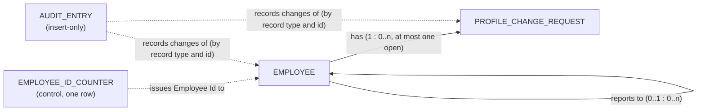

# PMS – HLD Part02-M1: Employee Information Management System (EIMS) Functional Design

Document ID: PMS-HLD-Part02-M1-EIMS-Functional-v1.0
Module: Employee Information Management System (EIMS)
Project: Payroll Management System (PMS) – proof of concept (POC), Stage 3 Solution Design
Author: Rajesh Verma (Enterprise Architect)
Date: November 2026

## 1. Document control

### 1.1 Version / revision history

| Version | Revision | Date | Author | Change remark |
| --- | --- | --- | --- | --- |
| 1.0 | 0.1 | 23-Nov-2026 | Rajesh Verma | First draft of §1–§2 and §3.1, based on the approved BRD set v1.0 (D-107), UX v1.1 (D-105), PMS-HLD-Part01 v1.0 rev 0.9, Part01a v1.0 rev 0.7, the Part02 anchor v1.0 rev 0.5 and the Part03 anchor v1.0 rev 0.4; threat-review method, settlement of the identity-provider order in this document and review grouping of 23 Nov 2026 (D-130) |

### 1.2 Review and approval

| Role | Name | Date | Decision |
| --- | --- | --- | --- |
| Architect | Rajesh Verma (Enterprise Architect) | 23-Nov-2026 | §1–§3.1 approved (D-130) |
| Product owner | Rajesh Verma | 23-Nov-2026 | §1–§3.1 approved (D-130) |
| Business analyst | | | |
| Dev lead | | | |

## 2. Introduction: Function design

This document describes the high-level solution approach for each system function of the Employee Information Management System (EIMS) module: APIs, database, orchestration and scenarios. Architecture-wide decisions (stack, resilience defaults, logging, security) are in PMS-HLD-Part01; cross-module flows and common design conventions (API, events, errors, audit and activity log, frontend) are in the Part02 anchor. Neither is repeated here. This is the first module document of the Part02 set; AMS, LMS, SMS and SUP follow its structure and depth.

Reading rules:

- Conventions of the Part02 anchor §2 apply: function ids `EIMS0010` to `EIMS0200` in steps of 10 (anchor §4); API references `[API-EIMS-nn : METHOD /api/eims/v1/<resource> (Purpose : …)]`, rolled up in §4.2; business statuses stay in PMS-BRD-M1-EIMS §6; the design is technology-neutral and names the identity provider, gateway and broker by role.
- Requirements, rules and screen behaviour are referenced by their BRD and UX ids (FR-EIMS, VR-EIMS, BR-EIMS, BR-CMN, SCR-EIMS, UJ-EIMS) and not restated. Column definitions belong to PMS-HLD-Part03-M1-EIMS-Datamodel (planned); this document names entities and the rules of the Part03 anchor, not columns.
- Cross-module flows XF-01, XF-07, XF-08 and XF-09 stay in the Part02 anchor §5; the function chapters here design only the EIMS steps of each flow.
- The identity-provider side of an account change (UM0010 to UM0050) is designed in PMS-HLD-Part02-M5-SUP (planned); here it is a call to that function. The order of the identity-provider call and the EIMS commit, retry of a half-done onboarding and recovery (OI-P02-01) are settled in this document, with EIMS0020 and EIMS0040 to EIMS0060, because EIMS owns the transaction and the Employee Id counter (Part03 anchor §2.3); PMS-HLD-Part02-M5-SUP references them.
- Design status per function: Not started until its chapter is drafted, then Draft, In review, Approved or Deferred (D-123).
- Notifications: none in the POC (C-05, NM is Phase 2). Each function's §3.2.n.5.9 shows "None (C-05)" with its audit and activity-log entries; in-app items (BRD §10) are dashboard and inbox items supplied by EIMS0200.
- Every diagram keeps a text-version table.

**Threat review in §3.2.n.5.8 (closes OI-P01a-08).** Every function's "Security & data privacy" part applies STRIDE – Spoofing, Tampering, Repudiation, Information disclosure, Denial of service, Elevation of privilege – only at the trust boundaries the function crosses. The template's five rows (authorization, sensitive fields, masking, encryption, logging) are kept; one "Threat review" row is added per boundary crossed, naming only the STRIDE threats that apply there and the control that answers each, by reference to PMS-HLD-Part01 §9 and §16.2 or the Part02 anchor §6. A threat without an existing control is recorded as an open item of the document, not designed ad hoc. The detailed method text goes to docs/04-standards/security (planned).

| Boundary | From → to | Typical threats | Existing controls (reference) |
| --- | --- | --- | --- |
| TB-1 | Browser → edge and API gateway | S (stolen session), T (forged request), I (data in transit), D (request flood) | HttpOnly session cookie and CSRF token (ADR-004, Part01 §9.6); TLS with HSTS, WAF and rate limit at the edge (ADR-005, Part01 §9.8); payload limit 1 MB |
| TB-2 | API gateway → EIMS service | S (call without a valid user), E (route or record outside the role or data scope), R (action without a trace) | Gateway route per role group, access token validated again by the service (Part01 §9.7, §9.8); role and data scope in the service and in the query (UM0060); neutral refused response (anchor §6.3, D-99); flow reference and activity log (Part01 §10.3, §10.5) |
| TB-3 | Other service or shell → EIMS, and EIMS → AMS / LMS | S (caller not the service it claims), E (internal API reached from the browser), I (more data than the caller needs) | Service token or relayed user token, network policies per service pair (Part01 §9.9, D-111); `/internal/` APIs never routed by the gateway (anchor §6.1); responses limited to the fields of the integration (INT-03 to 05, 07, 09) |
| TB-4 | EIMS → identity provider (INT-08) | S (misuse of the admin API), T / R (account change without a record), I (temporary password exposed) | Separate service client with client credentials limited to user management – create, update role, reset credential, disable, end sessions (Part01 §9.2, ADR-003); account changes audited by EIMS and recorded as security events (anchor §6.4, AUTH0060); password never stored or logged (FR-ADM-104, NFR-EIMS-02) |
| TB-5 | EIMS service → eims database | T (change outside the application), R (change without audit), I (data at rest) | Database per service with its own credentials (Part03 anchor §2.2); audit entry in the same transaction, insert-and-select-only grant (Part03 anchor §2.5); encrypted storage and backups (Part03 anchor §6) |

### 2.1 Reference documents

**Requirement documents**

| # | Document | Version |
| --- | --- | --- |
| 1 | PMS-BRD (anchor) – §4.3 roles and data scope, §5.3 dashboard and inbox, §6 BR-CMN, §7 INT-03 to INT-05, INT-07 to INT-09; PMS-BRD-M1-EIMS; PMS-BRD-M5-SUP (FR-UM-001 to 015, FR-AUTH, FR-ADM-101 to 117) | v1.0, approved baseline (D-107) |
| 2 | UX Journey Index and UX Summaries SCR-EIMS-01 to 04, SCR-SH-03, SCR-SH-04; mockups `docs/01-ux/mockups/html/scr-eims-0*.html` | v1.1 (D-105) |
| 3 | Decision log / ADRs | D-01 to D-130; ADR-001 to ADR-006 |

**Design documents**

| # | Document | Purpose |
| --- | --- | --- |
| 1 | PMS-HLD-Part01-Architecture-and-Design v1.0 rev 0.9 | Overall architecture and design: integration catalogue §8.2, resilience defaults §8.5, authorization §9.7 to §9.9, log record §10.3, flow reference §10.5, masking §10.8, load tests §14, OWASP mapping §16.2, NFR realization §16.3 |
| 2 | PMS-HLD-Part01a-Principles-Patterns-Decisions v1.0 rev 0.7 | Principles and patterns catalogue (AP-SEC-16 threat modelling); ADR register |
| 3 | PMS-HLD-Part02-Functional (anchor) v1.0 rev 0.5 | Function index §4, cross-module flows XF-01, XF-07 to XF-09 (§5), API, error, audit and frontend conventions (§6), roll-up inventories (§7) |
| 4 | PMS-HLD-Part02-M2-AMS, M3-LMS, M4-SMS-Functional (planned) | Callers of the EIMS APIs; providers of INT-09 (AMS0120, LMS0080) |
| 5 | PMS-HLD-Part02-M5-SUP-Functional (planned) | UM0010 to UM0060, AUTH, ADM0010 to ADM0060 called by EIMS functions |
| 6 | PMS-HLD-Part03-Datamodel (anchor) v1.0 rev 0.4 and PMS-HLD-Part03-M1-EIMS-Datamodel (planned) | Data model: eims ownership, conventions, common columns, common audit entry; EIMS entity definitions |
| 7 | API contract `contracts/openapi/eims-v1.yaml` (planned) | OpenAPI 3 contract of the EIMS APIs |

## 3. Module: Employee Information Management System

### 3.1 Preread

#### 3.1.1 Overview

EIMS holds the employee master data of PMS and is the source of the reporting line that every approval in PMS follows.

| Item | Detail |
| --- | --- |
| What it does | Onboarding one employee at a time with a system-generated Employee Id and temporary password; maintenance of the Admin-owned fields (date of joining, role, manager, hourly wage rate); deactivation; password reset; the employee's own profile with submit, withdraw and approval; profile change requests on an approved profile; the employee directory (PMS-BRD-M1-EIMS §7) |
| Who uses it | Admin (onboarding, maintenance, directory, top-level employee's approvals); Manager (own profile, direct reports in the directory and their approvals); Employee (own profile and change requests); system SYS-EIMS (Employee Id and temporary password, UJ-SYS-04) – BRD §4 |
| What it owns | Data in the eims database: EMPLOYEE and PROFILE_CHANGE_REQUEST, system tables EMPLOYEE_ID_COUNTER and AUDIT_ENTRY (Part03 anchor §2.2). APIs under `/api/eims/v1`: the screen APIs of SCR-EIMS-01 to 04 and the APIs other modules and the shell use – INT-03, INT-04, INT-05, INT-07 (§4.2). EIMS publishes and consumes no events |
| What it does not own | The user account, role and password – held in the identity provider and changed only through UM0010 to UM0050 (INT-08, BR-EIMS-09, ADR-003); attendance and leave – read only through the INT-09 checks of AMS0120 and LMS0080 |
| Depends on | Identity provider through UM (INT-08); AMS and LMS for the date-of-joining check (INT-09, XF-07); API gateway and shell (session, routing, layout); ADM0010 to ADM0060 for audit, activity log and flow reference |
| Used by | Shell (INT-07: EIMS card and inbox items, SH0020 to SH0040); AMS, LMS, SMS and the shell (INT-03 employee details, INT-04 approver); SMS (INT-05 hourly wage rate) |
| In-memory copies of other services' data | None. EIMS reads AMS and LMS only for the INT-09 check, at the moment of the change and never cached; OI-P03-03 stays with PMS-HLD-Part02-M2-AMS |
| Last approved profile | The EMPLOYEE record is always the last approved profile (or the not-yet-approved first profile); a profile change request holds the requested values separately, so other modules keep reading the approved values while a request is open (BR-CMN-11, FR-EIMS-028, D-70 – replaces the D-29 snapshot). The previous values are kept on the request when it is approved (BRD §9.2) |

#### 3.1.2 Module process flow

**Text version of the diagram**

| Step | Function id | Actor | From state | Action / decision | To state / handover |
| --- | --- | --- | --- | --- | --- |
| 1 | EIMS0020, EIMS0030 | Admin; system | – | Onboard: validate, generate Employee Id and temporary password, create the account (UM0010) | Profile Draft, account Active (XF-01) |
| 2 | EIMS0070, EIMS0080 | Employee | Draft or Rejected | View, save draft | Unchanged |
| 3 | EIMS0090 | Employee | Draft or Rejected | Submit or resubmit | Submitted; item for the approver (EIMS0200) |
| 4 | EIMS0100 | Employee | Submitted (no decision yet) | Withdraw | Draft |
| 5 | EIMS0140 | Manager; Admin for the top-level employee | Submitted | Open for review | Unchanged |
| 6 | EIMS0150 / EIMS0160 | As step 5 | Submitted | Approve / reject with remarks | Approved / Rejected (back to step 2) |
| 7 | EIMS0110 | Employee | Profile Approved, no open request | Start and save a change request | Request Draft |
| 8 | EIMS0120 | Employee | Request Draft or Rejected | Submit or resubmit (at least one changed value) | Request Submitted; review as steps 5–6 |
| 9 | EIMS0130 | Employee | Request Draft, Submitted (no decision) or Rejected | Withdraw | Request Withdrawn |
| 10 | EIMS0150 | Approver | Request Submitted | Approve: requested values applied to the profile, previous values kept on the request | Request Approved; profile stays Approved |
| 11 | EIMS0010, EIMS0040 | Admin | Any active employee | Change date of joining (INT-09, XF-07), role (UM0050, XF-09), manager (XF-08) or hourly wage rate | Profile status unchanged (FR-EIMS-012) |
| 12 | EIMS0050 | Admin | Active | Deactivate (UM0040, XF-09) | Inactive |
| 13 | EIMS0060 | Admin | Active | Reset password (UM0030, XF-09) | Temporary password shown once |
| 14 | EIMS0170 to EIMS0190 | AMS, LMS, SMS, shell | – | Read employee details, approver, hourly wage rate | Read only |
| 15 | EIMS0200 | Shell | – | Read the EIMS card, to-do items and inbox items | Read only (XF-05) |

#### 3.1.3 High-level ER diagram

Entity level only; full definitions in PMS-HLD-Part03-M1-EIMS-Datamodel (planned).

**Text version of the diagram**

| Entity | Related entity | Relationship | Cardinality | Rule |
| --- | --- | --- | --- | --- |
| EMPLOYEE | EMPLOYEE | reports to (Manager Id) | 0..1 : 0..n | Empty only for the one top-level employee (BR-CMN-01, VR-EIMS-05); no reporting loop |
| PROFILE_CHANGE_REQUEST | EMPLOYEE | is raised for | 0..n : 1 | At most one open request (Draft, Submitted, Rejected) per employee (BR-EIMS-03) |
| EMPLOYEE_ID_COUNTER | EMPLOYEE | issues the Employee Id | 1 : 0..n | Raised in the same local transaction that saves the employee; never reused (Part03 anchor §2.3, BR-EIMS-01) |
| AUDIT_ENTRY | EMPLOYEE, PROFILE_CHANGE_REQUEST, user account | records each change | 0..n : 1 | Record types EMPLOYEE, PROFILE_CHANGE_REQUEST, USER_ACCOUNT; no foreign key; written in the same transaction (Part03 anchor §2.5) |

The role is not on EMPLOYEE: it is held with the user account in the identity provider (BR-EIMS-09).

#### 3.1.4 Status lifecycle

Business statuses and transitions are defined in PMS-BRD-M1-EIMS §6.1 (profile), §6.2 (Active / Inactive) and §6.3 (profile change request). Technical handling:

- Profile status is the `status` of EMPLOYEE, request status the `status` of PROFILE_CHANGE_REQUEST, both with check constraints of the BRD codes; Active / Inactive is `is_active` of EMPLOYEE (Part03 anchor §2.3, §2.4).
- Each transition is one command API of the owning function. The service checks the actor, data scope and current status, then updates the record with the version the command carries (row_version + 1); a version or status that no longer matches is refused (EIMS-CON-001 or a BUS code) and nothing changes (anchor §6.1).
- EIMS emits no events: other modules read the current values at the time they need them (INT-03, INT-04, INT-07).
- Every transition writes its audit entries in the same local transaction and an activity-log record with the function's step names (anchor §6.4).

| Transition | Enforced in | Event emitted | Audit / activity entry |
| --- | --- | --- | --- |
| Profile – → Draft, account Active | EIMS0020 (with UM0010) | None | EMPLOYEE `created` with initial values; USER_ACCOUNT `created` (no password) |
| Profile Draft / Rejected → Draft / Rejected (save) | EIMS0080 | None | One entry per changed field |
| Profile Draft / Rejected → Submitted | EIMS0090 | None | Changed fields and `status` |
| Profile Submitted → Draft | EIMS0100 | None | `status` |
| Profile Submitted → Approved / Rejected | EIMS0150 / EIMS0160 | None | `status` with the remarks of a rejection; approver and decision time |
| Request – → Draft, Draft → Draft | EIMS0110 | None | PROFILE_CHANGE_REQUEST `created`; changed fields |
| Request Draft / Rejected → Submitted | EIMS0120 | None | Changed fields and `status` |
| Request Draft / Submitted / Rejected → Withdrawn | EIMS0130 | None | `status` |
| Request Submitted → Approved (values applied) / Rejected | EIMS0150 / EIMS0160 | None | Request `status`; on approval one EMPLOYEE entry per applied field |
| Account Active → Inactive | EIMS0050 (with UM0040) | None | EMPLOYEE `is_active`; USER_ACCOUNT disabled |
| Admin-owned field change (profile status unchanged) | EIMS0040 (role change with UM0050) | None | One EMPLOYEE entry per field; USER_ACCOUNT role |
| Password reset | EIMS0060 (with UM0030) | None | USER_ACCOUNT password reset (no value) |

#### 3.1.5 System function index

| Function id | System function | Type (screen / API / backend job) | UX screen | Delivery phase | Design status |
| --- | --- | --- | --- | --- | --- |
| EIMS0010 | View the employee directory – search, filter, show inactive (FR-EIMS-001 to 004, 006) | Screen | SCR-EIMS-01 | POC | Not started |
| EIMS0020 | Onboard an employee – create the employee and the user account (FR-EIMS-010, 011, 014; INT-08) | Screen | SCR-EIMS-02 | POC | Not started |
| EIMS0030 | Generate Employee Id and temporary password (FR-EIMS-040, 041; UJ-SYS-04) | Backend process | – (shown once on SCR-EIMS-02) | POC | Not started |
| EIMS0040 | Edit Admin-owned fields – date of joining, role, manager, hourly wage rate (FR-EIMS-012 to 017; INT-08, INT-09) | Screen | SCR-EIMS-02 | POC | Not started |
| EIMS0050 | Deactivate an employee (FR-EIMS-018; INT-08) | Screen | SCR-EIMS-02 | POC | Not started |
| EIMS0060 | Reset an employee's password (FR-EIMS-005; INT-08) | Screen | SCR-EIMS-01 | POC | Not started |
| EIMS0070 | View my profile and its status (FR-EIMS-020) | Screen | SCR-EIMS-03 | POC | Not started |
| EIMS0080 | Save a profile draft (FR-EIMS-021) | Screen | SCR-EIMS-03 | POC | Not started |
| EIMS0090 | Submit or resubmit my profile (FR-EIMS-022, 024) | Screen | SCR-EIMS-03 | POC | Not started |
| EIMS0100 | Withdraw my submitted profile (FR-EIMS-023) | Screen | SCR-EIMS-03 | POC | Not started |
| EIMS0110 | Start and save a profile change request (FR-EIMS-025, 026) | Screen | SCR-EIMS-03 | POC | Not started |
| EIMS0120 | Submit or resubmit a profile change request (FR-EIMS-026, 027) | Screen | SCR-EIMS-03 | POC | Not started |
| EIMS0130 | Withdraw a profile change request (FR-EIMS-027) | Screen | SCR-EIMS-03 | POC | Not started |
| EIMS0140 | Open a profile or change request for review, or read only from the directory (FR-EIMS-030 to 032, 034, 035) | Screen | SCR-EIMS-04 | POC | Not started |
| EIMS0150 | Approve profiles or change requests, one or several; apply approved changes (FR-EIMS-033, 028) | Screen | SCR-EIMS-04, SCR-SH-04 | POC | Not started |
| EIMS0160 | Reject a profile or change request with remarks (FR-EIMS-033) | Screen | SCR-EIMS-04, SCR-SH-04 | POC | Not started |
| EIMS0170 | Provide employee details to other modules (INT-03) | API | – | POC | Not started |
| EIMS0180 | Resolve the approver of a record (INT-04) | API | – | POC | Not started |
| EIMS0190 | Provide the current hourly wage rate (INT-05) | API | – | POC | Not started |
| EIMS0200 | Supply EIMS dashboard tiles, to-do items and inbox items (INT-07) | API | SCR-SH-03, SCR-SH-04 | POC | Not started |

Review grouping (each review adds a revision row): R1 §1–§3.1 · R2 EIMS0010 · R3 EIMS0020–EIMS0030 · R4 EIMS0040 · R5 EIMS0050–EIMS0060 · R6 EIMS0070–EIMS0100 · R7 EIMS0110–EIMS0130 · R8 EIMS0140–EIMS0160 · R9 EIMS0170–EIMS0200 · R10 §4–§5.

### 3.2 EIMS system functions

Function chapters are added review by review (R2 to R9).

## 4. NFR summary & inventories

Drafted with R10.

## 5. Appendix

Drafted with R10.
