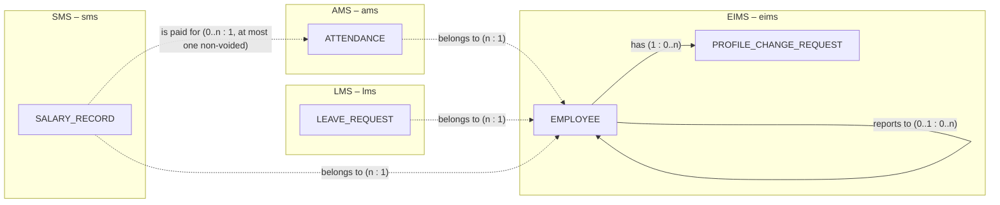

# PMS – HLD Part03: Data Model (Anchor)

Document ID: PMS-HLD-Part03-Datamodel-v1.0
Scope: data model anchor – conventions, ownership, index and cross-service view; entity definitions are in the module data model documents
Project: Payroll Management System (PMS) – proof of concept (POC), Stage 3 Solution Design
Author: Rajesh Verma (Enterprise Architect)
Date: November 2026

## 1. Document control

### 1.1 Version / revision history

| Version | Revision | Date | Author | Change remark |
| --- | --- | --- | --- | --- |
| 1.0 | 0.1 | 23-Nov-2026 | Rajesh Verma | First draft of §1–§3, based on the approved BRD set v1.0 (D-107), PMS-HLD-Part01 v1.0 rev 0.9, PMS-HLD-Part01a v1.0 rev 0.6 and PMS-HLD-Part02-Functional v1.0 rev 0.4; Part03 anchor design answers of 23 Nov 2026 (D-126) |
| 1.0 | 0.2 | 23-Nov-2026 | Rajesh Verma | Draft of §4 (master ER of the 5 business entities with text-version table; system tables and what they relate to) and §5 (cross-service data and consistency, 12 data objects) (D-127) |
| 1.0 | 0.3 | 23-Nov-2026 | Rajesh Verma | Draft of §6 (classification and privacy roll-up), §7 (volumetrics, retention, clean-up rules JOB-AMS-01 and JOB-CMN-01 step) and §8 (schema management, seed data, backups) (D-128) |
| 1.0 | 0.4 | 23-Nov-2026 | Rajesh Verma | Draft of §9 (open items OI-P03-01 to 03, OI-P02-02 data-side options; items brought forward from Part02 and Part01a); all sections drafted (D-129) |

### 1.2 Review and approval

| Role | Name | Date | Decision |
| --- | --- | --- | --- |
| Architect | Rajesh Verma (Enterprise Architect) | 23-Nov-2026 | §1–§3 approved (D-126); §4–§5 approved (D-127); §6–§8 approved (D-128); §9 approved (D-129); all sections reviewed – final approval with the HLD set at the Stage 3 gate |
| Data / DB lead | | | |
| Dev lead | | | |
| Security lead | | | |

## 2. Introduction: Data model

This document is the anchor of the PMS data model: modelling conventions, data ownership per service, the entity index with links to the module data model documents, the master ER view, cross-service consistency, and roll-up summaries of classification, volumetrics and schema management. Entity definitions (columns, keys, indexes) are only in the module data model documents (PMS-HLD-Part03-M1-EIMS to M4-SMS and M5-SUP); this anchor never repeats them (D-43). The common columns (§2.4) and the common audit entry (§2.5) are the only column lists here, because every service uses them unchanged. Rows that depend on a module document not yet written show "Module document (planned)" and are completed as each module document is written.

Reading rules:

- Business statuses and their transitions stay in the module BRDs §6; this document holds only how they are stored.
- Engine-specific types are used only for the chosen database, PostgreSQL 18 in every environment (Part01 §11, D-115); everything else is technology-neutral (Part01 §2).
- Rules that a standard will detail refer to `docs/04-standards/database-and-data (planned)` (Part01a §2).

### 2.1 Reference documents

**Requirement documents**

| # | Document | Version |
| --- | --- | --- |
| 1 | PMS-BRD (anchor §6 BR-CMN rules, §7 integrations, §8.1 volumetrics) and module BRDs PMS-BRD-M1-EIMS to M4-SMS (§6 status lifecycles, §9 data requirements, §13 volumetrics), PMS-BRD-M5-SUP (§8 audit and activity log, §11 data) | v1.0, approved baseline (D-107) |
| 2 | Decision log `docs/decisions/decision-log.md` and ADRs `docs/decisions/adr/` | D-01 to D-125; ADR-001 to ADR-006 |

**Design documents**

| # | Document | Purpose |
| --- | --- | --- |
| 1 | PMS-HLD-Part01-Architecture-and-Design v1.0 rev 0.9 (§8.3 outbox and job lock, §10.8 privacy and retention, §11 technology stack, §12 data architecture, §13 data migration and seed data, §17 volumetrics) | Overall architecture and design |
| 2 | PMS-HLD-Part01a-Principles-Patterns-Decisions v1.0 rev 0.6 | Principles and patterns catalogue (group DATA); ADR register |
| 3 | PMS-HLD-Part02-Functional (anchor) v1.0 rev 0.4 and PMS-HLD-Part02-M1-EIMS to M4-SMS-Functional (planned) | Functional design: function index, cross-module flows XF-01 to XF-09, API, event and audit conventions (§6) |
| 4 | PMS-HLD-Part02-M5-SUP-Functional (planned) | Supporting modules (UM, AUTH, ADM) |
| 5 | PMS-HLD-Part03-M1-EIMS to M4-SMS-Datamodel (planned) | Module data models (entity definitions) |
| 6 | PMS-HLD-Part03-M5-SUP-Datamodel (planned) | Supporting-module data model (need basis) |
| 7 | Contracts (`contracts/openapi`, `contracts/events`) | API and event schemas |

### 2.2 Data ownership (database per service)

| Service / module | Database / schema | Entities owned | Entities read from other services (how: API / event-replicated copy) |
| --- | --- | --- | --- |
| EIMS | eims | EMPLOYEE, PROFILE_CHANGE_REQUEST; system tables EMPLOYEE_ID_COUNTER, AUDIT_ENTRY | Attendance and leave before a new date of joining – API (INT-09, AMS0120, LMS0080); user account – identity-provider admin API (INT-08), not stored in eims |
| AMS | ams | ATTENDANCE; system tables OUTBOX_EVENT, JOB_LOCK, AUDIT_ENTRY | Employee details and approver – API (INT-03, INT-04), short-lived in-memory copy; leave on a date – API (INT-06, LMS0070); salary status – API (INT-10, SMS0110) |
| LMS | lms | LEAVE_REQUEST; system table AUDIT_ENTRY | Employee details and approver – API (INT-03, INT-04), short-lived in-memory copy; attendance on leave dates – API (INT-06, AMS0110) |
| SMS | sms | SALARY_RECORD; system tables ATTENDANCE_APPLIED_VERSION, PROCESSED_EVENT, RECONCILIATION_RUN, RECONCILIATION_MISMATCH, JOB_LOCK, AUDIT_ENTRY | Attendance – event (INT-01, INT-02): the values a salary record needs are copied into it when generated; approved attendance – paged API for the nightly reconciliation (AMS0100); hourly wage rate – API (INT-05, EIMS0190), copied into the salary record (BR-SMS-02) |
| Identity provider | Its own database | User accounts, credentials (hashed), roles, sessions, security events – not modelled by PMS (D-29, ADR-003); need-basis check in PMS-HLD-Part03-M5-SUP | Employee Id, role and enabled state – set by EIMS through the admin API (INT-08) |
| Shell and API gateway | None | None – the shell composes module cards from the module APIs (INT-07); the gateway keeps user sessions in memory (ADR-004) | – |

Rules: no foreign keys or joins across service databases; a reference to another service's entity is held as its business key (Employee Id) or its record id (attendance id in SMS) and resolved through that service's API or, for SMS, from the copied event values (§5). There are no replicated read tables: copies of another service's data are short-lived and in memory only (Part01 §12, AP-DATA-09).

### 2.3 Modelling conventions

| Topic | Convention |
| --- | --- |
| Entity and column naming | Entity (table) names singular, UPPER_SNAKE in the documents and lower snake_case in the database (`EMPLOYEE` → `employee`); columns snake_case; no module prefix, since each service has its own database. Constraint and index names: `pk_<table>`, `uk_<table>_<columns>`, `fk_<table>_<referenced table>`, `ck_<table>_<column>`, `ix_<table>_<columns>`. Detail in docs/04-standards/database-and-data (planned), AP-DATA-14 |
| Primary key | Surrogate `id` of type `uuid`, generated by the service; it is also the record id in APIs and events (`/attendance-entries/{id}`, event `subject.id`). A business key, where one exists, is held separately with a unique constraint (AP-DATA-15) |
| Business identifiers | Employee Id `EMP` + 4 digits (`EMP0001`), column `employee_id` `varchar(7)`, unique in EMPLOYEE, never reused (FR-EIMS-040, BR-EIMS-01, D-71). Generated from a counter row in EMPLOYEE_ID_COUNTER that is raised in the same local transaction that saves the employee: a rolled-back onboarding leaves no gap, and concurrent onboardings wait on the counter row. Whether a failure after the identity-provider call can still leave a gap depends on the order of the two steps, designed in PMS-HLD-Part02-M5-SUP (OI-P02-01). Records without a business id (profile change request, attendance, leave request, salary record) are known by their `id` |
| References to other records | Inside a database: foreign key on `id`. Across databases: no foreign key (C-02, D-10, AP-DATA-07); the reference holds the other service's key – `employee_id` for employees, `attendance_id` (`uuid`) for attendance in SMS – and is checked through that service's API or event |
| User references | Every `*_by` column and `approver_id` is `varchar(30)` holding an Employee Id, the PMS Administrator's user name (FR-UM-004) or `SYSTEM` for jobs and events; for changes made on an event, the envelope actor (Part02 §6.2). No foreign key, as user accounts live in the identity provider |
| Date / time | Timestamps `timestamptz`, stored in UTC and shown in IST (BR-CMN-18, AP-DATA-13, D-117); column suffix `_at`. Business dates (work date, leave dates, date of birth, date of joining) `date`, meaning the IST calendar date; times of day (attendance from and to) `time` in 15-minute steps (D-77). The BRD's "Created Date", "Approved Date" etc. are stored as `created_at`, `approved_at` |
| Money | Amounts and hourly wage rates `numeric(12,2)`, INR only, no currency column (D-08); rounded half up to 2 decimals (D-90). Hours `numeric(5,2)` |
| Enumerations / statuses | Stored as the upper-case codes of the API (Part02 §6.1) in a `varchar` column with a check constraint listing the values of the module BRD §6 (e.g. `DRAFT`, `SUBMITTED`, `APPROVED`, `REJECTED`); no lookup tables in the POC, as values change only by release (D-97) |
| Soft delete | Business records are never physically deleted (BR-CMN-06, AP-DATA-04): `is_active` = false marks a discarded or deactivated record. Only the system tables named in §7 are cleaned up |
| Optimistic locking | `row_version` on every business record (§2.4): integer, 1 on creation, raised by 1 on each change. It is the version carried in command bodies and returned with each record, and it is `subject.version` in attendance events (Part02 §6.1, §6.2; FR-CMN-014, NFR-06). An update states the version it was based on; no row changed means 409 (`<MOD>-CON-001`) |
| Semi-structured data | `jsonb` only where the content is a message or a set of fields that varies per row: the outbox event (envelope and payload, Part02 §6.2). Any other use is decided in the module document with its reason |
| Append-only and system tables | Audit, outbox, processed-event, version, run, mismatch, counter and job-lock tables have none of the common columns of §2.4; each module document defines their columns. The audit table is written with an insert-only database grant (§2.5) |
| Database users | Per service, a schema owner used only by the migrations, and an application user with the rights its functions need – on AUDIT_ENTRY insert and select only (FR-ADM-103). Credentials per service and environment (Part01 §9.10) |
| Audit columns | §2.4; audit log §2.5 |

### 2.4 Common columns (apply to every business record unless stated)

Business records: EMPLOYEE, PROFILE_CHANGE_REQUEST, ATTENDANCE, LEAVE_REQUEST, SALARY_RECORD.

| Column | Type | Null | Notes |
| --- | --- | --- | --- |
| id | uuid | N | Primary key (§2.3) |
| status | varchar(20) | N | Upper-case status code from the module BRD §6, check constraint (BR-CMN-02) |
| approver_id | varchar(30) | Y | Who decided the record; stored only with the decision – a waiting item has no stored approver, which is resolved from the current Manager Id when listed or decided (BR-CMN-02, D-123 (5)) |
| approved_at | timestamptz | Y | When the decision was taken (BRD "Approved Date") |
| remarks | varchar(500) | Y | Rejection, reopen or void reason (BR-CMN-02, BR-CMN-03) |
| is_active | boolean | N | Default true; false = soft-deleted (BR-CMN-06) |
| created_by | varchar(30) | N | Reference to user (§2.3) (BR-CMN-07) |
| created_at | timestamptz | N | Default current timestamp, UTC |
| updated_by | varchar(30) | Y | Reference to user |
| updated_at | timestamptz | Y | UTC |
| row_version | integer | N | Optimistic lock and event subject version: 1 on creation, + 1 on each change (§2.3) |

### 2.5 Common audit entry (one AUDIT_ENTRY table in each service database)

Not in the template. One structure for eims, ams, lms and sms (Part02 §6.4, ADM0010); module documents list only which records and fields they audit. Written in the same local transaction as the change (D-110 (12)); one entry per changed field, a creation with its initial values, a status change with old and new status and the remarks (FR-ADM-101, 102). Append only: the application user may insert and select, never update or delete; kept as long as the record, so never cleaned up (FR-ADM-103). Sensitive values are kept in full and protected like the record; passwords are never recorded (FR-ADM-104).

| Column | Type | Null | Notes |
| --- | --- | --- | --- |
| id | uuid | N | Primary key |
| flow_ref | char(14) | N | Flow reference of the user action, job run or event (Part01 §10.5, FR-ADM-113) |
| record_type | varchar(30) | N | Entity name, e.g. `EMPLOYEE`, `ATTENDANCE`, `USER_ACCOUNT` (account changes made through EIMS) |
| record_id | varchar(40) | N | Employee Id for EMPLOYEE and USER_ACCOUNT, otherwise the record `id` |
| field | varchar(40) | N | Column changed, or `created` / `status` |
| old_value | text | Y | Empty on creation; sensitive when the field is sensitive (§6) |
| new_value | text | Y | As old_value |
| process | varchar(60) | N | API id, job id or event type (e.g. `API-AMS-nn`, `JOB-CMN-01`, `ams.attendance.approved`) |
| changed_by | varchar(30) | N | Employee Id, Admin user name or `SYSTEM`; the envelope actor for event-driven changes |
| changed_at | timestamptz | N | UTC |

Index `ix_audit_entry_record (record_type, record_id, changed_at)` serves the history extract of one record in time order (ADM0020, FR-ADM-105); no other index in the POC.

## 3. Module data model documents & entity index

### 3.1 Module data model documents

| Module | Document | Service / database | Version | Status |
| --- | --- | --- | --- | --- |
| EIMS | PMS-HLD-Part03-M1-EIMS-Datamodel | EIMS service / eims | – | Not started |
| AMS | PMS-HLD-Part03-M2-AMS-Datamodel | AMS service / ams | – | Not started |
| LMS | PMS-HLD-Part03-M3-LMS-Datamodel | LMS service / lms | – | Not started |
| SMS | PMS-HLD-Part03-M4-SMS-Datamodel | SMS service / sms | – | Not started |
| SUP (UM, AUTH, ADM) | PMS-HLD-Part03-M5-SUP-Datamodel | Identity provider (need basis); common audit entry §2.5 | – | Not started |

Each module document is written after its Part02 module document (D-108).

### 3.2 Entity index

Status "Not started" with document section "Module document (planned)" until the module document is drafted, then the entity status values of the conventions (Draft, In review, Approved, Deferred, Moved, Removed) – as in the Part02 function index (D-123).

**Business entities**

| # | Entity | Module document (section) | Service | Type (master / transaction / history / config / log / reference) | Status |
| --- | --- | --- | --- | --- | --- |
| 1 | EMPLOYEE | PMS-HLD-Part03-M1-EIMS – Module document (planned) | EIMS | Master | Not started |
| 2 | PROFILE_CHANGE_REQUEST | PMS-HLD-Part03-M1-EIMS – Module document (planned) | EIMS | Transaction | Not started |
| 3 | ATTENDANCE | PMS-HLD-Part03-M2-AMS – Module document (planned) | AMS | Transaction | Not started |
| 4 | LEAVE_REQUEST | PMS-HLD-Part03-M3-LMS – Module document (planned) | LMS | Transaction | Not started |
| 5 | SALARY_RECORD | PMS-HLD-Part03-M4-SMS – Module document (planned) | SMS | Transaction | Not started |

**System tables** (no common columns of §2.4; type "control" added to the template types for state the system keeps to run a rule)

| # | Entity | Module document (section) | Service | Type | Status |
| --- | --- | --- | --- | --- | --- |
| 6 | AUDIT_ENTRY | This anchor §2.5 (structure); each module document lists what it audits | EIMS, AMS, LMS, SMS (one table in each database) | History | Draft (§2.5) |
| 7 | EMPLOYEE_ID_COUNTER | PMS-HLD-Part03-M1-EIMS – Module document (planned) | EIMS | Control – one row, last Employee Id number issued (§2.3) | Not started |
| 8 | OUTBOX_EVENT | PMS-HLD-Part03-M2-AMS – Module document (planned) | AMS | Log – events written with the status change, published by AMS0090; sent rows kept 90 days (§7) | Not started |
| 9 | JOB_LOCK (ams) | PMS-HLD-Part03-M2-AMS – Module document (planned) | AMS | Control – one run at a time of the outbox clean-up job | Not started |
| 10 | ATTENDANCE_APPLIED_VERSION | PMS-HLD-Part03-M4-SMS – Module document (planned) | SMS | Control – one row per attendance id with the last applied version; its row lock serialises two SMS instances on one attendance (Part02 §6.2) | Not started |
| 11 | PROCESSED_EVENT | PMS-HLD-Part03-M4-SMS – Module document (planned) | SMS | Log – one row per consumed event id (unique), kept 90 days (§7) | Not started |
| 12 | RECONCILIATION_RUN | PMS-HLD-Part03-M4-SMS – Module document (planned) | SMS | Log – one row per nightly run: start, end, result, counts, flow reference; last run on the Admin dashboard (SMS0120) | Not started |
| 13 | RECONCILIATION_MISMATCH | PMS-HLD-Part03-M4-SMS – Module document (planned) | SMS | Log – one row per mismatch found by a run (FR-SMS-044), linked to the run | Not started |
| 14 | JOB_LOCK (sms) | PMS-HLD-Part03-M4-SMS – Module document (planned) | SMS | Control – one run at a time of JOB-CMN-01 (Part01 §8.3) | Not started |

User accounts, credentials, roles, sessions and security events are held by the identity provider and are not PMS entities (§2.2); PMS-HLD-Part03-M5-SUP records the need-basis result.

## 4. ER diagrams

### 4.1 Master ER diagram (logical, all services)

Entity level only, business entities grouped by owning service; cross-service references are dashed (held as a key, no foreign key). System tables are listed below the diagram.

| Entity | Related entity | Relationship (verb) | Cardinality | Same / cross-service |
| --- | --- | --- | --- | --- |
| EMPLOYEE | EMPLOYEE | reports to (Manager Id; empty for the one top-level employee, BR-CMN-01) | 0..1 : 0..n | Same (eims) |
| PROFILE_CHANGE_REQUEST | EMPLOYEE | is raised for | 0..n : 1 | Same (eims) |
| ATTENDANCE | EMPLOYEE | belongs to (Employee Id) | 0..n : 1 | Cross (ams → eims) |
| LEAVE_REQUEST | EMPLOYEE | belongs to (Employee Id) | 0..n : 1 | Cross (lms → eims) |
| SALARY_RECORD | EMPLOYEE | belongs to (Employee Id) | 0..n : 1 | Cross (sms → eims) |
| SALARY_RECORD | ATTENDANCE | is paid for (attendance id); at most one non-voided record per attendance (BR-SMS-01, NFR-06) | 0..n : 1 | Cross (sms → ams) |
| ATTENDANCE, LEAVE_REQUEST, PROFILE_CHANGE_REQUEST, SALARY_RECORD | EMPLOYEE | decided by (approver_id, stored only with the decision) | 0..n : 0..1 | Cross, except PROFILE_CHANGE_REQUEST and EMPLOYEE in eims |
| ATTENDANCE | LEAVE_REQUEST | checked against on the same employee and date (INT-06); no stored reference | – | Cross (ams ↔ lms) |

Employee Ids are never deleted or reused (BR-CMN-06, FR-EIMS-040), so a cross-service reference never points to a missing employee.

**System tables and what they relate to**

| System table | Service | Relates to | Relationship |
| --- | --- | --- | --- |
| AUDIT_ENTRY | eims, ams, lms, sms | Every business record of its own database (record type + record id) | Many entries per record, no foreign key (one table for all record types) |
| EMPLOYEE_ID_COUNTER | eims | EMPLOYEE | One row; holds the last number issued |
| OUTBOX_EVENT | ams | ATTENDANCE | 0..n events per attendance (approved, reopened), written in the same transaction |
| JOB_LOCK | ams, sms | Outbox clean-up job; JOB-CMN-01 | One row per job |
| ATTENDANCE_APPLIED_VERSION | sms | ATTENDANCE (attendance id, cross-service) | One row per attendance whose event or reconciliation was applied |
| PROCESSED_EVENT | sms | OUTBOX_EVENT (event id, cross-service) | One row per consumed event |
| RECONCILIATION_RUN | sms | – | One row per nightly run |
| RECONCILIATION_MISMATCH | sms | RECONCILIATION_RUN (foreign key); ATTENDANCE and SALARY_RECORD by id | 0..n per run |

Service-wise ER diagrams with full entity definitions are in each module data model document.

## 5. Cross-service data & consistency

| Data object | Owner service | Consumer service | Mechanism (API call / event-replicated read copy / none) | Event(s) | Consistency (strong / eventual, max lag) | Reconciliation |
| --- | --- | --- | --- | --- | --- | --- |
| Approved attendance: attendance id, Employee Id, work date, from and to time, hours, version | AMS | SMS | Event; the values a salary record needs are copied into SALARY_RECORD when it is generated (SMS0080, XF-02) | ams.attendance.approved (INT-01) | Eventual: normally under 1 minute (NFR-01); up to the next night if delivery fails | JOB-CMN-01 creates any missing record (XF-04) |
| Reopened attendance | AMS | SMS | Event; voids the non-voided salary record (SMS0090, XF-03) | ams.attendance.reopened (INT-02) | Eventual: normally under 1 minute; the record stays Disputed meanwhile | JOB-CMN-01 voids any record whose attendance is no longer Approved |
| Order and duplicates of the two events | AMS | SMS | Version and event id stored in ATTENDANCE_APPLIED_VERSION and PROCESSED_EVENT in the salary change transaction (Part02 §6.2) | INT-01, INT-02 | A lower or equal version, or a known event id, changes nothing | JOB-CMN-01 stores the version it read in the same way |
| Approved attendance for a date range | AMS | SMS (reconciliation job) | Paged API, service token (AMS0100) | – | Read at run time | This is the reconciliation |
| Hourly wage rate | EIMS | SMS | API (INT-05, EIMS0190) at generation; copied into the salary record (BR-SMS-02) | – | Strong at the read; the copied rate is not changed by a later rate change (BR-CMN-13, no rate history, D-90) | None needed |
| Employee details (name, manager, active state, date of joining) | EIMS | AMS, LMS, SMS, shell | API (INT-03, EIMS0170); short-lived in-memory copy, lifetime set in the module documents | – | Strong at the read; a cached copy may lag by its lifetime | None |
| Approver of a record | EIMS | AMS, LMS, SMS, shell | API (INT-04, EIMS0180) whenever an item is listed or decided; approver_id stored only with the decision (D-123 (5)) | – | Strong at the decision; a manager change moves waiting items at once (XF-08) | None needed |
| Attendance / leave on the same date | AMS, LMS | LMS, AMS | API (INT-06, AMS0110, LMS0070) on save and submit; never skipped | – | Check-then-act across two databases: two simultaneous submissions can both pass (OI-P02-02) | None in the POC (OI-P02-02) |
| Records before a new date of joining | AMS, LMS | EIMS | API (INT-09, AMS0120, LMS0080) before the change is saved | – | As above (OI-P02-02) | None in the POC (OI-P02-02) |
| Salary status of approved attendance | SMS | AMS (and the shell through AMS) | API (INT-10, SMS0110) when history and inbox views load and before a reopen | – | Read at view time; reopen refused server-side unless the record is Disputed (D-122) | None needed |
| Dashboard tiles, to-do items, inbox items | EIMS, AMS, LMS, SMS | Shell | API (INT-07), one call per module card | – | Read at load; each card fails on its own (FR-CMN-008) | None |
| User account: Employee Id, role, enabled state | EIMS (values) | Identity provider (holds the account) | Admin API (INT-08) on onboarding, role change, reset and deactivation | – | Two steps in two systems; order and recovery designed in PMS-HLD-Part02-M5-SUP (OI-P02-01) | None in the POC (OI-P02-01) |

## 6. Data classification & privacy summary

Roll-up of the classification tables in the module documents; until they are written, the classification comes from the module BRDs §9 (D-71, D-75, D-80, D-87, D-93). Classes: **Sensitive – personal** (D-71 personal attributes), **Sensitive – pay** (hourly wage rate, wage amounts), **Internal** (all other business and system data; shown only within the role's data scope). Rules for every class: shown and returned only within the role's data scope (BRD anchor §4.3, D-58, D-63; UM0060), refused with the neutral response otherwise (Part02 §6.3); never written to the activity log – services log by an allow-list of ids, statuses and counts (Part01 §10.8, FR-ADM-115); test data synthetic in every environment (R-04). No field-level encryption in the POC: data at rest is protected by encrypted database storage – the operating-system-encrypted workstation drive locally, the managed database and volume encryption on AWS – and encrypted backup drives (Part01 §16, OI-P01-06 closed).

| Entity.column | Classification | Masking (UI / API / logs) | Encryption (at rest / field-level) | Access rule (role, data scope) | Retention |
| --- | --- | --- | --- | --- | --- |
| EMPLOYEE – father's and mother's name, date, place and country of birth, address lines, city, state, country, zip / PIN code, email, mobile number | Sensitive – personal (D-71) | UI and API: not masked, returned only within the data scope; logs: never | Storage encryption; no field-level | Employee own (R/W); manager for direct reports (R, review); Admin all employee master data (BRD anchor §4.3) | Kept with the record, never deleted (BR-CMN-06) |
| EMPLOYEE – hourly wage rate | Sensitive – pay (D-71) | As above | As above | Admin (R/W); further visibility per screen in PMS-HLD-Part03-M1-EIMS (planned) | As above |
| EMPLOYEE – Employee Id, names, date of joining, manager, status, workflow and audit columns | Internal | Logs: Employee Id only (an id, allowed) | Storage encryption | Data scope (BRD anchor §4.3) | As above |
| PROFILE_CHANGE_REQUEST – requested and previous values | As the EMPLOYEE field each value belongs to | As that field | As that field | Employee own; manager for direct reports; Admin for the top-level employee | As above |
| ATTENDANCE, LEAVE_REQUEST – all columns | Internal – not sensitive (D-80, D-87) | Logs: ids and statuses only | Storage encryption | Owner; manager for direct reports; Admin only the top-level employee's records (D-58); System read for salary (AMS → SMS) | As above |
| SALARY_RECORD – day wage rate, day wage amount | Sensitive – pay (D-93) | UI and API: within the data scope only; logs: never | Storage encryption; no field-level | Owner; manager for direct reports; Admin only the top-level employee's records (D-58); System R/W (generate, void, reconcile) | As above |
| SALARY_RECORD – other columns (dispute remark, explanation, remarks and dates) | Internal; free-text remarks never logged (Part01 §10.8) | As above | Storage encryption | As above | As above |
| AUDIT_ENTRY – old value, new value | As the field audited (sensitive values kept in full, FR-ADM-104); passwords never recorded | No user screen in the POC; history extract by IT operations on request of the HR or Finance Manager only (FR-ADM-105); logs: never | Storage encryption | Service application user insert and select only (§2.5); IT operations for the extract | Kept as long as the record (FR-ADM-103) |
| OUTBOX_EVENT – envelope and payload | Internal – attendance data only, no sensitive values (Part02 §6.2) | Payload never logged; event ids and types only | Storage encryption | AMS only; published to SMS | Sent rows 90 days (§7) |
| PROCESSED_EVENT, ATTENDANCE_APPLIED_VERSION, RECONCILIATION_RUN, RECONCILIATION_MISMATCH, EMPLOYEE_ID_COUNTER, JOB_LOCK | Internal – ids, versions, counts | – | Storage encryption | Owning service only; run result on the Admin dashboard (SMS0120) | §7 |
| User account, credentials, sessions, security events | Held by the identity provider (ADR-003) | Passwords never stored or shown in readable form | Hashed by the identity provider | Identity provider; IT operations for security events | Security events 90 days (Part01 §10.8) |

## 7. Volumetrics, retention & archival

Roll-up of the module documents; until they are written, figures from BRD anchor §8.1 and Part01 §17 (about 100 employees, 0 % growth, 20 % headroom planned, load-tested to 2×, NFR-07). Initial volume: none – greenfield (Part01 §13); about 100 employees are onboarded one by one at go-live (D-104).

| Entity | Initial volume | Growth (per month) | 3-year volume | Retention | Archival / purge approach |
| --- | --- | --- | --- | --- | --- |
| EMPLOYEE | About 100 at go-live | About 0 (replacements only) | About 100 plus inactive leavers | Never deleted (BR-CMN-06) | None |
| PROFILE_CHANGE_REQUEST | 0 | About 4 | About 150 | Never deleted | None |
| ATTENDANCE | 0 | About 2,200 | About 79,200 | Never deleted | None |
| LEAVE_REQUEST | 0 | About 100 | About 3,600 | Never deleted | None |
| SALARY_RECORD | 0 | About 2,200 plus regenerated after reopens | About 79,200 plus voided | Never deleted; voided, never changed (AP-DATA-16) | None |
| AUDIT_ENTRY (four databases) | 0 | About 41,000 | About 1.5 million (about 0.45 GB) | As long as the record (FR-ADM-103) | None; no archival needed – all databases stay below 3 GB in year 5 (Part01 §17) |
| OUTBOX_EVENT | 0 | About 2,200 plus reopens | About 6,600 at any time (90 days) | Sent rows deleted 90 days after they were sent; unsent rows never deleted | Daily clean-up job JOB-AMS-01 (below) |
| PROCESSED_EVENT | 0 | About 2,200 plus reopens | About 6,600 at any time (90 days) | 90 days after processing | Clean-up step of JOB-CMN-01 (below) |
| ATTENDANCE_APPLIED_VERSION | 0 | About 2,200 (one per approved attendance) | About 79,200 | Kept – needed for the ordering rule as long as the attendance can be reopened | None |
| RECONCILIATION_RUN | 0 | About 30 | About 1,100 | Kept like business records | None |
| RECONCILIATION_MISMATCH | 0 | Expected near 0 (only after failures) | Small | Kept like business records | None |
| EMPLOYEE_ID_COUNTER, JOB_LOCK | 1 row each (per job) | 0 | 1 row each | Kept | None |

**Clean-up rules (ADR-006 follow-up, D-126 (2)):**

| Job | Module | Schedule | Rule | Function |
| --- | --- | --- | --- | --- |
| JOB-AMS-01 Outbox clean-up | AMS (one instance under the AMS job lock) | Daily 02:00 IST | Delete OUTBOX_EVENT rows sent more than 90 days ago, in batches; never an unsent row; count logged in the activity log with the run's flow reference | AMS0090 (outbox relay, clean-up step) |
| JOB-CMN-01 step "processed-event clean-up" | SMS (inside the nightly run, under the SMS job lock) | Daily 01:00 IST, after reconciliation | Delete PROCESSED_EVENT rows processed more than 90 days ago; the version record stays, so a replayed old event is still ignored by the ordering rule (Part02 §6.2) | SMS0100 |

90 days matches the Production log retention (Part01 §10.8), so an event can be traced from its activity-log entries to its outbox row while both exist. The activity log itself is not in the service databases (90 days in Production, Part01 §10.8).

## 8. Schema management & reference data

| Topic | Approach |
| --- | --- |
| Schema migration tool and naming | One set of versioned migration scripts per service, kept with the service's code and applied by the schema migration tool of Part01 §11 when the service starts after a pipeline deployment, using the schema-owner user (D-112, AP-DATA-03). Scripts are named `V<nnn>__<short_description>` and never changed once applied; each service migrates only its own database (C-02). Detail in docs/04-standards/database-and-data (planned) |
| Versioning and backward-compatible changes (expand / contract) | Every change is backward compatible with the running version (2 replicas in Prod roll one by one): first expand – add tables, nullable columns or new check values; deploy code that uses them; backfill; then contract – remove or tighten in a later release. Renames are an add plus a later remove. Status check constraints change only by release (D-97). Backup before each Prod release; the reversal plan (roll forward or restore) stays with OI-P01a-16, docs/04-standards/database-and-data (planned) |
| Seed / reference data (lookups, roles, configuration) | No lookup tables (statuses are check constraints, §2.3). The migrations create the control rows: EMPLOYEE_ID_COUNTER at 0 and the JOB_LOCK rows. Roles and the PMS Administrator account are set up in the identity provider at installation (FR-UM-004, UM0020), not in the service databases. Sample data is never part of the migrations (Part01 §13) |
| Test data and masking for non-production | Synthetic data only, in every environment (R-04): about 20 sample employees with attendance, leave and salary records in Dev and QA, created by the seed job through the service APIs and the identity-provider admin API; about 200 employees with one year of data for performance tests, restored from a QA snapshot before each run (Part01 §13, §14.5). Production data is never copied to another environment, so no masking of copies is needed |
| Backup, restore and point-in-time recovery | Daily logical backup per database, 7 daily and 4 weekly copies on a separate encrypted drive locally; automated backups kept 7 days with point-in-time restore on AWS; restore tested before go-live and monthly (Part01 §12, D-112); RPO 24 h, RTO 8 h (NFR-02). Databases are restored one by one, so they may come back at different points: unsent outbox rows are published again, SMS ignores events already applied (§5), and the next JOB-CMN-01 run repairs the AMS → SMS hand-over (Part01 §12). A restored EMPLOYEE_ID_COUNTER never falls below the highest Employee Id restored with it, as both are in eims |

## 9. Appendix

### 9.1 Open items

| Id | Question | Owner | Status |
| --- | --- | --- | --- |
| OI-P03-01 | PMS-HLD-Part01 §12 (SMS row: "reconciliation run log, processed-event record, job lock") and §17 (outbox "cleanup of sent events decided in Part03") predate this anchor: align them with §2.2, §3.2 and §7 (version record, mismatch rows, AMS job lock, Employee Id counter, JOB-AMS-01) | Enterprise Architect – set consistency check (D-108) | Open |
| OI-P03-02 | How SMS holds the attendance from and to time shown on salary screens (FR-SMS-001 to 006, BRD M4-SMS §9.1): copied from the approved event into SALARY_RECORD, or read from AMS when shown | Enterprise Architect – PMS-HLD-Part03-M4-SMS | Open |
| OI-P03-03 | Lifetime of the short-lived in-memory copies of employee and approver details in AMS, LMS and SMS (§5) | Enterprise Architect – PMS-HLD-Part02-M2-AMS (first module that uses them), then the other module documents | Open |
| OI-P02-02 (data side, not decided here) | Check-then-act across databases (XF-06, XF-07). Data-side options noted for the decision: a database cannot hold a unique key across ams and lms, so prevention needs one owner of the "employee + date taken" fact (e.g. a claim record in one service that the other calls), while detection can be a nightly cross-check of attendance and leave per employee and date logged like JOB-CMN-01 mismatches | Enterprise Architect – before PMS-HLD-Part02-M2-AMS | Open (D-123), unchanged |

### 9.2 Items brought forward from Part02 and Part01a

Not in the template; records how this anchor settled the items handed over (as PMS-HLD-Part02 §10.2).

| Item | Source | Outcome in this document |
| --- | --- | --- |
| (a) SMS per-attendance version record and processed-event record | Part02 §6.2, XF-02 to XF-04 | ATTENDANCE_APPLIED_VERSION (row lock serialises two SMS instances) and PROCESSED_EVENT (unique event id), §3.2, §4.1, §5 (D-126); columns in PMS-HLD-Part03-M4-SMS |
| (b) Audit table per module | Part02 §6.4 | One common AUDIT_ENTRY structure in each service database, insert-and-select-only grant, index for the history extract – §2.5 (D-126) |
| (c) Outbox table and clean-up rule – ADR-006 follow-up | ADR-006; Part01 §17; Part01a AP-EIP-61, AP-DATA-11 | Sent rows deleted after 90 days by JOB-AMS-01; processed event ids after 90 days by a JOB-CMN-01 step – §7 (D-126, D-128); ADR-006 note, Part01a rev 0.7 and Part02 rev 0.5 (§7.3) updated; follow-up closed |
| (d) Record version on every business record | Part02 §6.1 | `row_version`, 1 on creation, + 1 per change, on the 5 business records; none on system tables – §2.3, §2.4 (D-126) |
| (e) Reconciliation run record | Part02 XF-04; D-93 | RECONCILIATION_RUN plus RECONCILIATION_MISMATCH rows linked to the run, kept like business records; SMS job lock – §3.2, §7 (D-126) |
| (f) Employee Id sequence gaps – OI-P02-01, data side | Part02 §10.1 | Counter row raised in the EIMS transaction, no gap from a rolled-back onboarding – §2.3 (D-126); the order of the identity-provider call and recovery stay with PMS-HLD-Part02-M5-SUP; OI-P02-01 stays open |
| OI-P02-02 check-then-act across databases | Part02 §10.1 | Not decided here; data-side options noted in §9.1 |
| OI-P01a-16 migration reversal plan | Part01a §7 | Stays with docs/04-standards/database-and-data; §8 gives only the approach |
| Identity-provider data | ADR-003; BRD M5-SUP §11.1 | Not PMS entities – §2.2, §6; need-basis result in PMS-HLD-Part03-M5-SUP |
| Replicated read copies | Part01 §12 | None; short-lived in-memory copies only (§2.2, §5) |
